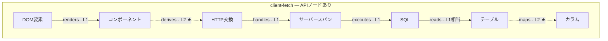
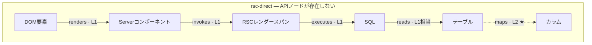
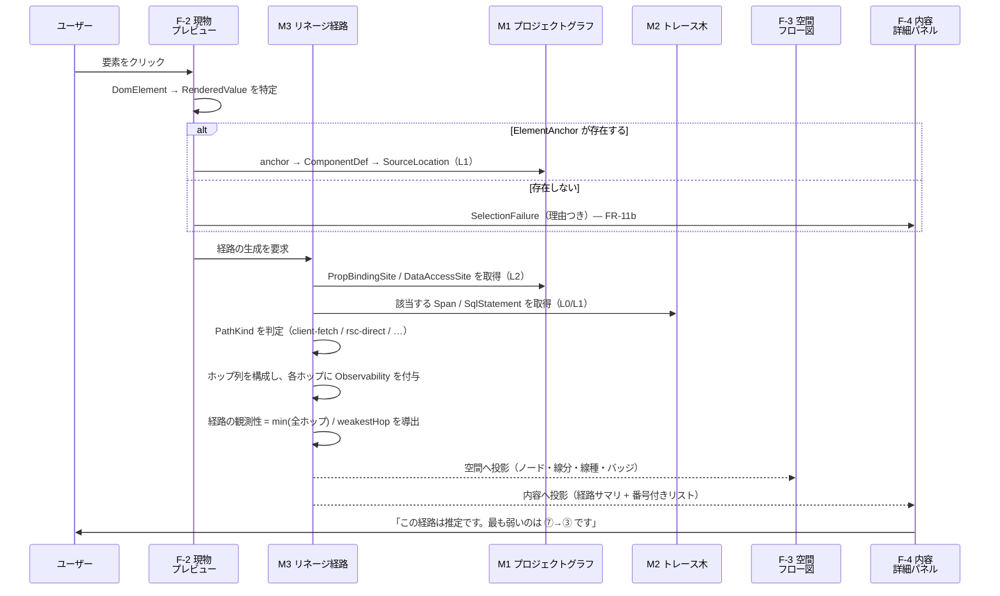

# Visual Computing IDE — 情報アーキテクチャ設計書

| 項目 | 内容 |
| --- | --- |
| フェーズ | **Phase 2: IA（情報アーキテクチャ）設計** |
| 文書バージョン | 0.1 |
| 作成日 | 2026-10-31 |
| ステータス | IA確定 / Phase 3（UX設計）への入力 |
| スコープ | **情報構造の設計のみ。** UXの詳細設計、UIの作成、技術選定、実装は含まない |

### 関連文書

| 文書 | 内容 |
| --- | --- |
| `docs/01-product-requirements.md` | 要件定義（v0.2）。要件ID・観測性モデル L0〜L3 の出典 |
| `docs/01b-feasibility-review.md` | Q-01〜Q-05 の成立可能性レビュー。IA が織り込むべき確定事項5点 |
| `docs/01c-mvp-priorities.md` | A / B / C 分類と実装順序 |
| `docs/02a-object-model.md` | **設計課題 B**: オブジェクトモデル |
| `docs/02b-navigation-structure.md` | **設計課題 C**: ナビゲーション構造 |
| `docs/02c-screen-inventory.md` | **設計課題 D**: 画面一覧と責務 |
| `docs/02d-observability-information-model.md` | **設計課題 H**: 観測性の情報モデル |
| `docs/design-references/` | 概念画像。**情報設計の示唆のみを抽出し、見た目は模写しない** |

### 本文書の構成と設計課題の対応

| 章 | 設計課題 | 内容 |
| --- | --- | --- |
| 2 | **A** | 情報の分類 |
| 3 | A | 所有関係・階層・関連・識別子の概観 |
| 4 | **E** | 中核データフローの情報構造 |
| 5 | **F** | 4面同期モデル |
| 6 | **G** | 情報の段階的開示 |
| 7 | **I** | 安全性と情報公開範囲 |
| 8 | **J** | 情報量の制御 |
| 9 | — | 要件定義書への変更案 |
| 10 | — | 品質レビュー |
| 11 | — | UC-01 の情報構造による説明（完了条件） |
| 12 | — | 未決定事項と Phase 3 への進行判定 |

---

## 1. 本設計の出発点

### 1.1 中核体験

```
Webページに表示された値を選択する
  → どの処理を通ったか理解する
    → DBのテーブル・カラムを特定する
      → 情報が実測なのか推論なのか理解する
```

この4段階のうち、**第4段階が本プロダクトの差別化である**。前3段階だけなら既存ツールの組み合わせで到達できる。第4段階が無ければ、本プロダクトは「正しそうに見える誤った図」を出す装置になる (`01` 0.2節)。

したがって **IA の中心は「観測性情報をどこに、どの粒度で、どの段階で配置するか」である**。これを情報構造の付属物ではなく、第一級の構造として扱う。

### 1.2 IA が前提とする確定事項

`01b` 7.3節により、PoC の結果に関わらず確定している5点。本設計はこれを前提とする。

| # | 確定事項 | 本設計での対応 |
| --- | --- | --- |
| 1 | RSC では「APIノード」が存在しない経路がある | 情報モデルの背骨を **スパンの木構造** とし、HTTP をその一種別に降格 (`02a` 3.2.1) |
| 2 | 要素→コードの対応は開発ビルド限定、ライブラリ由来では成立しない | `SelectionFailure` を独立オブジェクト化し、失敗を表示すべき情報として扱う (`02a` 3.3) |
| 3 | 順方向トレースの終端は構造的に L2 | 観測性を **エッジ単位** で保持し、経路の確度を導出値とする (`02d` 1.1, 2.2) |
| 4 | 計装は IDE がプロセスを起動した場合のみ機能する | `not-instrumented` を独立状態とし、計装状態をグローバル文脈に常時配置 (`02d` 第6章) |
| 5 | ストリーミングSSR では処理が時間的に重なる | 時間の面を「並行・入れ子を表現できる射影」と定義 (本書 5.4) |

### 1.3 設計方針との対応

| 方針 | 本設計での実現 |
| --- | --- |
| 主な対象者はフルスタックエンジニア | 情報密度と用語は P1 基準。平易化は構造を分岐させずラベル層で重ねる (`02b` 第7章) |
| 可視化を主目的とする | 探索モードを第一モードとし、A群の全画面が可視化に属する (`02c`) |
| ビジュアル編集は独立した副次的モード | 編集はモードとして分離し、B群。情報モデル上も `SourceLocation` を参照するのみ (`02a` 第6章) |
| 非エンジニアへの将来拡張を阻害しない | モードを増やさず表示プロファイルで対応 (`02b` 第7章) |
| ローカル環境を優先する | 環境セレクタは A群で `Local` 固定の表示のみ |
| クラウド機能は将来の情報構造を確保する | `EnvironmentRef` と `ServiceBoundary` の席を確保 (`02a` 第6章) |
| 実測と推論を混同しない | 観測性をノード・エッジ・属性の単位で保持 (`02d` 1.1) |
| 取得できない情報を架空のノードで補わない | `LinkStatus = untraceable` と切断マーカーを必須化 (`02d` 5.2) |
| 非対応の機能を実装済みと誤認させない | `SupportMatrix` を独立画面化 (S-08)、無効モードの表現規約 (`02b` 3.4) |
| 観測性 L0〜L3 はノード・エッジ・属性ごとに管理 | `02d` 第1章 |

---

## 2. 情報の分類（設計課題 A）

### 2.1 分類の原則

本プロダクトが扱う情報を **「どうやって知ったか」で一次分類する**。「何についての情報か」での分類（ページ・API・DB…）を一次軸にすると、実測と推論が同じ箱に入ってしまい、OBS-09 を構造で守れない。

> **一次軸 = 情報の由来（モデル）。二次軸 = 情報の対象（ドメイン）。**

### 2.2 一次分類 — 3つのモデル

| # | モデル | 由来 | 既定の観測性 | 消えるとき | 要件 |
| --- | --- | --- | --- | --- | --- |
| **M1** | プロジェクトグラフ | ソースコードの静的解析 | **L2** | プロジェクトを閉じる | FR-02, FR-03 |
| **M2** | トレース木 | ブラウザ計測 + サーバー計装 | **L0 / L1** | プロセス停止・計装無効 | FR-40, FR-41, FR-42, FR-20b |
| **M3** | リネージ経路 | M1 と M2 の突き合わせによる**導出** | ホップごとに変化 | 選択・スコープの変更 | FR-22, OBS-09, OBS-10 |

> **この3分離が本設計の骨格である。** 参考画像はこれらを1枚の「フロー図」に溶かしているが、情報モデルとして融合させると OBS-09 / OBS-05 を守れない（詳細は `02a` 第0章）。
> フロー図は3モデルの**投影面**であって、3モデルそのものではない。

### 2.3 二次分類 — 情報ドメイン

| # | ドメイン | 所属モデル | 主な情報 | 識別子の接頭辞 | 区分 |
| --- | --- | --- | --- | --- | --- |
| D-01 | **プロジェクト** | — | プロジェクト、検出構成、**対応範囲** | `prj:` | A |
| D-02 | **ページ・ルート** | M1 | ルートパターン、種別、レンダリング方式 | `route:` | A |
| D-03 | **コンポーネント** | M1 | 定義、境界(client/server)、props束縛点 | `comp:` | A |
| D-04 | **ソース位置** | M1 | ファイル・行・列 | `src:` | A |
| D-05 | **DOM要素** | 描画層 | 要素、表示値、要素アンカー、**特定失敗** | `dom:` / `anchor:` | A |
| D-06 | **HTTPリクエスト** | M2 | メソッド・URL・ヘッダ・ボディ・ステータス | `http:` | A |
| D-07 | **サーバー処理（スパン）** | M2 | スパン木、種別、境界、時間区間 | `span:` | A |
| D-08 | **SQL** | M2 | SQL文・パラメータ・実行時間・参照テーブル | `sql:` | A |
| D-09 | **DBテーブル・カラム** | データ層 | スキーマ・テーブル・カラム・制約・関連・行サンプル | `tbl:` / `col:` | A |
| D-10 | **トレース** | M2 | トレースID、起点種別、結合状態 | `trace:` | A |
| D-11 | **データフロー（リネージ）** | **M3** | 経路、ホップ、経路種別、最弱環、候補集合 | `lin:` / `hop:` | **A** |
| D-12 | **実行環境** | M2 | プロセス、ポート、コンテナ、スクリプト | `proc:` | A / B |
| D-13 | **計装** | — | 状態・理由・追加ファイル・収集範囲 | — | A / B |
| D-14 | **エラー・ログ** | M2 | コンソール、JSエラー、ビルドエラー、スタックトレース | — | B |
| D-15 | **観測性** | **横断** | レベル・状態・取得手段・根拠・確度 | — | **A** |
| D-16 | **ビジュアル編集** | — | 編集意図、変更集合、ファイル差分 | — | B |
| D-17 | **クラウド環境** | — | 環境、サービス、デプロイ、サービス境界 | — | C |
| D-18 | **AI文脈** | 横断 | AIへ渡す範囲 | — | C |
| D-19 | **ビューの状態** | 横断 | 選択・スコープ・射影・開示段階・監査 | — | A |

> **D-15（観測性）を独立したドメインにしつつ、所属を「横断」とした理由**: 観測性は独立したノードとして描かれる情報ではなく、**他の全ての情報に付随する値オブジェクト**である (OBS-01)。ドメインとして立てることで設計上の扱いを明確にしつつ、画面上に「観測性」という箱を作らない。

### 2.4 分類の網羅確認 — 重複と漏れの検査

設計課題 A の例示項目との対応を確認する。

| 例示項目 | 本分類での位置 | 独立ドメインにしたか |
| --- | --- | --- |
| プロジェクト情報 | D-01 | した |
| ページ | D-02 | した |
| DOM要素 | D-05 | した |
| コンポーネント | D-03 | した |
| データフロー | **D-11** | した（M3 として一次分類にも反映） |
| HTTPリクエスト | D-06 | した |
| サーバー処理 | D-07 | した（**スパン**として一般化） |
| SQL | D-08 | した |
| DBテーブル・カラム | D-09 | した |
| トレース | D-10 | した |
| 実行環境 | D-12 | した |
| エラー | D-14 | した |
| 観測性 | D-15 | した（横断として） |
| ビジュアル編集 | D-16 | した |
| クラウド環境 | D-17 | した |

| 例示に無く、本設計で追加した項目 | 追加の理由 |
| --- | --- |
| **D-04 ソース位置** | 複数ドメイン（コンポーネント・SQL・エラー・編集）から参照される共有識別子であり、従属させるとどこに置くか決まらない |
| **D-13 計装** | `01b` の確定事項4 (INS-08) により、計装状態が全 L1 情報の前提条件になったため。実行環境 (D-12) の一属性では扱いが軽すぎる |
| **D-19 ビューの状態** | 選択・スコープ・開示段階は「情報」ではないが、IA の対象である。UI非依存モデル (NFR-42) と分離して保持する必要がある |
| **D-18 AI文脈** | C群だが、NFR-22（送信範囲の明示）のため「何を渡すか」を情報として定義する席が必要 |

| 重複の検査 | 判定 |
| --- | --- |
| D-06 HTTPリクエスト と D-07 スパン | **重複しない。** HTTP交換はスパンに付随する詳細であり、スパンの一種別。ただし **ブラウザ側のHTTP計測 (L0)** とサーバー側スパン (L1) は由来が異なるため、両方を保持し `handles` ホップで結ぶ |
| D-10 トレース と D-07 スパン | **重複しない。** トレースはスパンの集合に対する識別子と起点情報 |
| D-11 リネージ と D-07 スパン | **重複しない。** リネージは M1 と M2 を横断する導出物。スパンを参照するが所有しない |
| D-02 ページ と D-03 コンポーネント | **重複しない。** ルートはコンポーネントを所有する |
| D-14 エラー と D-07 スパン | **部分的に重なる。** スパンの `status = error` と `RuntimeEvent` は別物（前者は処理区間の結果、後者はイベント）。**エラー表示 (FR-44) は両方を結合して提示する** |

> **漏れの検査**: `01` 5.2節の観測性マトリクス（フロントエンド / サーバー / DB / ローカルOS・ネットワーク / クラウド）の全行が、D-01〜D-19 のいずれかに配置されていることを確認した。唯一、**5.2.4節の「ファイアウォール」「プロキシ」「ロードバランサ」はドメインを与えない**。実在が確認できないノードを情報構造に持たないという決定であり、`02d` 5.3節に記載した。

---

## 3. 所有関係・階層・関連・識別子（概観）

詳細は `02a-object-model.md`。本章は要点のみ。

### 3.1 所有の階層

```
Workspace
└─ Project ──────────────────────────────────── prj:
   ├─ SupportMatrix                              （FR-07）
   ├─ Route ───────────────────────────────── route:
   │  └─ ComponentDef ──────────────────────── comp:
   │     ├─ PropBindingSite                     （FR-12）
   │     └─ DataAccessSite
   ├─ DbConnection ─────────────────────────── conn:
   │  └─ DbTable ───────────────────────────── tbl:
   │     ├─ DbColumn ───────────────────────── col:
   │     └─ RowSample
   ├─ ProcessInstance ──────────────────────── proc:
   │  ├─ InstrumentationState                   （INS-08）
   │  └─ Trace ─────────────────────────────── trace:
   │     └─ Span（木構造・自己参照）──────────── span:
   │        ├─ HttpExchange ─────────────────── http:
   │        └─ SqlStatement ─────────────────── sql:
   └─ PreviewSession
      └─ DomElement ───────────────────────── dom: / anchor:
         └─ RenderedValue

（所有されない導出物）
LineagePath ─ lin:        ← 上記を参照するのみ。所有しない
└─ LineageHop ─ hop:
```

### 3.2 関連の種別

| 種別 | 意味 | 例 |
| --- | --- | --- |
| **所有** | 親が消えれば子も消える | `Route` → `ComponentDef` |
| **参照** | 独立に存在するものを指す。切れたら `dangling` を立てる | `LineageHop` → `Span` |
| **投影** | 同じ対象を別の軸で見る。情報の複製ではない | `Span` → タイムラインのバー |
| **導出** | 他の情報から計算される。独立に設定できない | `LineagePath.経路の観測性` |

> **「投影」を明示的な関連種別として定義することが、UI-07（重複表示の禁止）の構造的な担保である。** 同じスパンがフロー図とタイムラインと詳細パネルに現れるのは重複ではなく、3つの投影である（第5章）。

### 3.3 識別子の原則

| 原則 | 内容 |
| --- | --- |
| 全ての情報オブジェクトは安定した識別子を持つ | `02a` 第2章 |
| **表示上の連番バッジは識別子ではない** | バッジはスコープ内の順序から再計算される揮発値（5.3節） |
| トレースID・スパンIDは標準規格互換の形式とする | INS-06、FR-29b の検索キー |
| 接続文字列・資格情報そのものは識別子に含めない | NFR-21 |

---

## 4. 中核データフローの情報構造（設計課題 E）

### 4.1 リネージ経路の構造

中核機能 FR-22 が生成する情報の実体は、`LineagePath`（経路）と `LineageHop`（ホップ）である。

```
LineagePath
├─ 起点            SelectionTarget（通常は RenderedValue）
├─ 方向            forward（FR-22）| backward（FR-26・B群）
├─ 経路種別         PathKind（4.2節）
├─ hops[]          主経路のホップ列
├─ branches[]      副経路（折りたたみ）
├─ 経路の観測性      = 全ホップ・全ノードの最弱レベル（導出・書込不可）  ← OBS-10
├─ 最弱ホップ        weakestHop                                    ← OBS-11
├─ 状態            complete | truncated | blocked | ambiguous
└─ 打ち切り理由      （complete 以外のとき必須）                       ← OBS-05
```

**各ホップが観測性を個別に保持する** (OBS-09)。経路は観測性を保持せず、導出するだけである。

### 4.2 経路種別（PathKind）— 直線モデルを採らない理由

> **RSC では API ノードが存在しない** (`01b` Q-02 C-1)。したがって「要素 → props → API → サーバー → SQL → テーブル → カラム」という固定列を情報構造の前提にできない。**経路種別がホップの構成を決める。**

| 経路種別 | ホップ構成 | APIノード | 最弱環 |
| --- | --- | --- | --- |
| `client-fetch` | renders → binds → **derives** → requests → handles → invokes → executes → reads / projects → **maps** | **あり** | `derives`, `maps` |
| `rsc-direct` | renders → binds → invokes → executes → reads / projects → **maps** | **なし** | `maps` のみ |
| `server-action` | renders → binds → requests(POST) → handles → invokes → executes → reads / projects → maps | あり（URLが処理名を表さない） | `derives`, `maps`, ラベルの曖昧さ |
| `static-literal` | renders → binds で終端 | なし | なし |
| `external-source` | renders → binds → derives → requests → **外部境界で打ち切り** | あり | 外部境界（L3・値を出さない） |
| `not-traced` | M1 のみ。全ホップ L2 | 静的推定のみ | 経路全体 |





> **`rsc-direct` の方が推論ホップが1つ少ない。** UI はこれを「情報が足りない経路」として扱ってはならない。**ノードが少ないことと確度が低いことは無関係である。**
>
> **ただし逆も言えない（M1 の決定 H。2026-11-01 追記）。** 「推論ホップが少ないから確度が高い」という主張は較正されていないため採らない。
> 実測では、ホップは減ったが切断は減らず、最弱環は L2 のままであった（`06d` 11章 #2 / `06e` 1.2節）。
> **経路種別の間に確度の順序を置かない。** 確定した記述は `02a` 3.5.2節である。

### 4.3 ホップごとの実測／推論の管理

`01` 5.4節の分解表を、関係種別の規定として一般化する（詳細は `02a` 3.5.1）。

| 関係種別 | 既定レベル | 昇格の可能性 | 降格条件 |
| --- | --- | --- | --- |
| `renders` | L1 | — | 注入なし → L2 / 不能 |
| `binds` | L2 | なし | — |
| **`derives`** | **L2** | **構造的に無い** | 加工・条件分岐 → 不能 |
| `requests` | L0 | — | — |
| `handles` | L1 | — | 結合失敗 → L2（時間窓推定） |
| `invokes` | L1 | — | 計装方式により L2 |
| `executes` | L1 | — | 計装なし → 不能 |
| `reads` | L1相当 | — | — |
| `projects` | L1相当 | — | `SELECT *` → L2 |
| **`maps`** | **L2** | **構造的に無い** | 別名・加工 → 不能 |

> **`derives` と `maps` は、いかなる実装によっても L2 を超えない。** これが `01b` Q-04.0 の結論の、情報構造上の表現である。この2つに「実測」を表示することは禁止される (5.3.2節)。

### 4.4 解決状態の管理

設計課題 E が求める6つの状態（複数候補・追跡不能・静的値・未接続・権限不足・未サポート）を、**ホップの状態**と**ノードの状態**に分けて定義する。

#### ホップの解決状態（LinkStatus）

| 状態 | 意味 | 線の描画 | 必須の付随情報 |
| --- | --- | --- | --- |
| `resolved` | 1つに解決 | レベルに応じた線種 | — |
| **`multiple-candidates`** | **複数候補** | 破線の分岐 | **候補件数**。実トレースで通った候補を強調 |
| **`static-literal`** | **静的値**（コード直書き） | 終端マーカー | ソース位置 |
| **`untraceable`** | **追跡不能** | **切断マーカー** | **理由** |
| **`unsupported`** | **未サポート** | 切断マーカー | 対応範囲へのリンク (FR-07) |
| `blocked-by-node` | 上流ノードが取得不能 | 切断マーカー | 上流の `NodeStatus` と解消操作 |

#### ノードの取得状態（NodeStatus）

| 状態 | 意味 | 値を表示してよいか |
| --- | --- | --- |
| `ok` | 取得できた | はい |
| `no-data` | 該当する情報が0件 | はい（0件として） |
| **`not-connected`** | **未接続** | いいえ |
| **`permission-denied`** | **権限不足** | いいえ |
| `stopped` | 停止中（停止を確認済み） | いいえ |
| `not-instrumented` | 計装が無いため観測できない | いいえ |
| `unsupported` | 対応範囲外 | いいえ |
| `error` | 取得を試みて失敗 | いいえ |

> **`未接続` と `権限不足` をホップではなくノードの状態にした理由**: 「DBに接続できない」のはカラムノードの問題であり、SQLとカラムを結ぶホップの問題ではない。ホップ側には `blocked-by-node` として伝播させ、**原因の所在を誤らせない**。

### 4.5 分岐・合流・入れ子・並行

| 事象 | 情報構造 | 表示上の要請 | 要件 |
| --- | --- | --- | --- |
| **分岐** | 1スパンが複数の子を持つ / 1ホップが複数の `to` を持つ | 主経路を1本に決め、残りを折りたたむ。**折りたたみ件数を必ず表示** | FR-20b, OBS-07 |
| **合流** | 複数の `from` が1つの `to` に入る（JOIN、複数テーブル由来の表示） | 合流点を明示し、**各入力の確度を個別に表示** | OBS-09 |
| **入れ子** | `parentSpanId` による木 | 既定は折りたたみ、展開は枝番で採番（5.3節） | FR-20b |
| **並行** | 兄弟スパンの時間区間の重なり | 時間の面で重ねて描く。**直列のガントに潰さない** | **FR-43b** |

> **主経路の決定規則**: ① 実測ホップ（L0/L1）を優先 ② 証拠数が多い候補を優先 ③ 同率なら決定せず `ambiguous` とし、複数候補として提示する。**①②で決まらないときに1つを選んで断定してはならない** (OBS-05)。

---

## 5. 4面同期モデル（設計課題 F）

### 5.1 射影軸を3から4へ

`01` 6.3節は3ビュー（フロー図=空間 / タイムライン=時間 / 詳細パネル=内容）を定義している。しかし **UC-01 の起点はプレビューであり、プレビューも選択状態の同期対象である**。本設計では射影軸を4つとする。

| 面 | 射影軸 | 答える問い | 区分 | 要件 |
| --- | --- | --- | --- | --- |
| **F-2 プレビュー** | **現物** | 実際に画面のどこに出ているか | **A** | FR-10, FR-11 |
| **F-3 フロー図** | **空間** | どこを通ったか | **A** | FR-20, FR-20b |
| **F-4 詳細パネル** | **内容** | 何が送られ、何が返り、根拠は何か | **A** | FR-23, OBS-11 |
| **F-5 タイムライン** | **時間** | いつ、どれだけかかり、何と並行したか | **B** | FR-43, FR-43b |

> **4つは情報の重複ではなく、同一の `SelectionTarget` の4つの投影である** (UI-07)。各面は自分の軸に属する情報だけを持ち、他の軸の情報を持たない。

| 面が持たないもの | 理由 |
| --- | --- |
| フロー図に属性値を置かない | 内容の軸は詳細パネルの担当 (UI-15) |
| タイムラインに SQL 文を置かない | 同上 |
| 詳細パネルに全体の形を置かない | 空間の軸はフロー図の担当 |
| プレビューに観測性バッジを重ねない | **プレビューはユーザーのアプリそのものであり、IDE の記号を描き込まない。** 選択枠のみ |

### 5.2 FR-21（A群）と FR-43（B群）の段階差

> 設計課題 F が求める「A段階での最小同期仕様とB段階の完成仕様の分離」。

| 段階 | 同期する面 | 時間の情報はどこに | 要件 |
| --- | --- | --- | --- |
| **A段階（最小同期）** | **F-2 現物 ↔ F-3 空間 ↔ F-4 内容** の3面 | **詳細パネル内の数値**（各ステップの所要時間）として表示。独立した面を持たない | **FR-21** |
| **B段階（完成）** | **+ F-5 時間** の4面 | 独立した面。並行・入れ子を表現 (FR-43b) | FR-43, FR-43b |

**A段階で成立する理由**: UC-01 の問い（この値はどこから来たか）は空間と内容で答えられる。時間は「どこで遅いか」(UC-04/UC-07) の問いに属し、A群の検証対象ではない。

**B段階で追加されること**: 時間の面が独立すると、`FR-43b`（並行・入れ子）が表現可能になる。A段階の詳細パネル内の所要時間は**直列を暗黙に仮定している**ため、ストリーミングSSR では合計が実時間と合わない。**A段階ではこの不一致を注記する**（「各処理の所要時間の合計は、並行実行のため全体時間と一致しない場合があります」）。

> **この注記は A段階の必須要件とする。** 合計が合わない数値を無言で並べることは、誤解を生む点で OBS-05 の精神に反する。

### 5.3 バッジとイベントIDの区別

> **決定: 画面に表示される番号は「ステップバッジ」であり、識別子ではない。**

| 項目 | ステップバッジ | イベントID |
| --- | --- | --- |
| 例 | ①②③… | `span:4a7f...`, `hop:lin_x:3` |
| 由来 | **現在のスコープ内の表示順序** | 永続識別子 |
| 安定性 | **スコープが変わると振り直される** | 不変 |
| 用途 | 4面の照合 (UI-10, UI-11) | 検索・参照・再現 (FR-29b) |
| 表示 | 常時 | 詳細パネルの「根拠」タブ内に折りたたみで表示 |

#### 採番規則

| 項目 | 規則 |
| --- | --- |
| 採番対象 | 現在の `ScopeContext` に含まれ、表示が確定したステップ |
| 順序（経路スコープ） | 経路の論理順（上流 → 下流） |
| 順序（トレーススコープ） | スパンの開始時刻順。同時刻は木の深さ優先 |
| 集約ノード | **1つの番号を占める**。展開時は `3-1`, `3-2` の枝番を与え、**全体の再採番は行わない** |
| 切断・終端 | 番号を与える（「追跡不能」も1ステップとして数える）。**欠番を作らない** |
| 色 | 4面で同一（UI-10）。色は意味の符号化にのみ使う (UI-02) |

> **集約の展開で枝番を使い、全体を再採番しない理由**: ユーザーが「③を見て」と口頭で共有している最中に番号が動くと、同期の仕掛けそのものが信頼を失う。**揮発的であることと、無闇に動くことは別である。**

### 5.4 選択状態の同期

#### 選択モデル

| 概念 | 定義 |
| --- | --- |
| `SelectionTarget` | `{種別, 識別子}` の**単一値**。モードをまたいで1つだけ |
| `ScopeContext` | バッジ採番と表示件数を決める文脈。`page` / `trace` / `component` / `path` |
| `ViewProjection` | 各面が `SelectionTarget` をどう表現するか。`yes` / `ancestor-only` / `no` |

#### 同期規則

| 操作 | 挙動 |
| --- | --- |
| いずれかの面で選択 | 他の全面が同期して強調 (UI-11) |
| 面が選択対象を表現できない | **空にしない。**「この面には対応する表示がありません」+ 理由を表示 |
| 面が祖先しか表現できない | 祖先を強調し、「選択中の対象はこの中に含まれます」と表示 |

#### 表現可否の表

| 選択対象 | F-2 現物 | F-3 空間 | F-4 内容 | F-5 時間 |
| --- | --- | --- | --- | --- |
| `RenderedValue` / `DomElement` | **yes** | yes（起点ノード） | yes | no（時間を持たない） |
| `Span` | ancestor-only（描画に寄与した場合） | **yes** | yes | **yes** |
| `HttpExchange` | no | yes | yes | yes |
| `SqlStatement` | no | yes | yes | yes |
| `DbColumn` | ancestor-only（表示要素へ逆照合） | yes（終端ノード） | **yes** | no |
| `LineageHop` | no | **yes**（線分） | yes | ancestor-only |
| `ComponentDef`（ツリーから選択） | **複数候補**（12箇所で描画 等） | ancestor-only | yes | no |

> **`no` のときに面を空白にしないことが重要である。** 空白は「情報が無い」と読まれ、「この軸では表現できない」と区別できない。これは OBS-05・OBS-06 と同じ原則の、ビュー層への適用である。

### 5.5 スコープ変更時の挙動

| 事象 | 挙動 |
| --- | --- |
| スコープを変更（ページ全体 ↔ コンポーネントのみ 等） | ① 選択の保持を試みる ② バッジを再採番 ③ **「番号を振り直しました」を1行で通知** |
| 選択対象が新スコープに含まれない | 最近傍の祖先へ降格。祖先も無ければ選択を解除し、理由を表示 |
| 新しい実測が到着（再読込・再リクエスト） | **既存のリネージ経路を黙って更新しない。**「新しい実行結果があります」を提示し、ユーザーの操作で切り替える |
| プロセス停止・計装無効化 | M2 が失われる。経路は `not-traced`（全ホップ L2）へ降格し、**降格したことを明示**（`degradedFrom` を使用） |

> **「黙って更新しない」を規則にした理由**: ユーザーが経路を読んでいる最中に内容が入れ替わると、読んでいた内容と手元の結論が食い違う。これは本プロダクトが解決しようとしている問題（頭の中のモデルと実行時の事実の不一致）をツール自身が生み出すことになる。

---

## 6. 情報の段階的開示（設計課題 G）

### 6.1 段階の定義

| 段階 | 操作 | 表示される情報 | 表示されない情報 |
| --- | --- | --- | --- |
| **0 未選択** | — | ノード種別アイコン・名称・状態・線種。スコープ要約（件数・総時間・**推定を含む旨**） | 属性値、観測性の詳細レベル、生データ |
| **1 ホバー** | ポインタを乗せる | 1行要約（例: `GET /api/properties — 124ms — 200 OK`）+ 観測性の語 + 最弱環には ★ | 構造化された詳細 |
| **2 クリック** | 選択 | 詳細パネルの**概要タブ**: 番号 / 種別 / 状態 / 観測性レベル / 解決状態 / 根拠の件数 / 最弱環か / 弱点の定型文 | 生データ、根拠の全件、秘密情報 |
| **3 詳細を開く** | タブ切替 | ヘッダ / パラメータ / **根拠** / 生データ。**秘密情報のマスク解除操作はここ** | — |
| **4 参照へ** | ジャンプ | コードピーク（B）/ テーブル詳細 / SQL全文。**遷移先でも取得手段を1行保持** | — |

### 6.2 段階ごとの配分原則

| 原則 | 内容 | 要件 |
| --- | --- | --- |
| **常時表示は「区別」まで** | 実測か推論かの**区別**は段階0。なぜそのレベルかの**説明**は段階2以降 | UI-20, 原則7 |
| **表示資源を最弱環と切断点に集中する** | 全ホップに等しくラベルを付けない | OBS-11 |
| **生データは段階3以降** | JSON・SQL全文・ヘッダは「概要」タブに置かない | **UI-21** |
| **秘密情報・実データ値は段階3以降** | マスク解除は明示操作 | **NFR-20**（第7章） |
| **専門用語の説明は段階1で添えられる** | 平易化は構造を変えず、ラベル層で重ねる | FR-75（C）, NFR-33 |

### 6.3 段階0で表示してよい情報の限定（UI-20）

| 要素 | 段階0での表示 |
| --- | --- |
| ノード | 種別アイコン、短いラベル、状態（正常 / 警告 / エラー / 不明）、線種 |
| エッジ | 線種（実線 / 破線 / 低彩度破線）、切断マーカー |
| スコープ要約 | 「N件のリクエスト / 総 Nms / **この経路は推定を含みます**」 |
| 表示しないもの | 属性値、所要時間の個別値、L0〜L3 の精密なバッジ、SQL断片、JSON |

> **段階0で全ノードに L0/L1/L2 のバッジを置かない** (`02d` 4.2節)。実線 / 破線の二値で「実測か推論か」は伝わる。精密なレベルは段階1以降で出す。情報密度を上げると UI-05（余白）と原則7 に反する。

### 6.4 参考画像の「吹き出しによる値の近接表示」の扱い

`01` 付録A.4-3 は、参考画像 `08` の「ノードの横に実際の値・SQL・テーブル定義を置く」表現を、段階的開示の中間段階として有効と評価している。

> **本設計では、吹き出しを段階2の付随表示として採用する。ただし条件を付す。**

| 条件 | 内容 |
| --- | --- |
| 段階0では表示しない | UI-15、UI-20 |
| **選択中の経路に属するノードのみ** | 全ノードに吹き出しを出すと段階0に戻ってしまう |
| **1ノードにつき最大1つの値の抜粋** | 全文は詳細パネル（段階3） |
| **秘密情報・PII候補は吹き出しに出さない** | 吹き出しはマスク解除操作を持てないため（第7章） |
| 吹き出しにも観測性を反映する | 推論由来の値には推定である旨を付す |

---

## 7. 安全性と情報公開範囲（設計課題 I）

### 7.1 情報の機密区分

| 区分 | 内容 | 検出方法 | 要件 | 区分 |
| --- | --- | --- | --- | --- |
| **SEC 秘密情報** | 環境変数の値、DB接続文字列、APIキー、`Authorization` ヘッダ、`Cookie`、トークン | **規則による決定的な判定**（既知のキー名 + 値のパターン） | **NFR-20** | **A** |
| **PII 個人情報候補** | 氏名・メール・電話・住所・生年月日・決済情報 | **推定**（カラム名・型） | NFR-26 | **B** |
| **DATA 実データ値** | 業務上の値（物件名、金額など） | — | FR-51 | A |
| **META 構造** | テーブル名・カラム名・型・SQL・エンドポイント | — | FR-50, FR-52 | A |

> **SEC の判定は「規則」、PII の判定は「推定」である点が決定的に重要である。** SEC は A群で成立する（キー名リストとパターンは較正不要）。PII は推定であり NFR-26 は B群にある。**したがって A段階では「PII を推定できない」前提で設計しなければならない。**

### 7.2 面ごとの表示方針

| | **F-2 プレビュー** | **F-3 フロー図** | **F-4 詳細パネル** | **F-5 ドロワー / ログ** | **書き出し（C群）** |
| --- | --- | --- | --- | --- | --- |
| **SEC** | **IDE は加工しない**（アプリ自身の描画） | **値を載せない** | **既定マスク**。明示操作で解除。解除は監査記録 | **既定マスク** | **常にマスク** |
| **PII** | 同上 | 載せない | A: 値を既定非表示 / B: 推定マスク | **A: 行データを流さない** | 常にマスク |
| **DATA** | アプリの描画のまま | **1ノードにつき最大1つの抜粋** | 件数制限（既定 N 行） | 流さない | マスク判定後 |
| **META** | — | 表示 | 表示 | 表示 | 表示 |

#### プレビューの扱い

> **プレビューはユーザーのアプリケーションそのものであり、IDE はその描画内容を加工しない。**

| 理由 | 内容 |
| --- | --- |
| 加工すると「現物」でなくなる | プレビューの射影軸は「現物」である（5.1節）。IDE がマスクを重ねると、ユーザーは実際の画面と異なるものを見る |
| アプリ自身が既にマスクしている情報を二重にマスクしない | — |
| **ただし、プレビューの内容を IDE が取り出して他の面へ運ぶときはマスク対象になる** | 選択要素のテキストを詳細パネルに載せる際は、SEC 判定を通す |

### 7.3 A段階の最小要件（FR-51 が A群、NFR-26 が B群であることの帰結）

> **問題**: FR-51（テーブルのデータプレビュー）は A群。その要件文は「既定で件数制限、PII候補カラムはマスク」とあるが、**PII 候補の推定 (NFR-26) は B群**である。A段階では推定手段が存在しない。

> **決定: A段階では、テーブルのデータプレビューは既定で値を表示しない。**

| 項目 | A段階の仕様 | B段階の仕様 |
| --- | --- | --- |
| 既定表示 | **カラム定義のみ**（名称・型・NULL可否・制約） | 同左 + PII 推定に基づくマスク済みの値 |
| 値の表示 | **明示操作でのみ**、N 行（既定5行）に限って開く | 既定で N 行を表示（PII はマスク） |
| 値を開く際の提示 | 「実データを表示します。個人情報が含まれる可能性があります」 | PII 候補カラムの件数を提示 |
| SEC の扱い | **規則による決定的マスクを適用**（接続文字列・トークン形式の値） | 同左 |
| 監査 | 値の表示操作を記録 (NFR-28) | 同左 |

**この仕様で A段階でも機密情報が露出しない理由**:

| 経路 | A段階での遮断 |
| --- | --- |
| テーブルのデータプレビュー | **既定で値を出さない**（上記） |
| HTTPヘッダ（Cookie / Authorization） | 規則による決定的マスク (NFR-20) |
| 環境変数 | 規則による決定的マスク (NFR-20) |
| SQL のパラメータ値 | **値を既定で伏せ、プレースホルダのみ表示**。明示操作で開く |
| リネージ経路の「実際の値」 | **1ノード1抜粋、SEC 判定を通したもののみ**。SEC に該当すれば抜粋自体を出さない |
| ログ・ドロワー | **A段階では行データを流さない**（構造と件数のみ） |
| 資格情報の保管 | OS の資格情報ストア。平文でプロジェクト内に書き出さない (NFR-21) |

> **A段階の最小要件を一文で言えば: 「規則で判定できる秘密情報はマスクする。推定が必要なものは、そもそも既定で表示しない。」**

### 7.4 マスク解除の規約

| 項目 | 規約 | 要件 |
| --- | --- | --- |
| 解除の単位 | **1項目ずつ**。「全て表示」を提供しない | NFR-20 |
| 解除の持続 | そのパネルを閉じるまで。セッションをまたいで保持しない | NFR-20 |
| 解除の記録 | 時刻・対象・操作を監査ログに記録 | **NFR-28** |
| 解除できないもの | 書き出し・共有（C群）では解除不可 | **NFR-25** |
| AIへの送信 | **既定で実データ値を送信しない**。送信範囲を事前提示 | **NFR-22**（C群） |

### 7.5 本番環境・破壊的操作（将来の席）

| 項目 | 方針 | 要件 | 区分 |
| --- | --- | --- | --- |
| 本番DBへの接続 | **既定で読み取り専用**。書き込み接続は明示設定 | NFR-24 | A（接続定義の属性として保持） |
| 任意SQLの実行 | 読み取りのみ。書き込みは二段階確認 | NFR-23, FR-54 | C |
| デプロイ・削除 | 二段階確認。AI は自律実行できない | NFR-23, FR-74 | C |

---

## 8. 情報量の制御（設計課題 J）

### 8.1 集約の階層

> **実プロジェクトのフローは参考画像のように疎ではない** (Q-10)。1ページの表示に数十のリクエストと数百のスパンが伴う。

| 階層 | 単位 | 表示するもの | 既定 | 要件 |
| --- | --- | --- | --- | --- |
| **T1 ページ / セッション** | 複数トレース | トレース一覧（起点・リクエスト数・総時間・エラー数・**経路の最弱レベル**） | ページ選択時の初期表示 | UC-07, FR-18 |
| **T2 トレース** | 1つのスパン木 | **境界グループ**（ブラウザ / サーバー / DB / 外部）に畳んだ図 | トレース選択時 | FR-20, FR-20b |
| **T3 コンポーネントスコープ** | 選択コンポーネントに関わるスパンのみ | 部分木 | スコープ切替時（B群） | **FR-25**, UI-34 |
| **T4 単一リネージ経路** | 1本の経路 | ホップの連なり（UC-01 の結果） | 要素選択時 | **FR-22** |

```
T1 ページ全体
  └─ T2 特定のトレース（1リクエスト / 1ドキュメント取得）
       └─ T3 選択したコンポーネントのスコープ
            └─ T4 単一のデータ経路
```

> **UC-01 は T4 に直行する。** 要素をクリックしたとき、T1→T2→T3 を経由させない。**中核体験に階層の降下を課さない**ことが重要である。T1〜T3 は俯瞰 (UC-07) と情報過多への対処のための経路であり、中核体験の前提条件ではない。

### 8.2 集約の規則

| 規則 | 内容 | 要件 |
| --- | --- | --- |
| **境界グループ** | ブラウザ / サーバー / DB / 外部 でノードを矩形グループに括る | 付録A.4-4 |
| **同種連続の集約** | 同じ種別の連続するスパンを `SQL × 12` のように畳む | NFR-03 |
| **件数を必ず表示** | 畳んだ件数を隠さない | **OBS-07 の原則** |
| **最弱環を隠さない** | 集約ノードの観測性 = 内包の最弱レベル。内包する最弱レベルと件数を表示 | **OBS-10**（`02d` 2.4） |
| **自動集約の閾値** | 500ノード超で同種連続を自動集約。5000ノード超で境界グループのみ表示 | **NFR-02, NFR-03** |
| **展開は明示操作** | 自動展開しない。展開時は枝番で採番（5.3節） | — |
| **フォーカスモード** | 選択経路以外を減光する。**削除しない** | **UI-33** |

> **「減光するが削除しない」が重要である。** 削除すると、ユーザーは「他に経路が無い」と読む。減光は「他にもあるが、いま関心の対象ではない」を意味する。OBS-07（網羅性を保証できない場合は件数を示す）と同じ原則である。

### 8.3 既定の表示粒度（Q-10 への回答）

| 状況 | 既定の粒度 |
| --- | --- |
| ページを選択した直後 | **T1**。トレース一覧と、ページ全体の経路の最弱レベル |
| トレースを選択 | **T2**。境界グループ + 代表ノード。同種連続は集約済み |
| プレビューで要素を選択（**UC-01**） | **T4 に直行**。単一経路。他は減光 |
| スコープを「このコンポーネントのみ」に切替（B群） | **T3** |

### 8.4 集約と観測性の相互作用

| 集約の例 | 内包 | 集約ノードのレベル | 表示 |
| --- | --- | --- | --- |
| `SQL × 12` | 全て L1 | L1 | 実線 |
| `サーバー内部処理`（RSC計装が部分失敗） | L1 × 3, L2 × 1 | **L2** | 破線 + 「内部に推定1件を含む」 |
| `外部サービス` | L1（呼び出し）+ L3（相手側） | **L3** | 低彩度破線 + 値を出さない |

> **集約は情報量を減らす操作だが、確度を上げる操作であってはならない。** 12件のうち1件が推論なら、集約ノードは推論である。

---

## 9. 要件定義書への変更案

> 作業制限 §7 に従い、**既存要件を削除・変更していない**。以下は Phase 1 文書への変更**案**である。採否は要件定義の担当判断とする。

| # | 対象 | 現状 | 変更案 | 根拠 | 影響 |
| --- | --- | --- | --- | --- | --- |
| **1** | **UI-10 の「連番ID」という名称** | 「フロー上の各ステップには一貫した**連番ID**を振り」 | **「ステップバッジ」へ改称**。「ID」の語を外す | 表示番号はスコープ内の順序から再計算される**揮発値**であり、識別子ではない。トレースID (FR-29b) と混同すると、「③を検索する」という誤った期待を生む | 用語のみ。機能に影響しない |
| **2** | **`01` 6.3節の3ビュー定義** | フロー図（空間）/ タイムライン（時間）/ 詳細パネル（内容） | **プレビュー（現物）を第4の射影軸として追加**し、FR-21 を「射影面間の同期」と定義し直す | UC-01 の起点はプレビューであり、同期対象である。現行定義では FR-21（A群）が、FR-43（B群・タイムライン）に依存することになり、A群だけでは成立しない | FR-21 の文言。A群の達成判定に影響 |
| **3** | **OBS-03 の適用段階** | 「L2 の推論には確度（高/中/低）とその根拠を詳細パネルで示す」（B群） | **補助要件 OBS-03a を A群に追加**: 「A段階では確度ラベルを表示せず、**根拠の種別と件数**のみを提示する」 | NFR-17（較正）は A群にあるが、較正データは PoC-04 でしか得られない。未較正のラベル表示は NFR-17 違反 | A群の表示仕様が明確になる。`02d` 3.2節 |
| **4** | **FR-51 の A段階の既定** | 「テーブルのデータをプレビューする（既定で件数制限、PII候補カラムはマスク）」（A群） | **A段階は「既定で値を表示せず、明示操作で N 行のみ」と読み替える補足を追加** | PII 候補の推定 (NFR-26) は B群であり、A段階では推定手段が無い。現行文のままでは A段階で PII が無防備に露出する | A群の安全性。第7.3節 |
| **5** | **OBS-06 の状態一覧** | 「データなし / 未接続 / 権限不足 / サービス停止」の4状態 | **`未計装 (not-instrumented)` を第5の状態として追加** | INS-08 の確定により、「計装が無いため観測できない」が独立した状態として必要。「データなし」と混同すると、DBアクセスの無いページだと誤認させる | 状態定義の追加。`02a` 4.1節 |
| **6** | **`01` 13.1節 項目2（モードタブ）** | 未決定 | **「探索 / データ / 実行（+ B群で編集）」の3モードに確定。Code / API / Logs / Infra / Deploy はモードにしない** | Q-17 の決定（既存IDEの代替を目指さない）と R-11（IDEとしての完全性への期待）。`02b` 1.2・1.3節 | モード構成の確定 |
| **7** | **FR-43 に伴う A段階の注記** | 規定なし | **A段階では「所要時間の合計は、並行実行のため全体時間と一致しない場合があります」の注記を必須とする** | FR-43b（並行・入れ子）が B群のため、A段階の詳細パネル内の所要時間は直列を暗黙に仮定する。無言で合わない数値を並べることは OBS-05 の精神に反する | A群の表示要件が1つ増える |
| **8** | **`01` 5.2.4節のファイアウォール / ロードバランサ** | 「L2/L3 として破線表示するか、ノード自体を改める」 | **MVPでは当該ノードを描かない**ことを明示 | 実在が確認できないノードで経路を補完しないという方針 (OBS-05) の直接の適用。参考画像の「ファイアウォール → 許可」バッジは採用しない | ノード種別の確定。`02d` 5.3節 |

> **本IA設計は、上記8件が採用されなくても成立する。** ただし #2・#3・#4・#5 が採用されない場合、A群の完成判定（`01c` 1.3節）に曖昧さが残る。

---

## 10. 品質レビュー

> 作成した IA に対し、独立した観点で検査した結果。

### 10.1 情報の分類に漏れや重複はないか

| 検査 | 結果 |
| --- | --- |
| 設計課題 A の例示15項目の配置 | **全て配置済み**（2.4節） |
| `01` 5.2節の観測性マトリクス全行の配置 | **全て配置済み**。ただしファイアウォール / プロキシ / ロードバランサは**意図的にドメインを与えない**（変更案 #8） |
| 重複の検査 | D-06/D-07、D-07/D-10、D-07/D-11、D-02/D-03 を検査。**重複なし**。D-14（エラー）と D-07（スパンの error 状態）のみ部分的に重なるため、FR-44 で結合して提示する方針を明記（2.4節） |
| 追加したドメイン | D-04（ソース位置）、D-13（計装）、D-18（AI文脈）、D-19（ビューの状態）。いずれも追加理由を明記 |

> **発見した問題**: 当初、計装を実行環境 (D-12) の一属性として扱っていた。しかし INS-08 の確定により、計装状態は**全 L1 情報の前提条件**であり、プロセスの一属性では扱いが軽すぎることが判明したため、独立ドメイン (D-13) に昇格させた。**修正済み。**

### 10.2 ナビゲーションに矛盾はないか

| 検査 | 結果 |
| --- | --- |
| モード切替の入口が1か所か | **一本化済み**。参考画像の「上部タブ + 左アイコンレール」の併存を解消 (`02b` 1.1節) |
| 同一機能への複数の入口 | 4箇所（要素選択・リネージ表示・テーブル参照・コード参照）を検査。**いずれも異なる文脈・確度を運ぶ**ことを確認 (`02b` 第4章) |
| モード間の遷移で選択を引き継ぐか | 引き継ぎ規則と**失敗時の扱い**を定義 (`02b` 第5章) |
| 階層の深さ | 4階層。中核体験まで4操作 (`02b` 第6章) |

> **発見した問題**: 当初、Code をモードに含めていた（参考画像に倣って）。しかし Q-17 の決定（既存IDEの完全な代替を目指さない）と R-11（IDEとしての完全性への期待）に反することが判明したため、**モードから外し「コードピーク」という遷移先に降格**させた。**修正済み**（`02b` 1.3節）。

> **発見した問題**: 当初、API をモードに含めていた。しかし `rsc-direct` 経路では API が存在しないため、**タブが空になり「APIが無いページ」を「情報が取れていない」と誤読させる**ことが判明した。**探索モードのドロワーに降格させた。修正済み。**

### 10.3 中核ユースケース UC-01 が成立するか

**成立する。** 第11章に情報構造としての完全な説明を記載した。

| UC-01 の各ステップ | 情報構造上の対応 | 画面・面 |
| --- | --- | --- |
| 1. 要素をクリック | `DomElement` → `RenderedValue` の選択 | S-04 / F-2 |
| 2. コンポーネント・コード位置を特定 | `ElementAnchor` → `ComponentDef` → `SourceLocation`（L1） | S-04 / F-4 |
| 3. 供給経路を5粒度で提示 | `LineagePath.hops[]`（経路種別に応じた構成） | S-04 / F-4 |
| 4. ノードと線で描画 | `LineagePath` の空間への投影 | S-04 / F-3 |
| 5. 番号付き縦リストで表示 | ステップバッジ + 内容への投影 | S-04 / F-4 |
| 6. **実測か推測かを明示** | 各ホップの `Observability` + 経路サマリ | S-04 / F-4 最上段 |
| 代替A1 静的リテラル | `LinkStatus = static-literal` + 終端マーカー | — |
| 代替A2 複数経路 | `LinkStatus = multiple-candidates` + 候補件数 | — |
| 代替A3 サーバー未起動 | `PathKind = not-traced`、全ホップ L2、**実値を表示しない** | — |
| 代替A4 特定失敗 | `LinkStatus = untraceable` + 切断マーカー + 理由 | — |

### 10.4 RSC の経路を扱えるか

**扱える。**

| 検査 | 結果 |
| --- | --- |
| APIノードが無い経路 | `PathKind = rsc-direct`。`derives` ホップと `requests`/`handles` ホップが存在しない構成として定義（4.2節） |
| 直線を仮定していないか | 情報モデルの背骨を**スパンの木構造**とし、HTTP をその一種別に降格 (`02a` 3.2.1) |
| 分岐・合流・入れ子・並行 | 4つ全てを情報構造として定義（4.5節） |
| Server Action の扱い | `PathKind = server-action`。URL が処理名を表さないことをラベルの曖昧さとして明記（4.2節） |
| Client / Server 境界 | `ComponentDef.境界` と `Span.境界` の2系統で保持。可視化は FR-20c（B群） |

> **発見した問題**: 当初、`rsc-direct` を「情報が少ない縮退経路」として扱っていた。推論ホップ (`derives`) が1つ減ることを根拠に「確度はむしろ高い」と結論したが、**この結論は PoC-02 / PoC-04 の実測で支持されなかった**（M1 の決定 H。2026-11-01 改訂）。
> 残る結論は「**UI が経路の短さを情報不足として表示してはならない**」の一点である。確度の順序づけは行わない（`02a` 3.5.2節）。

### 10.5 観測性モデルが破綻していないか

| 検査 | 結果 |
| --- | --- |
| OBS-09（ノード・エッジ・属性の単位） | 3つの付与単位を定義。**属性単位が必要な理由を `SELECT *` の例で論証** (`02d` 1.1) |
| OBS-10（最弱環） | `経路の観測性` を**書き込み不可の導出値**と定義。独立設定を構造で禁止 (`02d` 2.2) |
| OBS-11（最弱箇所の名指し） | `weakestHop` を必須フィールド化。経路サマリを詳細パネル最上段に配置 (`02d` 4.3) |
| 集約時の破綻 | 集約ノードの観測性 = 内包の最弱環。**再帰的に適用** (`02d` 2.4) |
| 降格の記録 | `degradedFrom` + `degradeReason`。「もともと L2」と「L1 から降格した」を区別 (`02d` 1.2) |

> **発見した矛盾**: **OBS-02（A群）と OBS-12（B群）の段階差。** 1本の経路の中でレベルが変わる (OBS-09) のに、区間ごとの線種切替 (OBS-12) が B群にあるため、A群の描画が OBS-09 と矛盾するように見えた。
> **解決**: A段階では**ホップを独立した線分として描く**（1本の連続線を描かない）。そもそも「1本の線に単一レベルを付ける」状況が発生しないため、矛盾しない。OBS-12 は B群での表現の精緻化である (`02d` 3.4)。

> **発見した矛盾**: **OBS-03（B群）と NFR-17（A群）の段階差。** NFR-17 は較正を要求するが、較正データは PoC-04 でしか得られない。
> **解決**: A段階では確度ラベル（高/中/低）を**表示しない**。較正不要な事実（レベル・解決状態・最弱環の名指し・根拠の種別と件数）のみを表示する。較正用のデータ構造は A群から保持する (`02d` 3.2, 第7章)。変更案 #3。

### 10.6 A / B / C の実装順序と整合するか

| 検査 | 結果 |
| --- | --- |
| A群36項目の画面配置 | **全て配置済み**（`02c` 第8章）。INS-01/02/04 は画面を持たない実装方針であり、結果は S-09 に表れる |
| A群だけで UC-01 が成立するか | **成立する**（10.3節）。FR-24（コードジャンプ・B群）と FR-25（スコープ切替・B群）が無くても中核体験は完結する |
| B群が後付け可能な構造か | 検査結果は下表 |
| 観測性・安全性が後付けになっていないか | `Observability` をモデルの必須属性とし、A群から保持。SEC マスクは規則ベースで A群から成立 |

| B群要件 | A群の構造に後付けできるか | 根拠 |
| --- | --- | --- |
| FR-43 タイムライン | **できる** | 射影軸の追加。`Span` は開始・終了・親子を A群から保持している |
| FR-25 スコープ切替 | **できる** | `ScopeContext` を A群から保持。採番規則が対応済み |
| FR-26 逆方向トレース | **できる** | `LineagePath.方向` の値追加。ただし `検出件数` 属性が必須 |
| FR-13〜16 編集 | **できる** | 編集層は `SourceLocation` と `PropBindingSite` を参照するのみ。M1〜M3 を変更しない |
| OBS-03 確度ラベル | **できる** | `Evidence[]` を A群から保持。較正後にラベルを導出する |
| FR-20c Client/Server 境界 | **できる** | `境界` 属性を A群から保持。可視化だけを後から追加 |

> **発見した問題**: **FR-17（コンポーネントツリー）が B群であるため、A群では「構造からの入口」が存在しない。** これは問題ではなく設計通りである（プレビュー選択で代替）。ただし、ツリー選択とプレビュー選択が**等価ではない**（インスタンスが特定されない）ことが B群導入時に顕在化するため、`02b` 4.1節に明記した。

### 10.7 非エンジニア向けの将来拡張を妨げないか

| 検査 | 結果 |
| --- | --- |
| モードを増やさずに済むか | **済む。** 表示プロファイル（用語の平易化・生データタブの既定非表示・開示段階の既定変更）で対応 (`02b` 第7章) |
| 情報構造を分岐させないか | **分岐させない。** 平易な表示名を別ラベル層として付与する (`02a` 第6章) |
| 読み取り専用モード (FR-62) | 編集モードの非表示と実行コントロールの無効化のみ。構造は同一 |
| 段階的開示が非エンジニアに効くか | 段階0が「アイコン・名称・状態」に限定されており、専門情報が常時露出しない（6.3節） |

> **Q-12（2モードで足りるか、段階的開示だけで解決できないか）への回答**: **段階的開示と表示プロファイルで解決し、ナビゲーションのモードは増やさない。** 別モードを設けると同じ情報に2つの構造が生まれ UI-07 に反し、`01` 2.1節の「P1 向けに成立した可視化の上に段階的開示として重ねる」方針とも矛盾する。

### 10.8 参考画像の情報設計上の優れた特徴を保持できているか

`01` 付録A.4 が挙げる5点について検査する。

| # | 参考画像の特徴 | 保持したか | 本設計での扱い |
| --- | --- | --- | --- |
| 1 | **連番バッジによる3ビュー同期** | **保持。強化した** | 4面に拡張 (5.1節)。さらに「バッジは識別子ではない」ことを明確化し、採番規則と再採番時の通知を規定 (5.3節) |
| 2 | **実線と破線の使い分け** | **保持。観測性の正式な符号化に昇格** | 段階0の常時表示を実線/破線の二値に限定 (6.3節)。ホップ単位の線分として描くことで OBS-09 と整合 (`02d` 3.4) |
| 3 | **吹き出しによる値の近接表示** | **保持。条件付き** | 段階2の付随表示として採用。ただし「選択経路のみ・1ノード1抜粋・秘密情報は載せない」の3条件 (6.4節) |
| 4 | **グループ矩形によるサービス境界** | **保持。集約の主機構に昇格** | T2 の既定表示を「境界グループ + 代表ノード」とした (8.1, 8.2節) |
| 5 | **サムネイル列による各段階の提示** | **条件付きで保持** | 詳細パネルの各ステップにプレビューのサムネイルを付す案は、非エンジニア向け (FR-60, C群) の表示プロファイルとして席を確保。**MVPでは採用しない**（情報密度と、秘密情報を含む画面のサムネイル化という安全上の問題があるため） |

| 参考画像の要素で**採用しなかった**もの | 理由 |
| --- | --- |
| ファイアウォール / ロードバランサのノード | 実在が確認できない。「許可」バッジは推論 (`01` 5.2.4節)。変更案 #8 |
| サーバー処理の内訳（認証12ms / 検証8ms / 整形10ms） | 自動計装では取得できない (`01` 5.2.2節, Q-14)。**取得できる粒度（ミドルウェア・ハンドラ・DB呼び出し）までに留める** |
| Code モードタブ | Q-17・R-11 との矛盾 (`02b` 1.3節) |
| 左アイコンレールと上部タブの併存 | モード切替の入口の重複 (`02b` 1.1節) |
| 「このカラムの利用箇所 4件」の断定的表記 | L2 であり網羅不可。**「検出できた4件」**と表記する (OBS-07) |

---

## 11. UC-01 の情報構造による説明（完了条件）

> 完了条件「UC-01 を情報構造として説明できる状態」に対する回答。
> 題材: 「PropertyCard に表示されている『千葉県』は、`properties` テーブルの `area` カラムから来ている」

### 11.1 情報の流れ



### 11.2 生成される情報オブジェクト

| # | オブジェクト | レベル | 状態 | 根拠 |
| --- | --- | --- | --- | --- |
| ① | `DomElement` + `RenderedValue("千葉県")` | **L0** | ok | DOM直接読み取り |
| ①→② | `LineageHop(renders)` | **L1** | resolved | `ElementAnchor` |
| ② | `ComponentDef(PropertyCard)` + `SourceLocation` | **L1** | ok | 同上 |
| ②→③ | `LineageHop(derives)` | **L2 ★** | resolved | 静的解析 + 値照合 |
| ③ | `HttpExchange(GET /api/properties)` | **L0** | ok | ブラウザ計測 |
| ③→④ | `LineageHop(handles)` | **L1** | resolved | トレースコンテキスト伝播 |
| ④ | `Span(server-handler)` | **L1** | ok | 自動計装 |
| ④→⑤ | `LineageHop(executes)` | **L1** | resolved | 同一トレース内の親子 |
| ⑤ | `SqlStatement` | **L1** | ok | ORM計装 |
| ⑤→⑥ | `LineageHop(reads)` | **L1相当** | resolved | 実測SQLの構文解析 |
| ⑥ | `DbTable(properties)` | **L0** | ok | DB直接照会 |
| ⑤→⑦ | `LineageHop(projects)` | **L1相当** | resolved | 実測SQLのSELECT句の解析 |
| ⑦ | `DbColumn(area)` | **L1相当** | ok | DB直接照会 + 実測SQLの解析 |
| ⑦→③ | `LineageHop(maps)` | **L2 ★** | resolved | ORMスキーマの推定 |
| — | `LineagePath` | **L2** | complete | **最弱環 = ⑦→③**（構成要素 14 のうち実測 12 / 推定 2） |

> **⑥ と ⑦ は別のノードであり、いずれも ⑤ から分岐する。** `reads` は `SqlStatement → DbTable`、`projects` は `SqlStatement → DbColumn` である (`02a` 3.5節)。**⑥→⑦ の線はモデルに存在しないため描かない** (OBS-05)。

### 11.3 ユーザーに提示される結論

```
この表示値の出所
  properties.area （推定）

経路全体の確度: 推定
  12 件が実測、2 件が推定です

★ 最も確度が低い箇所
  ⑦→③ カラムとAPIレスポンス項目の対応付け
  ORMの内部変換は観測できません。別名や加工がある場合は成立しません
  根拠2件: ORMスキーマ定義の一致 / 値の一致
  （値の一致だけでは一意に定まりません）
  [ この箇所を見る ]
```

### 11.4 `01c` M2 達成条件との対応

| # | M2 の達成条件 | 本IAでの対応 | 判定 |
| --- | --- | --- | --- |
| 1 | ページをプレビューし、任意の要素をクリックできる | S-04 / F-2 | **成立** |
| 2 | 要素→コンポーネント→API/RSC→サーバー→SQL→テーブル→カラム→実値が提示される | `LineagePath` を F-3 / F-4 へ投影（4.1, 4.2節） | **成立** |
| 3 | **各ステップに観測性レベルが個別に表示され、実測区間と推論区間が視覚的に区別される** | `LineageHop.Observability` + 線分ごとの線種（`02d` 1.1, 3.4） | **成立** |
| 4 | **経路の中で最も確度が低い箇所が名指しで示される** | `weakestHop` + 経路サマリ（11.3節） | **成立** |
| 5 | 特定できない要素をクリックすると理由が提示される | `SelectionFailure`（`02a` 3.3） | **成立** |
| 6 | RSC ページでも経路が破綻せず表示される | `PathKind = rsc-direct`（4.2節） | **成立** |
| 7 | 秘密情報がマスクされている | 規則ベースの SEC マスク（7.3節） | **成立** |
| 8 | 計装失敗時も静的解析ベースの経路が「推定」として表示され、クラッシュしない | `PathKind = not-traced`、全ホップ L2（`02a` 4.3） | **成立** |
| 9 | 50要素の誤答率が基準内 | **IA の対象外**（PoC-04 の実測事項） | 判定不能 |

> **条件1〜8は情報構造として成立する。条件9は実測が必要であり、IA では判定できない。**

---

## 12. 未決定事項と Phase 3 への進行判定

### 12.1 本 Phase で決定した事項

| # | 決定 | 文書 |
| --- | --- | --- |
| 1 | 情報の一次分類を「由来（M1/M2/M3）」、二次分類を「対象（D-01〜D-19）」とする | 本書 2章 |
| 2 | プロジェクトグラフ・トレース木・リネージ経路を**融合しない3モデル**とする | 本書 2.2, `02a` 0章 |
| 3 | 情報モデルの背骨を**スパンの木構造**とし、HTTP をその一種別に降格する | `02a` 3.2.1 |
| 4 | 観測性を**ノード・エッジ・属性**の3単位で保持し、経路の確度は導出値とする | `02d` 1章, 2章 |
| 5 | **A段階では確度ラベル（高/中/低）を表示しない。**根拠の種別と件数で代替する | `02d` 3.2 |
| 6 | 射影軸を**4つ（現物 / 空間 / 時間 / 内容）**とし、A段階は3面同期、B段階で4面 | 本書 5.1, 5.2 |
| 7 | 表示番号は**ステップバッジ**であり識別子ではない。採番規則と再採番通知を規定 | 本書 5.3 |
| 8 | MVP のモードは**探索 / データ / 実行**の3つ（+B群で編集）。Code はモードにしない | `02b` 1.2, 1.3 |
| 9 | モード切替の入口を**上部タブに一本化**し、アイコンレールを設けない | `02b` 1.1 |
| 10 | 画面は**13画面**（A群で必要なのは8画面）。面は**4軸に固定**し、新情報は面ではなく開示段階で受ける | `02c` 0章 |
| 11 | **A段階ではテーブルのデータ値を既定で表示しない**（PII 推定が B群のため） | 本書 7.3 |
| 12 | 集約の階層を **T1 ページ → T2 トレース → T3 コンポーネント → T4 単一経路** とし、UC-01 は T4 に直行する | 本書 8.1 |
| 13 | 集約ノードの観測性は**内包の最弱環**。集約で確度を上げない | 本書 8.4, `02d` 2.4 |
| 14 | 実在が確認できないノード（FW / LB / プロキシ）を**描かない** | `02d` 5.3 |
| 15 | 非エンジニア向け拡張は**モードを増やさず表示プロファイル**で対応する | `02b` 7章 |

### 12.2 本 Phase で解決した矛盾

| # | 矛盾 | 解決 |
| --- | --- | --- |
| 1 | OBS-02（A群）と OBS-12（B群）— 経路内でレベルが変わるのに区間切替が B群 | A段階はホップを独立線分として描く。「1本の線に単一レベル」の状況が発生しない |
| 2 | OBS-03（B群）と NFR-17（A群）— 較正要件が A群、確度表示が B群 | A段階は確度ラベルを表示せず、較正不要な事実のみ表示 |
| 3 | FR-51（A群）と NFR-26（B群）— データプレビューが A群、PII 推定が B群 | A段階は値を既定非表示。明示操作で N 行のみ |
| 4 | FR-21（A群）と `01` 6.3節の3ビュー定義 — タイムラインが B群 | 射影軸を4つに再定義。A段階は 現物/空間/内容 の3面 |
| 5 | 参考画像の Code モード と Q-17（補完ツールとして位置づける） | Code をモードから外し、コードピークに降格 |
| 6 | 参考画像の API モード と FR-20b（RSC には API が無い） | API をモードから外し、ドロワーへ |
| 7 | 参考画像の「上部タブ + 左アイコンレール」併存 | 上部タブに一本化 |
| 8 | OBS-06 の4状態 と INS-08（計装の適用条件） | `not-instrumented` を第5の状態として追加（変更案 #5） |
| 9 | `rsc-direct` を「情報不足」と扱う誤り | UI が短さを不足と表示しないよう規定。**「確度はむしろ高い」とした部分は M1 で撤回**（較正されていない — `02a` 3.5.2節） |
| 10 | FR-43 が B群のため A段階の所要時間が直列を仮定する | A段階で「合計が全体と一致しない場合がある」注記を必須化（変更案 #7） |

### 12.3 未決定事項（Phase 3 以降）

| # | 項目 | 決定時期 | 理由 |
| --- | --- | --- | --- |
| 1 | **色の意味規約の確定**（Q-09: 赤がキャッシュとエラーで衝突） | **Phase 3** | IA としては「色以外の符号で識別可能」(NFR-30) を規定済み。具体値は視覚デザインの領域 |
| 2 | ノード種別ごとのアイコンの具体 | Phase 3 | 同上 |
| 3 | 線種の具体（実線 / 破線の太さ・パターン） | Phase 3 | 同上 |
| 4 | 詳細パネルのタブ構成の、ノード種別ごとの具体 | Phase 3 | 本書 6.1 で5段階と大枠のタブ（概要 / ヘッダ / パラメータ / 根拠 / 生データ）を規定済み。種別ごとの過不足は UX 設計で詰める |
| 5 | **Q-14: サーバー処理の内訳の粒度** | Phase 3 | IA としては「取得できる粒度に留める」と決定済み。どこまで出すかは UX の判断 |
| 6 | **Q-16: プロダクト名称** | Phase 3 | `01` 13.3節で未決。IA に影響しない |
| 7 | 用語集（UI 上の日本語表記の統一） | Phase 3 | NFR-33, FR-75。IA は構造を規定、文言は UX |
| 8 | **確度ラベルの導入可否** | **PoC-04 の後** | NFR-17。較正できなければ導入しない（`02d` 第7章） |
| 9 | **UR-07: 実プロジェクト規模でのフローグラフの可読性** | **Phase 3 と並行** | 本書 8章で集約の階層と閾値を設計したが、**実測で検証されていない** |
| 10 | 吹き出し表示の上限（1経路あたり何ノードまで） | Phase 3 | 6.4節で条件を規定、具体の上限は可読性検証後 |

### 12.4 Phase 3（UX設計）への進行判定

> **判定: 進行可能（条件付き）**

#### 進行してよい理由

| # | 理由 |
| --- | --- |
| 1 | **中核ユースケース UC-01 が情報構造として完全に説明できる**（第11章）。M2 の達成条件9項目のうち、IA が担う8項目が成立する |
| 2 | `01b` 7.3節の確定事項5点が全て織り込まれている（1.2節）。特に RSC の経路と、終端が L2 であることの表現が構造として成立している |
| 3 | 観測性モデル（OBS-01〜13）が、**構造によって破れないように**設計されている。経路の確度を書き込み不可の導出値としたこと (OBS-10)、`weakestHop` を必須フィールドとしたこと (OBS-11) が核心 |
| 4 | A / B / C の実装順序と整合し、**B群が後付け可能**であることを個別に検査した（10.6節） |
| 5 | Phase 1 で Phase 2 に委ねられた12項目のうち、**IA の領域にある8項目を決定した**（12.1節）。残る4項目は視覚デザインの領域であり Phase 3 の対象 |

#### 進行の条件

| # | 条件 | 対応 |
| --- | --- | --- |
| 1 | **変更案 #2・#3・#4・#5 の採否を決定すること** | これらが未採用のままだと、A群の完成判定（`01c` 1.3節）に曖昧さが残る。特に #4（A段階のデータプレビュー既定）は安全性に関わるため、Phase 3 開始前に決着させる |
| 2 | **UR-07（実プロジェクト規模での可読性）を Phase 3 と並行して検証すること** | 本書8章の集約設計は未検証である。実測により閾値（500 / 5000ノード）と既定粒度の見直しが必要になりうる |
| 3 | **PoC-01 / PoC-03 の結果を Phase 3 の途中で反映できる余地を残すこと** | PoC-01（計装）が否定されると M2 が空になり、経路は全て `not-traced`（L2）になる。IA は縮退を織り込んでいる（`02a` 4.3）が、UX の既定表示が変わる |

#### 進行してはならない条件

| # | 条件 |
| --- | --- |
| 1 | 変更案 #4（A段階のデータプレビュー既定）が却下され、かつ代替の PII 保護策が無い場合。**A段階で個人情報が露出する構成のまま UX 設計へ進んではならない** |
| 2 | 確度ラベルを A群で表示する方針が採られ、かつ較正の見通しが立たない場合。**NFR-17 違反の状態で UX 設計へ進んではならない** |

### 12.5 Phase 3 への申し送り

| # | 申し送り |
| --- | --- |
| 1 | **段階0の情報量が本設計の生命線である。** 「アイコン・名称・状態・線種」に限定した根拠（UI-05 / UI-20 / 原則7）を、UX 設計で妥協しないこと |
| 2 | **経路サマリ（本書11.3節）は、詳細パネル最上段に置くこと。** 番号付きリストより上である。これが OBS-10 / OBS-11 の唯一の実体であり、位置を下げると M2 の達成条件3・4が形骸化する |
| 3 | **「表現できない面を空白にしない」** (5.4節) は、UX 設計で最も忘れられやすい規則である。空のパネルは「情報が無い」と読まれる |
| 4 | **ステップバッジの再採番時には必ず通知する** (5.3節)。無言の番号変更は同期の仕掛け全体の信頼を損なう |
| 5 | 色規約の確定 (Q-09) では、**NFR-30（色のみで区別しない）を先に満たしてから色を割り当てること。** 色を決めてから形・線種を後付けすると、低彩度変種 (UI-08) が成立しなくなる |

---

*本文書は Phase 2（IA設計）の成果物である。アプリケーションコードの作成、UIモックアップの実装、ライブラリの導入、技術選定、UXの詳細操作フローの設計は行っていない。既存要件の削除・変更も行っておらず、変更が必要と判断した8件は第9章に変更案として記載した。*
