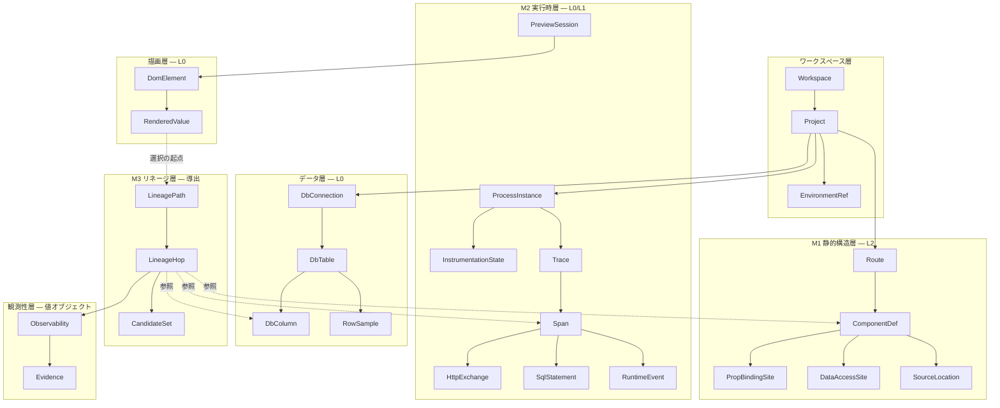
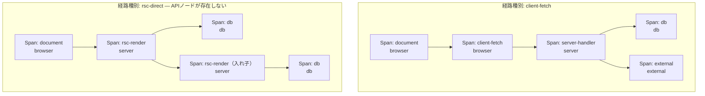
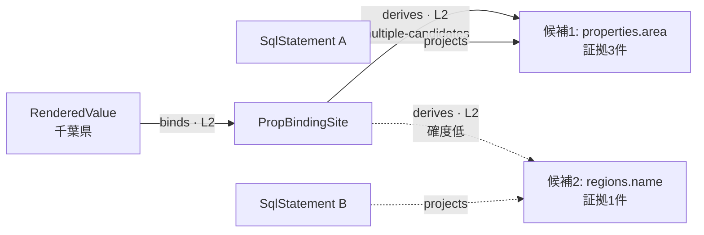
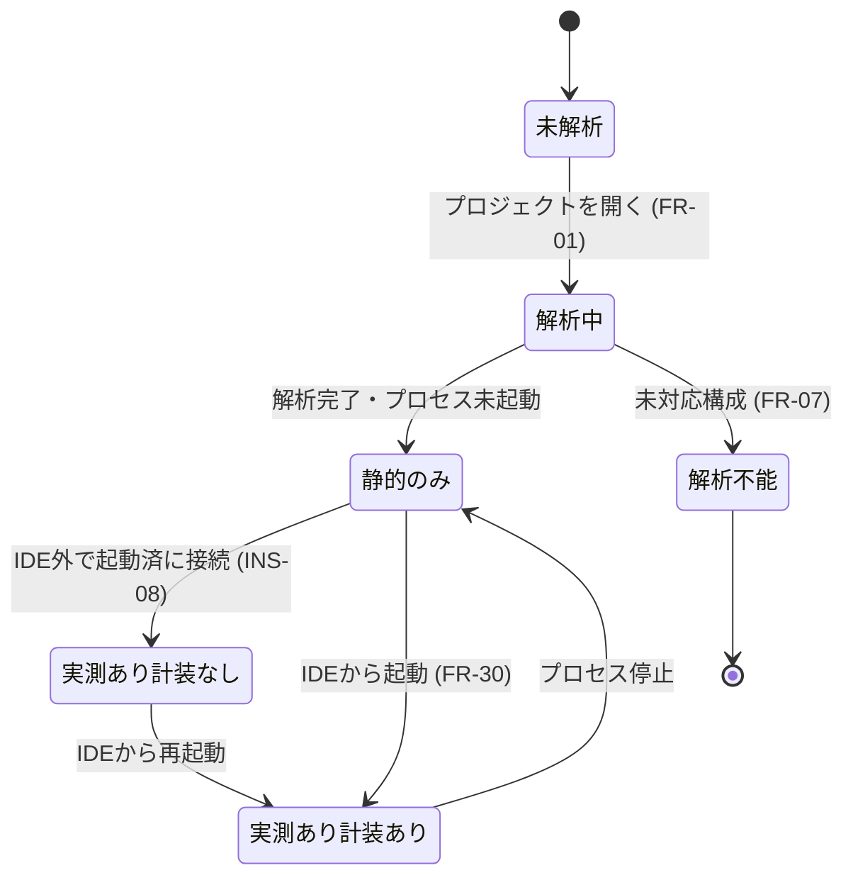

# オブジェクトモデル

| 項目 | 内容 |
| --- | --- |
| フェーズ | Phase 2: IA（情報アーキテクチャ）設計 |
| 文書バージョン | 0.2（M1 で 3.1 / 3.2 / 3.5 を改訂） |
| 作成日 | 2026-10-31 |
| 最終更新 | 2026-11-01（**M1: 関係モデルの最小仕様確定**。改訂の根拠は `docs/06g-m1-model-contract.md`） |

> **記号の衝突に注意。** 本文書 0章の **M1 / M2 / M3** は「プロジェクトグラフ / トレース木 / リネージ経路」の3つのモデルを指す。
> 一方、`06f` 6.2節が定めた MVP 移行の段階にも **M0〜M7** という記号がある。
> 本文書で「**M1 の決定**」と書いてあるものは後者（MVP 移行の段階1 = 関係モデルの最小仕様確定）である。
| 位置づけ | `docs/02-information-architecture.md` の付属文書（設計課題 B に対応） |
| スコープ | 情報の構造定義のみ。データベース設計・API設計・実装技術の選定は含まない |

### 関連文書

| 文書 | 関係 |
| --- | --- |
| `docs/01-product-requirements.md` | 要件の出典。特に 5.2節（観測性マトリクス）・5.4節（正準トレースの分解）・7章（FR） |
| `docs/01b-feasibility-review.md` | Q-02 C-1（RSCにAPIノードが無い）、Q-04.0（カラム特定は原理的に L2） |
| `docs/01c-mvp-priorities.md` | A / B / C 分類 |
| `docs/02-information-architecture.md` | 本文書の親。情報分類・データフローの情報構造・3面同期 |
| `docs/02d-observability-information-model.md` | 本文書で参照する `Observability` 値オブジェクトの詳細定義 |
| `docs/06f-integrity-review.md` | 3章の指摘 I-1〜I-6。本文書 3.5 の改訂の出発点 |
| `docs/06g-m1-model-contract.md` | **M1 の決定記録。** 本文書の改訂箇所と、実装側の契約（`src/lib/model.ts` の `RELATION_SPEC`）の対応 |

### 本文書が対応する要件ID

| 区分 | 要件ID |
| --- | --- |
| **A** | FR-01, FR-02, FR-03, FR-07, FR-10, FR-11, FR-11b, FR-12, FR-18, FR-20, FR-20b, FR-21, FR-22, FR-23, FR-30, FR-31, FR-40, FR-41, FR-42, FR-50, FR-51, FR-52, OBS-01, OBS-05, OBS-06, OBS-09, OBS-10, OBS-11, INS-03, INS-08, NFR-12 |
| **B** | FR-13, FR-14, FR-16, FR-17, FR-20c, FR-24, FR-25, FR-26, FR-27, FR-29b, FR-32, FR-33, FR-35, FR-43, FR-43b, FR-44, FR-46, FR-47, OBS-03, OBS-04, OBS-07, OBS-08, OBS-12, OBS-13, INS-05, INS-07 |
| **C** | FR-28, FR-80, FR-81, FR-82, FR-83, FR-84, FR-90, FR-92 |
| 非機能 | NFR-02, NFR-03, NFR-40, NFR-41, NFR-42 |

---

## 0. 本文書の最重要の主張

> **「プロジェクトグラフ」「トレース木」「リネージ経路」は、別々の3つのモデルである。**
> 参考画像はこの3つを1枚の「フロー図」に溶かし込んでいるが、情報モデルとして融合させてはならない。確度の由来が異なるためである。

| # | モデル | 何を表すか | 基本の観測性 | 生成元 | 対応要件 |
| --- | --- | --- | --- | --- | --- |
| **M1** | **プロジェクトグラフ** (Project Graph) | コードに書かれている構造。ページ・コンポーネント・データアクセス点 | **L2**（静的解析による推論） | ソースコード解析 | FR-02, FR-03 |
| **M2** | **トレース木** (Trace Tree) | 実際に起きたこと。スパンの親子関係と時間区間 | **L0 / L1**（実測） | ブラウザ計測 + サーバー計装 | FR-40, FR-41, FR-42, FR-20b |
| **M3** | **リネージ経路** (Lineage Path) | 「この表示値はこのカラム由来」という**主張** | **導出物**。ホップごとにレベルが変わる | M1 と M2 の突き合わせ | FR-22, FR-23, OBS-09, OBS-10 |

M3 は M1 と M2 から**導出される**。M3 は永続的な事実ではなく、**ある時点の、ある選択に対する、確度付きの解釈**である。

この分離が守られないと、以下の破綻が起きる。

| 融合した場合に起きること | 違反する要件 |
| --- | --- |
| 実測されたSQL（M2, L1）と推測されたカラム対応（M3, L2）が同じ「フロー図のノード」として同列に扱われる | OBS-09, 5.3.2節の禁止事項 |
| 計装が無効なとき、M2 が空になるのに M1 由来の図が「実測されたフロー」に見える | OBS-05, INS-03 |
| RSC で API ノードが無い経路を、M1 の静的構造で勝手に埋めてしまう | OBS-05, Q-02 C-1 |

---

## 1. 情報レイヤーと所有関係

### 1.1 レイヤー全体図



### 1.2 所有関係と参照関係の区別

| 種別 | 意味 | 削除時の挙動 |
| --- | --- | --- |
| **所有 (composition)** | 親が消えれば子も消える。図中の実線矢印 | 連鎖削除 |
| **参照 (reference)** | 独立に存在するものを指す。図中の破線矢印 | 参照先が消えたら `status = dangling` を立て、推測で埋めない (OBS-05) |

> **設計上の要点**: `LineageHop` は `ComponentDef` / `Span` / `DbColumn` を**参照するだけで所有しない**。したがってリネージ経路を破棄しても実測データは残り、実測データが無くてもリネージ経路は（L2 のみで）成立しうる (INS-03, NFR-12)。

---

## 2. 識別子の体系

全ての情報オブジェクトは安定した識別子を持つ。**表示上の連番バッジは識別子ではない**（詳細は `02-information-architecture.md` 第5章）。

| オブジェクト | 識別子の形式 | 安定性 | 備考 |
| --- | --- | --- | --- |
| `Project` | `prj:<絶対パスのハッシュ>` | プロジェクトを開いている間 | FR-01 |
| `Route` | `route:<prj>:<ルートパターン>` | 解析結果が変わるまで | 例 `route:prj_a1:/properties/[id]` |
| `ComponentDef` | `comp:<prj>:<相対パス>#<エクスポート名>` | ファイル移動で変化 | FR-02 |
| `SourceLocation` | `src:<相対パス>:<行>:<列>` | 編集で変化 | FR-24 |
| `PropBindingSite` | `bind:<相対パス>:<行>:<列>` | 編集で変化 | **行だけでは足りない。** 1行に複数の束縛が在りうる（M1） |
| `DataAccessSite` | `fetch:<相対パス>:<行>:<列>` | 編集で変化 | `requests` / `queries` / `supplies` の端点（M1） |
| `DomElement` | `dom:<previewSession>:<注入ID または DOMパス>` | ページ再読込で変化 | 注入IDがある場合のみ L1 (FR-11) |
| `ElementAnchor` | `anchor:<buildId>:<連番>` | ビルドが同じ間 | ビルド時注入の識別子。`ComponentDef` と `DomElement` を結ぶ唯一の L1 経路 |
| `Trace` | `trace:<128bit 16進>` | 永続 | 標準規格互換 (INS-06)、FR-29b の検索キー |
| `Span` | `span:<64bit 16進>` | 永続 | FR-20b の木構造のノード |
| `HttpExchange` | `http:<span>` | 永続 | スパンに付随する詳細 |
| `SqlStatement` | `sql:<span>` | 永続 | FR-52 |
| `DbTable` | `tbl:<connection>:<スキーマ>.<テーブル>` | 永続 | FR-50 |
| `DbColumn` | `col:<tbl>.<カラム>` | 永続 | FR-22 の終端 |
| `LineagePath` | `lin:<選択対象ID>@<トレースID または "static">:<リビジョン>` | **揮発的** | 選択・スコープ・実測の更新で再生成 |
| `LineageHop` | `hop:<lin>:<順序>` | 揮発的 | 表示バッジはこの `<順序>` に由来するが、同一ではない |
| `ProcessInstance` | `proc:<pid>@<起動時刻>` | プロセス生存中 | FR-31 |
| `DbConnection` | `conn:<接続定義のハッシュ>` | 設定が変わるまで | 接続文字列そのものは保持しない (NFR-21) |

> **ElementAnchor を独立したオブジェクトにした理由**: `01b` Q-03.0 により「要素→コードの対応は、ビルド時注入が本命であり、React のバージョン差で壊れた実績がある」ことが判明している。対応付けの手段を `DomElement` の属性ではなく独立したオブジェクトにしておくことで、手段が変わっても（注入 / ソースマップ推定 / 失敗）モデルを変えずに `Observability.source` だけで区別できる (NFR-40, NFR-41)。

---

## 3. 中核オブジェクトの定義

### 3.1 M1 静的構造層（既定 L2）

| オブジェクト | 主な属性 | 関係 | 要件 | 区分 |
| --- | --- | --- | --- | --- |
| `Project` | 名称, ルートパス, 検出フレームワーク, パッケージマネージャ, スクリプト一覧, 解析状態 | → `Route`, `DbConnection`, `ProcessInstance` | FR-01 | A |
| `SupportMatrix` | 対象領域（フレームワーク / ORM / スタイル / DB）, 判定（対応 / 部分対応 / 未対応）, 制限内容 | `Project` が1つ所有 | **FR-07** | A |
| `Route` | ルートパターン, 種別（ページ / ルートハンドラ / Server Action）, レンダリング方式（RSC / CSR / SSR / 不明） | → `ComponentDef` | FR-02, FR-18 | A |
| `ComponentDef` | 名称, ソース位置, **境界 (`client` / `server` / `unknown`)**, props定義 | → `PropBindingSite`, `DataAccessSite` | FR-02, **FR-20c** | A（境界属性はB） |
| `PropBindingSite` | props名, 式の種別（リテラル / 参照 / 計算 / 条件分岐 / 反復）, ソース位置 | ← `ComponentDef` | **FR-12** | A |
| `DataAccessSite` | 種別（ORM呼び出し / 生SQL / fetch / 外部SDK）, 対象の静的推定（テーブル名等）, ソース位置 | ← `ComponentDef` または `Route` | FR-02 | A |
| `SourceLocation` | ファイル, 行, 列, （任意）範囲 | 多数から参照される | FR-24 | A（保持）/ B（遷移） |

> **`PropBindingSite.式の種別` は FR-12（静的テキストと動的な値の判定）の情報的な実体である。** 「静的テキストである」は編集可否 (FR-13) と、リネージを辿るべきか否か (FR-22 代替フロー A1) の両方を決める。

#### 3.1.1 帰属の関係の端点は、この2つのサイトである（M1 で確定）

`requests` / `queries` / `supplies` の3つは、「どのコードがこれをしたか」を言う関係である。
**その端点は `PropBindingSite` と `DataAccessSite`（＝ソース位置）であって、`ComponentDef` ではない。**

| 決めたこと | 内容 |
| --- | --- |
| 新しいオブジェクトを増やさない | `06f` 3.4節は端点の名として `DataFetchSite` を提案していたが、**その名のオブジェクトは本文書に存在しない。** 既存の `DataAccessSite`（3.1節・種別に `fetch` と `ORM呼び出し` を既に持つ）がそのまま端点になる。名称は `DataAccessSite` を採る |
| 囲むコンポーネントは文脈である | 帰属のノードは `ComponentDef` として表示し、その中のサイトを端点として持つ。**表示ノードが端点を「担う」ことと、表示ノードが端点であることは別である** |
| 識別子は列まで持つ | 1行に「要素の位置」と「式の位置」が同居する（実測: `src/app/lin-a/page.tsx:18:11` の `<li>` と `:18:54` の `{row.region}`）。行だけで同定すると両者が区別できない |
| 既定レベルは静的発見時のもの | `DataAccessSite` の既定 L2 は、**静的解析で見つけた場合**の値である。実測した呼び出しスタックから同定した場合、そのサイトの観測性は **L1相当**になる（観測性はオブジェクトごとに取得手段から決まる — `02d` 1.1節） |

> **`ComponentInstance` は導入しない（M1 の決定 G）。**
> 同じ `ComponentDef` が1ページで複数回描かれるとき、**どの描画インスタンスが
> どの行・どの取得に対応するかを決める観測手段を持たない。** PoC-03 は
> 1つの JSX が生んだ要素の個数と順番（`anchorOrdinal` / `anchorInstanceCount`）を
> 観測できているが、**出現順序と配列の添字を結ぶ証拠は観測していない**（`06e` 11.3節 #5）。
>
> したがって次を制約として明文化する。
>
> | # | 制約 |
> | --- | --- |
> | 1 | 関係の帰属の粒度は **`definition`（定義まで）または `source-location`（ソース位置まで）**のいずれかである。実行時インスタンスへの帰属を作ってはならない |
> | 2 | 帰属のノードは「**この位置のコードであることまでです。同じコンポーネントが複数回描かれる場合、どの描画が対象かは同定していません**」を必ず表示する |
> | 3 | 1つの JSX が複数の DOM 要素を生んだ場合、その**個数**を出し、「どの使用箇所が何番目を描いたかは観測していません」を併記する |
> | 4 | インスタンスの同定を前提とする機能（「この行の値だけを辿る」等）は、MVP の対応範囲外として `SupportMatrix` に載せる |
>
> 制約1は実装側で機械的に検査する（`validateDataset` の R7）。**案A（`ComponentInstance` を置く）は採らない。**
> 観測できない区別を仕様が要求することになるためである（`06f` 3.5節）。

### 3.2 M2 実行時層（L0 / L1）

| オブジェクト | 主な属性 | 要件 | 区分 |
| --- | --- | --- | --- |
| `ProcessInstance` | PID, スクリプト名, 状態（実行中 / 停止 / 異常終了 / 未起動）, 終了コード, 待ち受けポート, **起動元（IDE / 外部 / 不明）** | FR-30, FR-31, **INS-08** | A |
| `InstrumentationState` | 状態（有効 / 無効 / 失敗 / 適用不可）, 理由, 追加ファイル一覧, 収集範囲 | INS-03, **INS-07**, INS-05, INS-08 | A（状態）/ B（一覧・制御） |
| `PreviewSession` | URL, ビューポート, 読込状態, 対応する `ProcessInstance` | FR-10 | A |
| `Trace` | トレースID, 起点種別（ドキュメント取得 / fetch / Server Action / 不明）, 開始時刻, 総所要時間, 結合状態 | FR-42, FR-29b | A |
| `Span` | スパンID, 親スパンID, 名称, **種別 (`document` / `rsc-render` / `server-handler` / `client-fetch` / `db` / `external` / `internal`)**, **境界 (`browser` / `server` / `db` / `external`)**, 開始時刻, 終了時刻, 状態 | **FR-20b**, FR-41, FR-43b | A |
| `HttpExchange` | メソッド, URL, リクエストヘッダ, リクエストボディ, ステータス, レスポンスヘッダ, レスポンスボディ, 所要時間, **観測位置 (`browser` / `server-internal`)** | FR-40 | A（観測位置は M1 で追加） |
| `SqlStatement` | SQL文, パラメータ, 実行時間, 取得件数, 解析済み参照テーブル, 解析済み射影カラム | FR-52, FR-41 | A |
| `RuntimeEvent` | 種別（コンソール / JSエラー / ビルド / プロセス出力）, 重大度, 本文, 関連ソース位置 | FR-32, FR-33, FR-44, FR-47 | B |

> **`HttpExchange.観測位置` を属性にした理由（M1 の決定 E）。**
> PoC-05 の `requests` の終点は**ブラウザのネットワーク記録に現れた通信**であり、
> PoC-02 Gate A の `requests` の終点は**サーバーの中から出た通信（ブラウザには現れない）**である。
> 始点・終点の型は同じなので**関係は分けない**が、両者は別物である。
>
> | 値 | 意味 | 取得手段 |
> | --- | --- | --- |
> | `browser` | ブラウザのネットワーク記録に現れた通信（ブラウザが送った通信） | `browser-network` / `preview-relay`（Phase 7B-3A。IDE のプレビュー中継を通った通信。`02d` 1.3.3） |
> | `server-internal` | サーバーの中から出た通信。**ブラウザからは観測できない** | `trace-span`（送信側の client スパン） |
>
> 区別をモデルに置かず文言だけで行うと、**2種類を同じ数え方で合計する実装が書ける。**
> 「ブラウザから見える通信が1件ある」と読める表示は、`rsc-direct` の成立条件
> （ブラウザから見える API 通信が 0 件であること）そのものを壊す。
> 実装では `kind: 'http'` のノードに `exchangeScope` を必須とし、検査する（`validateDataset` の R1）。

#### 3.2.1 Span の木構造 — FR-20b の情報的な実体



> **この2つが同じモデルで表現できることが FR-20b の要請である。** `rsc-direct` では `client-fetch` 種別のスパンが**存在しない**。情報モデルは欠落を欠落として扱い、UI は存在しないノードを描かない (OBS-05)。

`Span` は以下を満たす。

| 要請 | モデル上の対応 | 要件 |
| --- | --- | --- |
| 分岐 | 1つの `Span` が複数の子を持てる | FR-20b |
| 合流 | `LineageHop` 側で複数の `from` を許す（`CandidateSet`） | FR-22 代替フロー A2 |
| 入れ子 | `parentSpanId` による木 | FR-20b, FR-43b |
| 並行実行 | 兄弟スパンの時間区間の重なりを許す。直列を仮定しない | **FR-43b** |

### 3.3 描画層（L0）

| オブジェクト | 主な属性 | 要件 | 区分 |
| --- | --- | --- | --- |
| `DomElement` | タグ, 属性, 矩形, テキスト, `ElementAnchor`（任意） | FR-11 | A |
| `ElementAnchor` | 注入ID, 対応 `ComponentDef`, 対応 `SourceLocation`, 取得手段 | FR-11 | A |
| `RenderedValue` | 表示文字列, 由来種別（静的 / 動的 / 不明）, 所属 `DomElement` | FR-12 | A |
| `SelectionFailure` | 理由（`library-origin` / `not-instrumented-build` / `anchor-missing` / `unidentifiable`）, 説明文, 可能な代替操作 | **FR-11b** | A |

> **`SelectionFailure` を独立したオブジェクトにした理由**: FR-11b は「特定できないときに無反応にしない」ことを要求している。失敗を `null` で表現すると UI は無反応になる。**失敗もまた表示すべき情報である**という方針を、モデルの形で強制する。

### 3.4 データ層（L0）

| オブジェクト | 主な属性 | 要件 | 区分 |
| --- | --- | --- | --- |
| `DbConnection` | 接続名, 種別, 接続状態（接続済 / 未接続 / 権限不足 / 失敗）, 読み取り専用フラグ | FR-50, NFR-24 | A |
| `DbSchema` / `DbTable` | スキーマ名 / テーブル名, 行数推定, コメント | FR-50 | A |
| `DbColumn` | カラム名, 型, NULL可否, 既定値, 制約, **PII候補フラグ** | FR-50, NFR-26 | A（定義）/ B（PII候補） |
| `DbRelation` | 参照元カラム, 参照先カラム, 種別 | FR-50 | A |
| `RowSample` | 行の配列, 取得件数, 取得時刻, **マスク適用状況** | FR-51, NFR-20 | A |

### 3.5 M3 リネージ層（導出）

これが本プロダクトの中核 (FR-22) の情報的な実体である。

```
LineagePath
├─ id                 lin:<選択対象>@<トレース>:<リビジョン>
├─ 起点               SelectionTarget（通常は RenderedValue）
├─ 方向               forward | backward          ← FR-22 / FR-26
├─ 経路種別 (PathKind) client-fetch | rsc-direct | server-action
│                     | static-literal | external-source | not-traced | unknown
├─ hops[]             LineageHop の順序列（主経路）
├─ branches[]         主経路から分岐した副経路（折りたたみ表示）
├─ 経路の観測性        = hops 中の最弱レベル            ← OBS-10
├─ 最弱ホップ          weakestHop: LineageHop への参照  ← OBS-11
├─ 状態               complete | truncated | blocked | ambiguous
└─ 打ち切り理由        （状態が complete 以外のとき必須）
```

```
LineageHop
├─ id                 hop:<lin>:<順序>
├─ from / to          他オブジェクトへの参照（所有しない）
├─ 関係種別            renders | binds | requests | handles | invokes
│                     | executes | reads | projects | maps | derives
├─ observability      Observability 値オブジェクト → 02d
├─ 解決状態 (LinkStatus)
│                     resolved | multiple-candidates | static-literal
│                     | untraceable | unsupported | blocked-by-node
├─ candidates[]       解決状態が multiple-candidates のときの候補集合
└─ 表示バッジ          揮発的。スコープ内の順序から再計算される
```

#### 3.5.1 関係種別と既定の観測性レベル

`01` 5.4節の分解表を、関係種別の一覧として一般化したもの。
**`from → to` はデータが流れる向きで書く**（利用者の探索の向きではない。3.5.1.1節）。

| 関係種別 | from → to（データの向き） | 既定レベル | 降格条件 | 帰属の粒度 | 認める取得手段 |
| --- | --- | --- | --- | --- | --- |
| `renders` | `ComponentDef` → `DomElement` | **L1** | 注入が無い → 不能 | 定義 | `element-anchor` |
| `binds` | `PropBindingSite` → `RenderedValue` | **L2** | — | ソース位置 | `static-analysis` |
| `derives` | レスポンスのキー → `PropBindingSite` | **L2** | 加工・条件分岐あり → 不能 | ソース位置 | `static-analysis` / `structural-match`（単独不可） |
| **`requests`** | **`DataAccessSite` → `HttpExchange`** | **L1相当** | **スタックにアプリのフレームが無い → 関係を作らない** | ソース位置 | **`request-initiator` / `server-call-stack`** |
| `handles` | `HttpExchange` → `Span(server-handler)` | **L1** | 結合失敗 → L2（時間窓推定） | 定義 | `trace-context` / `time-window` |
| `invokes` | `Span` → `Span`（通信の子スパンは `HttpExchange` として表示される） | **L1** | 計装方式により L2 | 定義 | `trace-span` |
| `executes` | `Span` → `SqlStatement` | **L1** | 計装なし → 不能 | 定義 | `trace-span` / `orm-instrumentation` |
| **`queries`** | **`DataAccessSite` → `SqlStatement`** | **L1相当** | **スタックから取得位置を復元できない → 関係を作らない** | ソース位置 | **`server-call-stack`** |
| **`supplies`** | **`DataAccessSite` → `PropBindingSite`** | **L2** | 参照の連鎖が切れる → 関係を作らない | ソース位置 | **`static-analysis`** |
| `reads` | `SqlStatement` → `DbTable` | **L1相当** | — | 定義 | `sql-ast-parse` |
| `projects` | `SqlStatement` → `DbColumn` | **L1相当** | `SELECT *` / 集計 / 式 → **結果列を作らない**（Phase 6F） | 定義 | `sql-ast-parse` |
| `maps` | `DbColumn` → レスポンスのキー | **L2** | 別名・加工 → 不能。**キー名の一致だけでは成立しない** | 定義 | `orm-schema-map` / `structural-match`（単独不可） |
| `locatedAt` | 任意 → `SourceLocation` | L1 / L2 | 手段による | — | 手段による |

> **`binds` / `derives` / `maps` / `supplies` の4つが、構造的に L2 から昇格しえない。** これが `01b` Q-04.0 の結論の、モデル上の表現である。この4つのホップに「実測」を表示することは、いかなる実装によっても許されない。**実測された SQL を材料に使っても昇格しない**（参照の連鎖そのものが推定である — `06e`）。

> **この表は `src/lib/model.ts` の `RELATION_SPEC` と同じものである。**
> 表を2つ持つと必ず食い違う（Phase 6F で、SQL の構文解析器が2つあったことが
> 1つの不具合を5つのデータセットへ広げた）。文書側が決定の記録、実装側が
> 機械的な検査であり、**ずれは `tests/model.spec.mjs` が検出する。**

##### 3.5.1.1 データの向きと、利用者の探索の向きを区別する（M1 の決定 B）

本プロダクトの主機能（FR-22）は、**表示値からカラムへ遡る**操作である。
したがって画面の経路は、`renders` / `derives` / `supplies` の3つについて
**データが流れる向きと逆向きに進む。**

| | 内容 |
| --- | --- |
| 関係の定義 | **データの供給方向で定める。** 例: `supplies` は「取得位置がその値を供給する」ので `DataAccessSite → PropBindingSite` |
| 経路の進み方 | `LineagePath.方向` が決める（3.5節）。表示値から遡る既定の経路では、上の3関係は逆向きにたどられる |
| 実装での表し方 | ホップは `orientation`（`along-data` / `against-data`）を宣言する。**逆向きに描くことは許すが、黙って反転させることはできない** |

> **向きを「探索の向き」で定義してはならない。** そうすると `supplies` が
> 「描画位置が取得位置を供給する」という、データの流れと逆の意味になる。
> 逆方向トレース（FR-26）を足した時点で、同じ関係が2つの意味を持つ。

##### 3.5.1.2 `queries` を独立した関係とする理由（M1 の決定 A）

| 比較対象 | 違い |
| --- | --- |
| `executes`（`Span` → `SqlStatement`） | **始点の型が違う。** スパンの親子は「この処理の下で走った」ことしか言わない。Next.js の描画スパンはルート単位なので、1ページに2本の SQL があるとどちらがどのコードかを語らない（`06d` 2.2 実測） |
| `requests`（`DataAccessSite` → `HttpExchange`） | **終点の型が違う。** 通信と SQL は別物である |

`queries` の帰属は**取得位置（`DataAccessSite`）まで**である。
囲む `ComponentDef` は文脈として表示するが、**どの描画インスタンスが実行したかは同定しない**（3.1.1節）。

##### 3.5.1.3 `requests` の根拠を改めた理由（M1 の決定 C）

改訂前の表は `requests` を「L0 / 根拠: ブラウザ側の計測」としていた。
**ブラウザのネットワーク計測だけでは `… → HttpExchange` の線は引けない。**
計測が与えるのは `HttpExchange` **ノード**（メソッド・パス・状態・所要時間）であって、
「どのコードが始めたか」ではない。

| 区別 | 対象 | 取得手段 | 観測性 |
| --- | --- | --- | --- |
| **通信そのものの観測** | `HttpExchange` ノード | `browser-network`（ブラウザ）/ `preview-relay`（IDE の中継。7B-3A）/ `trace-span`（サーバー内部） | **L0 / L1** |
| **開始元の帰属** | `requests` 関係 | `request-initiator` / `server-call-stack` | **L1相当** |

> **ノードの観測性と関係の観測性は別に書く**（`02d` 1.1節の3単位）。
> 開始元のスタックが取れなければ、**ノードは作るが関係は作らない。**
> 「通信は観測できたが、誰が始めたかは分からない」が正しい状態であり、
> 推測で結んではならない（OBS-05）。

#### 3.5.2 経路種別ごとのホップ構成

| 経路種別 | ホップ列（主経路） | APIノード | 最弱環の位置 | 検証の状態 |
| --- | --- | --- | --- | --- |
| `client-fetch` | renders → binds → derives → requests → handles → invokes → executes → reads/projects → maps | **あり** | `derives` と `maps` | **未成立。** `derives` / `maps` は1本も作れていない（`06f` 4章の G1 / G2） |
| `rsc-direct` | renders → **supplies** → **queries** → executes → reads/projects | **なし** | **`supplies`** | 成立（PoC-04。`06e` 2.3節の保守規則6つが前提） |
| `server-action` | renders → binds → requests(POST) → handles → invokes → executes → reads/projects → maps | あり（URLが処理名を表さない） | `derives`, `maps`, およびラベル付けの曖昧さ | 未検証（題材に無い） |
| `static-literal` | renders → **binds のみで終端** | なし | なし（`locatedAt` まで L1） | 未検証 |
| `external-source` | renders → binds → derives → requests → **外部境界で打ち切り** | あり | 外部境界（L3 として明示、値を出さない — OBS-04） | 未検証 |
| `not-traced` | M1 のみ。全ホップ **L2** | 静的推定のみ | 経路全体 | — |

> **`rsc-direct` が `client-fetch` より確度が高い、という主張は採らない（M1 の決定 H）。**
> 改訂前の本節は「`derives` が無い分、経路が短く確度は相対的に高い」と書いていたが、
> **この主張は較正されていない。** PoC-02 / PoC-04 の実測で分かったのは次である。
>
> | # | 実測 | 出所 |
> | --- | --- | --- |
> | 1 | 推論ホップは1本に減るが、**最弱環は L2 のままである**（`supplies` が L2） | `06e` 1.2節 |
> | 2 | **ホップは減ったが、切断は減っていない** | `06d` 11章 #2 |
> | 3 | 照合に使える中間成果物（応答 JSON）が**存在しない**ため、裏付けの材料はむしろ少ない | `06e` 1.2節 (4) |
> | 4 | 減ったホップには**実測だった区間が含まれる**（`requests` / `handles`） | `06e` 1.2節 |
>
> 経路の確度は最弱環で決まる (OBS-10)。推論ホップが1本少ないことは、**経路全体の確度を変えない。**
> 確度の順序づけは較正を要求するが、較正データは無い (NFR-17 / `02d` 第7章)。
> **したがって経路種別の間に確度の順序を置かない。**
>
> ただし逆方向の誤読も禁止する。**UI は経路の短さを「情報不足」として表示してはならない**
> （ノードが少ないことと確度が低いことは無関係である。`02` 4.2節 / `03` P3-02）。

#### 3.5.3 分岐・合流・複数候補



| 事象 | モデル上の表現 | UI上の要請 | 要件 |
| --- | --- | --- | --- |
| **分岐** | 1つの `Span` が複数の子を持つ / 1つのホップが複数の `to` を持つ | 主経路を1本に決め、残りを折りたたむ。折りたたみ件数を必ず表示 | FR-20b, OBS-07 |
| **流入（グラフ構造上）** | **複数のホップが1つのノードに入る。** 流入の意味を `Convergence` で宣言する（下表） | 線の本数を「入力の本数」として読ませない | OBS-09 |
| **合流（データ）** | 複数の入力が1つの出力になった（JOIN・連結・集計） | **MVP では表せない。** 下記のとおり観測手段が無い | OBS-05 |
| **複数候補** | `LinkStatus = multiple-candidates` + `candidates[]` | **1つに断定しない。** 候補を証拠数つきで列挙し、実トレースがあれば実際に通った候補を強調 | FR-22 代替A2, OBS-05 |
| **並行実行** | 兄弟スパンの時間区間の重なり | タイムラインで重ねて描く（B群） | FR-43b |

##### 流入の意味を区別する（M1 の決定 F）

改訂前の本節は「分岐」を「1つの `Span` が複数の子を持つ」と定義し、
**「1つのノードに、根拠の異なる複数のホップが入る」場合を扱っていなかった。**
実測ではこれが起きている（`06f` I-2）。

| 値 | 意味 | 実測の例 |
| --- | --- | --- |
| `shared-object` | **別々の関係（または別々の根拠）が、同じ対象を指しているだけ。** データは合流していない | ⑤ に `executes`（どのスパンの下で走ったか）と `queries`（どのコードが実行したか）が入る／③' に `invokes` と `requests` が入る／③ に `derives` と `maps` が入る |
| `data-merge` | **実際に複数の入力が1つの出力になった**（JOIN の結果が1つの表示値になる、複数列の連結） | **無い。MVP では作れない**（下記） |

> **`data-merge` を作れない理由。** 「2つの列がこの1つの表示値になった」と言うには、
> 表示値が両方の列に依存していることを示す証拠が要る。本プロダクトは
> **表示された値も、取得した行も読まない**（NFR-20）。静的解析が得るのは
> 「この式が2つの参照を含む」であり、それは**候補が2つある**こと
> （`multiple-candidates`）であって、合流の観測ではない。
> したがって `data-merge` は実装側で拒否する（`validateDataset` の R8）。

> **流入が2本あることは、確度の根拠にならない。** 2本の線はそれぞれ自分の
> 観測性を持つ (OBS-09)。「2つの根拠があるから確かだ」は較正を要する主張であり、
> A段階では行わない (`02d` 3.2節)。ノードの観測性は、そのノード自身の取得手段から決まる。

---

## 4. 状態モデル

### 4.1 NodeStatus — ノードの取得状態（OBS-06 の実体）

| 値 | 意味 | 値を表示してよいか | 例 |
| --- | --- | --- | --- |
| `ok` | 取得できた | はい | 通常のスパン |
| `no-data` | 取得経路は生きているが、該当する情報が無かった | はい（「0件」として） | SQLの結果が0行 |
| `not-connected` | 接続が確立していない | **いいえ** | DB未接続、Docker未起動 |
| `permission-denied` | 権限により取得できない | **いいえ** | 他ユーザーのプロセス情報 |
| `stopped` | 対象が停止している（停止していることは確認済み） | **いいえ** | コンテナ停止中 |
| `not-instrumented` | 計装が適用されていないため観測できない | **いいえ** | 外部起動のサーバー (INS-08) |
| `unsupported` | 対応範囲外 | **いいえ** | 未対応ORM (FR-07) |
| `error` | 取得を試みて失敗した | **いいえ**（エラー内容は表示） | 解析例外 |

> **`not-connected` と `stopped` と `no-data` を1つにまとめてはならない** (OBS-06)。「Dockerが起動していない」と「コンテナが停止している」は、ユーザーが取るべき次の行動が異なる。
> **`not-instrumented` は OBS-06 の4状態に含まれていないが、INS-08 の確定により必須になる。** 要件への追加を提案する（`02-information-architecture.md` 第9章）。

### 4.2 LinkStatus — ホップの解決状態（FR-22 代替フローの実体）

| 値 | 意味 | 線の描画 | 要件 |
| --- | --- | --- | --- |
| `resolved` | 1つに解決した | 観測性レベルに従う（実線 / 破線） | FR-22 |
| `multiple-candidates` | 複数の候補がある | 破線 + 分岐 + 候補件数 | FR-22 代替A2 |
| `static-literal` | 追跡不要。コードに直書き | 終端マーカー（線を伸ばさない） | FR-22 代替A1, FR-12 |
| `untraceable` | 追跡を試みたが不能 | **切断マーカー + 理由** | **FR-22 代替A4, OBS-05** |
| `unsupported` | 解析手段が対応していない | 切断マーカー + 対応範囲へのリンク | FR-07 |
| `blocked-by-node` | 上流ノードが `not-connected` / `permission-denied` 等で取得できないため解決不能 | 切断マーカー + 上流の状態を表示 | OBS-06, NFR-12 |

> **`untraceable` と `unsupported` と `blocked-by-node` を区別する理由**: ユーザーが取るべき行動が異なる。`untraceable` は諦める。`unsupported` は対応待ち。`blocked-by-node` は接続すれば解決する。

### 4.3 解析・実測の可用性と縮退（INS-03, NFR-12）



| 状態 | 利用できるモデル | リネージの最高到達点 | 経路の観測性 | 表示方針 |
| --- | --- | --- | --- | --- |
| **静的のみ** | M1 | 静的推定の経路（`not-traced`） | **全ホップ L2** | 「推定」であることを経路全体に明示。**実際の値は表示しない** (FR-22 代替A3) |
| **実測あり・計装なし** | M1 + ブラウザ側 M2 | HTTP交換まで。サーバー内部は不可 | 混在。サーバー以降は `not-instrumented` | サーバー以降を切断マーカーで示し、**INS-08 の理由を提示** |
| **実測あり・計装あり** | M1 + M2 全体 | カラムまで | 混在。最弱環は `derives` / `maps` | 完全な経路。最弱環を名指し (OBS-11) |
| **解析不能** | なし | なし | — | 対応範囲 (`SupportMatrix`) を提示して終了 (FR-07) |

> **この表が NFR-12（グレースフルデグレード）の情報的な定義である。** いずれの状態でも「何も表示されない」はなく、「何がどこまで分かるか」が変わる。

---

## 5. 横断オブジェクト（ビューの状態）

これらは**情報そのものではなく、情報の見え方を決める状態**である。UI非依存のモデル (NFR-42) とは分離して保持する。

| オブジェクト | 属性 | 役割 | 要件 |
| --- | --- | --- | --- |
| `SelectionTarget` | `{種別, 識別子}` の単一値 | 全面で共有される唯一の選択 | FR-21, UI-11 |
| `ScopeContext` | 種別（ページ / トレース / コンポーネント / 単一経路）, 対象ID | バッジ採番と表示件数を決める | FR-25, UI-34 |
| `ViewProjection` | 面の種別, 表現可否 (`yes` / `no` / `ancestor-only`), バッジ割当 | 選択を各面へ写像する | FR-21 |
| `DisclosureState` | 段階 (0〜4), 開いているタブ, マスク解除の有無 | 段階的開示の現在地 | UI-20〜22 |
| `AuditEntry` | 時刻, 操作, 対象, 実行者 | マスク解除・コード変更・SQL実行の記録 | NFR-28 |

---

## 6. 将来拡張の席（C群・非エンジニア向け）

> 本章は **情報構造の席を確保するだけ** であり、MVPでの実装を意味しない。

| 領域 | 追加されるオブジェクト | 既存モデルへの影響 | 要件 |
| --- | --- | --- | --- |
| クラウド環境 | `CloudEnvironment`, `CloudService`, `Deployment`, `ServiceBoundary` | `EnvironmentRef` の値が増えるのみ。`Trace` / `Span` はそのまま使える | FR-80〜84, FR-92 |
| 外部API可視化 | `Span.境界 = external` の活用 | 既存の `Span` 種別で表現可能 | FR-90 |
| ビジュアル編集 | `EditIntent`, `ChangeSet`, `FileChange` | `SourceLocation` と `PropBindingSite` を参照するのみ。M1〜M3 を変更しない | FR-13〜16 |
| 逆方向トレース | `LineagePath.方向 = backward` | 既存の `LineagePath` に方向属性を足すだけ。**ただし網羅性を保証できないため `検出件数` 属性が必須** | FR-26, FR-27, OBS-07 |
| 非エンジニア向け表示 | `TermGlossary`, `PlainLabel` | 各オブジェクトに「平易な表示名」を足す層。構造は変えない | FR-60, FR-75, NFR-33 |
| AI支援 | `ContextBundle`（AIへ渡す範囲の明示） | `SelectionTarget` + `ScopeContext` から導出 | FR-70〜72, NFR-22 |

> **非エンジニア向け拡張を阻害しないための構造的担保**: 用語の平易化を「別の表示名」としてオブジェクトに付与する設計にしてあるため、情報構造を分岐させずに FR-60 / FR-75 を実現できる。**モードを分けるのではなく、同じ構造に別のラベル層を重ねる**。

---

## 7. 本モデルが満たす要件の確認

| 要件 | モデル上の担保 |
| --- | --- |
| FR-03（プロジェクトグラフの保持） | M1 を独立したモデルとして定義。UIから独立 (NFR-42) |
| FR-20b（スパンの木構造） | `Span.parentSpanId` による木。HTTP は種別の1つに過ぎない |
| FR-22（順方向トレース） | `LineagePath` + `LineageHop`。終端は `DbColumn` |
| OBS-01（全要素が観測性を保持） | `Observability` を `LineageHop` と各ノードの必須属性とした |
| OBS-09（ノード・エッジ・属性の単位） | レベルは `LineagePath` ではなく `LineageHop` が持つ |
| OBS-10（最弱環） | `LineagePath.経路の観測性` を導出値として定義。独立して設定できない |
| OBS-11（最弱箇所の名指し） | `LineagePath.weakestHop` を必須フィールドとした |
| OBS-05（推測で補完しない） | `LinkStatus` に `untraceable` を設け、欠落を明示的な値として扱う |
| OBS-06（4状態の区別） | `NodeStatus` を8値で定義 |
| FR-11b（特定失敗の理由提示） | `SelectionFailure` を独立オブジェクト化 |
| INS-03 / NFR-12（縮退） | 4.3節の状態遷移。M2 が空でも M1 のみで成立 |
| NFR-40 / 41（拡張性） | 取得手段を `Observability.source` に外出し。ノード種別は `Span.種別` の値追加で拡張 |

### 7.1 M1（MVP 段階1）で追加した担保

| # | 主張 | モデル上の担保 | 検査 |
| --- | --- | --- | --- |
| 1 | 関係種別と取得手段は**別の軸**である | 関係は 3.5.1節の表、取得手段は `02d` 1.3節の表。1つの取得手段が複数の関係を支えうる（`server-call-stack` は `requests` と `queries`） | `tests/model.spec.mjs` 第1節 |
| 2 | 帰属の関係はコンポーネント定義どうしを結ばない | 端点を `PropBindingSite` / `DataAccessSite` とし、**ホップにソース位置を必須にした** | 同 第1・3節（R6） |
| 3 | データの向きと探索の向きを混同しない | `orientation` を宣言させる（3.5.1.1節） | 同 第1・3節（R5） |
| 4 | 通信の観測位置を区別する | `HttpExchange.観測位置`（3.2節） | 同 第4節（R1） |
| 5 | グラフ上の流入をデータの合流と読まない | `Convergence`。`data-merge` は拒否（3.5.3節） | 同 第5節（R8） |
| 6 | インスタンスを同定したと表示しない | 帰属の粒度を2値に限定し、定型文を必須にした（3.1.1節） | 同 第6節（R7） |
| 7 | 構造的に推定の関係を実測にしない | `ceiling` を表に持ち、実測の取得手段を拒否 | 同 第3・7節（R4） |
| 8 | キー構成・値の一致だけで関係を作らない | `insufficientAlone` を表に持つ（`maps` / `derives`） | 同 第3節（R9） |

---

*本文書は Phase 2（IA設計）の成果物である。アプリケーションコードの作成、UIモックアップの実装、ライブラリの導入、技術選定は行っていない。*
