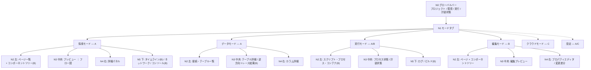

# ナビゲーション構造

| 項目 | 内容 |
| --- | --- |
| フェーズ | Phase 2: IA（情報アーキテクチャ）設計 |
| 文書バージョン | 0.1 |
| 作成日 | 2026-10-31 |
| 位置づけ | `docs/02-information-architecture.md` の付属文書（設計課題 C に対応） |
| スコープ | 情報階層と導線の定義。操作フローの詳細・画面遷移アニメーション・UIコンポーネントは Phase 3 |

### 関連文書

| 文書 | 関係 |
| --- | --- |
| `docs/01-product-requirements.md` | 1.4節（モード構成の方針）、6.3節（4階層レイアウト）、13.1節 項目2・3（本文書が解くべき課題） |
| `docs/01c-mvp-priorities.md` | A / B / C 分類。編集モードが B群である帰結 |
| `docs/02c-screen-inventory.md` | 本文書の各ノードに対応する画面の責務 |
| `docs/02-information-architecture.md` | 3面同期・スコープ・段階的開示 |

### 本文書が対応する要件ID

| 区分 | 要件ID |
| --- | --- |
| **A** | FR-01, FR-07, FR-10, FR-11, FR-18, FR-20, FR-22, FR-23, FR-30, FR-31, FR-50, FR-51, FR-52, INS-08, OBS-06, UI-06, UI-12, UI-13, UI-14, NFR-32, NFR-36 |
| **B** | FR-13〜FR-16, FR-17, FR-19, FR-24, FR-25, FR-26, FR-32, FR-33, FR-35, FR-43, FR-44, FR-46, FR-47, INS-05, INS-07 |
| **C** | FR-60, FR-61, FR-62, FR-70, FR-80〜FR-84 |
| 解決する未決定事項 | 13.1節 項目2（モードタブの確定）、項目3（左サイドバーとモードの重複）、Q-11、Q-12 |

---

## 0. 本文書が解く課題

`01` 13.1節は、Phase 2 で決めるべきこととして次の2点を挙げている。

| # | 課題 | 参考画像の状況 |
| --- | --- | --- |
| 2 | モードタブの構成。MVPで必要なものはどれか | 画像ごとに **4〜9個** とばらついている（`05`: Design/Data/API/Logic/Deploy、`08`: Visual/Code/Database/API/Infra/Deploy/Logs、`10`: 9個、`12`: 6個） |
| 3 | 左サイドバーのアイコン群とモード切替の重複 | `03`/`04`/`05`/`08` は **上部タブと左アイコンレールが併存** しており、どちらがモード切替か読み取れない |

本文書はこれらを決定する。

---

## 1. 決定: ナビゲーションの第一階層は「モード」であり、入口は1か所にする

### 1.1 モード切替を上部タブに一本化する

> **決定1: モード切替の入口は上部タブのみとする。MVPでは左アイコンレールを設けない。**

| 根拠 | 内容 |
| --- | --- |
| 原則7（一目で概要） | モード切替の入口が2か所あると、ユーザーは両者の関係を推論しなければならない。これは理解を与えるという目的に反する |
| UI-07（重複表示の禁止） | 同一の機能への入口の重複は、情報の重複と同じ問題を生む |
| NFR-33（平易さ） | ラベル付きタブはアイコンのみのレールより意味が明瞭 |
| モード数が少ない | 1.2節の決定によりMVPのモードは **3つ**。レールによる省スペース化の必要が無い |

> アイコンレールは、モードが6つ以上に増える C群（クラウド・AI・共有）で再検討する。その時点では「モード群のグループ化」としてレールを導入しうる。**MVPでは構造を単純に保つ。**

### 1.2 モードの確定 — MVPは3モード

> **決定2: MVP のモードは「探索 / データ / 実行」の3つ。編集は B群で4つ目として追加する。**

| モード | 目的 | 主な対象 | 区分 | 参考画像の対応 |
| --- | --- | --- | --- | --- |
| **探索** (Explore) | 画面に表示された値の出所を理解する。**中核体験 (UC-01)** | プレビュー / フロー図 / リネージ経路 | **A** | `03`, `08`, `09`③ |
| **データ** (Data) | DBの構造と実データを、画面との対応関係を保ったまま参照する | スキーマ / テーブル / カラム / 実行SQL | **A** | `09`④, `08` Database |
| **実行** (Run) | アプリの実行状態と環境を把握する。計装の状態を知る | プロセス / ポート / ログ / ビルド / 計装 | **A**（最小）/ **B**（充実） | `03` 下部タブ, `09`⑦ |
| **編集** (Edit) | 画面上で見た目と文言を変更し、コードへ反映する | コンポーネント / スタイル / 差分 | **B** | `05`, `06`, `09`⑧ |
| （将来）**クラウド** | 環境横断の構成と稼働状況 | 環境 / サービス / デプロイ | **C** | `10`, `11`, `12` |
| （将来）**設定** | 接続・資格情報・表示設定 | 接続 / 言語 / 表示モード | A（最小）/ C（充実） | — |

### 1.3 モードにしないもの — 参考画像からの除外判断

| 参考画像のタブ | 判断 | 理由 |
| --- | --- | --- |
| **Code** | **モードにしない。「コードピーク」という遷移先にする** | `01` 13.3節の決定「既存IDEの完全な代替を目指さない。補完ツールとして位置づける」(Q-17)。コード編集モードを設けると、IDEとしての完全性への期待を生む (R-11)。FR-24 のジャンプ先として、読み取り専用のオーバーレイで足りる |
| **API** | **モードにしない。探索モードのドロワーに置く** | APIリクエストはトレースの構成要素であり、独立した情報領域ではない。独立させると `rsc-direct` 経路（APIが存在しない）でタブが空になり、誤解を招く (FR-20b) |
| **Logs** | **モードにしない。実行モードのドロワーに置く** | ログはプロセスに従属する情報 (FR-32) |
| **Infra** | **MVPでは設けない** | ローカルの Docker / ポートは実行モードに含まれる (FR-35, FR-37)。クラウドのインフラは C群 |
| **Deploy** | **MVPでは設けない** | FR-85 は C群 |
| **Pages** | **モードにしない。各モードの左パネルに置く** | ページはナビゲーションの対象であって、独立した活動ではない (FR-18) |
| **Timeline** | **モードにしない。探索モードのドロワーに置く** | 3面同期の一面であり、独立させると同期が切れる (FR-43, UI-11) |

> **「Code をモードにしない」は、本文書で最も影響の大きい決定である。** 参考画像の多くが Code タブを持つが、それを採用すると Q-17 の決定（補完ツールとして位置づける）と R-11（IDEとしての完全性への期待）に反する。コードは**遷移先**であって**活動**ではない。

---

## 2. 情報階層

### 2.1 全体構造



### 2.2 各階層の責務

| 階層 | 名称 | 責務 | 持たないもの | 要件 |
| --- | --- | --- | --- | --- |
| **N0** | グローバルバー | プロジェクト全体に関わる文脈。どのモードでも不変 | モード固有の操作 | FR-01, FR-30, FR-31, INS-08 |
| **N1** | モードタブ | 活動の切替。**第一階層の唯一の分岐** | ページやオブジェクトの選択 | `01` 1.4節 |
| **N2** | 左パネル（コンテキストナビ） | **「何を見るか」の選択**。モードごとに対象が変わる | 選択したものの詳細 | FR-18, FR-17, FR-50 |
| **N3** | 中央キャンバス | **選択したものの構造の表示**。画面面積の最大 | 生データ・属性値 | UI-06, UI-15, FR-10, FR-20 |
| **N4** | 右詳細パネル | **選択したものの内容と根拠**。選択が無いときは**このページの概要**（下記 ※） | 構造の俯瞰 | UI-13, FR-23, OBS-11 |
| **N5** | 下部ドロワー | **時間軸と履歴**。既定は折りたたみ | 構造・内容（N3/N4の重複） | UI-14, FR-43, FR-32, FR-40 |

> **※ N4 の「選択が無いとき格納」は Phase 4B で変更された。** 探索モードでは右の詳細パネルを
> **固定・開閉しない**と決めたため、格納できない。選択が無いときは空パネルではなく
> **このページの概要**（俯瞰サマリ）を置く。詳細は `02c` S-04 の ※2。UI-13 の意図（選択が無いときに
> 詳細で画面を占有しない）は、内容を俯瞰に切り替えることで満たす。

### 2.3 N0 グローバルバーの構成

| 位置 | 要素 | 内容 | 区分 | 要件 |
| --- | --- | --- | --- | --- |
| 左 | プロジェクトセレクタ | 現在のプロジェクト名、切替、開く | A | FR-01 |
| 左 | **対応範囲インジケータ** | 未対応構成を検出した場合の警告。押すと対応範囲画面へ | **A** | **FR-07** |
| 中央 | 環境セレクタ | A群では `Local` 固定で表示のみ。C群で Staging/Production を追加 | A（席）/ C（機能） | FR-80 |
| 中央 | 実行コントロール | スクリプト選択・起動・停止、プロセス状態 | A | FR-30, FR-31 |
| 右 | **計装状態インジケータ** | 有効 / 無効 / 失敗 / **適用不可（外部起動）** | **A** | **INS-03, INS-08** |
| 右 | 共有・デプロイ | C群。MVPでは非表示 | C | FR-63, FR-85 |

> **環境セレクタを A群から「表示のみ」で置く理由**: 後から追加すると、ユーザーが MVP期間中に形成した「この IDE はローカル専用」というメンタルモデルを壊すことになる。**将来の情報構造の席を確保する**という方針 (設計方針 §3) の適用である。ただし `Local` 以外を選択できないことは明示する（選択不可の理由を表示する — OBS-05 の精神）。

> **計装状態インジケータを常時表示する理由**: 計装の有無は、画面上の全ての L1 情報の前提条件である (`02d` 第6章)。モード固有ではなく、プロジェクト全体の文脈であるため N0 に置く。

---

## 3. モード別のナビゲーション

### 3.1 探索モード（A群・中核）

```
N2 左パネル                N3 中央キャンバス              N4 右詳細パネル
┌──────────────┐  ┌───────────────────────┐  ┌──────────────┐
│ ページ一覧      │  │ プレビュー  ｜  フロー図   │  │ 経路サマリ      │
│  / Home       │  │            ｜           │  │  最弱環の名指し  │
│  / properties │  │            ｜           │  ├──────────────┤
│  / [id]       │  │            ｜           │  │ ① フロントエンド │
│               │  │            ｜           │  │ ② コンポーネント │
│ ──────────    │  │            ｜           │  │ ③ APIリクエスト  │
│ コンポーネント   │  │            ｜           │  │ ④ サーバー処理   │
│ ツリー (B)     │  │            ｜           │  │ ⑤ データベース   │
│               │  │            ｜           │  │ ⑥ レスポンス     │
│ ──────────    │  │            ｜           │  │ ⑦ 表示          │
│ スコープ切替 (B)│  │            ｜           │  │                │
└──────────────┘  └───────────────────────┘  └──────────────┘
                   ┌─────────────────────────────────────────┐
                   │ N5 ドロワー: タイムライン(B) / ネットワーク / コンソール(B) │
                   └─────────────────────────────────────────┘
```

| 階層 | 内容 | 区分 | 要件 |
| --- | --- | --- | --- |
| N2 | ページ一覧とルートパス | A | FR-18 |
| N2 | コンポーネントツリー（プレビューと相互選択） | B | FR-17 |
| N2 | スコープ切替（ページ全体 / 選択コンポーネントのみ） | B | FR-25, UI-34 |
| N3 左 | プレビュー（要素選択の起点） | A | FR-10, FR-11, FR-11b |
| N3 右 | フロー図（スパン木とリネージ経路の投影） | A | FR-20, FR-20b, FR-21 |
| N4 | 経路サマリ + 番号付き縦リスト | A | FR-23, OBS-10, OBS-11 |
| N5 | ネットワーク（HTTP交換の一覧） | A | FR-40 |
| N5 | タイムライン（並行・入れ子対応） | B | FR-43, FR-43b |
| N5 | コンソール（JSエラー・ログ） | B | FR-47 |

> **N3 の分割比率は可変とし、片方を最大化できる** (UI-12)。既定は プレビュー:フロー図 = 1:1。Q-11（既定の分割比率）への回答は「1:1 を既定とし、要素選択時にフロー図側へ 1:1.5 まで自動で寄せる」。**選択によって注目対象が移動するため**である。

> **Physical View（立体表示）はモードでも画面でもない。** `04d` が検討した立体表示は、N3 右の
> フロー図（F-3）の**描画様式**である。モードタブは 3+1 のまま変わらず（決定2）、画面も増えない
> （`02c` S-04 の ※1）。**平面と立体の表示切替を設けるかは未決**であり、設けるとしてもそれは
> F-3 の中の選択であって N1 の分岐ではない。

> **スコープ切替 (FR-25) の席を A群では置かない。** 上の表と図に記した「スコープ切替 (B)」は、B群で追加する**位置**を示したものであって、A群の画面に無効な操作を置くことを意味しない。`03` 7.6節の基準②（A群に代替手段がある場合は席を置かない）に該当する — 要素を選択すると自動的に `path`（T4）になるため、A群ではスコープを手で切り替える必要がない (IX-23)。

### 3.2 データモード（A群）

| 階層 | 内容 | 区分 | 要件 |
| --- | --- | --- | --- |
| N2 | 接続一覧（状態: 接続済 / 未接続 / 権限不足）、スキーマ・テーブル一覧 | A | FR-50, OBS-06 |
| N3 | テーブル詳細（カラム定義・制約・リレーション）、データプレビュー、このテーブルに対して実行されたSQLの一覧 | A | FR-50, FR-51, FR-52 |
| N3 | 逆方向トレース結果（検出件数の明示つき） | B | FR-26, FR-27, OBS-07 |
| N4 | カラム詳細（型・制約・PII候補・利用箇所への導線） | A | FR-50 |

> **「このテーブルに対して実行されたSQLの一覧」を A群に置く理由**: FR-52（実行SQLの表示）は A群であり、UC-01 の経路上からも到達できるが、**テーブル側からの入口がないと「このテーブルは本当に使われているのか」という問いに答えられない**。逆方向トレース (FR-26, B群) の縮退版として、実測SQLに基づく確実な情報のみを A群で提供する。これは L1 であり、静的解析に依存しないため網羅性の問題も生じない（ただし「観測された範囲での」という限定は必要）。

### 3.3 実行モード（A群最小 / B群充実）

| 階層 | 内容 | 区分 | 要件 |
| --- | --- | --- | --- |
| N2 | スクリプト一覧、プロセス一覧、コンテナ一覧 | A / B（コンテナ） | FR-30, FR-31, FR-35 |
| N3 | プロセス詳細（PID・ポート・状態・起動元） | A | FR-31, INS-08 |
| N3 | **計装パネル**（状態・理由・追加ファイル一覧・収集範囲） | A（状態）/ B（一覧・制御） | INS-03, INS-05, INS-07, INS-08 |
| N3 | **対応範囲パネル**（フレームワーク・ORM・スタイル・DBの対応状況と限界） | **A** | **FR-07** |
| N5 | 統合ログ（フィルタ・検索）、ビルドエラー | B | FR-32, FR-33 |

> **対応範囲パネル (FR-07) を独立した表示物として実行モードに置く。** 「何が見えないか」は、ユーザーが IDE を信頼するための基礎情報であり、エラー時にだけ出る警告では足りない。誠実さ要件 (`01c` A-1) の情報構造上の実体である。

### 3.4 編集モード（B群）

| 階層 | 内容 | 区分 | 要件 |
| --- | --- | --- | --- |
| N2 | ページ一覧 + コンポーネントツリー | B | FR-17, FR-18 |
| N3 | 編集プレビュー（選択ハンドル・ツールバー）、レスポンシブ切替・ズーム | B | FR-10, FR-19 |
| N4 | プロパティエディタ（テキスト / スタイル） | B | FR-13, FR-14 |
| N4 | 変更差分（変更ファイル一覧・差分・取り消し） | B | FR-16 |

> **編集モードは A群では存在しない。** タブ自体を表示しないか、無効状態で「この機能は今後提供されます」と表示する。無効状態での表示を選ぶ場合、**実装済みと誤認させない表現**が必須である（設計方針 §3）。

---

## 4. 同一機能への複数の入口と、それぞれの役割

> 同じ機能に複数の入口があること自体は問題ではない。**各入口が異なる文脈を運ぶ**場合、それは情報設計上の価値である。問題になるのは、同じ文脈で同じ結果を返す入口が複数ある場合である。

### 4.1 要素を選択する

| 入口 | 運ぶ文脈 | 結果の違い | 区分 | 要件 |
| --- | --- | --- | --- | --- |
| プレビュー上でクリック | **実際に描画された現物**。実値・位置・実行時の状態を伴う | リネージ経路が実測ベース（L0/L1 を含む） | A | FR-11 |
| コンポーネントツリーから選択 | **コードに書かれた構造**。実行時のインスタンスは特定されない | 同一コンポーネントが複数描画されている場合、**どのインスタンスか決まらない**。経路は静的推定に寄る | B | FR-17 |

> **この2つは等価ではない。** ツリーから `PropertyCard` を選んでも、画面に12枚ある `PropertyCard` のどれかは決まらない。UI はこの差を明示し、ツリー選択時は「このコンポーネントは12箇所で描画されています」と提示して、プレビュー側での絞り込みを促す。

### 4.2 リネージ経路を表示する

| 入口 | 方向 | 網羅性 | 区分 | 要件 |
| --- | --- | --- | --- | --- |
| 画面要素から（探索モード） | **順方向**（要素 → カラム） | 1本の経路を特定する。最弱環は `derives` / `maps` | **A** | FR-22 |
| カラムから（データモード） | **逆方向**（カラム → 画面） | **網羅性を保証できない。「検出できた N 件」** | B | FR-26, FR-27, OBS-07 |
| 実行SQLから（データモード / ドロワー） | **順方向の部分**（SQL → テーブル・カラム） | 実測SQLの構文解析のため確実。ただし画面側へは繋がらない | A | FR-52 |
| ネットワーク一覧のリクエストから（ドロワー） | **順方向の部分**（HTTP → サーバー → SQL） | 実測。画面要素との対応は推論 | A | FR-40, FR-42 |

> **4つの入口は、経路のどの区間を、どの確度で得られるかが異なる。** これは重複ではなく、観測性の異なる4つの切り口である。詳細パネルは入口によらず同じ構造を使うが、**経路サマリに表示される「経路の観測性」と「最弱環」が入口ごとに変わる** (`02d` 2.2節)。

### 4.3 テーブル・カラムを参照する

| 入口 | 役割 | 区分 |
| --- | --- | --- |
| データモードの一覧から | **カタログとしての入口**。構造を調べる。画面との対応は未知 | A |
| 探索モードの詳細パネルからジャンプ | **文脈つきの入口**。「いま追っている経路の終端として」のテーブル。選択カラムが強調される | A（保持）/ B（遷移 FR-24） |

> **文脈つきの入口では、遷移先でも元の経路への戻り導線を保持する。** 文脈を失うことは、本プロダクトが解決しようとしているコンテキストスイッチ税 (C-01) をツール内部で再現することになる。

### 4.4 コードを見る

| 入口 | 役割 | 区分 |
| --- | --- | --- |
| 詳細パネルの各ステップから（コードピーク） | **その経路のその地点**のコード。該当行が強調される | B | FR-24 |
| 対応範囲パネルから | 未対応構成の検出箇所 | A | FR-07 |

> いずれも**読み取り専用のオーバーレイ**であり、モードを切り替えない。1.3節の決定（Code をモードにしない）の帰結である。

---

## 5. モード間の遷移と状態の引き継ぎ

`01` 1.4節は「モード間の遷移を設計する。遷移時に選択状態を引き継ぐこと」を要求している。

### 5.1 引き継ぎ規則

| 遷移 | 引き継ぐもの | 引き継がないもの | 要件 |
| --- | --- | --- | --- |
| 探索 → 編集 | 選択中の `DomElement` と対応 `ComponentDef` | リネージ経路、スコープ | FR-11, 1.4節 |
| 編集 → 探索 | 選択中の `ComponentDef`。可能なら `DomElement` | プロパティの編集中状態 | 1.4節 |
| 探索 → データ | 経路の終端 `DbTable` / `DbColumn`（経路がある場合） | プレビューの選択 | FR-24 |
| データ → 探索 | 逆方向トレースで選んだ利用箇所のページと要素（B群） | テーブル選択 | FR-26 |
| 任意 → 実行 | なし（プロジェクト全体の状態を見るため） | — | — |
| 任意 ← 実行 | なし | — | — |

### 5.2 引き継ぎに失敗する場合

| 事象 | 扱い | 要件 |
| --- | --- | --- |
| 編集モードで選択中の要素が、探索モードで特定できない | **無言で選択を解除しない。** 「この要素は探索モードで追跡できません」+ 理由 | FR-11b, OBS-05 |
| 経路の終端が無い（`static-literal` / `untraceable`） | データモードへの遷移を提示しない（押せないボタンを置かない） | FR-22 代替A1/A4 |
| 動的な値を編集しようとした | 編集を無効化し、探索モードでのトレースを提案する | **FR-12, UC-03 代替A1** |

> **「動的な値は編集させず、代わりに出所を見せる」は、2つのモードを繋ぐ最も重要な導線である。** `01` 1.4節の「画面を編集し、その変更がどこに波及するか見る」という連続性の、具体的な実体がこれである。

---

## 6. 階層の深さとキーボード導線

| 項目 | 規定 | 要件 |
| --- | --- | --- |
| 最大階層の深さ | **N0 → N1 → N2 → N3/N4 の4階層**。段階的開示（N4内のタブ・コードピーク）は階層に数えない | 原則7 |
| 初回起動から中核体験までの操作数 | プロジェクトを開く → 起動 → ページ選択 → 要素クリック = **4操作** | **NFR-36**（5分以内） |
| キーボードでの到達 | モード切替・ページ切替・要素選択の移動・詳細パネルのタブ移動・ドロワー開閉を網羅する | **NFR-32** |
| 戻る導線 | モード遷移・ジャンプ・スコープ変更は履歴として戻れる | — |

> **ドロワー (N5) を階層に数えない理由**: ドロワーは N3/N4 と同じ選択対象を時間軸で射影したものであり、**階層ではなく面**である（`02` 第5章）。開いても情報の深さは変わらない。

---

## 7. 非エンジニア向け拡張（C群）がナビゲーションに与える影響

> `01` 2.1節の決定により、P3（非エンジニア）向け支援は将来の重要機能として維持する。本構造がそれを阻害しないことを確認する。

| 将来の機能 | 本構造への影響 | 判定 |
| --- | --- | --- |
| FR-60 表示モード切替（エンジニア向け / 非エンジニア向け） | **モードを増やさない。** 各モードの中で、用語の平易化・生データタブの既定非表示・段階的開示の既定段階を変える「表示プロファイル」として実現する | 阻害しない |
| FR-62 読み取り専用モード | 編集モードを非表示にし、実行コントロールを無効化する。**ナビゲーション構造は同一** | 阻害しない |
| FR-75 専門用語の説明 | 各ラベルに説明を付与する層。構造に影響しない | 阻害しない |
| FR-70 AIに質問する | N4 の詳細パネルにタブとして追加するか、N0 からの呼び出しにする。**モードにしない**（文脈を失うため） | 阻害しない |

> **Q-12（2モードで足りるか、段階的開示だけで解決できないか）への回答: 段階的開示と表示プロファイルで解決し、ナビゲーションのモードは増やさない。** 非エンジニア向けに別のモードを設けると、同じ情報に2つの構造が生まれ、UI-07 に反する。また「非エンジニアには簡略版を見せる」という設計は、`01` 2.1節の「P1 向けに成立した可視化の上に段階的開示として重ねる」という方針と矛盾する。

---

## 8. 本構造が満たす要件の確認

| 要件 / 課題 | 担保 | 章 |
| --- | --- | --- |
| 13.1節 項目2（モードタブの確定） | 3モード（+B群で4つ目）に確定。除外判断を明記 | 1.2, 1.3 |
| 13.1節 項目3（左サイドバーとの重複） | アイコンレールを設けず、モード切替を上部タブに一本化 | 1.1 |
| Q-11（分割比率とモード切替の設計） | 既定 1:1、選択時にフロー図側へ寄せる | 3.1 |
| Q-12（2モードで足りるか） | 表示プロファイルで解決し、モードを増やさない | 7 |
| `01` 1.4節（モードを第一階層に） | N1 をモードタブとした | 2.1 |
| `01` 1.4節（遷移で選択を引き継ぐ） | 引き継ぎ規則と失敗時の扱いを定義 | 5 |
| UI-06（中央が最大面積） | N3 を最大面積とし、N4 は選択が無いとき俯瞰へ切り替え（Phase 4B で格納から変更）、N5 は既定折りたたみ | 2.2 |
| UI-07（重複表示の禁止） | 同一機能の入口が複数ある場合、各々が異なる文脈・確度を運ぶことを確認 | 4 |
| FR-07（対応範囲の明示） | N0 のインジケータ + 実行モードの対応範囲パネル | 2.3, 3.3 |
| INS-08（計装の適用条件） | N0 の計装状態インジケータを常時表示 | 2.3 |
| NFR-32（キーボード操作） | 全階層をキーボードで到達可能と規定 | 6 |
| NFR-36（5分以内に価値へ到達） | 4操作で中核体験に到達 | 6 |
| 非エンジニア向けの将来拡張 | モードを増やさず表示プロファイルで対応 | 7 |

---

## 変更履歴

| 日付 | フェーズ | 変更 |
| --- | --- | --- |
| 2026-10-31 | Phase 2 | 初版 |
| 2026-10-31 | **Phase 5B** | N4 の「選択が無いとき格納」を Phase 4B の固定パネル化に合わせて修正。Physical View がモード・画面を増やさないことを 3.1 に明記。**決定1・決定2（モード構成）は変更していない** |

---

*本文書は Phase 2（IA設計）の成果物である。操作フローの詳細、画面遷移の挙動、UIコンポーネントの選定は Phase 3 の対象であり、本文書では決定していない。*
