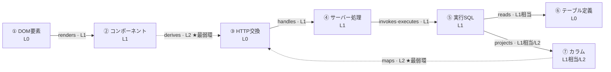

# 観測性の情報モデル

| 項目 | 内容 |
| --- | --- |
| フェーズ | Phase 2: IA（情報アーキテクチャ）設計 |
| 文書バージョン | 0.2（M1 で 1.1 / 1.3 / 5.2 を改訂） |
| 作成日 | 2026-10-31 |
| 最終更新 | 2026-11-01（M1: 取得手段 2 件の正式化。改訂の根拠は `docs/06g-m1-model-contract.md`） |
| 位置づけ | `docs/02-information-architecture.md` の付属文書（設計課題 H に対応） |
| スコープ | 観測性情報の構造定義。視覚デザインの確定（具体的な色・線幅・トークン）は Phase 3 |

### 関連文書

| 文書 | 関係 |
| --- | --- |
| `docs/01-product-requirements.md` | 5.1節（L0〜L3の定義）、5.3節（OBS-01〜13）、5.4節（正準トレースの分解） |
| `docs/01b-feasibility-review.md` | Q-04.0（カラム特定は原理的に L2）、第5章（観測性モデルの精査）、UR-05（較正の未検証） |
| `docs/01c-mvp-priorities.md` | OBS-01/02/05/06/09/10/11 と NFR-17 が A群、OBS-03/04/07/08/12/13 と NFR-26 が B群 |
| `docs/02a-object-model.md` | `Observability` を保持するオブジェクトの定義 |

### 本文書が対応する要件ID

| 区分 | 要件ID |
| --- | --- |
| **A** | OBS-01, OBS-02, OBS-05, OBS-06, OBS-09, OBS-10, OBS-11, FR-07, FR-11b, FR-22, FR-23, INS-03, INS-08, NFR-12, NFR-17 |
| **B** | OBS-03, OBS-04, OBS-07, OBS-08, OBS-12, OBS-13, FR-26, FR-27, INS-05, INS-07 |
| 非機能 | NFR-10, NFR-30（色以外の符号）, NFR-13 |

---

## 0. 本文書が解く問題

要件 OBS-09 は「観測性レベルはノード・エッジ・属性の単位で個別に判定する」と定めている。しかし **「どの単位に、どの値を、どう付けるか」の情報構造は未定義である**。本文書はそれを定義する。

あわせて、Phase 1.5 で積み残された次の2つの段階差を解決する。

| # | 段階差 | 問題 |
| --- | --- | --- |
| 1 | **OBS-03（確度と根拠の表示）が B群、NFR-17（確度ラベルの較正）が A群** | A群で確度ラベルを表示しないなら NFR-17 は何を縛るのか。表示するなら較正データが無い段階で表示してよいのか |
| 2 | **OBS-02（L2/L3の視覚的区別）が A群、OBS-12（区間ごとの線種切替）が B群** | 1本の経路の中でレベルが変わる (OBS-09) のに、区間ごとの描き分けが B群では、A群の表示が OBS-09 と矛盾しないか |

---

## 1. 観測性の付与単位

### 1.1 3つの付与単位

> **原則: 観測性は「経路」には付かない。「経路の観測性」は常に導出値である。**

| 単位 | 対象 | 何を意味するか | 要件 |
| --- | --- | --- | --- |
| **ノード** | `Span`, `DbTable`, `DomElement`, `ProcessInstance` 等 | 「この構成要素が存在したこと」をどう知ったか | OBS-01, OBS-09 |
| **エッジ** | `LineageHop` | 「この2つが繋がっていること」をどう知ったか | **OBS-09。最も重要** |
| **属性** | ノード内の個々のフィールド（SQL文、実行時間、カラム型、実値…） | 「この値」をどう知ったか | OBS-01, OBS-09 |

> **取得手段（`source`）は、関係種別とは別の軸である（M1 の決定 D）。**
> `02a` 3.5.1節の表が決めるのは**端点の型**（何と何を結ぶか）であり、
> 本節 1.3 の表が決めるのは**観測性**（実測か推定か）である。
> 対応は 1対1 ではない。
>
> | | 関係種別（`02a` 3.5.1） | 取得手段（本節 1.3） |
> | --- | --- | --- |
> | 決めるもの | from / to の型 | 観測性（`observabilityOf` の入力） |
> | 多重度 | 1つの関係が複数の取得手段を持ちうる（`handles` は `trace-context` と `time-window`） | **1つの取得手段が複数の関係を支えうる**（`server-call-stack` は `requests` と `queries` を支える — `06d` 6.1節） |
>
> したがって「`server-call-stack` という**関係**を追加する」という整理は誤りである（`06f` I-1）。
> 関係の追加（`queries` / `supplies`）と取得手段の追加（`request-initiator` / `server-call-stack`）は
> **別々に決める。**

**属性単位が必要な理由**（具体例）:

| ノード | 属性 | レベル | 理由 |
| --- | --- | --- | --- |
| `SqlStatement` | SQL文 | **L1** | ORM計装で実測 |
| `SqlStatement` | 参照テーブル | **L1相当** | 実測SQLの決定的な構文解析 |
| `SqlStatement` | 射影カラム | **L1相当 または L2** | `SELECT *` なら列を特定できない |
| `SqlStatement` | 実行時間 | **L1** | 計装の計測値 |

> **同一ノード内で属性ごとにレベルが異なる。** ノード単位の単一ラベルでは、`SELECT *` の場合に「SQLは実測だがカラムは推論」という事実が表現できない。これが属性単位を必須とする理由である。

### 1.2 Observability 値オブジェクトの構造

```
Observability
├─ level          L0 | L1 | L2 | L3                    ← 必須。OBS-01
├─ status         NodeStatus | LinkStatus              ← 必須。OBS-06
├─ source         取得手段の識別子                        ← 必須。OBS-08 の基礎
├─ evidence[]     Evidence の配列                        ← A群では件数と種別のみ使用
├─ confidence     high | medium | low | null            ← B群でのみ値が入る。OBS-03
├─ degradedFrom   L0 | L1 | null                        ← 降格の記録
└─ degradeReason  降格した理由（degradedFrom が非 null のとき必須）
```

```
Evidence
├─ method    証拠の種別（1.3節の一覧）
├─ detail    何が一致したかの具体（例「SELECT句に area が列挙されている」）
└─ strength  decisive | corroborating | weak          ← B群で確度算出に使用
```

#### なぜ `degradedFrom` を持つか

`01b` Q-05.5 により、トレース結合が失敗した場合は「時間窓による推定」へ降格する。降格後は L2 だが、**「もともと L1 で取れるはずだったが失敗した」のと「もともと L2 でしか取れない」のは、ユーザーが取るべき行動が違う**。前者は再試行や設定で改善しうる。この区別を失わないために降格を記録する。

### 1.3 source（取得手段）の一覧

| 値 | 説明 | 既定レベル | 要件 |
| --- | --- | --- | --- |
| `dom-read` | ブラウザのDOM直接読み取り | L0 | FR-10 |
| `browser-network` | ブラウザのネットワーク計測 | L0 | FR-40 |
| `os-process` | OSのプロセス・ソケット情報 | L0〜L2 | FR-31 |
| `db-introspection` | DBへの直接照会（情報スキーマ） | L0 | FR-50 |
| `db-query` | DBへの明示的な照会（データプレビュー） | L0 | FR-51 |
| `element-anchor` | ビルド時に注入した要素識別子 | L1 | FR-11 |
| `trace-span` | 計装が生成したスパン | L1 | FR-41 |
| `trace-context` | トレースコンテキストの伝播 | L1 | FR-42 |
| `orm-instrumentation` | ORM計装のスパン属性 | L1 | FR-52 |
| `sql-ast-parse` | **実測されたSQL文**の構文解析 | **L1相当** | FR-52 |
| **`request-initiator`** | **ブラウザが要求を送る時点で記録した呼び出しスタック**を、ソースマップで元の位置へ戻し、ソースの読み直しで照合したもの | **L1相当** | FR-22（PoC-05 で追加） |
| **`server-call-stack`** | **サーバー側で、データ取得の呼び出しの入口で記録した呼び出しスタック**を、同じ写像・同じ照合で戻したもの | **L1相当** | FR-22（PoC-02 で追加） |
| **`preview-relay`** | **IDE のプレビュー中継が、ブラウザから受けて開発サーバーへ転送した HTTP の要求と応答**を、転送したその場で記録したもの（方法・パス・状態・時刻・応答の専用ヘッダのトレース識別子だけ） | **L0** | FR-40（Phase 7B-3A で追加。1.3.3節） |
| `orm-schema-map` | ORMのスキーマ定義から読んだ対応表 | L2 | — |
| `static-analysis` | ソースコードの静的解析 | L2 | FR-02 |
| `structural-match` | 結果セットの列構成とJSONキー構成の照合 | L2 | — |
| `value-match` | 値の一致 | **L2（単独では補強材料のみ）** | 5.3.2節の禁止事項 |
| `time-window` | 時間窓による推定（トレース結合の代替） | L2 | Q-05.5 |
| `schematic` | 観測手段が存在せず、一般的構成知識から描いた | L3 | OBS-04 |
| `none` | 取得できなかった | — | OBS-05 |

> **`sql-ast-parse` を「L1相当」とした根拠** (`01` 5.4節 #5→6): 解析の対象が**実測されたSQL文そのもの**であり、解析が決定的であるため、静的解析による推論 (L2) とは質が異なる。ただし L1 そのものではないため、**UI上は L1 と同じ表現を用いつつ、根拠として「実行されたSQLの構文解析」と明示する**。
> **`value-match` 単独で確度を上げてはならない** (5.3.2節)。値の一致は必要条件であって十分条件ではない。モデル上、`value-match` は `strength = corroborating` 以上になれない。

#### 1.3.1 `request-initiator` / `server-call-stack` を「L1相当」とした根拠（M1 の決定 D）

| 条件 | 内容 |
| --- | --- |
| 記録の出所 | **実行時に記録されたもの**である。ブラウザ自身（`request-initiator`）または計装自身（`server-call-stack`）が、通信・取得の**呼び出しの入口**で取る |
| 写像の決定性 | ソースマップによる位置の復元は決定的である（`sql-ast-parse` と同じ性質） |
| 独立した照合 | 復元した位置のソース行を**読み直し**、そこに通信・取得の呼び出しがあることを確認する。囲むコンポーネントは**独立した2つの情報源**（ソースの読み直しとビルド時のマニフェスト）の一致を要求する |
| 使わないもの | 時刻の近さ・SQL 文の一致・ページのパス・値の一致。**いずれも帰属の根拠にしない** |
| 成立しない場合 | `component` を null にして理由を返す。**関係を作らない**（FR-11b / OBS-05） |

> **「L1相当」は L1 そのものではない。** UI 上の表現は L1 と同じにしつつ、
> 根拠の文言で区別する（`sql-ast-parse` と同じ扱い。1.3節の注記）。
> 文言は「ブラウザが記録した通信開始時の呼び出しスタック」
> 「サーバー側でデータ取得の呼び出し時に記録したスタック」である。

> **スパン開始時のスタックで代用してはならない。** 実測では、スパンは接続プールの
> コールバックの中で作られるため、**その時点のスタックからアプリのフレームが消えている**
> （`ObsServerCallsite.appFrameAtSpanStart` にその事実を記録している）。
> 代用すると「取れなかった」が「取れた」に化ける。

#### 1.3.2 構成の照合だけでは関係を作らない（M1 の決定 #9）

`structural-match`（結果セットの列構成と JSON キー構成の照合）について、
`value-match` と同じ制約を置く。

| 決めたこと | 内容 |
| --- | --- |
| 単独で根拠にしない | **`maps` / `derives` を `structural-match` 単独で作ってはならない。** キー名が一致することは、コード上でその値がそこへ渡ったことの確認ではない |
| 確認できない場合 | **関係を作らず、切断を維持する**（OBS-05）。「対応が付かなかった」を表示する |
| 実装での担保 | `RELATION_SPEC` の `insufficientAlone` に `structural-match` / `value-match` を置き、唯一の根拠である場合を拒否する |

> **この制約は `06f` 4.3節 V2 の合否条件を上書きする。**
> V2 は「応答のキー名だけを読み、SELECT 句の別名・列名の集合と照合して
> 1対1が立つか」を見る検証だったが、**1対1が立っただけでは `maps` を作らない。**
> キー名の一致は候補の絞り込みであり、同名の別物（同じ名前の別テーブルの列、
> 加工を通ったキー）を排除できない。コード上のデータ伝播を確認できないときは
> 切断のまま残す。

#### 1.3.3 `preview-relay` を `browser-network` と分けた理由（Phase 7B-3A）

| 条件 | 内容 |
| --- | --- |
| 記録の取り手 | ブラウザではなく **IDE のプレビュー中継**（IDE のプロセス内）。利用者のブラウザに CDP をつながないため、IDE がブラウザ自身のネットワーク記録を読む手段は無い |
| 見えるもの | 中継を通った通信だけ。**ブラウザのキャッシュで済んだもの・別 origin への通信は現れない**（`browser-network` なら現れる）。この差を隠さないために名前を分ける |
| 所要時間 | 中継が要求を受けてから応答を送り終えるまで。ブラウザが測った値ではない |
| レベル | **L0。** 通信そのもの（方法・パス・状態）を転送した当事者として直接見ている。推論を含まない |
| 支える関係 | **無い（ノードだけ）。** `HttpExchange` ノードの取得手段になる。`handles` は従来どおり `trace-context`（応答の専用ヘッダのトレース識別子とスパンの一致）で作る |
| 使わないもの | 開始元の帰属。**中継の記録は「誰が送ったか」を語らない。** `requests` の取得手段に加えない（決定 C を維持） |
| 観測位置 | `ExchangeScope = browser`（ブラウザが送った通信）。ノードの概要に「ブラウザ自身の記録ではありません」と併記する |

---

## 2. 最弱環の情報構造（OBS-10 / OBS-11）

### 2.1 レベルの順序関係

```
L0 ≧ L1 > L1相当 > L2(確度高) > L2(確度中) > L2(確度低) > L3
```

| 比較 | 判断 |
| --- | --- |
| L0 と L1 | **実測として同格に扱う。** ただし L1 は計装への依存を示すアイコンを付す (5.1節) |
| L1相当 と L1 | 表現は同じ。根拠の文言で区別する |
| L2 同士 | 確度で順序付ける（B群で確度が導入された後のみ） |
| L3 | 常に最弱。**L3 を含む経路に実測値を表示しない** (OBS-04) |

### 2.2 経路の観測性の導出

```
LineagePath.経路の観測性 = min( 全 LineageHop.observability.level,
                               経路上の全ノードの observability.level )

LineagePath.weakestHop  = 上記 min を与えるホップ
                          同率の場合の優先順位:
                            1. status が resolved でないもの
                            2. confidence が低いもの（B群のみ）
                            3. 経路の下流にあるもの（終端に近いほど主張への影響が大きい）
```

> **`経路の観測性` は書き込み不可の導出値としてモデル化する。** 独立に設定できる値にすると、実装のどこかで「経路全体を L1 にする」ことが可能になり、OBS-10 が破られる。**構造で禁止する。**

### 2.3 正準トレースへの適用（`01` 5.4節の再掲と拡張）



> **`maps` の始点は `DbColumn`（⑦）であって `DbTable`（⑥）ではない** (`02a` 3.5節の `LineageHop.種別` の定義)。対応づけられるのは「カラムと応答のキー」であり、テーブルと応答ではない。
> **`projects` の始点は `SqlStatement`（⑤）であって `DbTable`（⑥）ではない。** 列を取り出したのは SQL であり、テーブルから列への線は**モデルに存在しない**。フロー図で ⑥→⑦ の線を描いてはならない (OBS-05)。

| 項目 | 値 |
| --- | --- |
| 構成要素数 | **14（ノード7 + ホップ7）** |
| L0 / L1 / L1相当 の数 | **12** |
| L2 の数 | **2**（`derives`, `maps`） |
| **経路の観測性** | **L2** |
| **最弱ホップ** | `maps`（`DbColumn` → レスポンスキー）。同率の `derives` より下流にあるため |
| ユーザーへの提示文 | 「この経路で最も確度が低いのは、**データベースのカラムとAPIレスポンスの項目名の対応付け**です。ORMの内部変換は観測できないため、推定しています。」 |

> **12/14 が実測であっても経路は L2。** これが本プロダクトの構造的な事実である (OBS-10)。

> **件数（14 / 12 / 2）は導出値であり、固定値ではない。** 経路の構成が変われば件数も変わる。文書・UI文言・実装のいずれにも定数として埋め込まず、`LineagePath` から算出する。

### 2.4 集約ノードへの再帰適用

情報量制御（`02-information-architecture.md` 第8章）で複数ノードを1つに畳む際、**集約ノードの観測性は内包する要素の最弱環に等しい**。

| 集約の例 | 内包 | 集約ノードのレベル |
| --- | --- | --- |
| 「SQL × 12」 | 全て L1 | **L1** |
| 「サーバー内部処理」（RSC計装が部分的に失敗） | L1 × 3, L2 × 1 | **L2** + 「内部に推定を含む」表示 |
| 「外部サービス」 | L1（呼び出し）+ L3（相手側） | **L3** + 値を表示しない |

> **集約によって最弱環が隠れてはならない。** 集約ノードには、内包する最弱レベルと、そのレベルの要素数を必ず表示する。これは OBS-07（網羅性を保証しない場合の件数表記）と同じ原則の適用である。

---

## 3. A群とB群の段階差の解決

### 3.1 問題の整理

| 要件 | 内容 | 区分 |
| --- | --- | --- |
| OBS-02 | L2/L3 を L0/L1 と視覚的に区別する | **A** |
| OBS-11 | 経路で最も確度が低い箇所を名指しする | **A** |
| NFR-17 | 「確度:高」の実正解率が 95% を下回ってはならない | **A** |
| OBS-03 | L2 の推論に確度（高/中/低）と根拠を表示する | **B** |
| OBS-13 | 確度の算出根拠（一致した証拠の数と種別）を開示する | **B** |
| OBS-12 | 1本の線の中で区間ごとに線種を切り替える | **B** |

`01b` UR-05 により、**確度ラベルを較正できるかは未検証**である。較正データは PoC-04 の実施によってのみ得られる。

### 3.2 解決方針 — A群では確度ラベルを表示しない

> **決定: A段階では「高 / 中 / 低」の確度ラベルを一切表示しない。**
> 代わりに、**較正を必要としない事実のみ**を表示する。

| 情報 | 較正が必要か | A段階 | B段階 |
| --- | --- | --- | --- |
| 観測性レベル (L0〜L3) | **不要**。取得手段の分類という事実 | **表示する** | 表示する |
| ホップの解決状態 (LinkStatus) | **不要**。解決できたか否かの事実 | **表示する** | 表示する |
| 最弱ホップの名指し (OBS-11) | **不要**。どのホップが L2 かは構造から定まる | **表示する** | 表示する |
| 根拠の**種別と件数** | **不要**。何を根拠にしたかの事実 | **表示する**（例「実行SQLの構文解析・ORMスキーマの一致 の2件が根拠」） | 表示する |
| 確度ラベル（高/中/低） | **必要**。NFR-17 の対象 | **表示しない** | PoC-04 の較正後に表示 (OBS-03) |
| 確度の算出式の開示 | 確度ラベルの存在が前提 | 対象外 | 表示する (OBS-13) |

**この方針の根拠**:

1. **NFR-17 は A群にある**。較正されていない確度ラベルの表示は NFR-17 違反である。較正データは A群完成時点では存在しない。したがって A群では表示できない。
2. **OBS-11（最弱環の名指し）は確度ラベル無しで成立する**。「この経路で最も確度が低いのは `maps` です」は、レベルの比較のみで導ける。
3. **M2 の達成条件（`01c` 1.3節）の条件3・4は、レベル表示と最弱環の名指しで満たされる。** 条件文は「観測性レベルが個別に表示され」「最も確度が低い箇所が名指しで示される」であり、確度ラベルを要求していない。
4. 根拠の件数表示は、確度ラベルより**誠実**である。「確度:高」は IDE の判断だが、「根拠2件: 実行SQLの構文解析 / ORMスキーマの一致」は観測された事実であり、ユーザー自身が判断できる。

### 3.3 A群の最小確度表示仕様

A段階の詳細パネルで、L2 のホップについて表示する情報。

| 項目 | 表示内容 | 例 |
| --- | --- | --- |
| レベル | 推定であること | 「推定（静的解析）」 |
| 何が推定か | ホップの関係種別を平易に | 「カラム名 `area` と レスポンスの項目名 `area` の対応付け」 |
| 根拠（種別と件数） | `Evidence[]` の種別を列挙 | 「根拠2件: ORMスキーマ定義の一致 / 値の一致」 |
| 弱点 | なぜ確実でないか（関係種別ごとの定型文） | 「ORMの内部変換は観測できません。別名や加工がある場合は成立しません」 |
| 最弱環か | この経路の最弱環であるか | 「★ この経路で最も確度が低い箇所です」 |

> **「値の一致」を根拠に挙げる際は、必ず「値の一致だけでは一意に定まりません」を併記する** (5.3.2節の禁止事項)。

### 3.4 OBS-02（A群）と OBS-12（B群）の段階差の解決

| 問題 | OBS-09 により1本の経路の中でレベルが変わるのに、区間ごとの線種切替 (OBS-12) が B群では、A群の描画が OBS-09 と矛盾しないか |
| --- | --- |

> **決定: A段階では「ホップ＝独立した線分」として描く。1本の連続した線を描かない。**

| 段階 | 描画モデル | OBS-09 との整合 |
| --- | --- | --- |
| **A** | リネージ経路を **ノードとホップの連なり**として描く。各ホップは独立した線分であり、それぞれ自身のレベルに従った線種を持つ | **整合する。** 「1本の線に単一のレベルを付ける」という状況がそもそも発生しない |
| **B** | 見た目の連続性を高めるため、隣接する線分を1本の線として繋ぎ、**区間ごとに線種を切り替える** (OBS-12) | 同じ情報の、より洗練された表現 |

**この解釈により、OBS-12 は A群の要件を精緻化するものであって、A群に欠落があるわけではない。** `01c` の「OBS-12 は A の OBS-02/OBS-11 の表現を精緻化したもの」という記述と一致する。

---

## 4. 観測性の表示配分（Q-08 への回答）

> Q-08: 観測性レベルを UI 上でどこまで明示すべきか。明示しすぎると読みにくく、しなさすぎると誤解を生む。

### 4.1 配分の原則

| 原則 | 内容 |
| --- | --- |
| **P1. 常時表示は「区別」まで。「説明」は要求時** | 実測か推論かの**区別**は常時。なぜそのレベルかの**説明**は段階2以降 |
| **P2. 誤解のコストが高い箇所を優先する** | 全ホップに等しくラベルを付けず、**最弱環**と**切断点**に表示資源を集中する |
| **P3. 色に依存しない** | 線種・形・ラベルで識別可能にする (NFR-30, UI-08) |
| **P4. 「不明」を空白にしない** | 取得できなかったことは、空白ではなく明示的なマーカーで示す (OBS-05) |

### 4.2 段階別の観測性情報

| 段階 | 操作 | 観測性として表示するもの | 要件 |
| --- | --- | --- | --- |
| **0** | 未選択 | 線種（実線 = 実測 / 破線 = 推論 / 低彩度破線 = 図式）。切断マーカー。**スコープ要約に「この経路は推定を含みます」の1行** | OBS-02, OBS-05 |
| **1** | ホバー | 1行要約にレベルの語を含める（例「推定 — propsとレスポンスの対応付け」）。**最弱環には ★ を付す** | OBS-02, OBS-11 |
| **2** | クリック | 概要タブに: レベル / 解決状態 / 根拠の件数 / 最弱環か否か / 弱点の定型文 | OBS-11, OBS-03（B） |
| **3** | 「根拠」タブ | `Evidence[]` の全件（種別・何が一致したか）、取得手段 (`source`)、降格の有無と理由 | **OBS-08, OBS-13**（B） |
| **4** | コード・SQLへ遷移 | 遷移先でも、その情報の取得手段を1行で保持表示 | OBS-08（B） |

> **段階0で「全ノードにL0/L1/L2のバッジを置く」ことはしない。** 情報密度が上がりすぎ、UI-05（余白）と原則7（一目で概要）に反する。線種による二値的な区別（実測 / 推論）で十分であり、精密なレベルは段階1以降で出す。

### 4.3 経路サマリ — OBS-10 / OBS-11 の表示位置

リネージ経路を表示するとき、**詳細パネルの最上段に経路サマリを置く**。番号付きリストより上である。

```
┌─────────────────────────────────────────────┐
│ この表示値の出所                              │
│ properties.area （推定）                      │
│                                             │
│ 経路全体の確度: 推定                          │
│ 12 件が実測、2 件が推定です                    │
│                                             │
│ ★ 最も確度が低い箇所                          │
│   ⑦→③ カラムとレスポンス項目の対応付け          │
│   ORMの内部変換は観測できません                 │
│   [ この箇所を見る ]                          │
└─────────────────────────────────────────────┘
```

| 構成要素 | 対応要件 | 区分 |
| --- | --- | --- |
| 主張（どのカラム由来か）と、それが推定であること | FR-22, OBS-02 | A |
| 経路全体の確度（最弱環の値） | **OBS-10** | A |
| 実測件数 / 推定件数 | OBS-09 を可視化 | A |
| 最弱箇所の名指しと、そこへの遷移 | **OBS-11** | A |
| 弱点の説明文 | OBS-03 の簡易版 | A |

> **この経路サマリが `01c` の M2 達成条件 3・4 を直接満たす構造物である。** これが無ければ A群は完成しない。

---

## 5. 状態の表現規約

### 5.1 NodeStatus の表現（OBS-06）

| 状態 | 表現の要点 | 値の表示 | ユーザーへの次の行動 |
| --- | --- | --- | --- |
| `ok` | 通常 | あり | — |
| `no-data` | 「0件」と明示。空欄にしない | あり（0件として） | — |
| `not-connected` | 「未接続」。**「停止中」と断定しない** | なし | 接続設定へ |
| `permission-denied` | 「権限により取得できません」 | なし | 必要な権限の説明 |
| `stopped` | 「停止中」（停止を確認できた場合のみ） | なし | 起動操作へ |
| `not-instrumented` | 「計装が適用されていないため観測できません」 | なし | **IDEから再起動する操作へ (INS-08)** |
| `unsupported` | 「この構成は未対応です」 | なし | 対応範囲の表示へ (FR-07) |
| `error` | エラー内容を表示 | なし | 再試行 / ログへ |

> **`not-connected` / `stopped` / `no-data` を同じ灰色の空ノードで表すことは禁止する。** 3者はユーザーが取る行動が異なる。形またはラベルで区別する (NFR-30)。

### 5.2 LinkStatus の表現

| 状態 | 線の描画 | 必須の付随情報 |
| --- | --- | --- |
| `resolved` | レベルに応じた線種 | — |
| `multiple-candidates` | 破線の分岐 | **候補件数**。実トレースで通った候補があれば強調 |
| `static-literal` | 終端マーカー（線を伸ばさない） | ソース位置へのリンク |
| `untraceable` | **切断マーカー** | **理由**（動的クエリ / 加工あり / 対応外 等） |
| `unsupported` | 切断マーカー | 対応範囲へのリンク (FR-07) |
| `blocked-by-node` | 切断マーカー | 上流ノードの `NodeStatus` と、その解消操作 |

#### 5.2.1 1つのノードに複数のホップが入るときの表現（M1 の決定 F）

| 規約 | 内容 |
| --- | --- |
| 本数を入力数として読ませない | 「2本入っている」を「2つの値が合流した」と読ませない。各ホップの関係名（何を言っているホップか）を必ず添える |
| 各ホップの観測性を個別に出す | 流入の本数で確度を上げない。観測性はホップごと (OBS-09) |
| 合流は主張しない | `Convergence = data-merge` は MVP に存在しない（`02a` 3.5.3節）。「JOIN の結果である」等を表示してはならない |

#### 5.2.2 通信の観測位置の表現（M1 の決定 E）

| 観測位置 | 表示の要点 |
| --- | --- |
| `browser` | 従来どおり。取得手段は「ブラウザのネットワーク計測」 |
| `server-internal` | **「サーバーの中から出た通信です。ブラウザには現れません」を必ず添える。** ブラウザのネットワーク記録に存在しないことを明示する |

> **両者を同じ数え方で合計してはならない。** 「ブラウザから見える通信が N 件」という
> 集計にサーバー内部の通信を混ぜると、`rsc-direct` の成立条件（ブラウザから見える
> API 通信が 0 件）そのものが壊れる。

> **切断マーカーは「経路が途切れた」ことを示す積極的な表示であり、線を描かないことではない。** 線を描かないと、ユーザーには「そもそも関係が無い」のか「追跡できなかった」のか区別できない (OBS-05)。

> **マーカーの形を規定する**（色で区別させないため。NFR-30）:
> | マーカー | 形 | 意味 |
> | --- | --- | --- |
> | **切断マーカー** | 線の端に直交する短い縦バー **＋ ✕** | 追跡しようとしたが、できなかった |
> | **終端マーカー** | 縦バーのみ（✕ を付けない） | ここで正常に終わる（`static-literal`） |
> 両者は**形だけで判別できる**こと。色・彩度の差に依存してはならない。

### 5.3 L3（図式的表現）の扱い（OBS-04, B群）

| 規約 | 内容 | 要件 |
| --- | --- | --- |
| 値を出さない | L3 ノードの詳細パネルに実測値を表示しない | OBS-04 |
| 注記を必須にする | 「説明用の図示であり、実際の計測ではありません」 | OBS-04 |
| 経路を L3 に落とす | L3 を含む経路は、経路全体が L3 | OBS-10 |
| **ローカル環境に実在しないノードを描かない** | ロードバランサ、CDN、ファイアウォール通過イベント等。**実在が確認できた構成のみ描く** | `01` 5.2.4節, FR-37b |

> **参考画像の「ファイアウォール → 許可」バッジは採用しない。** `01` 5.2.4節の通り、これは「接続が成功した＝経路上で遮断されなかった」という推論である。MVPでは**このノード自体を描かない**（C群で「ネットワーク到達性」として再定義する）。架空のノードで経路を補完しない、という方針 (OBS-05) の直接の適用である。

---

## 6. 計装状態の情報モデル（INS-03 / INS-07 / INS-08）

計装は L1 情報の供給源であり、その状態は**全ての L1 表示の前提条件**である。したがって計装状態は、個別のノードではなく**グローバルな文脈情報**として扱う。

| 情報 | 表示位置 | 区分 | 要件 |
| --- | --- | --- | --- |
| 計装の有効 / 無効 / 失敗 / 適用不可 | **グローバルバーの常時インジケータ** | A | INS-03, INS-08 |
| 適用不可の理由（外部起動のプロセスに接続している） | インジケータのホバー + 実行モード | A | **INS-08** |
| 追加されたファイルの一覧 | 実行モードの計装パネル | B | **INS-07** |
| 収集するデータ範囲の確認・制御 | 同上 | B | INS-05 |

> **計装が無効なとき、L1 の情報は「0件」ではなく `not-instrumented` として表示する。** 「SQLが0件実行された」と「SQLを観測できなかった」は全く異なる (OBS-06)。この区別を誤ると、ユーザーは「DBアクセスが無いページだ」と誤った結論に至る。**これは本プロダクトが最も避けるべき失敗モード（正しそうに見える誤った図）そのものである。**

---

## 7. 較正の情報構造（NFR-17 / B群での確度導入に向けて）

A群では確度ラベルを出さないが、**較正のためのデータ構造は A群から保持する**。後付けできないためである。

| 保持する情報 | 用途 |
| --- | --- |
| `LineageHop.evidence[]` の種別と件数 | 証拠の組み合わせと正解率の相関を測る（PoC-04） |
| `LineageHop.observability.source` | 取得手段ごとの正解率を測る |
| `LineagePath.経路種別` | `rsc-direct` と `client-fetch` で精度が異なる仮説の検証 |
| ユーザーによる訂正フィードバック（B群） | 較正データの供給源 |

| 較正の判定 | 内容 | 要件 |
| --- | --- | --- |
| 確度ラベルを導入してよい条件 | PoC-04 により、証拠の組み合わせごとの正解率が測定され、「高」に割り当てる組み合わせの正解率が 95% 以上であること | **NFR-17** |
| 条件を満たさない場合 | **確度ラベルを導入しない。** 根拠の件数表示のまま B群へ進む | NFR-17, 原則1（誠実さが第一） |

> **較正できないなら、ラベルを出さないことが正解である。** 確度表示の不在は不便だが、誤った確度表示は観測性モデル全体を無意味にする (`01c` 0.2節 原則4)。

---

## 8. 本モデルが満たす要件の確認

| 要件 | 本文書での担保 | 章 |
| --- | --- | --- |
| OBS-01 | `Observability` をノード・エッジ・属性の必須属性と定義 | 1.1, 1.2 |
| OBS-02 | 線種による二値的区別を段階0で常時表示 | 4.2 |
| OBS-03（B） | 確度ラベルは較正後に導入。A群では根拠の件数で代替 | 3.2, 3.3 |
| OBS-04（B） | L3 の値表示禁止と、実在しないノードを描かない規約 | 5.3 |
| OBS-05 | `LinkStatus = untraceable` と切断マーカーを必須化 | 5.2 |
| OBS-06 | `NodeStatus` 8値と、それぞれの表現・次の行動 | 5.1 |
| OBS-07（B） | 集約・逆方向トレースで件数を必須化 | 2.4 |
| OBS-08（B） | 「根拠」タブに `source` と `Evidence[]` を開示 | 4.2 |
| **OBS-09** | 付与単位を3つ（ノード / エッジ / 属性）に定義。属性単位の必要性を論証 | **1.1** |
| **OBS-10** | `経路の観測性` を書き込み不可の導出値と定義。集約へも再帰適用 | **2.2, 2.4** |
| **OBS-11** | `weakestHop` を必須フィールド化。経路サマリを詳細パネル最上段に配置 | **2.2, 4.3** |
| OBS-12（B） | A群は線分の連なり、B群で連続線の区間切替へ精緻化 | 3.4 |
| OBS-13（B） | `Evidence.strength` と算出根拠の開示 | 1.2, 4.2 |
| **NFR-17** | A群で確度ラベルを表示しない決定。較正データは A群から保持 | **3.2, 7** |
| NFR-30 | 色以外（線種・形・ラベル）での識別を原則化 | 4.1 |
| INS-08 | 計装状態をグローバル文脈として常時表示。`not-instrumented` を独立状態化 | 6 |
| **OBS-01 / OBS-09（M1 追記）** | 取得手段が関係種別とは**別の軸**であることを明文化。`request-initiator` / `server-call-stack` を L1相当として正式化 | **1.1, 1.3, 1.3.1** |
| **OBS-05（M1 追記）** | 構成の照合だけで関係を作らない。確認できなければ切断を維持 | **1.3.2** |
| **FR-40（7B-3A 追記）** | 中継が転送した通信の記録を `preview-relay`（L0）として `browser-network` と区別。開始元の根拠にしない | **1.3, 1.3.3** |
| **OBS-09（M1 追記）** | 1つのノードへの流入の表現規約。流入の本数で確度を上げない | **5.2.1** |
| FR-07 | `unsupported` 状態から対応範囲への導線 | 5.1, 5.2 |

---

*本文書は Phase 2（IA設計）の成果物である。視覚デザインの具体値（色・線幅・トークン）は確定しておらず、Phase 3 の対象である。*
