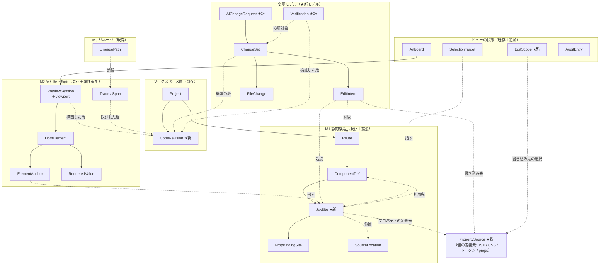
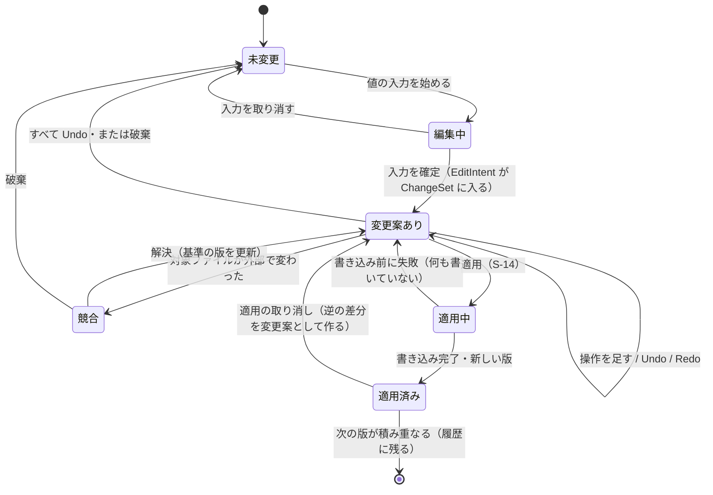
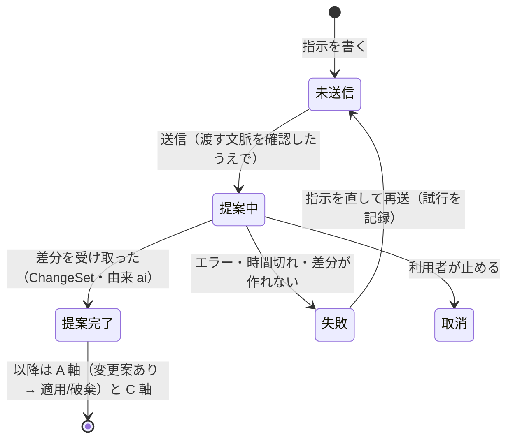

# 編集機能の情報アーキテクチャ（ビジュアル編集・変更管理・AI変更依頼）

| 項目 | 内容 |
| --- | --- |
| フェーズ | **編集トラック: IA（情報アーキテクチャ）** — UI方向性の選定【完了】→ **IA【本書】** → UX → UIの精緻化 → 技術PoC → 実装 |
| 文書バージョン | **0.2**（依頼者の方針を反映して改訂 — 末尾の改訂履歴） |
| 作成日 | 2026-11-02 |
| ステータス | **IA確定（編集トラック）/ UX 設計（`03e`）への入力。** 既存の確定文書（`01`〜`02d`）は書き換えていない。既存文書への変更は `02f-edit-ia-change-proposals.md` に**変更案**として分けた |
| 基準コミット | `e5fb310`（Phase 7C-3。作業ツリーに未コミット変更なし） |
| スコープ | 情報構造（オブジェクト・関係・状態・情報の置き場所・選択と編集範囲）。**UX の操作手順、ピクセル単位の配置、視覚デザイン、技術選定、実装は含まない** |

### 関連文書

| 文書 | 本書との関係 |
| --- | --- |
| `docs/01-product-requirements.md` | 要件ID の出典。特に 1.3節（原則）・1.4節（モード方針）・2.2節（非対象ユーザー）・UC-03・7.2節（FR-10〜19c）・7.8節（FR-70〜76）・8.2節（NFR-14〜17）・R-04・R-10 |
| `docs/01b-feasibility-review.md` | Q-03（要素→コード）。特に C-3〜C-7 と代替2・代替3（編集を縮退してよい根拠） |
| `docs/01c-mvp-priorities.md` | B-1（FR-13〜16 は分割不可）、C群（FR-19b / FR-19c / FR-73 / FR-74） |
| `docs/02-information-architecture.md` | 4面同期（5章）、選択モデル（5.4）、黙って更新しない（5.5） |
| `docs/02a-object-model.md` | 既存オブジェクトと識別子（2章）、`ComponentInstance` を置かない決定（3.1.1）、編集の席（6章） |
| `docs/02b-navigation-structure.md` | モード構成（1.2）、編集モードの席（3.4）、モード間の引き継ぎ（5章）、AI をモードにしない（7章） |
| `docs/02c-screen-inventory.md` | S-11（ビジュアル編集）、S-13（AIへの質問） |
| `docs/02d-observability-information-model.md` | 取得手段と観測性（1.3）、いまの起動での成立条件（1.3.4 / 1.3.5） |
| `docs/03*-` | UX。B-UX-01 / B-UX-02（編集の将来フロー）、UXR-25 / UXR-29、ST-14 / ST-19、IX-01〜05 |
| `docs/06b-poc03-report.md` | 要素識別子の注入方式と、その限界（繰り返し・テキストノード・ライブラリ） |
| `docs/06g-m1-model-contract.md` | 関係の閉じた集合、帰属の粒度（`definition` / `source-location`） |
| `docs/07c0-mvp-acceptance-report.md` | 課題台帳（P1-3 注入の設定・P1-6 固定文字と式の混在・P1-7 遷移後の選択 など） |
| **`docs/02f-edit-ia-change-proposals.md`** | **本書に伴う既存文書への変更案**（採否は各文書の担当判断） |
| **`docs/03e-edit-ux-design.md`** | **本書を前提とした編集トラックの UX 設計** |

### 本書で使う記法

| 記法 | 意味 |
| --- | --- |
| `ED-xx` | 本書で決めたこと（決定） |
| `EQ-xx` | 本書で決めず、他の段階に送る問い |
| `EP-xx` | 技術PoC で確かめる問い |
| `CP-xx` | 既存文書への変更案（`02f` に本文） |
| 【要件】 / 【実装】 | 「要件として文書にある」と「コードにある」を分けて書くときの印 |

---

## 1. 前提・対象範囲・今回決めないこと

### 1.1 本書の出発点 — 守る原則

本書は次の原則を前提とし、どの決定もこれに反しないことを 10章で確かめる。

| # | 原則 | 既存の出典 |
| --- | --- | --- |
| P-1 | 中心価値は「Webアプリの仕組みを理解できること」。**可視化が主、編集が従** | `01` 1.3節 原則2・3、1.4節 |
| P-2 | 探索と編集は**独立したモード**。相互遷移で選択を引き継ぐ | `01` 1.4節、`02b` 5章 |
| P-3 | 成果物は**通常の React / Next.js コード**。IDE 独自形式にロジックを閉じ込めない | `01` 1.2節、原則4、NFR-43、NFR-53 |
| P-4 | 実測・推定・未観測を混同しない（UI の語は「実測 / 推定」と切断） | `01` 5章、`02d`、`03` 4.2節 |
| P-5 | 編集後も、**過去の観測を変更後の実測として表示しない** | `02` 5.5節、ST-14、ST-19（本書で「コードの版」へ拡張） |
| P-6 | DB 由来の表示値を、静的な文言と同じ方法で書き換えない | UC-03 代替A1、FR-12、`02b` 5.2節 |
| P-7 | 編集対象を確実に特定できないときは、**理由を示して編集を制限する** | UC-03 代替A2、FR-11b、`01b` Q-03 代替2 |
| P-8 | ユーザーのコードを明示操作なしに変えない。外部変更を上書きしない | NFR-14、NFR-15、NFR-16、UC-03 代替A3 |

### 1.2 採用済みの UI 方向性の扱い

採用画像（PC とスマホの実ページを中央キャンバスに並べた構成）から、**構造だけ**を受け取る。

| 画像から受け取るもの（構造） | 受け取らないもの |
| --- | --- |
| 中央: 複数のアートボードに実ページを並べるキャンバス | 画像内の名称（`GRiDDATA` 以外の部品名など）、件数、設定値、ボタン名 |
| 左: ページ・部品（コンポーネント）・再利用する部品 | 画像内の機能の有無をそのまま確定仕様とすること |
| 右: 選択対象のプロパティと詳細のドック | 画像内のアートボード幅と描画内容の対応（下表のとおり整合しない） |
| 補助表示: データフロー（記録済み経路）と探索モードへの導線 | 「下書き保存済み」「差分を確認」などの文言の意味（本書 6章で定義し直す） |
| 既存のダーク 2.5D 表現・実ページプレビュー・右詳細ドック | 変更前後の比較を主役にする構成（不採用の別案） |

**画像の中で、情報設計として整合しない点**（UI の誤りの指摘ではなく、IA が解くべき論点の抽出）:

| # | 画像の表現 | 整合しない理由 | 本書での扱い |
| --- | --- | --- | --- |
| I-1 | Desktop（1440×900）のアートボードはカード2列。右ドックのグリッド設定は「4 (desktop)」 | 設定値と描画が一致しない。どちらが「いまのコード」か読み取れない | ドックの値は**選択した要素のいまのコード**から読み、アートボードは**その版の実描画**とする。両者の版が違うときは「表示の由来」の状態で示す（6.7節） |
| I-2 | Mobile（375）でカード1列。設定は「2 (md)」 | Tailwind の `md` は 768px 以上。375px では効かない | アートボードの幅から**有効なブレークポイントを導出**して示す。ブレークポイントを幅と独立に選ばせない（5.5節） |
| I-3 | 「使用箇所 全10箇所」と、一覧の「全10件」 | 1つの JSX（`map` の中の `<PropertyCard>`）が10回描画された状態を「10箇所で使用」と読める | 「利用箇所（JSX の位置）」と「描画の回数」を別の語・別の数にする（3.4節、5.3節） |
| I-4 | 経路「表示された値 → コンポーネント → **通信 GET /api/properties** → サーバー処理 → テーブル」 | 実装済みの題材（`poc/fixture-app`）は RSC 直接取得で、通信ノードが無い経路がある（`02` 4.2節） | 補助表示は記録済みの経路種別に従う。固定の段を描かない（4.6節） |
| I-5 | グローバルバーの Undo / Redo | 探索モードには取り消す編集が無い。ナビゲーションの「戻る」（`02b` 6章）と混同されうる | Undo / Redo は**編集モードの操作**と定義する（6.9節） |
| I-6 | 「下書き保存済み 11/02 14:27」 | 何が保存されたのか（コードか、IDE 内の変更案か）が読めない | 下書き保存・コードへの適用・Git コミットを別の語として定義する（6.8節） |
| I-7 | 「再利用する」ボタン | 選択要素から新しいコンポーネントを切り出す操作と読める。既存要件に無い | 新規要件の候補として扱い、本書の初期範囲に入れない（2章 R-05c） |

### 1.3 対象範囲

| 対象 | 内容 |
| --- | --- |
| 含める | 検討依頼の8機能（2章）の**情報構造**。オブジェクトと関係、識別、情報の置き場所、選択と編集範囲、状態、既存設計への影響、PoC への問い |
| 含める | 白紙からの作成（**既存プロジェクトへのページ追加**と**新規プロジェクトの作成**の2つの能力）の要件上の位置づけと、既存方針との衝突 |
| 含めない | 操作手順、画面遷移の挙動、ショートカット、文言の最終形 → **UX** |
| 含めない | 寸法、色、アイコン、2.5D の描き方 → **UI の精緻化** |
| 含めない | 書き換えの方式（AST ライブラリ、差分アルゴリズム）、ファイル監視の手段、AI の接続方式 → **技術PoC** |
| 含めない | A / B / C の再分類の確定。本書は**提案**に留める（`02f`） |

### 1.4 今回決めないこと

| # | 決めないこと | 送り先 |
| --- | --- | --- |
| 1 | 新規プロジェクトの**生成方式**（テンプレート / コード生成器 / AI）と、生成する**フレームワーク・構成** | **PoC（EP-15）より前に確定しない**。能力としては対象に含め、後続段階に置く（ED-01） |
| 2 | 編集の既定の書き込み先のブレークポイント | UX（`03e` で推奨案を提示済み） |
| 3 | 変更をまとめる単位・適用の単位 | UX（`03e` で推奨案を提示済み）。情報構造は複数の単位を許す |
| 4 | 適用前プレビューを**どの技術で成立させるか**（予測の重ね合わせ / 隔離した作業コピーでの実描画 / その他） | **EP-12**。IA は「適用前プレビュー」と「適用後の実描画」を区別することだけを決めた（6.7節） |
| 5 | AI が作業ツリーへ直接書くか、変更案だけを返すか | **EP-11**。IA は「変更案として受け取る」を既定とし、直接書く場合は外部変更として扱う |
| 6 | Git の状態表示（FR-08）やコミット操作を IDE に置くか | 後続（FR-08 は C群・Phase B）。本書はコミットを IDE の責務に**含めない** |
| 7 | 編集トラックの A / B / C の位置づけ（M4 との関係） | 要件定義の担当判断（`02f` CP-02）。**本書は探索トラックとの順序だけを定める（1.7節）** |
| 8 | CSS Modules・グローバル CSS・共有トークン等への書き込みを、どの段階で対応するか | 後続（EP-16 の結果）。モデルは最初からこれらを表せるようにした（3.9節） |

### 1.5 現在の実装状況（2026-11-02 時点・`e5fb310`）

**要件があることと実装されていることは別である。** 以下はコードで確かめた事実である。

| 項目 | 状況 | 根拠 |
| --- | --- | --- |
| モードタブ | 「探索」だけが有効。「データ」「実行」「編集（準備中）」は押してもモードが変わらない飾り。モードの状態もルーティングも無い | `src/components/GlobalBar.tsx:44-58` |
| 実プレビュー | iframe 1つ。中継（別ポート・宛先固定）経由。高さ 300px 固定、幅はパネル幅。**幅の切替・複数ビューポートは無い** | `src/server/previewGateway.ts`、`src/components/panels/LivePreview.tsx`、`previewLayout.ts` |
| 要素→ソース | ビルド時注入（`data-vcide` = `sha1(相対パス:行:列)` の先頭10桁）。**小文字タグの要素だけ**に付く。コンポーネントの利用（大文字タグ）は「usages」として静的に記録するだけで DOM には現れない。IDE 側の6段の照合を通ったときだけ位置を出す | `poc/anchor/transform.cjs:86-120`、`src/server/anchors.ts:279-356` |
| 注入の前提 | 対象の `next.config` が `POC03_ANCHOR` を読む設定のときだけ。**IDE は設定を書き換えない**（P1-3） | `src/server/anchors.ts:63-81`、`07c0` |
| 繰り返し要素 | 同じ JSX から生まれた要素は同じ識別子。「N 個のうち M 番目」までは出すが、どの描画インスタンスかは同定しない | `src/lib/adapter.ts:236-259`、`src/lib/model.ts`（`ATTRIBUTION_SCOPE_NOTE`、R7） |
| 文言の由来 | 直下の式がちょうど1つのときだけ値の由来を結ぶ。固定の文字だけなら `no-value-site`、混在は `mixed-text-children`（P1-6） | `src/lib/liveLineage.ts:104-112` |
| 対象のソースへの書き込み | **無い**。IDE が書くのは `.ide-runtime` 配下だけ。`next dev` 自身が書く `next-env.d.ts` などは指紋で検知して表示するだけ | `src/server/devServer.ts:130, 432, 621-641` |
| ファイル監視 | **無い**（`fs.watch` 等なし）。必要なときに mtime と大きさを比べる | `src/server/lineage.ts:47-107`、`src/server/dataAccess.ts:228-239` |
| 観測とコードの版 | 観測は起動ごとのセッションで、停止・再起動で捨てる。**コードのハッシュ・コミット・ビルドID による版の管理は無い**。陳腐化は `stale-run`・`source-changed-after-run`・`source-changed-after-call` の mtime 判定だけ | `src/lib/liveObservation.ts`、`lineage.ts`、`dataAccess.ts` |
| Git・Undo/Redo・差分・AI | **いずれも無い**（AI は子プロセスへ渡さない環境変数として名前が出るだけ） | `src/server/childEnv.ts:6-9` |

したがって、本書の8機能はいずれも**実装されていない**。実装済みのうち編集が依存するのは「実プレビュー」「要素→ソースの特定（条件付き）」「値の由来の判定（限定）」「mtime による書き換え検知」の4つである。

### 1.6 能力の状態を表す語（本書・`03e` 共通）

「まだ無い」ことを、理由の違いで書き分ける。**「未実装」と「不採用」を同じ語で書かない。**

| 語 | 意味 | 情報構造 | 例 |
| --- | --- | --- | --- |
| **実装済み** | コードにあり、動く | ある | 実プレビュー、要素→ソースの特定（条件付き） |
| **初期範囲** | 未実装。編集トラックの最初の提供に含める | ある | 静的な文言、単純な Tailwind 指定、差分・適用・取り消し・競合・版・検証 |
| **後続予定** | 未実装。対象に含めるが、初期範囲より後に置く（PoC の結果で時期を決める） | **ある**（席と状態を定義する） | 新規プロジェクトの作成、ページ追加と部品配置、CSS Modules 等への書き込み |
| **初期対象外** | 未実装。初期範囲・後続予定のどちらにも置かない。**前提が成立すれば再検討する** | 理由と前提を記録する | 描画の1件だけを DOM 上の見た目で変える |
| **対象外（不採用）** | 採らないと決めた | 持たない | AI を独立モードにする、外部の変更を上書きする |

### 1.7 探索トラックと編集トラックの順序

> **ED-09: 編集トラックの設計（IA・UX）を進めることは、編集を探索より優先することを意味しない。**

| トラック | 順序の基準 | 現状 |
| --- | --- | --- |
| **探索トラック**（既存） | `01c` の A → B → C。A群の完成（M2）とユーザーテスト（`01c` 1.4節）が B群の着手条件（`01c` 2.2節） | M2 は未達（`07c0` P2-9）。P1（利用者のプロジェクトへの対応）が残る |
| **編集トラック**（追加） | 本書の段階: IA → UX → UI → 技術PoC → 実装。**実装の着手は `01c` 2.2節の B群の着手条件に従う**（CP-02） | IA・UX（文書）のみ |

| 規則 | 内容 |
| --- | --- |
| 設計と実装を分ける | 編集トラックの文書作成は探索トラックと並行してよい。**実装・PoC の資源配分は探索トラックの A群を先に満たす** |
| 安全の条件は編集の一部 | 差分確認・取り消し・競合検出・コードと観測の版の対応・検証状態の表示は、**編集機能と分割できない成立条件**である（`01c` B-1「FR-13〜16 は分割不可」の拡張 — CP-02）。これらを欠いた編集機能を「初期範囲の一部だけ」として出さない |
| 探索の品質を下げない | 編集トラックが探索モードに足すのは、N0 の状態表示と観測の鮮度だけ（4.5節）。探索の既存の面・情報量は変えない |

---

## 2. 既存要件と追加要件の対応表

### 2.1 分類の凡例

| 分類 | 意味 |
| --- | --- |
| **そのまま** | 既存要件をそのまま使う |
| **拡張** | 既存要件の意図の範囲で、対象・粒度を広げる |
| **新規** | 既存要件に無い。追加要件として扱う |
| **衝突** | 既存方針と衝突する。採るなら方針の見直しが必要 |

「要件」欄は文書にあるか、「実装」欄はコードにあるかを別々に書く。

### 2.2 対応表

「位置づけ」欄は 1.6節の語（初期範囲 / 後続予定 / 初期対象外 / 対象外）で書く。

| # | 検討する機能（分解） | 分類 | 根拠となる既存の節・要件ID | 要件の有無 | 実装の有無 | 位置づけ |
| --- | --- | --- | --- | --- | --- | --- |
| **R-01a** | 既存プロジェクトの中に**新しいページ（ルート）を追加**する | **新規** | 既存要件はページの一覧・切替のみ（FR-18）。要素の追加は FR-19b（C群） | 無い | 無い | **後続予定**（EP-10） |
| **R-01b** | ページに**プロジェクト内の部品と基本要素を配置**し、React コードを生成する | **拡張**（FR-19b を拡張） | FR-19b「要素の追加・削除・並べ替え」（P2 / `01c` 3.2 C群）、`01` 9.4節「編集の往復精度を先に確立する必要がある」 | 一部 | 無い | **後続予定**（EP-10） |
| **R-01c** | **新規プロジェクトを作成し、React コードを生成する**（白紙からの Web サイト作成） | **新規・衝突**（追加要件として受け入れる。既存方針の改訂が要る） | `01` 2.2節「コードを一切持たないユーザー — ゼロからのアプリ生成は本プロダクトの目的ではない」、1.2節「ノーコードツールではない」、原則5「既存プロジェクトに寄生する。新規プロジェクト専用にしない」、13.5節 Phase 1 #1「自動化・コード生成ではない」 | 否定されている（改訂案 CP-01） | 無い | **後続予定**（EP-15。生成方式・フレームワークは PoC 前に確定しない） |
| **R-02a** | 既存 Next.js プロジェクトを読み込み、実ページを表示する | **そのまま** | FR-01、FR-10、UC-03 | ある（A群） | **ある**（7A / 7B-1。App Router・Turbopack・`src/` 内） | 実装済み |
| **R-02b** | 要素を選び、対応するソース位置を特定する | **そのまま** | FR-11、FR-11b、`01b` Q-03 | ある（A群） | **ある（条件付き）**（7B-2。注入設定が要る＝P1-3） | 実装済み（条件付き） |
| **R-02c** | 静的な文言を編集してコードへ反映する | **そのまま** | UC-03、FR-12、FR-13 | ある（B群） | 無い | **初期範囲** |
| **R-02d** | 見た目を**単純な Tailwind 指定**で編集してコードへ反映する | **拡張** | FR-14（サイズ・余白・配置・色・フォント…）、R-04、Q-06 | 一部 | 無い | **初期範囲** |
| **R-02f** | 見た目の実体が **CSS Modules・グローバル CSS・共有トークン・インラインスタイル・props** にある場合に、そこへ書く | **拡張** | FR-14 は書き込み手段を限定していない。R-04「CSS-in-JS、CSS Modules など複数のスタイル手段の混在」。`01` 2.3節「スタイル: MVP は Tailwind、後続で CSS Modules・styled-components・vanilla-extract」 | 一部（リスク・後続対応として） | 無い | **後続予定**（EP-16）。初期範囲では**出所を示し、編集は制限**（5.7節） |
| **R-02e** | 動的な値（props・DB 由来）を直接書き換えさせない | **そのまま** | UC-03 代替A1、FR-12、`02b` 5.2節、B-UX-01 代替フロー | ある | 判定のみある（`valueOrigin`・`liveLineage.ts`）。編集制限としては無い | **初期範囲** |
| **R-03** | 選択要素から探索モードへ移り、出所・処理を確認する | **そのまま**（引き継ぐ情報は**拡張**） | `01` 1.4節「モード間の遷移を設計する」、`02b` 5.1・5.2節、`03c` 6.1節 | ある | 無い（編集モードが無い） | **初期範囲** |
| **R-04a** | 変更差分の表示と取り消し | **そのまま** | FR-16、`01c` B-1「FR-13〜16 は分割不可」、`02c` S-11「`ChangeSet` を持たない `EditIntent` は成立しない」 | ある（B群） | 無い | **初期範囲**（成立条件） |
| **R-04b** | Undo / Redo | **拡張** | FR-16「取り消せる」、UXR-25「取り消せる操作には確認を付けない」。操作単位の履歴の定義は無い | 一部 | 無い | **初期範囲**（成立条件） |
| **R-04c** | 変更履歴（適用した変更の記録） | **拡張** | NFR-28（IDE が実行した操作の履歴）、`02a` 5章 `AuditEntry` | 一部 | 無い | **初期範囲** |
| **R-04d** | 下書き保存・適用前プレビュー・コードへの適用・破棄を区別する | **新規** | UC-03 基本フローは「編集 → 楽観的更新 → ソース書き換え → 差分」で、**未適用の変更案という段を持たない** | 無い | 無い | **初期範囲**（成立条件。プレビューの方式は EP-12） |
| **R-05a** | コンポーネント定義を編集し、全利用箇所へ反映する | **拡張** | R-04「1箇所の編集が全箇所に波及する」、`01b` Q-03 C-6「影響範囲提示が必須」、B-UX-02 | 一部（リスクとしてのみ） | 無い | **初期範囲**（影響範囲の提示が条件） |
| **R-05b** | 1つの**利用箇所（JSX の位置）**で渡す props を変える | **拡張** | R-04「編集先がコンポーネント定義か呼び出し元か判断できない」、`02a` 3.1.1 帰属の粒度 `source-location` | 一部 | 静的な利用箇所の記録のみある（`transform.cjs` の usages） | **初期範囲**（リテラルの props） |
| **R-05c** | 選択から部品を切り出して再利用する（「再利用する」） | **新規** | 既存要件に無い | 無い | 無い | **後続予定** |
| **R-05d** | 繰り返し描画の**1件だけ**を、**DOM 上の見た目で**変える | **衝突** | `02a` 3.1.1「`ComponentInstance` は導入しない（M1 の決定 G）」、`06g` 1.7節（`runtime-instance` を拒否） | 否定されている | 拒否する検査がある（`model.ts:688`） | **初期対象外**（前提: 描画の1件と配列の要素を結ぶ観測手段。2.3節） |
| **R-05f** | 繰り返し描画の元になっている **DB 内の値**を変える | **別の能力**（コード編集ではなくデータの変更） | FR-54「任意SQLの実行（読み取りのみ。書き込みは明示的な許可）」（C群）、NFR-23（二段階確認）、NFR-24（本番は読み取り専用） | 書き込みは C群・二段階確認 | 無い | **対象外（編集モードでは扱わない）**。編集モードからは出所（探索・データモード）へ案内するだけ |
| **R-05e** | 部品の利用箇所の一覧 | **そのまま**（C群） | FR-28、UC-08、OBS-07（検出件数の明示） | ある（Phase B） | 無い | **初期範囲**（影響範囲の提示に必要な範囲で。網羅を主張しない） |
| **R-06a** | PC・スマホなど複数幅で表示する | **拡張** | FR-19「レスポンシブ表示の切替（デスクトップ/モバイル幅）とズーム」（`01c` B-1）。**複数幅の同時表示**は無い | 一部 | 無い | **初期範囲**（同時表示は EP-08。不成立なら切替） |
| **R-06b** | 幅ごとの見た目の上書きを編集する | **新規** | 既存要件に無い（FR-14 は幅を区別しない） | 無い | 無い | **初期範囲**（Tailwind の variant に限る） |
| **R-07a** | AI へ変更を依頼し、提案を受け取る | **拡張** | FR-73「AIが操作を提案し、承認後に実行。実行前に影響範囲を表示」（C群）、UC-12 手順4・5、R-10 | 一部（操作の提案。コード変更は明記なし） | 無い | **後続予定**（EP-11） |
| **R-07b** | AI の変更内容（差分）と検証結果を確認する | **新規** | FR-71（回答根拠のハイライト）は質問への回答の根拠であり、変更の検証ではない | 無い | 無い | **後続予定**（R-07a と一体） |
| **R-07c** | AI に渡す文脈を確認・制御する | **そのまま** | FR-72、NFR-22、SG-09、`02a` 6章 `ContextBundle` | ある（Phase B） | 無い | **後続予定**（R-07a と分割不可） |
| **R-07d** | AI を独立したモードにする | **衝突** | `02b` 7章「FR-70 AI はモードにしない（文脈を失うため）」、`02c` S-13 | 否定されている | — | **対象外（不採用）** |
| **R-08a** | 外部エディタ・AI によるコード変更を検出する | **そのまま**（範囲は**拡張**） | FR-04（ファイル監視・増分更新、`01c` B-4）、NFR-16、NFR-52 | ある | 部分（mtime の都度比較のみ。監視は無い） | **初期範囲**（少なくとも適用の直前の比較。成立条件） |
| **R-08b** | 未適用の変更と外部変更の競合を扱う | **拡張** | UC-03 代替A3「競合を検出し、上書きしない」。解決の情報構造は無い。`03*` に「競合」の概念は無い（ポート競合のみ） | 一部 | 無い | **初期範囲**（成立条件） |
| **R-08c** | 観測記録とコードの版の対応（古い観測の表示） | **拡張** | `02` 5.5節、ST-14、ST-19、`02d` 1.3.4(b)「書き換えなし」 | 一部（起動・mtime 単位） | 一部（`stale-run`、`source-changed-after-*`） | **初期範囲**（成立条件） |

### 2.3 衝突の扱い

| 衝突 | 本書の扱い | 変更案 |
| --- | --- | --- |
| R-01c 新規プロジェクトの作成 | **追加要件として情報構造に残し、後続予定に置く。** 既存方針（原則5・2.2節・Phase 1 確定事項 #1・1.2節）と衝突するため、**要件定義の改訂が先に必要**であることを記録する。衝突だけを理由に対象から外さない。生成方式・フレームワークは EP-15 の前に決めない | CP-01 |
| R-05d 描画の1件だけの見た目の変更 | **初期対象外。** 1件ごとの違いは配列の要素（データ）から生まれており、DOM 上の見た目だけを変えるには「どの描画がどのデータか」を同定する必要がある。これは M1 の決定 G が「観測していない」とした区別である。**前提（描画の1件と配列の要素を結ぶ観測手段）が成立したら再検討する** | なし（既存決定を維持し、再検討の前提を記録） |
| R-05f DB 内の値の変更 | 繰り返し描画の1件の文言を変えたい場合の多くは、実際には**データの変更**である。これはコードの編集ではない。編集モードでは扱わず、出所（探索モードの経路、データモードの該当カラム）へ案内する。データの書き込みは既存要件どおり C群・二段階確認 | なし |
| R-07d AI モード | **対象外（不採用）。** 既存決定を維持する（4.2節） | なし |
| `05-data-design.md` §1 #3 と FR-13 | `05` は INS-01(a)「既存のアプリケーションコードを一切変更しない」を一般化して「適用しない」と書いている。INS-01(a) は**計装**の要件（`01` 5.5.1節）であり、FR-13〜16 は明示操作による書き換えを要求している | CP-03（`05` の読み替えの注記） |

**繰り返し描画の1件に関わる3つの変更の区別**（R-05b / R-05d / R-05f）:

| 変えたいもの | 実体 | 能力 | 位置づけ |
| --- | --- | --- | --- |
| その利用箇所で**渡している props**（リテラル） | ソース（利用箇所の JSX） | コードの編集 | 初期範囲 |
| 描画の1件の**見た目だけ**（DOM 上で） | 存在しない（コードは全件で共通） | — | 初期対象外 |
| 描画の1件の**元のデータ** | DB の行 | データの変更 | 対象外（編集モードでは扱わない） |

### 2.4 白紙からの作成 — 2つの能力と既存方針への影響

> **ED-01（改訂）: 白紙からの作成を、次の2つの別の能力として情報構造に残す。**
>
> | 能力 | 内容 | 位置づけ |
> | --- | --- | --- |
> | **C-1 既存プロジェクトへのページ追加・部品配置** | 開いているプロジェクトに新しいルートを足し、プロジェクト内の部品と基本要素を置いて React コードを生成する（R-01a / R-01b） | **後続予定**（EP-10 の後。初期範囲の「既存要素の編集」の往復精度が先） |
> | **C-2 新規プロジェクトの作成と React コード生成** | 空の場所に新しいプロジェクトを作り、ページと部品を置いて React コードを生成する（R-01c） | **後続予定**（CP-01 の要件改訂と EP-15 の後）。**生成方式・フレームワークは PoC 前に確定しない** |
>
> どちらも、生成物は**通常の React / Next.js コード**であり、IDE 独自のメタデータにロジックを置かない（原則4・NFR-43）。データの取得・接続を GUI で作る機能は、どちらの能力にも含めない（未定義。要求が出たときに改めて扱う）。

| 影響を受ける方針 | C-1（既存プロジェクトにページを足す） | C-2（新規プロジェクトを作る） |
| --- | --- | --- |
| 原則5「既存プロジェクトに寄生する。新規プロジェクト専用にしない」 | 影響なし | **改訂が要る。** 「新規プロジェクト**専用**にしない」は C-2 を追加しても保てる（既存プロジェクトへの対応を主にしたまま、作成を入口の1つとして足す）。CP-01 |
| 2.2節「コードを一切持たないユーザーは非対象」 | 影響なし | **改訂が要る。** C-2 の利用者は作成時点ではコードを持たない。ただし作成後は「コードを持つ利用者」になり、以降は既存プロジェクトと同じ扱いになる |
| 1.2節「ノーコードツールではない」・13.5節 #1「理解を与える。コード生成ではない」 | 緊張がある。生成したコードを探索モードでそのまま読めること（静的な文言は `static-literal` で終端する）を条件に両立させる | **改訂が要る。** コード生成を能力として持つことになる。理解を与える目的との両立条件: ①生成したコードを利用者が読める通常のコードにする ②作成後は探索モードで仕組みを辿れる ③生成した内容（ファイル一覧・差分）を必ず見せる |
| 原則4「コードが正」・NFR-43・NFR-53 | 生成物は通常の `page.tsx` と JSX | 生成物は通常のプロジェクト。IDE を外しても動く |
| 可視化の品質（原則3） | 新しいページはデータを持たないため、可視化の対象が増えない | 同左。作成直後のプロジェクトは観測するデータの流れがほぼ無い |
| 対象スタック（`01` 2.3節・9.2節） | 既存プロジェクトの構成に従う | **生成する構成を決めていない**（EP-15）。生成する構成が対象スタックの外になれば、探索モードが対応しないプロジェクトを作ることになる。この整合は EP-15 の判定基準に入れる |
| 優先順位（`01c`） | FR-19b（C群）の一部の前倒し候補 | 既存の分類に該当が無い。CP-02 で位置を決める |

> **ED-01a: 新規プロジェクトの作成は、情報構造上は「空の基準の版に対する変更案の適用」として表す**（3.6節 `cause = ide-create`）。新しいオブジェクトを増やさない。作成した瞬間から、そのプロジェクトは既存プロジェクトと同じ扱い（版・観測・編集）になる。生成の手段（テンプレート / 生成器 / AI）は `ChangeSet` の由来の値の違いとして表し、方式が決まっても構造を変えない。

---

## 3. オブジェクトと関係

### 3.1 方針

| # | 方針 |
| --- | --- |
| 1 | `02a` の既存オブジェクト（`Project` / `Route` / `ComponentDef` / `PropBindingSite` / `SourceLocation` / `DomElement` / `ElementAnchor` / `RenderedValue` / `PreviewSession` / `Trace` / `Span` / `LineagePath` / `AuditEntry` / `ContextBundle`）を**そのまま使う** |
| 2 | `02a` 6章が席を置いた `EditIntent` / `ChangeSet` / `FileChange` は**名前を変えずに中身を定義する** |
| 3 | 新しく足すのは、既存のどれにも置き場所が無いものだけ: **`JsxSite`（選択と対応付けの起点となるソース上の JSX）**、**`PropertySource`（値の定義元＝実際に書き換えるファイル・範囲）**、**`CodeRevision`（コードの版）**、**`AiChangeRequest`**、**`Verification`** の5つ |
| 3a | **選択した対象・対応するソース上の対象・変更するプロパティ・実際に変更するファイルと範囲**を、別々の値として持つ（3.9節）。JSX は起点であって、書き込み先を JSX に限定しない |
| 4 | 「適用済み変更」「操作履歴」「外部変更」「アートボード」「ブレークポイント」は**独立したオブジェクトにしない**。既存オブジェクトの状態・属性・ビューの状態として表す（理由は各節） |
| 5 | M1 / M2 / M3 の3モデル（`02a` 0章）に、**第4のモデル「変更モデル」**（コードをどう変えるか）を足す。変更モデルは M1〜M3 を**参照するだけ**で書き換えない |

### 3.2 全体図



### 3.3 オブジェクト一覧（責務・識別・所属・関係）

| オブジェクト | 区分 | 責務（何を表すか） | 識別子（仮） | 所属（所有者） | 主な関係 |
| --- | --- | --- | --- | --- | --- |
| `Project` | 既存 | 開いているプロジェクト | `prj:`（`02a` 2章） | Workspace | → `Route`、→ `CodeRevision` |
| **`CodeRevision`** | **新** | **ある時点の作業ツリーの内容**。観測・描画・変更案・検証が「どのコードに対するものか」を結ぶ唯一の基準 | `rev:<対象ファイル群の内容ハッシュの指紋>` | `Project`（現在の版は1つ。過去の版は参照される間だけ保持） | `parent`、`cause`（3.6節）、`changedFiles[]` |
| `Route` | 既存 | ページ／ルート。**ファイル（`app/**/page.tsx`）で定まる** | `route:<prj>:<ルートパターン>` | `Project` | → `ComponentDef`。新規作成は `EditIntent(create-route)` の結果として現れる |
| `ComponentDef` | 既存 | コンポーネント**定義**（関数・エクスポート） | `comp:<prj>:<相対パス>#<エクスポート名>` | `Route` または `Project`（共有部品） | → `JsxSite`（自身が含む JSX） |
| **`JsxSite`** | **新** | **ソース上の1つの JSX 要素**。**選択と対応付けの起点**（DOM 要素から最初に結びつくソース上の対象）。種類は ①ホスト要素（`<div>`）②**コンポーネントの利用**（`<PropertyCard …/>`）③フラグメント。**書き込み先そのものではない**（書き込み先は `PropertySource`） | `jsx:<相対パス>:<行>:<列>`（`ElementAnchor` の元になる位置と同じ） | `ComponentDef`（囲むコンポーネント） | `kind`、`usesComponent`（②のとき → `ComponentDef`）、`className`（3.5節）、`children[]`、→ `PropBindingSite` |
| `PropBindingSite` | 既存 | 式の位置と種別（リテラル / 参照 / 計算 / 条件 / 反復） | `bind:<相対パス>:<行>:<列>` | `ComponentDef` | 文言の編集可否を決める（5.6節） |
| `SourceLocation` | 既存 | ファイル・行・列 | `src:` | — | 多数から参照 |
| `PreviewSession` | 既存＋**属性追加** | 1つの iframe 文書。**属性 `viewport`（幅・高さ・名称）と `renderedRevision`（描画したコードの版）を足す** | `pv:<連番>` | IDE のセッション | → `DomElement`、→ `CodeRevision` |
| `Artboard` | ビューの状態 | キャンバス上の枠。**1つの `PreviewSession` を表示する入れ物**。位置・倍率を持つ | `ab:<連番>` | 編集モードのキャンバス | → `PreviewSession`（1対1）、→ `Route` |
| `DomElement` / `ElementAnchor` / `RenderedValue` | 既存 | 描画された要素、その注入識別子、表示された値 | `dom:` / `anchor:` | `PreviewSession` | `ElementAnchor` → `JsxSite`（**多対1**。繰り返し描画） |
| **`PropertySource`** | **新** | **ある要素のあるプロパティの値が、ソース上のどこで定義されているか**（＝実際に書き換えるファイル・範囲の候補）。種類: JSX テキスト / JSX 属性（props のリテラル）/ Tailwind の token / CSS Modules の規則 / グローバル CSS の規則 / 共有トークン（CSS 変数・設定）/ インラインスタイル / 定数 / 利用箇所から渡る props | `psrc:<相対パス>:<開始行>:<開始列>-<終了行>:<終了列>#<プロパティ>` | 出所のファイル | ← `JsxSite`（1つの JsxSite のプロパティは0..n 個の定義元を持つ）。`影響範囲`（その定義元を変えると効く要素の範囲: 確認できた範囲 / 不明な範囲）、`対応状況`（初期範囲 / 後続予定）、取得手段（`static-analysis` か `dom-read` との照合か） |
| `Breakpoint` | 値（オブジェクトにしない） | `{名前, 最小幅}`。プロジェクトの Tailwind 設定（無ければ既定値）から読む。**取得手段 `static-analysis`** | — | `Project` の属性 | `Artboard.viewport` から「有効なブレークポイント」を導出 |
| `EditScope` | **新（ビューの状態）** | 「この編集をどこに書くか」の利用者の選択。`{プロパティ, 書き込み先: PropertySource, 対象: definition / usage, 幅: base / <bp名>}` | — | 編集モードの選択 | `SelectionTarget` と**別の値**（5.2節） |
| `EditIntent` | 既存の席→**定義** | **1回の編集操作**（Undo / Redo の最小単位）。`{種類, 選択した対象（当時）, 起点の JsxSite, プロパティ, 書き込み先の PropertySource, 幅, 変更前, 変更後, 由来(user / ai / generator), 時刻}`（3.9節の4層をすべて記録する） | `edit:<cs>:<順序>` | `ChangeSet` | → `JsxSite` / `PropertySource` / `Route`。種類は 3.7節 |
| `ChangeSet` | 既存の席→**定義** | **変更案**。基準の版に対する `EditIntent` の集まりと、それから導いたファイル差分。状態（6.2節）で「下書き」「適用済み」「破棄」を表す | `cs:<連番>` | `Project`（IDE ローカルに保存。プロジェクトには置かない） | `baseRevision`、`appliedRevision`、→ `EditIntent[]`、→ `FileChange[]`、← `AiChangeRequest`、← `Verification` |
| `FileChange` | 既存の席→**定義** | 1ファイルの差分。`{パス, 基準の内容ハッシュ, 差分, 変更後の内容ハッシュ}`。**`EditIntent` から導出**し、独立に編集しない | `fc:<cs>:<相対パス>` | `ChangeSet` | 競合判定の単位（6.5節） |
| **`AiChangeRequest`** | **新** | AI への変更依頼1件。`{指示文, ContextBundle, 対象の選択, 実行状態, 試行[], 結果の ChangeSet}` | `ai:<連番>` | `Project` | → `ContextBundle`（既存の席）、→ `ChangeSet`（0..1） |
| **`Verification`** | **新** | 変更案（または適用後の版）に対する検証の結果。`{対象 ChangeSet, 検証した版, 検査[]: 型検査 / ビルド / 再描画 / 対象要素の一致 / コンソールエラー, 各結果}` | `ver:<cs>@<rev>` | `ChangeSet` | **版が変わると無効**（6.4節） |
| `AuditEntry` | 既存＋拡張 | 適用・取り消し・破棄・AI 実行・競合の解決の記録（NFR-28）。**操作履歴の表示はこれを読む** | `audit:<連番>` | `Project` | → `ChangeSet`、→ `CodeRevision` |
| `ContextBundle` | 既存の席 | AI に渡す範囲（NFR-22） | — | `AiChangeRequest` | `SelectionTarget` + `ScopeContext` から導出 |
| `Trace` / `Span` / `LineagePath` | 既存＋**属性追加** | 観測記録・トレース・リネージ経路。**属性 `observedRevision` を足す**（観測したときのコードの版） | 既存 | 既存 | → `CodeRevision`。鮮度は導出（6.6節） |

### 3.4 統合・不採用にした概念

| 依頼の概念 | 本書の扱い | 理由 |
| --- | --- | --- |
| 「ページ」と「ルート」 | **同じ `Route`** | Next.js App Router ではページはルートのファイルで決まる。別にすると「ルートは同じでページが2つ」という存在しない状態を許す |
| アートボード／ビューポート | **`Artboard`（ビューの状態）＋ `PreviewSession.viewport`（属性）** | 幅は「描画の条件」であってコードの構成要素ではない。独立した情報オブジェクトにすると、ページの複製と誤読される（3.8節） |
| コンポーネントの「利用箇所」 | **`JsxSite`（kind = コンポーネントの利用）** | 利用箇所はソース上の JSX の位置であり、帰属の粒度 `source-location`（`06g` 1.7節）の内側で表せる。新しい種類のオブジェクトは要らない |
| 描画インスタンス | **置かない**（`ComponentInstance` 不採用を維持） | 観測できない区別を仕様が要求することになる（`02a` 3.1.1） |
| DOM 要素とソース上の編集対象 | **`DomElement` → `JsxSite` → `PropertySource` の3段に分ける**（`ElementAnchor` で多対1、プロパティごとに1対多） | 1つの JSX が N 個の DOM を生む。1つの見た目のプロパティは JSX の外（CSS・トークン・props）で決まりうる |
| スタイル | **プロパティ（値）と `PropertySource`（定義元）に分ける**。Tailwind の場合の定義元の構造は 3.5節 | スタイルの実体は Tailwind の token、CSS Modules、グローバル CSS、共有トークン、インラインスタイル、props のいずれにもありうる。「スタイル」という1つのオブジェクトにすると、どこを書くのかが消える |
| ブレークポイント | **値**（`Project` の属性） | 版ごとに設定から読む値。選択・編集の対象ではなく、「幅ごとの上書き」の**鍵**として使う |
| 変更案／差分／適用済み変更 | **`ChangeSet`（状態で区別）＋ `FileChange`（導出）** | 「適用済み変更」は `ChangeSet.status = applied` の別名にすぎない。別オブジェクトにすると、下書きと適用済みで同じ差分を二重に持つ |
| 操作履歴 | **`EditIntent` の順序列（未適用分）＋ `AuditEntry`（適用以降）** | Undo の単位と監査の単位を同じものにすると、取り消した操作が監査から消える |
| AI の実行状態 | **`AiChangeRequest.実行状態`** と `試行[]` | 実行は依頼の属性。独立させる必要は無い |
| 検証結果 | **`Verification`（新）** | 利用者の変更と AI の変更の両方に掛かり、**版に結びつく**ため、`ChangeSet` の属性では版が変わったときの無効化を表せない |
| 外部変更 | **`CodeRevision.cause = external`** | 外部変更は「版が変わった理由」の1つ。別オブジェクトにすると、IDE の適用・`next dev` の自動書き換え・AI の直接書き込みとの区別が4種類のオブジェクトに分散する |
| 観測記録／トレース／リネージ経路 | **既存のまま**。`observedRevision` だけを足す | 観測の内容は変えない。鮮度は導出値（6.6節） |

### 3.5 Tailwind の場合の定義元の構造（`JsxSite.className`）— 初期範囲

> 本節は `PropertySource` の種類のうち **Tailwind の token** の内部構造である。CSS Modules・グローバル CSS・共有トークンの定義元は 3.10節。

```
JsxSite.className
├─ 式の種類        literal（"..."）| template | call（cn / clsx / cva / twMerge）
│                 | prop-passthrough（className={className}）| computed | none
├─ tokens[]        式の中で静的に読めるクラス
│   ├─ text        "md:grid-cols-2"
│   ├─ variant     base | <bp名> | 状態（hover: 等）| 複合（md:hover:）
│   ├─ group       grid-template-columns 等（Tailwind のユーティリティの分類）
│   ├─ segment     どのリテラル片にあるか（条件の枝を含む）
│   └─ conditional 条件の中にあるか（cond ? "a" : "b"、{ "a": flag }）
└─ 読めない部分     変数・関数呼び出しの結果など（数と位置だけ）
```

| 概念 | 本書での定義 |
| --- | --- |
| **基本スタイル** | `variant = base` の token。**すべての幅に効く**（Tailwind はモバイルファースト） |
| **幅ごとの上書き** | `variant = <bp名>` の token。その最小幅以上で、同じ `group` の基本スタイルを上書きする |
| **有効な値**（あるアートボードで実際に効いている値） | アートボードの幅から有効なブレークポイントを導出し、`group` ごとに最も大きい有効 variant を採る。**導出値**であり、編集の書き込み先ではない |
| **実測の値** | 描画された要素の計算済みスタイル（`dom-read`）。導出値と食い違えば、`tokens[]` で読めない部分があることを示す |

### 3.6 `CodeRevision` — コードの版

| 属性 | 内容 |
| --- | --- |
| `id` | 対象ファイル群（`src/` と設定ファイル。範囲は EP-13）の内容ハッシュから作る指紋 |
| `parent` | 直前の版 |
| `cause` | `ide-create`（新規プロジェクトの作成。空の基準の版に対する適用 — ED-01a）/ `ide-apply`（`ChangeSet` を適用）/ `ide-revert`（適用の取り消し）/ `external`（IDE 以外）/ `ai-direct`（IDE が起動した AI が直接書いた・帰属が分かる）/ `framework-generated`（`next dev` が書く `next-env.d.ts` 等。既に指紋で検知済み — `devServer.ts:621-641`）/ `unknown`（起動前など、比較の基準が無い） |
| `changedFiles[]` | 直前の版から変わったファイルと、その内容ハッシュ |
| `gitHead` | 参考情報（あれば）。**版の同一性は Git に依存しない**（未コミットの作業ツリーも版である） |

> **ED-02: 観測・描画・変更案・検証は、すべて `CodeRevision` を参照する。** 版を持たないものは「対応不明」として扱い、現在のコードと一致するとは表示しない（6.6節）。
> 現在の実装の `stale-run` / `source-changed-after-run` / `source-changed-after-call`（mtime 判定）は、`CodeRevision` の比較の**特別な場合**として包含される。

### 3.7 `EditIntent` の種類

| 種類 | 対象 | 書き込み先 | 初期範囲 |
| --- | --- | --- | --- |
| `set-text` | `JsxSite` の直下の JSX テキスト（リテラル） | 囲む `ComponentDef` のファイル | **含む**（FR-13） |
| `set-prop-literal` | 利用箇所の `JsxSite` に渡す**リテラルの props**（`title="…"`） | 利用箇所のファイル | **含む**（R-05b） |
| `set-class-token` / `remove-class-token` / `add-class-token` | `JsxSite.className.tokens[]` の1つ（variant つき） | 同上 | **含む**（FR-14。条件つき — 5.7節） |
| `insert-element` / `remove-element` / `move-element` | `JsxSite` の子の並び | 同上 | R-01b。**後続予定**（EP-10） |
| `create-route` | 新しい `Route` のファイル | 新規ファイル | R-01a。**後続予定**（EP-10） |
| `create-project` | 新しいプロジェクトの一式 | 空の場所への新規ファイル群 | R-01c。**後続予定**（EP-15。生成方式は未定） |
| `set-style-rule` / `set-token-value` | CSS Modules・グローバル CSS の規則、共有トークンの値 | CSS ファイル・トークンの定義 | R-02f。**後続予定**（EP-16） |
| `extract-component` | 選択した `JsxSite` から新しい `ComponentDef` を作る | 新規ファイル＋元ファイル | R-05c。**後続予定** |
| `ai-patch` | AI が返した差分（`EditIntent` に分解できないもの） | `FileChange` そのもの | R-07a。**後続予定**。**1つの単位として扱う**（6.9節） |

### 3.8 同じページの PC 版とスマホ版 — **別ページではない**

> **ED-03: 同じ `Route` の PC 版とスマホ版は、同じコードを異なる幅で描いた2つの `PreviewSession`（2つの `Artboard`）である。別ページではない。**

```
Route  /properties  ──（ファイル app/properties/page.tsx）
 ├─ Artboard "Desktop"  → PreviewSession(viewport 1440×900, renderedRevision rev:a1)
 └─ Artboard "Mobile"   → PreviewSession(viewport  375×812, renderedRevision rev:a1)
                              ↑ 同じ版・同じ JSX。DOM の違いは幅による（CSS とメディアクエリ）
```

| 帰結 | 内容 |
| --- | --- |
| 選択の対応 | 一方のアートボードで選んだ要素の `JsxSite` は、もう一方でも同じ `JsxSite`。**対応する DOM が無い場合**（`hidden md:block` 等）は「この幅では描画されていません」と示す（5.4節） |
| 編集の波及 | `base` への編集は**全アートボードに効く**。`<bp名>` への編集は、その幅以上のアートボードにだけ効く。編集の前に「影響するアートボード」を示す |
| アートボードの削除 | ビューの状態を消すだけ。**ページ（ファイル）は消えない** |
| 例外 1 — 別ルートで作り分けている | `/m/properties` のように別のルートなら、別の `Route`。アートボードはそれぞれのルートを描く |
| 例外 2 — サーバーで端末を判定して出し分けている | 幅だけでは再現できない。アートボードは「幅のシミュレーション」であって「端末の再現」ではないことを `SupportMatrix` に載せる |
| 観測 | 各アートボードは別の文書（`docToken` が別 — `02d` 1.3.5）。探索モードの経路は**文書ごと**に成立する |

### 3.9 選択から書き込み先までの4層

> **ED-10: 「画面上で選択した対象」「対応するソース上の対象」「変更するプロパティ」「実際に変更するファイル・範囲」を別々の値として持つ。** `JsxSite` は2層目（対応付けの起点）であり、4層目（書き込み先）を JSX に限定しない。

```
① 画面上で選択した対象     SelectionTarget   例: Mobile アートボードの 3 枚目のカードの外枠（DomElement）
        │  ElementAnchor（多対1。繰り返し描画はここで1つに畳まれる）
        ▼
② 対応するソース上の対象   JsxSite           例: PropertyCard.tsx:8 の <div>
        │  利用者が選ぶ（プロパティの一覧は JsxSite から引ける）
        ▼
③ 変更するプロパティ       Property          例: 内側の余白（padding）／ 文言 ／ 列数
        │  定義元の解決（1つのプロパティに 0..n 個）
        ▼
④ 実際に変更するファイル・範囲  PropertySource   例: PropertyCard.tsx:8 の className 内の token "p-4"
                                              ／ card.module.css:12 の .card { padding }
                                              ／ tokens.css:3 の --space-4
                                              ／ PropertyList.tsx:12 で渡す className
```

| 層 | 値 | 持ち主 | 変わるとき | 誰が決めるか |
| --- | --- | --- | --- | --- |
| ① 選択 | `SelectionTarget` | ビューの状態 | 利用者がクリック・選び直す | 利用者 |
| ② ソース上の対象 | `JsxSite` | M1 | 選択から導出（6段の照合を通ったとき） | システム（失敗すれば理由 — 5.7節） |
| ③ プロパティ | 文言 / props / スタイルの性質（`group`）/ 構造 | `EditScope.プロパティ` | 利用者がドックの項目を選ぶ | 利用者 |
| ④ 書き込み先 | `PropertySource` | `EditScope.書き込み先` | ③と幅から候補を解決し、**1つに決まれば既定、複数なら利用者が選ぶ** | システムが候補を出し、利用者が確定 |

| 規則 | 内容 |
| --- | --- |
| 4層は `EditIntent` にすべて記録する | Undo・差分・検証・競合判定・探索への引き継ぎで、どの層の情報が必要かが違うため（例: 探索へは①②、差分は④、検証は①③） |
| ④が決まらないとき | 編集させない。「この性質の定義元を特定できません」＋分かった候補（5.7節 `style-source-unknown`） |
| ④が対応していない種類のとき | 定義元を**示し**（ファイル・行）、編集は制限する（`style-source-unsupported`）。初期範囲は JSX テキスト・リテラルの props・リテラルの Tailwind token だけ |
| ④の影響範囲 | 定義元の種類ごとに違う（3.10節）。**確認できた範囲と不明な範囲を分けて示す** |
| ①と④の距離を見せる | ①（選んだ1つの描画）と④（書き換える定義）の影響範囲が違うことを、編集の前に必ず示す（例: 「1枚を選んでいますが、変更は 10 枚すべてと、他の 2 つのページの同じ部品に効きます」） |

### 3.10 定義元（`PropertySource`）の種類と影響範囲

| 種類 | 例 | 影響範囲（確認できる部分） | 影響範囲（不明になりうる部分） | 位置づけ |
| --- | --- | --- | --- | --- |
| JSX テキスト | `<h1>見出し</h1>` | その `JsxSite` の全描画 | 囲む部品が他で使われている場合の利用箇所（検出できた範囲のみ） | **初期範囲** |
| リテラルの props（利用箇所） | `<Hero title="…"/>` | その利用箇所の全描画 | — | **初期範囲** |
| Tailwind の token（リテラル） | `className="p-4 md:p-6"` | その `JsxSite` の全描画と、効く幅（3.5節） | 囲む部品の他の利用箇所（検出できた範囲のみ） | **初期範囲** |
| Tailwind の token（条件・合成の中） | `cn("p-4", active && "p-6")` | 条件の枝ごと | 条件が実行時に決まる | 後続予定（EP-03）。初期は表示のみ |
| 利用箇所から渡る `className` | `<Card className="mt-2"/>` | その利用箇所 | 部品の中での合成順（上書きされるか） | 後続予定（EP-04） |
| CSS Modules の規則 | `styles.card` → `card.module.css` | そのクラスを参照する `JsxSite`（静的に検出できた範囲） | 動的なクラス名の参照 | **後続予定**（EP-16） |
| グローバル CSS の規則 | `globals.css` の `.card` / 要素セレクタ | セレクタに一致する要素（**描画済みの範囲だけ確認できる**） | 描画していないページ・状態 | **後続予定**（EP-16）。影響範囲が広く不明を含むため、条件付き |
| 共有トークン | `--space-4`、Tailwind の theme 設定 | トークンを参照する箇所（検出できた範囲） | プロジェクト全体に及びうる | **後続予定**（EP-16）。常に条件付き |
| インラインスタイル | `style={{ padding: 16 }}` | その `JsxSite` | — | 後続予定（リテラルなら初期範囲に入れうる — EP-02） |
| 定数 | `const TITLE = "…"` | 定数を参照する箇所（検出できた範囲） | 動的な参照 | 後続予定（5.6節「条件付き」） |
| ライブラリ・生成物の中 | `node_modules`、`.next` | — | — | **対象外**（書き込まない） |

> **影響範囲の表示規約**: 「確認できた範囲」は件数と場所で、「不明な範囲」は**理由**で示す（例: 「検出できた利用箇所 3 件。動的に組み立てたクラス名は検出できません」）。不明な範囲を「0 件」と書かない（OBS-07、`03d` 6章「利用されていません」の禁止と同じ）。

---

## 4. 情報の配置とナビゲーション

### 4.1 全体構造（編集モード）

```
┌──────────────────────────────────────────────────────────────────────────┐
│ N0 グローバル: プロジェクト / 対応範囲 / 環境(Local) / 実行 / 計装          │
│               ＋【コードの状態】【変更の状態】【AI の実行状態】（★追加）    │
├──────────────────────────────────────────────────────────────────────────┤
│ N1 モード: 探索 / データ / 実行 / 編集                                     │
├──────────┬────────────────────────────────────────────┬──────────────────┤
│ N2 左     │ N3 中央キャンバス                             │ N4 右ドック       │
│ ページ    │  Artboard(Desktop)   Artboard(Mobile)       │ 選択の見出し      │
│ 部品      │  ┌──────────┐      ┌────┐                 │ 編集範囲・可否    │
│ 構造      │  │ 実ページ  │      │実頁│                 │ 内容/スタイル/由来│
│           │  └──────────┘      └────┘                 │ AI に依頼（入力） │
├──────────┴───────────────────────────────┬────────────┴──────────────────┤
│ N5 補助: 記録済みの経路（射影・読み取り専用）→［出所を探索］                  │
└────────────────────────────────────────────────────────────────────────────┘
          ＋ S-14 変更の確認（差分・検証・適用/破棄・履歴・競合）— 編集モード内の画面
```

### 4.2 モード切替と AI の位置づけ

| 決定 | 内容 | 根拠 |
| --- | --- | --- |
| **ED-04** | モードは **探索 / データ / 実行 / 編集** の4つのまま。**AI をモードにしない** | `02b` 1.2・7章、`02c` S-13。AI の依頼は「選択している要素」を文脈とするため、モードを切り替えると文脈が失われる |
| ED-04a | AI の**変更依頼**は、`ChangeSet` の**由来の1つ**として扱う。結果は利用者の変更と同じ S-14 で確認・適用する | 変更の確認の場所を1つにする（UI-07 の精神）。AI の変更だけ別の確認経路を持つと、検証と適用の規則が2系統になる |
| ED-04b | AI への**質問**（FR-70、S-13）と**変更依頼**（R-07a）は別の情報。質問は探索モードを含む全モードの右ドックで、変更依頼は編集モードの右ドックで受ける | 質問はコードを変えない。変更依頼はコードを変える。同じ入力欄に置くと、質問のつもりで変更が起きうる（R-10） |
| ED-04c | AI の**実行状態**は N0 に常時表示する（実行中 / 提案あり / 失敗） | 実行は長く、利用者はその間に別の選択・別のモードへ移りうる。計装状態と同じく「どのモードでも効く文脈」 |

### 4.3 領域ごとの表示情報と責務

| 領域 | 表示する情報 | 責務 | 持たないもの |
| --- | --- | --- | --- |
| **N0 グローバル** | 既存（プロジェクト / 対応範囲 / 環境 / 実行 / 計装）＋**コードの状態**（同期 / 外部変更あり / 競合あり）＋**変更の状態**（未適用の変更案 N 件・最後に下書き保存した時刻 / 適用済み・未検証）＋**AI の実行状態** | どのモードでも効く文脈。S-14 への入口 | 差分の中身、Undo / Redo（I-5） |
| **N1 モード** | 4タブ | 活動の切替。選択を引き継ぐ（5.8節） | — |
| **N2 左** | **ページ**（`Route` の一覧。追加 R-01a は後続予定）／**部品**（プロジェクトの `ComponentDef` の一覧と**検出できた**利用箇所数、基本要素）／**構造**（選択ページの JSX の木 = FR-17） | 「何を見る・置くか」の選択 | 選択したものの属性 |
| **N3 中央** | 複数の `Artboard`。各枠の見出しに **ルート・幅・有効なブレークポイント・表示の由来**（6.7節）。選択枠、**同じ `JsxSite` から描画された他の要素**の副次枠、他のアートボードの対応要素 | 現物の射影（`02` 5.1節の F-2）。選択の起点 | プロパティ値、観測性のバッジ（`02` 5.1節「プレビューに IDE の記号を描き込まない」は**ページの内側**に適用。枠の外側の見出しは IDE の領域） |
| **N4 右ドック** | ①選択の見出し（種類・名前・パンくず: ページ › 利用箇所 › 定義 › 要素）②**編集範囲**（`EditScope`: プロパティ・**書き込み先のファイルと範囲**・定義/利用箇所・幅）と**編集可否**（5.7節の3値＋理由）、**影響範囲**（確認できた範囲／不明な範囲）③タブ: **内容**（文言・リテラル props）／**スタイル**（基本と幅ごとの上書き・有効な値・**定義元**）／**由来**（値の由来の要約と［出所を探索］）④**AI に依頼**（入力と、渡す文脈の確認 — FR-72。後続予定） | 選択したものの内容と、どこに書くか | 全体の差分、ファイル単位の操作（S-14 の責務） |
| **N5 補助（データフロー）** | 選択要素の**記録済み経路**の圧縮表示（経路種別に従った段・実測/推定の線種・切断）、**観測の鮮度**（6.6節）、［出所を探索］ | 編集中に「この値はどこから来るか」を失わせない。探索モードへの導線 | 経路の編集、経路の詳細（探索モードの F-3 / F-4 の責務）。**観測していない経路を描かない** |
| **S-14 変更の確認**（★新しい画面） | 変更案の一覧（由来: 利用者 / AI / 生成）、**適用前プレビュー**の状態、ファイル単位の差分、検証結果、競合、適用・破棄、適用済みの履歴と取り消し、AI の依頼の詳細（指示・文脈・試行） | **コードへ書き込む判断の唯一の場所** | 要素の選択・プロパティ編集（S-11 の責務） |

### 4.4 履歴・差分・AI 関連情報の表示先

| 情報 | 主な表示先 | 補助の表示先 | 理由 |
| --- | --- | --- | --- |
| Undo / Redo | 編集モードの操作（N3 の操作群） | — | 対象は編集モードの `EditIntent`（6.9節）。探索モードでは出さない |
| 未適用の操作の列（この下書きの操作） | S-14 | N4（選択中の要素に関わる分の要約） | 要素単位の要約は文脈を保つため。全体は1か所 |
| 差分（ファイル単位） | **S-14** | N4（選択中の要素の「変更前 → 変更後」） | `FileChange` は導出物。ドックでは要素の言葉、S-14 ではコードの言葉で見せる |
| 適用 / 破棄 | **S-14 のみ** | N0 から S-14 へ | 差分を見ずに適用できる入口を作らない（`01c` B-1「差分表示のない編集機能は危険」） |
| 適用済みの履歴・適用の取り消し | S-14（履歴） | — | `AuditEntry` を読む |
| AI の依頼の入力 | N4（選択の文脈つき） | — | 文脈を失わない（ED-04） |
| AI の実行状態 | N0 | S-14 | ED-04c |
| AI の提案・変更内容・検証結果 | **S-14** | N3（適用前プレビューを出す場合 — 6.7節） | 利用者の変更と同じ確認経路（ED-04a） |
| 外部変更・競合 | N0（状態）＋ 影響を受けるアートボードの見出し | S-14（解決） | 背景で変わった事実は通知して手動で切り替える（UXR-29） |
| 観測の鮮度 | N5 と、探索モードの経路サマリ（F-4 の最上段） | — | 経路の主張の直前に置く（`02` 12.5節 #2 の経路サマリの位置づけを保つ） |

### 4.5 探索モードとの対応

| 階層 | 探索モード（既存・`02b` 3.1） | 編集モード（本書） | 対応の意味 |
| --- | --- | --- | --- |
| N0 | プロジェクト / 対応範囲 / 環境 / 実行 / 計装 | 同じ ＋ コード・変更・AI の状態 | **N0 は全モード共通**。追加分は探索モードでも表示する（観測が古くなった理由が分かるように） |
| N1 | 探索（選択中） | 編集（選択中） | 選択を引き継ぐ |
| N2 | ページ一覧（＋コンポーネントツリー B） | ページ / 部品 / 構造 | ページ一覧は同じ情報。部品と構造は編集の対象を選ぶため |
| N3 | プレビュー（現物）｜フロー図（空間） | アートボード群（現物のみ） | 編集モードは**空間の面を主役にしない** |
| N4 | 経路サマリ ＋ 番号付きリスト（内容） | 選択の見出し ＋ 編集範囲 ＋ 内容/スタイル/由来 | 同じ「内容」の軸。対象が経路か、コードか |
| N5 | ドロワー（ネットワーク / タイムライン） | 記録済み経路の補助表示 | 編集モードでは空間の面を**縮めて**置く。重複ではなく、別モードでの射影（下記） |

> **補助表示（N5）が UI-07（重複表示の禁止）に反しない理由**: 探索モードのフロー図と編集モードの補助表示は、**同じ画面に同時には出ない**（モードが違う）。編集モードの中では、空間の射影はこの補助表示の1つだけである。参考画像 `05` の「下部の簡略フローと右下のライブプレビュー」は同一画面での二重表示であり、採らない。

### 4.6 補助表示（データフロー）の規約

| # | 規約 |
| --- | --- |
| 1 | **記録済みの経路だけを描く。** 選択要素の経路が未観測なら「この要素の経路はまだ観測していません」と書き、図式的な段（通信・サーバー・DB）を描かない（OBS-05、I-4） |
| 2 | 経路種別（`client-fetch` / `rsc-direct` / `static-literal` …）に従って段を決める。固定の5段を描かない |
| 3 | 実測 / 推定の線種、切断マーカー、★最弱環は探索モードと同じ符号を使う |
| 4 | **鮮度（6.6節）を経路の見出しに置く。** 「古い」「対応不明」のとき、経路は減光し、値を出さない |
| 5 | 静的な文言（`static-literal`）は「このテキストはコードに直接書かれています」で終端する。データの段を描かない |
| 6 | ［出所を探索］で探索モードへ移る（5.8節） |

### 4.7 画面一覧への影響

| 画面 | 変更 |
| --- | --- |
| S-11 ビジュアル編集 | 面の構成を「アートボード群（現物）／右ドック（内容）／補助表示（空間の縮約）」に定義し直す（CP-08） |
| **S-14 変更の確認**（新） | 独立した文脈（変更案の判断）を持ち、単独で到達・離脱できるため「画面」として数える（`02c` 0章の数え方）。14画面になる |
| S-13 AIへの質問 | 変えない。**変更依頼は S-13 ではない**（ED-04b） |
| S-04 探索 | 経路サマリに鮮度を足す（CP-10）。面の数は変えない |
| S-01 プロジェクトを開く | **新規プロジェクトの作成（C-2・後続予定）の入口の席**を置く。後続予定であることを示し、実装済みと誤認させない（`03e` UX-E03） |

---

## 5. 選択と編集範囲

### 5.1 原則

| # | 原則 | 出典 |
| --- | --- | --- |
| 1 | 選択は常に1つ。モードをまたいで1つ（`SelectionTarget`） | IX-01、`02` 5.4節 |
| 2 | **選択（何を見ているか）と編集範囲（どこに書くか）は別の値**。選択は `SelectionTarget`、書き込み先は `EditScope` | 本書 ED-05 |
| 3 | 書き込み先は常に**ソース上のファイルと範囲**（`PropertySource`。JSX・CSS・トークン・props のいずれもありうる）。DOM でも描画インスタンスでもない。`JsxSite` は選択と対応付けの**起点**であり、書き込み先とは限らない（3.9節 ED-10）。**初期範囲で書き込めるのは JSX テキスト・リテラルの props・リテラルの Tailwind token** | `02a` 3.1.1、`06g` 1.7節 |
| 4 | 書き込み先が1つに決まらないときは編集させない。候補と理由を示す | P-7、UC-03 代替A2 |

> **ED-05: `EditScope` を `SelectionTarget` とは別の値として持つ。** 同じ要素を選んでいても、「定義に書く／利用箇所に書く」「基本に書く／md 以上に書く」で結果が変わる。選択に混ぜると、選択を引き継いだときに書き込み先まで暗黙に引き継がれてしまう。**`EditScope` はモードをまたいで引き継がない。**

### 5.2 選択できる対象と、その編集範囲

| 選択対象（`SelectionTarget.種別`） | どこで選ぶか | 右ドックが示すもの | 書き込み先（`EditScope` の候補） |
| --- | --- | --- | --- |
| `Route`（ページ） | N2 ページ | ルート・ファイル・レンダリング方式 | ファイル（`create-route`。後続予定） |
| `Artboard`（表示用） | N3 の枠の見出し | 幅・高さ・有効なブレークポイント・表示の由来 | **コードではない**（ビューの状態）。Undo の対象外（6.9節） |
| `JsxSite`（ホスト要素） | N3 の要素クリック／N2 構造 | 要素の文言・プロパティ・定義元・描画数 | プロパティごとの `PropertySource`（初期範囲では囲む `ComponentDef` のファイル内の JSX テキスト・Tailwind token） |
| `JsxSite`（コンポーネントの利用） | N3 で要素を選び、パンくずで「利用箇所」を選ぶ／N2 構造 | 渡している props、検出できた利用箇所数 | 利用箇所のファイル（リテラル props） |
| `ComponentDef`（定義） | N2 部品／パンくず | 定義の位置、**検出できた**利用箇所数（網羅保証なし — OBS-07） | 定義のファイル（全利用箇所に効く） |
| `DomElement` | N3 の要素クリック | — | **書き込み先にならない**。`ElementAnchor` を通して `JsxSite` に読み替える |

### 5.3 コンポーネント定義と利用箇所

```
page.tsx
  <PropertyList>                       ← JsxSite(利用: PropertyList)   page.tsx:40
PropertyList.tsx
  {rows.map(r => <PropertyCard …/>)}   ← JsxSite(利用: PropertyCard)   PropertyList.tsx:12   … 利用箇所 1
PropertyCard.tsx（定義）
  <div className="rounded …">          ← JsxSite(ホスト)               PropertyCard.tsx:8    … 描画 10回
```

| 言葉 | 意味 | 数の出し方 |
| --- | --- | --- |
| **定義** | `ComponentDef`。1つ | — |
| **利用箇所** | `usesComponent` を持つ `JsxSite`。ソース上の位置 | 「検出できた N 箇所」（静的解析・L2。網羅を主張しない） |
| **描画の回数** | 1つの `JsxSite` から生まれた DOM の数（`anchorInstanceCount`） | 「このアートボードで M 回描画」（実測・`dom-read`） |

| 書きたいこと | 書き込み先 | 可否 |
| --- | --- | --- |
| 部品の見た目を**全部**変える | 定義の中の `JsxSite` | 可（影響: 検出できた N 箇所の利用箇所と、各アートボードの描画を示す） |
| **この利用箇所だけ**、渡す文言を変える | 利用箇所の `JsxSite` のリテラル props | 可（props がリテラルのとき） |
| **この利用箇所だけ**、部品の内側の見た目を変える | 部品が `className` 等を受け取るなら利用箇所の props。受け取らないなら**定義の変更（props の追加）が要る** | 後者は**条件付き**: 「定義の変更が必要です」と示し、利用者の変更としては受けない（AI 依頼の候補として示すのは UX の判断 — EQ-05） |
| **10回の描画のうち1件だけ**、見た目を DOM 上で変える | — | **初期対象外**（R-05d）。理由: 「この要素は同じコードから 10 回描画されています。1件だけの見た目の変更には対応していません」 |
| 1件の**文言の元になっているデータ**を変える | DB の行 | **編集モードでは扱わない**（R-05f）。「この値はデータから来ています」＋［出所を探索］。データの変更は提案しない |
| その利用箇所で**渡している props**を変える | 利用箇所の `JsxSite` のリテラル props | 可（上の2行目と同じ。1件ではなく、その利用箇所の全描画に効く） |

### 5.4 繰り返し表示された要素と、共有する JSX

| 規則 | 内容 |
| --- | --- |
| 選択 | クリックした DOM が主選択。同じ `JsxSite` から描画された他の DOM を副次枠で示す |
| 編集の効果 | **常に `JsxSite` 全体に効く**（全描画が変わる）。編集前にその数を示す |
| 文言 | 繰り返しの中の文言の多くは動的。静的な文言（ラベル「物件番号」等）は全描画で同じになる旨を示す |
| 他のアートボード | 同じ `JsxSite` の描画を全アートボードで副次枠にする。描画が無いアートボードは「この幅では描画されていません」 |
| 何番目か | 「M 番目（全 N 個）」は表示してよい（実測）。**配列の何番目のデータか**は同定しない（`02a` 3.1.1 制約2・3の文言を使う） |

### 5.5 基本スタイルと幅ごとの上書き

| 規則 | 内容 |
| --- | --- |
| 表示 | スタイルタブは `group` ごとに「基本の値」「幅ごとの上書き（variant 別）」「**このアートボードで有効な値**」を並べる（3.5節） |
| 書き込み先 | `EditScope.幅`。**常に明示**する（既定値は UX — EQ-03） |
| 影響の提示 | 書き込み先の幅から、**効くアートボード／効かないアートボード**を示す。例: base に書く → すべて、`md` に書く → 768px 以上の枠だけ |
| 打ち消し | `md` で上書きされている `group` を base で変えても、md 以上の枠では変わらない。その旨を示す（I-1 のような「設定と描画の食い違い」を作らない） |
| ブレークポイントの由来 | プロジェクトの Tailwind 設定から読む（`static-analysis`）。読めなければ既定値を使い、「既定値です」と示す |
| 状態 variant（hover 等） | 表示はする。編集は後続予定（EQ-06） |

### 5.6 静的な文言と、props・DB 由来の値

`PropBindingSite.式の種別`（`02a` 3.1）と、実装済みの値の由来の判定（`valueOrigin`・`liveLineage.ts`）を使う。

| 文言の由来 | 例 | 編集 | 書き込み先 | 右ドックの表示 |
| --- | --- | --- | --- | --- |
| **静的な文言**（JSX テキストのリテラル） | `<h1>再生可能エネルギーの未来をつくる</h1>` | **可** | 囲む定義のファイル | 「このテキストはコードに直接書かれています（ファイル:行）」 |
| **リテラルの props**（利用箇所で直書き） | `<Hero title="再生可能…"/>` | **可**（書き込み先が描画位置と別のファイル） | 利用箇所のファイル | 「この文言は page.tsx:20 で渡されています」 |
| **定数の参照** | `{SITE_TITLE}` | **条件付き**（定数の定義へ書く。他の参照箇所にも効く） | 定数の定義 | 「この値は定数です。他の N 箇所でも使われています（検出できた範囲）」 |
| **props の参照**（上流が動的） | `{p.area}` | **不可** | — | 「この値は props から来ています」＋由来の要約＋［出所を探索］ |
| **DB・通信由来** | `{row.region}`（経路が `supplies` まで成立） | **不可**（P-6） | — | 「この値はデータベースから来ています（推定）」＋［出所を探索］。**データの書き換えは提案しない** |
| **固定の文字と式の混在** | `<p>No.{id}</p>` | **条件付き**（固定の文字の部分だけ） | 囲む定義 | 「固定の部分『No.』だけ変えられます」（P1-6 の範囲 — EP-02） |
| **翻訳辞書・関数の結果** | `{t('hero.title')}` | **不可**（初期範囲） | — | 「関数の結果です。辞書ファイルの編集は対応していません」 |
| **不明** | 判定できない | **不可** | — | 判定できなかった段と理由 |

### 5.7 編集可否の判定（3値と理由）

| 値 | 意味 | 例 |
| --- | --- | --- |
| **編集可能** | 書き込み先が1つに決まり、変更が局所的で、版が一致している | 静的な文言、リテラルのクラス文字列の token |
| **条件付きで可能** | 書き込み先は決まるが、**影響が選択の外に及ぶ**か、**一部だけ**変えられる | 定義の編集（全利用箇所に効く）、定数、`cn()` の静的な片、混在する文言の固定部分、上書きで打ち消される base |
| **編集不可** | 書き込み先が決まらない、または書いてはならない | 動的な値、ライブラリ由来、注入なし、版の不一致、競合中 |

**編集不可・条件付きの理由コード（仮）**:

| 理由コード | 意味 | 対応する既存の理由 |
| --- | --- | --- |
| `no-anchor` | 要素の識別子が無い（注入なし・JSX を経ない DOM） | `anchor-missing`、`injection-unavailable` |
| `library-origin` | ライブラリの中の要素 | `library-origin`、`outside-scope` |
| `unverified-anchor` | 6段の照合を通らない | `id-mismatch` / `tag-mismatch` / `source-mismatch` / `verifier-unavailable` |
| `revision-mismatch` | **描画した版と現在のコードの版が違う**（外部変更・適用直後で再描画前） | `source-changed-after-run` を一般化 |
| `dynamic-value` | 値が props・データから来る | `valueOrigin` |
| `mixed-content` | 固定の文字と式の混在 | `mixed-text-children` |
| `computed-class` | クラスが変数・関数の結果で、token を読めない | 新 |
| `conditional-class` | token が条件の中にある（条件付き可能） | 新 |
| `shared-definition` | 定義の編集で他の利用箇所に効く（条件付き可能） | 新 |
| `needs-definition-change` | 利用箇所だけを変えるには定義の変更が要る | 新 |
| `per-render-not-supported` | 描画の1件だけは変えられない | R7 |
| `conflict` | 対象ファイルに競合がある | 新 |
| `unsupported-syntax` | 書き換えの対象外の構文（EP-02 の結果で決まる） | 新 |
| `style-source-unknown` | プロパティの定義元を特定できない（計算済みスタイルとソースの token が合わない等） | 新（EP-16） |
| `style-source-unsupported` | 定義元は分かったが、初期範囲で書き込まない種類（CSS Modules・グローバル CSS・共有トークン等）。**定義元のファイル・行は示す** | 新（後続予定） |
| `wide-impact` | 定義元の影響範囲に**不明な範囲**がある（グローバル CSS・共有トークン）。条件付き | 新 |

### 5.8 探索と編集の間の引き継ぎ

`02b` 5.1節の規則を拡張する（CP-07）。

| 遷移 | 引き継ぐもの | 引き継がないもの | 遷移先での扱い |
| --- | --- | --- | --- |
| **探索 → 編集** | `SelectionTarget`（`DomElement` → `JsxSite`）、`Route` | リネージ経路、スコープ、`EditScope` | 同じ `Route` のアートボードで同じ `JsxSite` を選ぶ。**探索のプレビューと最も近い幅**のアートボードを主選択にし、他は副次枠 |
| **編集 → 探索**（［出所を探索］） | `SelectionTarget`（`JsxSite` と、選んだアートボードの `DomElement`）、`Route` | `EditScope`、未適用の変更、アートボードの配置 | 探索のプレビューで同じ `JsxSite` を選び、**その文書の観測**で経路を出す。**未適用の変更は探索に持ち込まない**（探索は常に現在のコードの実描画を見る） |
| 編集 → 探索（適用後） | 同上 | — | 観測が適用前の版なら、経路を「古い（コード変更前の観測）」として出し、再観測を促す。**古い経路を新しい実測として出さない**（P-5） |
| 編集 → データ | 経路の終端（あれば） | 選択 | `02b` 5.1 と同じ |

### 5.9 特定できなくなった場合に保持・表示するもの

選択した対象が、編集・外部変更・再描画の後に見つからなくなることがある。

| 事象 | 保持するもの | 表示 | 解除するか |
| --- | --- | --- | --- |
| 適用で `JsxSite` の位置（行・列）がずれた | **最後に確認できた選択**（ファイル・行・列・要素名・文言の先頭・版） | 「コードが変わったため、選択を探し直しています」→ 見つかれば移す（EP-01） | 見つからなければ「選択していた要素はこの版で見つかりません（最後の位置: ファイル:行）」。**無言で解除しない** |
| 要素を削除した | 同上 | 「この要素は変更で取り除かれました」＋変更案へのリンク | 選択を親の `JsxSite` へ降格するかは UX（EQ-07） |
| 外部変更で対象ファイルが変わった | 同上 ＋ 外部変更の版 | 「コードが外部で変更されました」＋ `revision-mismatch` | 編集を止め、再描画後に探し直す |
| モード遷移で対応が無い | 遷移元の選択 | 「この要素は探索モードで追跡できません」＋理由（`02b` 5.2） | 解除しない |
| アートボードに描画が無い | 選択は保つ | 「この幅では描画されていません」 | 解除しない |

> **ED-06: 「最後に確認できた選択」を `SelectionTarget` の属性として保持する。** 識別子（位置から作る）が編集で変わる以上、選択は識別子だけでは保てない。保持するのは**位置・要素名・内容の手がかり・版**であり、これを使って探し直すかどうか・どこまで信じるかは EP-01 で決める。見つけ直した選択を、見つけ直したと**示す**（同じ要素だと断定しない）。

---

## 6. 状態モデル

### 6.1 状態の軸

状態は互いに独立した軸に分ける（`03c` ST-01〜04 の「互いの値で代用しない」を踏襲）。

| 軸 | 何の状態か | 持ち主 |
| --- | --- | --- |
| A. 変更 | コードに対する変更がどこまで進んだか | `ChangeSet`（と、要素ごとの導出） |
| B. AI | AI の依頼がどこまで進んだか | `AiChangeRequest` |
| C. 検証 | 変更が期待どおりに動くと確かめたか | `Verification` |
| D. コードの同期 | 作業ツリーが IDE の知っている版と一致しているか | `Project` / `CodeRevision` |
| E. 編集可否 | 選択対象に書けるか | `JsxSite`＋`EditScope`（導出） |
| F. 観測の鮮度 | 観測記録が現在のコードに対応しているか | `Trace` / `LineagePath`（導出） |
| G. 表示の由来 | アートボードに見えているものは何か | `PreviewSession` |

### 6.2 A. 変更の状態

> **ED-11: 編集の基本フローは「変更案の作成 → 適用前プレビューと差分の確認 → 明示的な適用 → 実際の再描画 → 検証結果の確認」とする。** 各段は省略しない。ただし適用前プレビューを成立させる技術方式は未確定（EP-12）であり、成立しない場合の縮退は 6.7節に定める。

```
 変更案の作成 ──▶ 適用前プレビュー ＋ 差分の確認 ──▶ 明示的な適用 ──▶ 実際の再描画 ──▶ 検証結果の確認
 （作業ツリーは不変）  （作業ツリーは不変。         （作業ツリーへ   （開発サーバーが   （版に結びつく。
                      プレビューは予測か隔離環境）   書く。新しい版）  新しい版を描く）   成功≠適用完了）
```



| 状態 | 意味 | コード（作業ツリー） | 実ページ |
| --- | --- | --- | --- |
| **未変更** | 対象に関わる `EditIntent` が無い | 変わっていない | 現在の版 |
| **編集中** | 値を入力している途中。まだ `ChangeSet` に入っていない（1文字ずつの入力など） | 変わっていない | 適用前プレビューに反映してよい（6.7） |
| **変更案あり** | `ChangeSet` に未適用の `EditIntent` がある（＝**下書き**） | **変わっていない** | 現在の版の実描画。適用前プレビューを出す場合は、それが適用前であることを示す |
| **競合** | 変更案の基準の版と、現在の版で対象ファイルが違う | 外部の変更が入っている | 外部の変更を反映した描画 |
| **適用中** | 書き込みの最中 | 書き込み中 | 再描画待ち |
| **適用済み** | 作業ツリーに書いた。新しい `CodeRevision`（`cause = ide-apply`） | **変わった（未コミット）** | 再描画で新しい版になる（G 軸で確かめる） |

> **適用は「全ファイルを書くか、何も書かないか」とする**（部分適用を状態として持たない）。途中で失敗したときに何が書かれたか分からない状態は、本プロダクトの誠実さの原則（P-4）に反する。実現できるかは EP-06。

### 6.3 B. AI の状態



| 状態 | 意味 | 表示の要点 |
| --- | --- | --- |
| 未送信 | 指示と文脈を組み立て中 | 渡す範囲（ファイル・選択・観測の要約・**実データの値は既定で含めない** — NFR-22, SG-09） |
| **提案中** | AI が実行している | N0 に表示。**作業ツリーは変わっていない**（変更案として受け取る場合 — ED-07） |
| **提案完了** | 変更案ができた | 以降は利用者の変更と同じ（A 軸・C 軸）。「AI の提案」であることは由来として残す |
| **失敗** | 変更案ができなかった | 理由（AI の応答・検証の失敗・対象外のファイルへの変更など）。**部分的な変更を残さない** |
| 取消 | 止めた | 何も変えていない |

> **ED-07: AI の変更は、既定で「変更案」として受け取る。** AI が作業ツリーへ直接書く方式（Claude Code などのエージェントの既定の動き）を使う場合、その書き込みは **`CodeRevision.cause = ai-direct` の外部変更**として扱い、A 軸の「適用済み」とは区別する（利用者が S-14 で適用を判断していないため）。どちらの方式が成立するかは EP-11。
> **AI の提案は「検証済み」と表示しない。** 検証は C 軸で別に行い、その結果だけを示す（`03d` 6章の禁止表現「検証済み」と整合）。

### 6.4 C. 検証の状態

| 状態 | 意味 |
| --- | --- |
| **未検証** | 検証していない、または**版が変わって前の結果が無効**になった |
| 検証中 | 実行中 |
| **検証成功** | 実行した検査がすべて通った。**実行しなかった検査を明示する**（「成功」は実行した検査についてだけ言う） |
| **検証失敗** | 1つ以上の検査が失敗した。どの検査が・どこで |
| 一部のみ | 検査の一部が実行できなかった（例: 型検査のスクリプトが無い、対象要素が描画されていない幅） |

| 検査（仮） | 何を確かめるか | 取得手段 |
| --- | --- | --- |
| 構文・型 | 変更後のコードが解析・型検査を通る | 対象プロジェクトの検査（あれば） |
| 再描画 | 開発サーバーが変更を取り込み、エラー無く描画した | 開発サーバーの出力・コンソール（`dom-read`） |
| 対象要素の一致 | 変更した `JsxSite` の描画が、期待した文言・クラス・有効なスタイルになった | `dom-read`（計算済みスタイル） |
| 他の描画への影響 | 影響を示したアートボード・利用箇所で、描画が崩れていない | 同上（範囲は EP-07） |

> **検証は版に結びつく**（`Verification` の識別子が `ver:<cs>@<rev>`）。版が変われば「未検証」に戻る。**過去の検証結果を、現在のコードの検証結果として表示しない**（P-5 と同じ構造）。

### 6.5 D. コードの同期と競合

| 状態 | 意味 | 影響 |
| --- | --- | --- |
| **同期** | 作業ツリーの版 = IDE が最後に知った版 | — |
| 再解析中 | 版が変わり、`JsxSite`・`ComponentDef` 等を読み直している | 編集を一時的に止める（`revision-mismatch`） |
| **外部変更あり** | IDE 以外が作業ツリーを変えた。未適用の変更案とは**重ならない** | 観測が古くなる（F 軸）。変更案の基準の版を新しい版へ進めてよい（重ならないため） |
| **競合あり** | 外部変更が、未適用の変更案の**対象ファイル**（または対象範囲）と重なる | 対象の変更案を「競合」へ。**適用させない**。外部の変更を上書きしない（NFR-16） |

競合の単位（ファイル単位か、範囲単位か）は EP-05 で決める。**ファイル単位を下限**とする（範囲単位が成立しなければ、同じファイルへの外部変更はすべて競合として扱う）。

| 競合の解決（情報として用意するもの） | 内容 |
| --- | --- |
| 何が衝突しているか | 変更案の `FileChange` と、外部変更の差分を並べる |
| 選べる道 | ①変更案を新しい版の上で作り直す（`EditIntent` から再計算できる場合）②変更案を破棄する ③（外部の変更を上書きする道は**用意しない**） |
| 誰が変えたか | `CodeRevision.cause`（external / ai-direct / framework-generated）。外部エディタの特定はしない |

### 6.6 F. 観測の鮮度

| 状態 | 条件 | 経路の表示 |
| --- | --- | --- |
| **一致** | `observedRevision` = 現在の版。または、その間に変わったファイルが経路の参照する位置を含まない（判定できる場合） | 通常どおり |
| **古い** | `observedRevision` と現在の版の間で、経路が参照するファイル（`JsxSite`・`PropBindingSite`・`DataAccessSite` のファイル）が変わった | 経路を減光し、「コード変更前（版 x）の観測です。再読み込みで観測し直してください」。**値を出さない** |
| **対応不明** | 観測に版が無い（記録済みデータセット、版の導入前の観測、外部起動のサーバー、IDE が見ていないファイル）／変わったファイルの影響を判定できない | 「この観測がいまのコードに対応するか確かめられません」。**一致として扱わない** |

| 既存との関係 | 内容 |
| --- | --- |
| 観測性レベル（L0〜L3・実測/推定）とは**別の軸** | 「実測」は「観測したときに実際に起きた」の意味であり、「いまのコードで起きる」の意味ではない。鮮度は後者を言う。**同じ記号を使わない**（実線/破線を鮮度の表現に転用しない） |
| `02` 5.5節「新しい実測を黙って反映しない」 | そのまま。鮮度の変化も**通知して、利用者の操作で切り替える**（UXR-29） |
| 実装済みの判定 | `stale-run`（起動が違う）→ 「古い」の一種。`source-changed-after-run` / `-after-call`（mtime）→ 「古い」の判定の一部。記録済みデータセット（`src/data/observation.*.ts`）→ 「対応不明」 |

### 6.7 G. 表示の由来（アートボードに見えているもの）— 適用前プレビューと適用後の実描画

> **ED-12: 「適用前プレビュー」と「適用後の実描画」を別の状態として扱い、同じ見え方にしない。** 適用前プレビューは作業ツリーに書く前に変更案の結果を見せるもの、実描画は作業ツリーに書いた後に開発サーバーが実際に描いたものである。**検証（C 軸）は実描画に対してだけ行う。**

| 状態 | 意味 | 作業ツリー | 表示 |
| --- | --- | --- | --- |
| **実描画** | 開発サーバーが版 R を描いたもの（`renderedRevision = R`） | 版 R | 枠の見出しに「現在のコード」（R が現在の版のとき）または版 |
| **適用前プレビュー（予測）** | 未適用の変更案を、IDE が実描画の上に**予測として重ねた**もの（方式 A） | **変わっていない** | 「適用前プレビュー（予測）」。実描画と見分けがつく符号を必須とする（具体は UI） |
| **適用前プレビュー（隔離環境の実描画）** | 変更案を**作業ツリーとは別の作業コピー**に書き、別の開発サーバーが描いたもの（方式 B） | **変わっていない**（隔離コピーだけが変わる） | 「適用前プレビュー（作業ツリーには未適用）」。予測ではないが、**作業ツリーの実描画でもない** |
| 更新待ち | 適用・外部変更の後、再描画が終わっていない | 新しい版 | 「更新を待っています」。古い描画の上で編集させない |
| **不一致** | 再描画後の対象要素が、変更案の期待と合わない（C 軸の「対象要素の一致」が失敗） | 新しい版 | 「適用したコードと表示が一致しません」＋検証結果へ |
| スナップショット | 生きた iframe ではなく、ある版・ある時刻の画像（EP-08 の縮退） | — | 版と時刻を必ず出す。選択・編集はできない |

| 適用前プレビューの方式（EP-12） | 得られるもの | 限界 | 縮退 |
| --- | --- | --- | --- |
| A. 予測の重ね合わせ | 即時の反映 | 予測であり、実際の描画と違いうる（クラスの合成・CSS の優先順位・再レンダリング） | — |
| B. 隔離した作業コピーでの実描画 | 実際の描画に近い | 起動の費用・待ち時間・データ（DB）を共有するかの判断 | A に縮退 |
| C. どちらも成立しない | — | — | **適用前プレビューを出さず、差分だけで判断**させ、適用後の実描画と検証で確かめる。適用の取り消しを短い操作にする（6.9） |

> **適用前プレビューは観測でも推定でもない。** 方式 A は予測、方式 B は「作業ツリーとは別のコード」の実描画である。どちらも**探索モードの観測として扱わない**（観測の記録を作らない、または作っても作業ツリーの版に結びつけない）。`02` 5.1節「プレビューに IDE の記号を描き込まない」との関係は CP-09。

### 6.8 下書き保存・コードへの適用・Git コミット

> **ED-08: この3つを別の行為として定義し、同じ語・同じボタンで表さない。**

| 行為 | 何が起きるか | 書き込み先 | 開発サーバー・実ページ | 取り消し方 | IDE の責務か |
| --- | --- | --- | --- | --- | --- |
| **下書き保存** | 未適用の `ChangeSet`（`EditIntent` の列と基準の版）を IDE が保存する。IDE を閉じても残る | **IDE のローカル保存領域**（プロジェクトの外。NFR-43・INS-01(b) の追加ファイル条件に触れない） | 変わらない | 破棄 | **はい**（自動保存でよい — UX） |
| **コードへの適用** | `ChangeSet` の `FileChange` を作業ツリーのファイルに書く。新しい `CodeRevision`（`ide-apply`）ができる | **ユーザーのソースファイル**（明示操作 — NFR-14） | 再描画（HMR）される。G 軸・C 軸で確かめる | 適用の取り消し（逆の差分を変更案として作り、適用する — 6.9） | **はい** |
| **Git コミット** | 作業ツリーの変更を Git の履歴に記録する | Git のリポジトリ | 変わらない | Git の操作 | **いいえ（本書の範囲では）**。IDE はコミットしない。適用済みの変更は「未コミットの変更」として Git に見える（`git diff` で確認できる — 実装済みの案内文と同じ立場） |

| 帰結 | 内容 |
| --- | --- |
| 「保存」の語 | 下書き保存だけに使う。適用を「保存」と呼ばない（エディタの「保存」＝ファイルへの書き込みと混同するため） |
| 画像の「下書き保存済み」 | 未適用の変更案が IDE に保存されたことを指す（I-6）。**コードは変わっていない**ことと並べて示す |
| 原則4「コードが正」との関係 | 下書きはロジックを持たない（`EditIntent` は「どこを何に変えるか」だけ）。IDE を消しても、**適用済みの変更はコードとして残り、未適用の下書きだけが消える** |
| AI の直接書き込み（ED-07） | 適用ではない（利用者が判断していない）。「外部変更（AI）」として表示し、S-14 で内容を確かめられるようにする |

### 6.9 Undo / Redo の対象と境界

| 対象にするもの | 対象にしないもの |
| --- | --- |
| 未適用の `EditIntent`（変更案の中の操作） | 選択・ズーム・パン・アートボードの配置・パネルの開閉（ビューの状態） |
| 適用（`ChangeSet` の適用）— 1回の適用を1単位として取り消せる | モード遷移・ジャンプ（ナビゲーションの「戻る」は別 — `02b` 6章、`03a` UX-07 §9） |
| AI の提案の受け入れ（変更案を作る）— 1単位 | 外部変更（IDE は外部の変更を取り消さない） |
| — | Git の操作 |

| 境界 | 規則 |
| --- | --- |
| **適用の前後** | 適用前の Undo は変更案の中の操作を戻す（ファイルは変わらない）。適用後の Undo は「適用の取り消し」で、**逆の差分を作って書く**（ファイルが変わる）。両者を同じ見え方にしない |
| **AI の変更** | AI の提案は**1つの単位**（`ai-patch`）として扱い、利用者の操作の列に溶かさない。AI の提案を受け入れても、それより前の利用者の Redo を黙って消さない（消える場合はその旨を示す） |
| **外部変更** | 外部変更が対象ファイルに入ったら、その**ファイルについて**それより前の Undo（適用の取り消し）を「外部変更を上書きするおそれ」があるとして止める。止めたことと理由を示す |
| **無関係な変更を壊さない** | 適用の取り消しは、その適用が書いた範囲が**その後変わっていない**ときだけ行う。変わっていれば競合として扱う（EP-06） |
| **Undo の及ぶ範囲** | 編集モードのセッション（下書きと、そのセッションで行った適用）。過去のセッションの適用は S-14 の履歴から「適用の取り消し」として扱う（Undo の列には載せない） |

### 6.10 状態の組み合わせで起きてはならないこと

| # | 禁止 | 理由 |
| --- | --- | --- |
| 1 | 「競合」の変更案を適用できる | NFR-16 |
| 2 | 「検証成功」を、検証した版と違う版で表示する | P-5 と同じ構造 |
| 3 | 適用前プレビューの上の要素を、実描画として観測・探索する | 予測（または作業ツリーと別のコード）を観測として扱うことになる |
| 7 | 「AI の提案完了」「適用完了」「検証成功」を1つの完了表示にまとめる | 3つは別の事実（6.3 / 6.2 / 6.4） |
| 4 | 「古い」観測の経路に値を出す | 旧コードの値を新コードの値と読ませる |
| 5 | 「編集中」の要素を他の操作の対象にする（別の要素への切替で入力が黙って消える／黙って確定する） | どちらにするかは UX。黙って起きないこと |
| 6 | 「AI 提案中」に、同じファイルへの利用者の適用が通り、AI の提案が古い版の上の差分のまま「提案完了」になる | AI の提案も基準の版を持ち、競合判定を受ける |

---

## 7. 既存設計への影響

詳細な変更案（変更前・変更後・理由・影響）は `02f-edit-ia-change-proposals.md` に置く。ここでは一覧と、変えないものを示す。

### 7.1 変更案の一覧

| CP | 対象 | 種類 | 要旨 |
| --- | --- | --- | --- |
| CP-01 | `01` 2.2節・原則5・1.2節・13.5節 | 改訂案 | 白紙からの作成を2つの能力（C-1 ページ追加・部品配置 / C-2 新規プロジェクトの作成）として追加要件にする。C-2 のために原則5・2.2節・Phase 1 確定事項 #1 を改訂する。どちらも後続予定 |
| CP-02 | `01c` B-1・2.2節・C群 | 再分類案 | FR-13〜16 の分割不可の束に「Undo/Redo」「適用前の競合検出」「版と観測の鮮度」「検証状態」を加える（成立条件）。編集トラックの実装着手は B群の着手条件（2.2節）に従い、探索トラックより優先しないことを明記。C-1・C-2・R-02f・AI 変更依頼の位置は EP の後に決める |
| CP-03 | `05-data-design.md` §1 #3 | 注記 | INS-01(a) は計装の要件。FR-13〜16 の明示操作による書き換えとは別であることを注記 |
| CP-04 | `01` UC-03・`03a` B-UX-01 | 改訂案 | 基本フローを「変更案の作成 → 適用前プレビューと差分の確認 → 明示的な適用 → 実際の再描画 → 検証結果の確認」にする（ED-11）。手順4の楽観的更新を「適用前プレビュー（方式は EP-12）」と読み替える |
| CP-05 | `01` 7.2節 | 追加案 | FR-14b（幅ごとの上書き）、FR-16b（Undo/Redo の範囲）、FR-16c（下書き保存）、FR-16d（検証）を追加 |
| CP-06 | `02a` 2章・3章・6章 | 追加案 | `JsxSite`・`PropertySource`・`CodeRevision`・`AiChangeRequest`・`Verification` の追加。4層（ED-10）。`PreviewSession` に `viewport`・`renderedRevision`、`Trace` / `LineagePath` に `observedRevision`。`EditIntent` / `ChangeSet` / `FileChange` の定義 |
| CP-07 | `02b` 3.4節・5章 | 改訂案 | 編集モードの N2〜N5 を本書 4章に、引き継ぎ規則を本書 5.8・5.9節に。N0 にコード・変更・AI の状態を追加 |
| CP-08 | `02c` S-11・0.1節 | 改訂案 | S-11 の面の構成、S-14「変更の確認」の追加（14画面） |
| CP-09 | `02` 5.1節 | 注記 | 「プレビューに IDE の記号を描き込まない」の例外として、編集モードの選択枠・副次枠と、枠単位で明示した適用前プレビューを許す |
| CP-10 | `02d`（新節）・`03c` | 追加案 | 観測の鮮度（一致/古い/対応不明）を観測性レベルとは別の軸として定義。表示規約 |
| CP-11 | `02b` 3.4節の文言 | 修正案 | 「この機能は今後提供されます」→ `03` 6.3節の「準備中」の表現に揃える（`03d` 6章の禁止表現に当たるため） |
| CP-12 | `01` 7.8節 FR-73 | 拡張案 | 「操作の提案」に「コード変更の提案（変更案として受け取り、利用者が適用する）」を含めることを明記。AI の直接書き込みは外部変更として扱う |
| CP-13 | `01` 7.2節 FR-14・2.3節 | 拡張案 | スタイルの書き込み先を Tailwind に限定しない（CSS Modules・グローバル CSS・共有トークン・インラインスタイル・props）。初期範囲は Tailwind のリテラル token（R-02f） |
| CP-14 | `03a` B-UX-01・B-UX-02・UX-07・`03` 6.3節 | 置き換え案 | 将来フローを `03e` の UX-E01〜E09 に置き換える。B-UX-02 の「12 箇所で描画されています」は利用箇所と描画回数を混同しているため改める |
| CP-15 | `01` 9.3節 | 修正案 | FR-13〜16 を「必須」の表から外し `01c` B-1 を参照（C-1） |
| CP-16 | `03` 原則9・UXR-23〜25 | 拡張案 | 編集トラックでも確認ダイアログを置かず、差分確認（S-14）と状態表示で判断を支える（`03e` 6章） |

### 7.2 変えないもの（既存決定の維持）

| 既存決定 | 本書での確認 |
| --- | --- |
| 可視化が主、編集が従（`01` 1.3 原則3） | 編集モードは探索の情報（観測・経路）を**参照するだけ**で、書き換えない。探索モードに編集の要素を入れない |
| 編集を縮退してよい（`01b` Q-03 代替2・3） | 8章の各 PoC に縮退先を置き、最悪でも「編集なし・探索のみ」で成立することを確認した |
| モードは上部タブ一本（`02b` 決定1）・AI をモードにしない（`02b` 7章） | 維持 |
| `ComponentInstance` を置かない（M1 の決定 G） | 維持。描画の1件だけの見た目の編集は**初期対象外**（前提の観測手段が成立したら再検討。不採用ではない） |
| 観測性は取得手段だけで決まる（`observabilityOf`） | 維持。鮮度は別の軸 |
| 選択は1つ（IX-01）・複数選択なし（IX-02） | 維持。副次枠は「選択」ではなく「同じコードの描画」の表示 |
| Code をモードにしない（`02b` 1.3） | 維持。差分は S-14 の中の表示であり、コード編集の場ではない |
| 背景の変化は通知して手動で切り替え（UXR-29） | 外部変更・鮮度の変化に適用 |

### 7.3 既存文書間の矛盾（本書の調査で見つけたもの）

| # | 矛盾 | 根拠 | 本書の扱い |
| --- | --- | --- | --- |
| C-1 | `01` 9.3節の「MVPに含める機能（必須）」に FR-13〜16 が残っている。一方、同章冒頭の注記と `01c` B-1 は B群へ降格 | `01` 9.3節表「編集 FR-13, 14, 15, 16」／`01c` 0.3節・5章 #1 | `01c` を正とする（`01` 9.1節の注記が委譲を宣言している） |
| C-2 | `05` §1 #3 が INS-01(a)「一切変更しない」を、明示操作による編集にまで一般化している | `05-data-design.md:22`／`01` 5.5.1節 | CP-03 |
| C-3 | `02b` 3.4節「この機能は今後提供されます」が `03d` 6章の禁止表現に当たる | `02b` 3.4節／`03d` 6章 | CP-11 |
| C-4 | 詳細パネルの「格納」（UI-13、`03` 7.3節、`03c` 5.1節）と、Phase 4B の「固定・開閉しない」（`02b` 2.2節 ※、`02c` S-04 ※2）。`04b` 本文に決定の記述が無い | UX 調査 | 本書の右ドックは**固定**を前提にした（実装も 360px 固定 — `AppShell.tsx`）。決定の出典を `04b` に補うべき |
| C-5 | `02a` 2章の `ElementAnchor` 識別子 `anchor:<buildId>:<連番>` と、実装（`sha1(相対パス:行:列)` の先頭10桁）の形式が違う | `02a` 2章／`06b` 1.3節・`transform.cjs` | 本書は実装の「位置から作る識別子」を前提にした（EP-01 の根拠）。`02a` の表を実装に合わせる変更案を CP-06 に含めた |
| C-6 | README の段階表が 7C-3 を「未着手」としている。コードと `07c3` 報告は完了 | 実装調査 | 本書の範囲外。記録のみ |
| C-8 | `03a` B-UX-02「このコンポーネントは 12 箇所で描画されています」が、利用箇所（ソース上の位置）と描画の回数を1つの数にしている | `03a` 付録 B-UX-02／本書 5.3節 | CP-14 |
| C-9 | `01c` 2.2節は B群（編集を含む）の着手を「A群の完成とユーザーテストの後」とする。M2 は未達（`07c0` P2-9）のまま、編集トラックの IA・UX を進めている | `01c` 2.2節／`07c0` | **文書作成は着手条件の対象外とし、実装の着手は 2.2節に従う**（1.7節 ED-09）。CP-02 に明記を提案 |
| C-10 | `01` 2.3節はスタイルの対象を「MVP: Tailwind、後続: CSS Modules ほか」とする一方、FR-14 は書き込み先を定めず、R-04 は混在を難所に挙げる。書き込み先のモデルがどの文書にも無い | `01` 2.3節・FR-14・R-04 | 本書 3.9・3.10節、CP-13 |
| C-7 | 依頼の4区分「観測できた事実・静的解析・推定・未観測」と、既存 UI の語（「実測 / 推定」の2語＋切断）。既存では静的解析は「推定（L2）」に含まれる | `03` 4.2節、UXR-21、`05c` 6節 | 本書は既存の語を維持する。**静的解析の結果を独立した語にしない**。編集の根拠（「このテキストはコードに直接書かれています」）は、**現在の版のソースを読んだ事実**として書き、観測性のラベルを付けない（6.6節の鮮度で版との対応を示す） |

---

## 8. 未決定事項・PoC で確認する項目

### 8.1 情報設計が依存する技術上の問い

**双方向同期（画面の編集 ⇄ コード）は成立済みとは扱わない。** 以下はいずれも未検証である。

| EP | 問い | IA が依存している箇所 | 成立しない場合の IA 上の縮退 |
| --- | --- | --- | --- |
| **EP-01** | 編集の後も、要素とソースの対応を保てるか。位置から作る識別子（`sha1(パス:行:列)`）は行がずれると変わる。適用・外部変更の後に、同じ `JsxSite` を見つけ直せるか | 5.9節（最後に確認できた選択）、6.9節（Undo の対象の特定） | 適用・外部変更のたびに**選択を解除し**、「最後の位置」だけを示して再選択を求める。Undo は変更案の中（ファイル未変更）に限る |
| **EP-02** | 静的な文言と、リテラルのクラス文字列の token を、**整形・コメント・無関係な部分を壊さず**に書き換えられるか（NFR-15）。混在する文言（P1-6）の固定部分はどうか | 5.6節・5.7節の「編集可能」の範囲 | 書き換えが整形を変える場合は**差分に整形の変化を区別して示し、承認を求める**。それも無理なら文言だけ。さらに無理なら**編集モードを提供せず**、探索モードの「このテキストはコードに直接書かれています（ファイル:行）」までとする（`01b` Q-03 代替3） |
| **EP-03** | `cn()` / `clsx` / `cva` / テンプレート文字列・条件付きクラスの中で、書き換える token を一意に特定できるか（Q-06） | 3.5節、5.7節 `conditional-class` / `computed-class` | 条件付き・合成のクラスは**表示のみ**（token と条件を示す）。編集はリテラルの片に限る。特定できなければ `computed-class` で編集不可 |
| **EP-04** | 共有部品の編集先（定義か利用箇所か）と、利用箇所の検出をどこまでできるか。props の受け渡し（`className` の透過）を判定できるか | 5.3節 | 利用箇所の編集は**リテラル props だけ**。それ以外は定義の編集に限り、「検出できた N 箇所に影響（網羅を保証しません）」を必ず示す。数が出せなければ「影響範囲を特定できません」と書き、条件付きにする |
| **EP-05** | 外部変更を検出できるか（監視か、適用時の比較か）。`next dev` 自身の書き込み・エディタの一時ファイル・AI の書き込みを区別できるか。範囲単位の競合判定ができるか | 6.5節、N0 のコードの状態 | 常時の検出ができなければ、**適用の直前に内容ハッシュを比べるだけ**にする（N0 の「外部変更あり」は出さず、適用時に競合として出す）。範囲単位が無理なら**ファイル単位**で競合とする |
| **EP-06** | Undo / 適用の取り消しが、無関係な変更を壊さないか。全ファイルを書くか何も書かないか（原子性）を保てるか | 6.2節、6.9節 | 適用の取り消しは、**適用した内容がそのまま残っているファイルだけ**に限る。それ以外は「Git で戻してください」と案内し、IDE は取り消さない。原子性が無理なら**1ファイルずつの変更案**に制限する |
| **EP-07** | コードの更新と実ページの表示が一致したことを確かめられるか（HMR の完了の検出、対象要素の文言・計算済みスタイルの比較） | 6.4節（検証）、6.7節（不一致） | 検証は「未検証」のままにし、「再読み込みして確認してください」と示す。**一致と表示しない** |
| **EP-08** | 同じ開発サーバーの実ページを、複数の幅で同時に表示できるか（中継・HMR・負荷・文書の同定が iframe ごとに成り立つか） | 3.8節、4.3節 N3 | **1つの実ページ＋幅の切替**（既存の FR-19 の形）にする。他の幅は「スナップショット（版・時刻つき）」として並べ、選択・編集はできないことを示す |
| **EP-09** | 要素識別子の注入を、利用者が `next.config` を手で編集せずに有効にできるか（P1-3）。注入の範囲（`src/` の外、ライブラリ） | 5.7節 `no-anchor`、編集モードの入口 | 注入が無いプロジェクトでは**編集モード全体を「対応範囲外」**として理由を示す（S-02 / S-08 の `SupportMatrix`）。探索は影響を受けない |
| **EP-10** | 新しいルートのファイル作成、部品の import と配置（`insert-element`）を、整形を保って生成できるか | R-01a / R-01b、3.7節 | C-1（ページ追加・部品配置）を**提供しない**（後続予定のまま）。既存要素の編集だけにする |
| **EP-11** | AI（Claude Code など）から**変更案として**差分を受け取れるか（作業ツリーを直接変えさせずに）。渡す文脈を制御できるか（NFR-22） | 6.3節、ED-07 | AI が直接書く方式しか無ければ、**AI の変更は外部変更（`ai-direct`）として検出・表示**し、S-14 で差分と検証を見せる（適用の判断は事後になることを明示）。それも無理なら AI は**質問（FR-70）だけ**にする |
| **EP-12** | **適用前プレビューを成立させる方式**: 未適用の変更を実ページを壊さずに予測として重ねられるか（方式 A）、隔離した作業コピー（別の作業ツリー・別の開発サーバー）で実描画できるか（方式 B） | 6.7節、ED-11 | B が無理なら A。両方とも無理なら**適用前プレビューを出さず、差分だけで判断**させ、適用後の実描画と検証で確かめる（適用の取り消しを短い操作にする） |
| **EP-13** | `CodeRevision` の指紋を、実用的な時間で計算できるか（対象ファイルの範囲・頻度）。観測と版を結べるか | 3.6節、6.6節 | 版を細かく持てなければ、**プロジェクト内の何かが変わったら、それ以前の観測をすべて「古い」**とする粗い判定にする（一致と誤って出すより安全側） |
| **EP-15** | 新規プロジェクトを、通常の React / Next.js コードとして生成できるか。**生成方式（テンプレート / 生成器 / AI）とフレームワーク・構成は、この PoC の比較結果で決める**。判定基準に「生成物が探索モードの対象スタックに入るか」「IDE を外しても動くか（NFR-53）」「生成内容を差分として見せられるか」を含める | 2.4節 C-2、ED-01a | 新規プロジェクトの作成を**提供しない**（後続予定のまま）。既存プロジェクトを開く入口だけにする |
| **EP-16** | 見た目のプロパティの**定義元**（Tailwind token / CSS Modules / グローバル CSS / 共有トークン / props）を特定できるか。計算済みスタイル（`dom-read`）とソースの照合で、どの定義が効いているかを決められるか | 3.9・3.10節、5.7節 `style-source-*` | 定義元を特定できる範囲（リテラルの Tailwind token）だけ編集可能にし、それ以外は `style-source-unknown` / `-unsupported` で**定義元の候補を示して編集を制限**する |
| **EP-14** | ブレークポイントの値をプロジェクトの Tailwind 設定から読めるか（v3 の設定ファイル / v4 の CSS 内定義） | 3.5節、5.5節 | 既定値を使い「既定値です（プロジェクトの設定を読めませんでした）」と示す。読めず、かつ既定値と違う疑いがあれば、幅ごとの上書きの編集を**条件付き**にする |

### 8.2 本書で決めず、他の段階に送る問い

| EQ | 問い | 送り先 |
| --- | --- | --- |
| EQ-01 | 新規プロジェクトの作成（C-2）の要件改訂（CP-01）と、提供の時期 | 要件定義（CP-01）・EP-15 の後 |
| EQ-02 | 編集トラックの A/B/C・マイルストーン上の位置（`01` 9.5節 M4 との関係） | 要件定義（CP-02） |
| EQ-03 | スタイル編集の既定の書き込み先の幅 | UX（`03e` 2.1節で推奨案） |
| EQ-04 | 変更をまとめる単位・適用の単位 | UX（`03e` 2.2節で推奨案） |
| EQ-04a | モード移動時の未適用案の扱い | UX（`03e` 2.3節で推奨案） |
| EQ-05 | 「利用箇所だけ変えるには定義の変更が要る」とき、AI への依頼を候補として示すか | UX（R-10 を踏まえて） |
| EQ-06 | 状態 variant（hover・focus・dark）の編集 | 後続予定 |
| EQ-07 | 要素を削除して選択が失われたとき、親へ降格するか | UX |
| EQ-08 | 下書きの保持期間と、複数の下書き（変更案）を同時に持つか | UX（情報構造は複数を許す） |
| EQ-09 | 非エンジニア（P3）に編集を開くか（Q-13「読み取り専用を既定にすべきか」） | 後続。本書は P1 を前提とした |
| EQ-10 | Git の状態表示（FR-08）を S-14 に置くか | 後続 |

---

## 9. 次の UX 設計への引き継ぎ

### 9.1 UX で設計するフロー

| # | フロー | 本書の入力 |
| --- | --- | --- |
| 1 | 要素を選ぶ → 編集範囲を確かめる → 文言を変える → 変更案 → 差分 → 適用 → 再描画 → 検証 | 5.2〜5.7、6.2、6.4、6.8 |
| 2 | 共有部品の編集（定義か利用箇所かの選択、影響の提示） | 5.3 |
| 3 | 複数幅の編集（書き込み先の幅の選択、影響するアートボードの提示、打ち消しの説明） | 3.8、5.5 |
| 4 | 動的な値を選んだとき → 編集させず → ［出所を探索］ | 5.6、5.8（B-UX-01 代替フローを継承） |
| 5 | 探索 ⇄ 編集の往復（未適用の変更・古い観測の扱い） | 5.8、6.6 |
| 6 | AI への変更依頼（文脈の確認 → 提案中 → 提案の確認 → 適用/破棄） | 4.2、6.3、ED-07 |
| 7 | 外部変更・競合の通知と解決 | 6.5 |
| 8 | 選択が見つからなくなったとき | 5.9 |
| 9 | Undo / Redo と適用の取り消しの見分け | 6.9 |
| 10 | 編集モードに入れない・編集できない理由の提示（対応範囲外・注入なし） | 5.7、EP-09 |
| 11 | 新しいページの追加と部品の配置（C-1・後続予定）、新規プロジェクト作成の入口と境界（C-2・後続予定） | ED-01、ED-01a、3.7 |

### 9.2 UX で決めること（本書が残した余地）

EQ-03〜EQ-08、文言（理由コードの言い換え）、エラーカード（E-xx）の追加、操作のキーボード導線、適用前プレビューの見せ方（EP-12 の結果次第）。

### 9.3 UX で崩してはならないこと

| # | 制約 | 本書の節 |
| --- | --- | --- |
| 1 | **差分を見ずに適用できる経路を作らない**（S-14 以外に適用を置かない） | 4.4 |
| 2 | **選択と編集範囲を混ぜない**。書き込み先（定義/利用箇所・幅）を常に見える位置に置く | 5.1、ED-05 |
| 3 | 下書き保存・適用・コミットを同じ語・同じボタンにしない | 6.8 |
| 4 | 適用前プレビュー・古い観測・対応不明を、実描画・現在の観測と見分けられるようにする | 6.6、6.7 |
| 5 | 動的な値に、静的な文言と同じ編集欄を出さない（無効化した入力欄を置くのではなく、由来を示す） | 5.6、P-6 |
| 6 | 「利用箇所の数」と「描画の回数」を同じ数・同じ語で出さない | 5.3、I-3 |
| 7 | AI の提案に「検証済み」「正しい」を付けない。検証は実行した検査の結果だけを言う | 6.3、6.4 |
| 8 | 編集・外部変更で選択が失われたとき、無言で解除しない | 5.9 |
| 9 | 探索モードの情報量を増やさない（編集の状態は N0 と鮮度の表示だけ） | 4.5、7.2 |

---

## 10. 原則との照合

| 原則 | 本書での担保 |
| --- | --- |
| P-1 可視化が主 | 編集モードは M1〜M3 を参照するだけ（3.1 #5）。探索モードへの追加は N0 の状態と鮮度のみ（4.5） |
| P-2 独立したモード・選択の引き継ぎ | 4モード維持（ED-04）、引き継ぎ規則（5.8）、失敗時の保持（5.9） |
| P-3 通常のコードが成果物 | 書き込み先は常にソース（5.1 #3）。下書きはロジックを持たない（6.8）。IDE 独自の部品ライブラリを置かない（N2 の部品はプロジェクトの `ComponentDef`） |
| P-4 実測・推定・未観測を混同しない | 補助表示は記録済みだけ（4.6）。適用前プレビューは観測として扱わない（6.7）。鮮度は別の軸（6.6） |
| P-5 過去の観測を変更後の実測にしない | `CodeRevision` と `observedRevision`（ED-02）、検証も版に結びつく（6.4） |
| P-6 DB 由来の値を静的な文言と同じ方法で書き換えない | 5.6 の表。props の変更（R-05b）・描画1件の見た目（R-05d）・DB 内の値（R-05f）を区別した（2.3節） |
| P-7 特定できなければ理由を示して制限 | 3値の編集可否と理由コード（5.7） |
| P-8 明示操作なしに変えない・外部変更を上書きしない | 適用は S-14 のみ（4.4）、競合は適用不可・上書きの道を用意しない（6.5）、AI の直接書き込みは適用と区別（ED-07） |

---

## 決定の一覧

| ID | 決定 |
| --- | --- |
| ED-01 | 白紙からの作成を2つの能力として残す: C-1 既存プロジェクトへのページ追加・部品配置、C-2 新規プロジェクトの作成と React コード生成。どちらも後続予定。C-2 の生成方式・フレームワークは PoC 前に確定しない（**改訂**: 0.1 では C-2 を含めなかった） |
| ED-01a | 新規プロジェクトの作成は「空の基準の版に対する変更案の適用」として表す。新しいオブジェクトを増やさない |
| ED-02 | 観測・描画・変更案・検証は `CodeRevision`（コードの版）を参照する。版の無いものは「対応不明」 |
| ED-03 | 同じルートの PC 版とスマホ版は、同じコードを異なる幅で描いた2つの `PreviewSession`。別ページではない |
| ED-04 | モードは4つのまま。AI をモードにしない。AI の変更依頼は `ChangeSet` の由来の1つ（a）、質問と変更依頼を分ける（b）、AI の実行状態は N0（c） |
| ED-05 | 選択（`SelectionTarget`）と編集範囲（`EditScope`）を別の値にする。`EditScope` はモードをまたいで引き継がない |
| ED-06 | 「最後に確認できた選択」を保持し、見つけ直したときはそう示す |
| ED-07 | AI の変更は既定で変更案として受け取る。直接書き込みは外部変更（`ai-direct`）として扱う。AI の提案を「検証済み」としない |
| ED-08 | 下書き保存（IDE 内）・コードへの適用（作業ツリー）・Git コミット（IDE の責務外）を別の行為として定義する |
| ED-09 | 編集トラックの設計を進めることは、編集を探索より優先することを意味しない。安全の条件（差分・取り消し・競合・版・検証）は編集機能と分割できない成立条件 |
| ED-10 | 選択した対象・対応するソース上の対象（`JsxSite`）・変更するプロパティ・実際に変更するファイルと範囲（`PropertySource`）を別々の値として持つ。書き込み先を JSX に限定しない |
| ED-11 | 基本フローは 変更案の作成 → 適用前プレビューと差分の確認 → 明示的な適用 → 実際の再描画 → 検証結果の確認 |
| ED-12 | 適用前プレビューと適用後の実描画を別の状態として扱う。検証は実描画に対してだけ行う |

---

## 改訂履歴

| 版 | 日付 | 内容 |
| --- | --- | --- |
| 0.1 | 2026-11-02 | 初版 |
| **0.2** | 2026-11-02 | 依頼者の方針を反映。①白紙からの作成を2つの能力（C-1 ページ追加・部品配置 / C-2 新規プロジェクト作成）として残し、後続予定に置く（ED-01 改訂・ED-01a、EP-15）②能力の状態語（実装済み / 初期範囲 / 後続予定 / 初期対象外 / 対象外）を定義（1.6）③探索トラックと編集トラックの順序（1.7・ED-09）④4層の分離と `PropertySource`（3.9・3.10・ED-10、EP-16）⑤基本フローと、適用前プレビュー／適用後の実描画の区別（ED-11・ED-12、EP-12 の書き直し）⑥描画1件の見た目・利用箇所の props・DB 内の値の区別（2.3）⑦矛盾 C-8〜C-10、変更案 CP-13〜CP-16 |

*本文書は編集トラックの IA 段階の成果物である。アプリケーションコードの変更、依存の追加、サーバーの起動、テストの実行、コミットは行っていない。既存の確定文書は書き換えておらず、変更が必要と判断したものは `02f-edit-ia-change-proposals.md` に変更案として分けた。*
