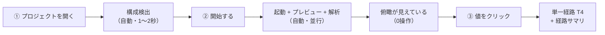

# Visual Computing IDE — UX設計書

| 項目 | 内容 |
| --- | --- |
| フェーズ | **Phase 3: UX設計** |
| 文書バージョン | 0.1 |
| 作成日 | 2026-10-31 |
| ステータス | UX確定 / Phase 4（UIデザイン）への入力 |
| スコープ | **操作フロー・状態遷移・フィードバック・エラー時の体験の設計のみ。** UIの実装、視覚デザインの確定、技術選定、パッケージの導入は含まない |

### 関連文書

| 文書 | 本書との関係 |
| --- | --- |
| `docs/01-product-requirements.md` | 要件ID（FR / OBS / INS / NFR / UI）・UC-01〜14・観測性 L0〜L3 の出典 |
| `docs/01b-feasibility-review.md` | Q-01〜Q-05。本書が前提とする確定事項5点と、未解決リスク UR-01〜07 |
| `docs/01c-mvp-priorities.md` | A / B / C 分類。本書は **A群だけで成立する操作体験**を設計する |
| `docs/02-information-architecture.md` | 情報分類・4面同期・段階的開示・情報量制御・変更案8件 |
| `docs/02a-object-model.md` | `LineagePath` / `LineageHop` / `SelectionFailure` / `NodeStatus` / `LinkStatus` |
| `docs/02b-navigation-structure.md` | 3モード・N0〜N5 の階層・モード間の引き継ぎ規則 |
| `docs/02c-screen-inventory.md` | S-01〜S-13 と F-1〜F-5 |
| `docs/02d-observability-information-model.md` | 観測性の付与単位・最弱環・A段階の表示仕様 |
| **`docs/03a-user-flows.md`** | **UX-01〜UX-07 の操作フロー詳細（本書の中核の付属文書）** |
| **`docs/03b-interaction-model.md`** | 選択・同期・開示・フォーカス・キーボード・フィードバックの規約 |
| **`docs/03c-state-transitions.md`** | 状態の3軸定義と状態遷移図 |
| **`docs/03d-error-and-empty-states.md`** | 追跡不能・空・エラー状態の提示内容と次の行動 |
| `docs/design-references/` | 概念画像。**情報設計と操作の示唆のみを抽出し、見た目は模写しない** |

### 本書の構成

| 章 | 内容 |
| --- | --- |
| 0 | 本書のスコープと、本書が決めないこと |
| 1 | **最初に確定する事項**（IA変更案 #2 / #3 / #5 の採用と整合性確認、#4 の条件付き採用と安全策） |
| 2 | UX原則10項目の、設計規則への翻訳（UXR-01〜UXR-30） |
| 3 | **中核体験 UC-01 の設計**（操作数の最小化、T4直行、経路サマリ） |
| 4 | 表示語彙（L0〜L3 を専門用語なしで区別させる言い換えと定型文） |
| 5 | 情報量の制御（閾値を検証対象として扱う） |
| 6 | モードと文脈の維持 |
| 7 | レビュー結果（6観点） |
| 8 | IAへの変更提案（Phase 3 発） |
| 9 | 未決定事項 |
| 10 | Phase 4 への進行判定と申し送り |

---

## 0. 本書のスコープ

### 0.1 本書が決めること

| # | 決めること |
| --- | --- |
| 1 | ユーザーが何を、どの順で操作するか（UX-01〜UX-07） |
| 2 | 各操作に対してシステムが何を返すか（内容・時間・順序） |
| 3 | 選択状態・開示状態・データ状態がどう変化するか |
| 4 | 取得できなかったときに何を表示し、次に何ができるか |
| 5 | 画面上に出す**文言の設計**（専門用語の言い換え、定型文、禁止表現） |

### 0.2 本書が決めないこと（Phase 4 以降）

| # | 決めないこと | 理由 |
| --- | --- | --- |
| 1 | 色の具体値、線幅、アイコンの形 | 視覚デザインの領域。本書は「色以外でも識別できること」を規約として要求するに留める (NFR-30) |
| 2 | レイアウトの寸法、余白の実数 | 同上 |
| 3 | フレームワーク・ライブラリ・配布形態 | 技術選定は本フェーズの対象外 |
| 4 | アニメーションの詳細な曲線・時間の実数 | 本書は「遅延の上限」と「動かしてよい対象」のみ規定する |
| 5 | 文言の最終的な日本語表記ゆれの統一（用語集の完成） | 本書は中核体験で実際に使う語のみ確定する（第4章）。全体の用語集は Phase 4 と並行 |

### 0.3 本書が前提とする技術的確定事項

`01b` 7.3節の5点を、UX設計上の制約として読み替える。

| # | 確定事項 | UX上の制約 |
| --- | --- | --- |
| 1 | RSC では「APIノード」が存在しない経路がある | **経路の形がページによって変わる。** 固定の7ステップを前提にした画面構成にできない。ノードが無いことを「取得失敗」と読ませない (UX-05) |
| 2 | 要素→コードの対応は開発ビルド限定、ライブラリ由来では成立しない | **クリックしても何も起きない、が起きうる。** 無反応を禁止し、理由を返す (UX-04 / E-01) |
| 3 | 順方向トレースの終端は構造的に L2 | **「完了」「成功」と読める表現を経路全体に与えてはならない。** 最弱環を常に見せる (UX-03) |
| 4 | 計装は IDE がプロセスを起動した場合のみ機能する | **起動の仕方が後の体験を決める。** 初回フローで起動元を明示し、外部起動時は制限を先に伝える (UX-01 / E-02) |
| 5 | ストリーミングSSR では処理が時間的に重なる | A段階は時間の面を持たないため、**所要時間の合計に注記を必須とする**（IA変更案 #7 相当） |

---

## 1. 最初に確定する事項

### 1.1 IA変更案 #2・#3・#5 を採用した場合の整合性確認

> 指示により **#2・#3・#5 は採用済みの前提**で本書を設計する。採用によって UX 設計に生じる要請と、既存文書との矛盾の有無を確認する。

#### #2 プレビューを第4の射影軸として追加し、FR-21 を「射影面間の同期」と定義し直す

| 確認項目 | 結果 |
| --- | --- |
| A段階で同期する面 | **F-2 現物（プレビュー） ↔ F-3 空間（フロー図） ↔ F-4 内容（詳細パネル）の3面**。F-5 時間（タイムライン）は B群 |
| UX への要請 | 要素選択は3面同時に反映されなければならない。**プレビューだけが更新されてフロー図が前の選択のままになる中間状態を作らない**（`03b` 2.4節で「同期の原子性」として規定） |
| 既存文書との矛盾 | **無い。** `02c` S-04 の面構成（F-1〜F-5）が既に4軸前提で書かれている |
| 新たに必要になった設計 | **プレビュー側に IDE の記号を描き込まない**という `02` 5.1節の制約のもとで、どう選択を示すか。→ 選択枠と、プレビュー外縁（アプリの描画領域の外側）のステップバッジのみを許可 (`03b` 2.3節) |
| A群の完成判定への影響 | FR-21 が FR-43（B群）に依存しなくなり、**A群だけで FR-21 を達成できる**。`01c` 1.3節の達成条件2が判定可能になる |

#### #3 OBS-03a を A群に追加（A段階では確度ラベルを表示せず、根拠の種別と件数のみを提示する）

| 確認項目 | 結果 |
| --- | --- |
| UX への要請 | 画面上に **「確度: 高 / 中 / 低」「信頼度 ○%」「スコア」を一切出さない**。これを禁止表現として明文化する (UXR-12) |
| 派生して生じた論点 | 「12 か所が実測、2 か所が推定」という**件数表示が、割合（86%）として読まれうる**。件数は確度ではない |
| 本書での対処 | 件数を単独で出さず、**必ず最弱環の原則を述べる一文と同じ塊に置く**。文面を固定する（第4.4節）:<br>「N か所のうち M か所が推定です。経路全体は、いちばん弱いところに合わせて『推定』になります。」<br>**N / M は経路から算出する導出値であり、定数ではない**（`02d` 2.3節）。正準トレースでは N=14 / M=2 |
| 既存文書との矛盾 | **無い。** `02d` 3.2 / 3.3節の A群最小仕様をそのまま文言に落としている |
| A群の完成判定への影響 | `01c` M2 達成条件3・4 が、確度ラベル無しで判定できる |

#### #5 `not-instrumented` を OBS-06 の第5の状態として追加

| 確認項目 | 結果 |
| --- | --- |
| UX への要請 | 「SQLが0件」と「SQLを観測できなかった」を**別の見た目・別の文言・別の次操作**にする |
| 本書での対処 | `03d` の状態カード E-02 として独立定義。次操作は **「IDEから起動し直す」** の1つに固定 (INS-08) |
| 波及 | グローバルバーの計装インジケータは、`無効`と`適用不可（外部起動）`を区別して表示する。前者は設定の問題、後者は起動の仕方の問題であり、ユーザーが取る行動が違う |
| 既存文書との矛盾 | **無い。** `02a` 4.1節が既に8値で定義済み |

#### 3件の採用によって解消される、A群の曖昧さ

| 曖昧さ | 解消 |
| --- | --- |
| A群だけで3面同期が成立するか | #2 により成立する |
| A群で確度をどう見せるか | #3 により「見せない。根拠の件数で代替する」に確定 |
| 計装が無いページで「DBアクセスが無い」と誤読されないか | #5 により状態として区別される |

### 1.2 IA変更案 #4 の条件付き採用

> **#4 の原案**: 「A段階は、テーブルのデータプレビューを既定で値を表示せず、明示操作で N 行のみ」と読み替える補足を FR-51 に追加する。
> **指示**: #4 は条件付き採用とし、**実DBの値を明示操作で表示する場合にも個人情報を不用意に露出しない安全策**を設計する。

#### 1.2.1 なぜ「既定で非表示」だけでは足りないか

| # | 原案の限界 |
| --- | --- |
| 1 | **明示操作の後が無防備である。** 「明示操作で N 行」を認めた瞬間、A段階（PII 推定 NFR-26 が無い段階）では、その N 行に何が含まれるかを IDE は知らない |
| 2 | **UC-01 が必要としているのは「行」ではなく「1つの値」である。** 「千葉県はどこから来たか」に答えるために、他人の氏名やメールアドレスを含む行全体を開く必要はない。原案は露出面積が過大である |
| 3 | **開示したことがユーザーの視界から消える。** 画面共有・スクリーンショット・録画の最中に開いたまま忘れると、意図せず流出する |
| 4 | **「マスクされていない＝安全」と読まれる。** A段階に PII 判定が無いことが伝わらないと、ユーザーは IDE が守ってくれていると誤解する（OBS-05 の精神に反する） |

#### 1.2.2 採用の条件 — 安全策 SG-01〜SG-10

> **採用条件: 下表の SG-01〜SG-06 を A群の必須要件として同時に実装する場合に限り、#4 を採用する。** SG-07〜SG-10 は B群で追加する。

| ID | 安全策 | 区分 | 根拠要件 |
| --- | --- | --- | --- |
| **SG-01** | **開示の既定単位を「1セル」とする。** 経路の終端で実値を見るとき、開くのは**選択中のカラムの1値のみ**。行全体・列全体・「全て表示」を提供しない | **A** | NFR-20, `02` 7.4 |
| **SG-02** | **経路に紐づく行だけを対象にする。** 実値は「いま追っているトレースで実際に読まれた行」から取る。特定できない場合、**無関係な行サンプルで代用しない**（「この経路に対応する行を特定できません」と表示して終える） | **A** | OBS-05 |
| **SG-03** | **規則で判定できる遮断を、開示操作より前に適用する。** ①既知のキー名（`password` / `token` / `secret` / `authorization` / `cookie` / `api[_-]?key` 等）②値の形状（メール形式・電話番号形式・カード番号形式・長い乱数列）。該当した値は**開示操作があっても出さない**。これは推定ではなく規則であり、A段階で成立する | **A** | NFR-20 |
| **SG-04** | **「判定していないこと」を明示する。** 開示前の一文を固定する:<br>**「実際のデータを表示します。このIDEは個人情報かどうかを判定していません。内容をご自身で確認してください。」**<br>マスクされていないことを安全の証拠として表示しない | **A** | OBS-05, NFR-26（不在の明示） |
| **SG-05** | **開示していることを常時可視化する。** 開示中は N0 グローバルバーに「実データ表示中 N 件 ／ [すべて隠す]」を出す。1操作で全部閉じられる。パネルを閉じる・ページを移動する・モードを変える・プロジェクトを切り替える、のいずれでも**自動で閉じる** | **A** | NFR-20, NFR-28 |
| **SG-06** | **開示を記録する。** 時刻・対象（テーブル.カラム）・操作者を監査ログに残す。**値そのものはログに書かない** | **A** | **NFR-28** |
| **SG-07** | **長い値を切り詰める。** 64文字を超える値は先頭のみ + 文字数を表示し、全文は追加の1操作とする | B | NFR-20 |
| **SG-08** | PII 推定 (NFR-26) 導入後は、推定該当カラムを**開示操作の前段で件数提示**する | B | NFR-26 |
| **SG-09** | 書き出し・共有・AIへの送信では、**開示状態を引き継がず常にマスクする** | B / C | NFR-22, NFR-25 |
| **SG-10** | テーブル単位の N 行プレビュー（原案の形）は、**PII 推定が入る B段階で初めて提供する** | B | NFR-26 |

#### 1.2.3 条件付き採用の結論

| 項目 | 内容 |
| --- | --- |
| **採用の形** | FR-51 の A段階の読み替えを **「既定で値を表示せず、明示操作で**1セルずつ**開く。行単位・列単位の開示は B段階」** とする（原案の「N 行」を「1セル」に狭める） |
| **変更点** | 原案より**狭く**なる。IA の第7.3節の表（「明示操作でのみ、N 行（既定5行）に限って開く」）を 1セル に改める必要がある → **IA変更案 P3-01**（第8章） |
| **UC-01 への影響** | **無い。** UC-01 が必要とするのは終端カラムの1値であり、1セル開示で完全に満たされる（`03a` UX-02 ステップ⑦） |
| **UC-04 / データモードへの影響** | S-06 テーブル詳細で「5行プレビュー」が A群から外れる。代わりに **「このテーブルに対して実際に発行されたSQL」（L1・既に A群）** が、テーブルが使われているかを知る手段として残る。実用上の欠落は限定的 |
| **却下した場合** | `02` 12.4節の「進行してはならない条件1」に該当する。SG-01〜06 を伴わない #4 の却下は、**A段階で個人情報が無防備に露出する構成**を意味するため、その状態で Phase 4 へ進んではならない |

---

## 2. UX原則10項目の、設計規則への翻訳

> 原則は判断基準であって仕様ではない。各原則を**検証可能な規則 (UXR)** に翻訳する。全ての規則は、どの画面・どのフローにも適用される横断規約である。

### 原則1. ユーザーが考えずに操作できる

| ID | 規則 | 検証方法 |
| --- | --- | --- |
| **UXR-01** | **中核体験の開始に、専門用語の理解を要求しない。** 最初の価値（経路の表示）に到達するまでに、ユーザーが意味を知らなければならない語を **0個** にする | UX-01 の全画面の文言を走査し、初出の専門用語が無いことを確認する |
| **UXR-02** | **既定値で前に進める。** ページ・スクリプト・接続のいずれも、選択肢が1つなら自動で選ぶ。複数なら最も確からしいものを既定にし、変更を1操作で可能にする | UX-01 の操作数が3以下 |
| **UXR-03** | **同じ目的の操作を1つに束ねる。** 「起動する」と「プレビューを開く」を別操作にしない | 第3.2節の操作数計測 |

### 原則2. 全体像を最初に理解できる

| ID | 規則 | 検証方法 |
| --- | --- | --- |
| **UXR-04** | **ページを開いた時点で、0操作で俯瞰が出ている。** 要素を選ぶ前に「このページの表示で何が起きたか」が見えている | UX-01 ステップ5の既定表示 |
| **UXR-05** | **俯瞰は、わからないことも含めて全体像である。** 計装が無い・DBに繋がっていない等の欠落は、俯瞰の時点で見えていなければならない | 第5.3節の俯瞰サマリの必須項目 |

### 原則3. 選択した対象が常に分かる

| ID | 規則 | 検証方法 |
| --- | --- | --- |
| **UXR-06** | **選択は常に1つ。** 同時に2つ選択された状態を作らない (`02a` 5章 `SelectionTarget`) | `03b` 2.1節 |
| **UXR-07** | **選択を表現できない面を空白にしない。** 「この面には対応する表示がありません」+ 理由を出す | `03d` 第5章（空状態） |
| **UXR-08** | **ホバーは選択ではない。** ホバー表示は1行要約までとし、ホバーで詳細パネルを書き換えない | `03b` 2.2節 |

### 原則4. 画面が変わっても文脈を失わない

| ID | 規則 | 検証方法 |
| --- | --- | --- |
| **UXR-09** | **モードをまたいだ遷移には、必ず戻り導線を伴わせる。** 「どこから来たか」を1行で示し、1操作で戻れる | `03a` UX-07 |
| **UXR-10** | **戻ると、出発時の選択・開示段階・スコープが復元される。** 復元できない項目がある場合は、何が復元できなかったかを示す | `03c` 6章 |

### 原則5. 重要な情報ほど少ない操作で到達できる

| ID | 規則 | 検証方法 |
| --- | --- | --- |
| **UXR-11** | **到達操作数の上限を定める。** ①経路の表示 = プレビュー上1操作 ②最弱環の説明 = 経路表示から1操作 ③終端カラムの定義 = 経路表示から1操作 ④実値 = 経路表示から2操作（1つは安全のための明示操作） | 第3.3節の操作数表 |

### 原則6. 取得できない情報を成功したように見せない

| ID | 規則 | 検証方法 |
| --- | --- | --- |
| **UXR-12** | **禁止表現リストを設ける。** A段階で画面に出してはならない語: 「確度: 高/中/低」「信頼度 N%」「完全」「すべての〜」「検証済み」「正確に特定しました」。また、経路全体に対する「成功」「完了」のチェック記号 | 第4.5節 |
| **UXR-13** | **経路の長さ・ノードの少なさを、確からしさの表現に使わない。** 短い経路に、長い経路より肯定的な記号・色・語を与えない（第4.6節） | UX-05 のレビュー |
| **UXR-14** | **切断は「描かない」ではなく「切断として描く」。** 線の不在は「関係が無い」と読まれる | `03d` 第3章 |
| **UXR-15** | **集約・省略・打ち切りは、必ず件数を伴う。** 「N 件を畳んでいます」「N 件は描画していません」 | 第5章 |

### 原則7. エラー時に原因と次の行動が分かる

| ID | 規則 | 検証方法 |
| --- | --- | --- |
| **UXR-16** | **状態カードの4要素を必須とする。** ①何が起きたか（事実）②なぜか（理由。不明なら「理由を特定できません」）③この結果わからないこと（影響）④次にできること（0〜2個） | `03d` 第1章 |
| **UXR-17** | **次の操作は最大2つ。** 3つ以上提示する状態は、原因の切り分けが足りていない | `03d` の全カード |
| **UXR-18** | **理由を推測で埋めない。** 「おそらく〜」をシステムの断定文として出さない | 同上 |

### 原則8. 実測と推論を混同しない

| ID | 規則 | 検証方法 |
| --- | --- | --- |
| **UXR-19** | **段階0の区別は二値（実測 / 推定）に限る。** L0〜L3 の4値バッジを常時表示しない (`02d` 4.2) | `03b` 5章 |
| **UXR-20** | **1つの経路に単一の確からしさを与えない。** ホップごとに線種を持つ (`02d` 3.4 A段階の線分モデル) | `03b` 3.3節 |
| **UXR-21** | **「L0」「L1」「L2」「L3」の記号そのものは、段階3（根拠タブ）より前に出さない。** 段階0〜2 は言い換え語を使う（第4.2節） | 第4章 |
| **UXR-22** | **降格（本来実測できたはずが推定に落ちた）を、もともとの推定と区別して表示する。** `degradedFrom` を文言に反映する | 第4.4節 |

### 原則9. 不必要な確認ダイアログを増やさない

| ID | 規則 | 検証方法 |
| --- | --- | --- |
| **UXR-23** | **A群でモーダルの確認ダイアログを 0 にする。** 起動・停止・ページ切替・スコープ変更・モード切替・再解析はすべて確認なしで実行する | 第3.4節 |
| **UXR-24** | **安全上の明示操作は、ダイアログではなくインラインの1操作で行う。** 実データ開示は、その場に説明文と[表示する]を出す（SG-04） | 1.2.2節 |
| **UXR-25** | **取り消せる操作には確認を付けない。取り消せない操作は A群に存在しない。** 存在するようになった時点（C群の削除・デプロイ）で二段階確認を導入する (NFR-23) | — |

### 原則10. 情報を重複表示しない

| ID | 規則 | 検証方法 |
| --- | --- | --- |
| **UXR-26** | **面は自分の軸の情報だけを持つ。** フロー図に属性値を置かない。詳細パネルに全体の形を置かない (`02` 5.1) | `03b` 3章 |
| **UXR-27** | **文脈帯は、現在のモードが選択対象を表現できないときにのみ出す。** 探索モードで詳細パネルが開いているときは出さない（重複になるため） | 第6.2節 |
| **UXR-28** | **同じ事実を2か所で言わない。** 「推定である」ことは、経路サマリ（1回）と該当ホップの線種（記号）で足り、各ステップ行に文章で繰り返さない | 第3.5節 |

### 本書が追加する横断規則

| ID | 規則 | 理由 |
| --- | --- | --- |
| **UXR-29** | **「ユーザーが要求した結果の到着」は自動で反映する。「背景で変わった事実」は通知して手動で切り替えさせる。** 前者は待っている状態であり自動反映が自然。後者は読んでいる最中に内容が入れ替わる事故になる (`02` 5.5節) | 2種類の更新を1つの規則で扱うと、どちらかが不自然になる |
| **UXR-30** | **進行中（pending）を、データ無し（no-data）としても、取得失敗（error）としても描かない。** 3者は別の見た目を持つ | 最も頻出する誤読。`03c` 第2章で3軸に分離した理由 |

---

## 3. 中核体験 UC-01 の設計

> **本章が本書の中心である。** 他の全ての設計は、ここで定めた体験を壊さない範囲で決まる。

### 3.1 設計の出発点

UC-01 の問いは1つである。

> **「画面に出ているこの値は、どこから来たのか。そしてそれはどこまで確かなのか。」**

この問いに答えるために、ユーザーに次のことを要求してはならない。

| 要求してはならないこと | 理由 |
| --- | --- |
| トレースを選ぶこと | 「どのトレースか」はユーザーの関心ではない。クリックした値に対応するトレースはシステムが決められる |
| スコープを設定すること | 同上。要素を選んだ時点でスコープは「その1本の経路」に定まる |
| モードを切り替えること | 探索モードから出ずに完結する |
| 観測性の用語を学ぶこと | 第4章の言い換えで解消する |
| 経路が表示される前に、何かを確認すること | UXR-23 |

### 3.2 操作数 — 初回起動から最初の経路まで

`02b` 6章は「プロジェクトを開く → 起動 → ページ選択 → 要素クリック = 4操作」としている。本書はこれを **3操作** に短縮する。

| # | 操作 | システムの反応 | 短縮の方法 |
| --- | --- | --- | --- |
| 1 | **プロジェクトを開く**（フォルダ選択、または最近開いた一覧から1クリック） | 構成検出が走り、S-02 プロジェクト概要に「何が分かり、何が分からないか」と、**単一の次操作ボタン**が出る | — |
| 2 | **「開始する」** | ①スクリプトを起動 ②プレビューを既定ページで開く ③静的解析を並行実行 ④計装状態を確定 — を**1操作に束ねる**。完了すると探索モードに入り、俯瞰が表示されている | **起動・ページ選択・プレビュー表示の3操作を1つに統合**（UXR-03 / UXR-02） |
| 3 | **プレビュー上の値をクリック** | **T4（単一経路）に直行**。フロー図が1本の経路に、詳細パネルが経路サマリ + 番号付きリストに切り替わる | **T1→T2→T3 の降下を課さない**（`02` 8.1節の要請） |



#### 「開始する」が束ねてよい理由と、束ねてはいけない境界

| 項目 | 判断 |
| --- | --- |
| プロセスの起動を確認なしで行ってよいか | **よい。** ボタンの名前が行為を表しており（「開始する」＋直下に `npm run dev` を表示）、取り消せる（停止できる）。UXR-23 / UXR-25 |
| スクリプトが複数あるときは | **既定を1つ選び、ボタンの直下に表示する。** 変更は1操作（プルダウン）。確認ダイアログにしない |
| ページが複数あるときは | **既定ページを1つ選ぶ**（ルート `/` があればそれ、無ければ最初の静的ルート）。切替は左パネルで1操作 |
| 外部で既にサーバーが起動している場合は | **束ねない。** 「外部で起動中のサーバーが見つかりました」を提示し、**[IDEから起動し直す（推奨）] / [そのまま接続する]** の2択を1画面で示す。計装の有無が後の体験を根本的に変えるため、ここだけは選択をユーザーに返す（E-02 / INS-08） |

### 3.3 到達操作数の上限（UXR-11 の実体）

| 到達したい情報 | 操作数 | 経路 |
| --- | --- | --- |
| この値の出所（テーブル.カラム名） | **0**（経路表示と同時に、経路サマリの最上段に出ている） | — |
| 経路全体が実測か推定か | **0**（同上） |
| **いちばん弱い箇所がどこで、なぜ弱いか** | **1**（経路サマリの ★ ブロックに最初から文章で出ている。[ここを見る]で該当ホップへ移動するのが1操作） | UXR-11 ② |
| 各ステップの概要 | **1**（番号付きリストの行をクリック） |
| 実行されたSQLの全文 | **2**（ステップ⑤ → 生データタブ） |
| 終端カラムの型・制約 | **1**（経路サマリのカラム名をクリック） |
| **終端カラムの実値** | **2**（カラム → [実際の値を表示する]。SG-04 の説明文を伴う） |
| 根拠の全件 | **2**（ホップ → 根拠タブ） |
| コードの該当箇所 | B群（FR-24） |

### 3.4 A群における確認ダイアログの一覧

| 操作 | 確認 | 形式 |
| --- | --- | --- |
| プロジェクトを開く / 切り替える | **なし** | — |
| 起動 / 停止 / 再起動 | **なし** | — |
| ページ切替 / 要素選択 / スコープ変更 / モード切替 | **なし** | — |
| 再解析 | **なし** | — |
| **実データ（1セル）の表示** | **あり（ただしモーダルではない）** | その場に SG-04 の一文と [表示する]。セッション内2回目以降は一文を省略し、ボタンのみ |
| 秘密情報のマスク解除 | **あり（同上）** | 1項目ずつ。[表示する]（`02` 7.4） |

> **A群のモーダルダイアログは 0 である。** 安全のための明示操作は、文脈を離れないインライン操作として設計する（UXR-24）。

### 3.5 経路サマリの設計（M2 達成条件3・4 の実体）

`02d` 4.3節が「詳細パネル最上段に置く」と規定した構造物を、文言として確定する。

```
┌────────────────────────────────────────────────┐
│ この値の出所                                    │
│                                                │
│   properties . area        ← テーブル . カラム  │
│   推定                      ← 二値の語          │
│                                                │
│   14 か所のうち 2 か所が推定です。               │
│   経路全体は、いちばん弱いところに              │
│   合わせて「推定」になります。                   │
│                                                │
│ ★ いちばん弱いところ                            │
│   ⑦→③ カラムと応答項目の対応づけ                │
│   ORMの内部変換は観測できません。               │
│   別名や加工があると成立しません。               │
│   根拠 2 件：実行されたSQLの解析 ／ 値の一致      │
│         （値の一致だけでは1つに絞れません）      │
│   [ ここを見る ]                                │
└────────────────────────────────────────────────┘
```

| 設計判断 | 内容 | 根拠 |
| --- | --- | --- |
| 主張を最初に出す | ユーザーの問い（どこから来たか）への答えを最初の2行に置く | 原則5 |
| 「推定」を主張のすぐ下に置く | 主張と確からしさを離すと、主張だけが記憶される | OBS-10, 原則6 |
| 件数のあとに最弱環の原則を1文で添える | 件数が割合として読まれることを防ぐ（1.1節 #3） | UXR-12 |
| 弱点の説明を**最初から展開しておく** | 「なぜ推定か」を1操作先に置くと、大半のユーザーが読まない。原則5 の「重要な情報ほど少ない操作で」の適用 | OBS-11, UXR-11 |
| 根拠は件数と種別のみ | 確度ラベルを出さない（IA変更案 #3） | NFR-17 |
| [ここを見る] は移動であって開示ではない | 押すとフロー図の該当ホップが選択され、番号付きリストがその行までスクロールする。新しい情報は出ない | UXR-28 |
| **件数は導出値である** | 「14 か所のうち 2 か所」の数値は `LineagePath` から算出する。文言のテンプレートだけを固定し、**数値を定数として持たない**。正準トレースでの値は 14 / 2（`02d` 2.3節） | OBS-10 |
| **★ブロックは独立した塊にする** | 主張ブロックと ★ブロックを別の要素に分け、**★ブロックごと取り除いてもレイアウトが崩れないようにする**。`static-literal`（推定なし）と `not-traced`（全体が推定）では ★ブロックが存在しない | 第3.6節 / 10.4 申し送り1 |
| 経路が `complete` でも「完了」と書かない | 終端が構造的に L2 であるため (`01b` Q-04.0) | UXR-12 |

### 3.6 経路種別ごとの経路サマリの差分

| 経路種別 | 主張の文面 | 最弱環 | ★ブロック |
| --- | --- | --- | --- |
| `client-fetch` | 「properties.area（推定）」 | `maps`（同率の `derives` より下流） | あり（1つ） |
| `rsc-direct` | 同じ | `maps` | あり（1つ） |
| `server-action` | 同じ + 「この通信はフォーム送信（Server Action）です。URLは処理の名前を表しません」 | `maps` / ラベルの曖昧さ | あり（1つ） |
| `static-literal` | 「**コードに直接書かれています**（データベース由来ではありません）」 | **なし** | **なし** |
| `external-source` | 「外部サービスから来ています。**この先は観測できません**」 | 外部境界 | あり（1つ） |
| `not-traced` | 「**実行していないため、コードから推定した経路です**。実際の値は表示できません」 | **経路全体**（1箇所に絞れない） | **なし** |

> **ステップ数を経路種別の比較軸として画面に出さない。** 上表は設計上の整理であり、UI では経路種別ごとのステップ数を並べて見せない（UXR-13 / 第4.6節）。経路サマリに表示される件数は、**その経路の中での実測と推定の内訳**であって、経路種別間の比較値ではない。

> **`static-literal` と `not-traced` では、経路サマリの構成そのものが変わる。** 前者は ★ ブロックが不要（推定が存在しない）、後者は ★ が1箇所に絞れない（全体が推定）。**「★ が常にある」ことを前提にしたレイアウトにしてはならない**（Phase 4 への申し送り）。

---

## 4. 表示語彙 — 専門用語を覚えなくても区別できるようにする

### 4.1 設計方針

| 方針 | 内容 |
| --- | --- |
| **構造を分岐させない** | 非エンジニア向けに別の画面・別のモードを作らない (`02b` 7章)。**同じ構造に別のラベル層を重ねる** |
| **記号（L0〜L3）を主役にしない** | 段階0〜2 では言い換え語を使い、記号は段階3の根拠タブでのみ併記する (UXR-21) |
| **二値で始めて、必要な人だけ深く行く** | 常時見えるのは「実測 / 推定」の二値。その内訳は要求されたときに出す |

### 4.2 観測性レベルの表示語彙

| 内部の値 | 段階0〜1 の語 | 段階2 の語 | 段階3（根拠タブ）の表記 | 線 |
| --- | --- | --- | --- | --- |
| **L0** | **実測** | 実測（直接見た） | `L0 実測` + 取得手段 | 実線 |
| **L1** | **実測** | 実測（計装で見た） | `L1 計装による実測` + 取得手段 | 実線 + 計装の印 |
| **L1相当** | **実測** | 実測（実行されたSQLの解析） | `L1相当` + 「解析の対象は実測されたSQL文です」 | 実線 |
| **L2** | **推定** | 推定（コードから推測） | `L2 静的解析による推論` + 根拠一覧 | 破線 |
| **L3** | **説明用の図** | 説明用の図（計測ではありません） | `L3 図式的表現` | 低彩度破線・値なし |

> **「実測」と「推定」の2語だけが常時画面に出る。** 他は要求に応じて現れる。これが Q-08（どこまで明示するか）への UX からの回答である。

### 4.3 関係種別の平易な言い換え

ステップ間の線を説明するときの表現。専門用語（`renders` / `derives` / `maps`）は画面に出さない。

| 内部の関係種別 | 画面上の表現 | 既定 |
| --- | --- | --- |
| `renders` | 「この要素を描いたコンポーネント」 | 実測 |
| `binds` | 「コード上で、この位置に入る値」 | 推定 |
| `derives` | 「応答のどの項目が、この値になったか」 | **推定** |
| `requests` | 「ブラウザが送った通信」 | 実測 |
| `handles` | 「その通信を受けたサーバーの処理」 | 実測 |
| `invokes` | 「サーバー内部での呼び出し」 | 実測 |
| `executes` | 「その処理が実行したSQL」 | 実測 |
| `reads` | 「そのSQLが読んだテーブル」 | 実測 |
| `projects` | 「そのSQLが取り出した列」 | 実測 / 推定 |
| `maps` | 「カラムと応答項目の対応づけ」 | **推定** |

### 4.4 「なぜ推定なのか」の定型文（UX-03 の中核）

> **最弱環を選択したとき、なぜその関係が推論なのかが分かる**という要請への回答。関係種別ごとに**固定文**を持たせ、毎回同じ説明が出るようにする。文面を可変にすると、ユーザーは同じ説明を読み直すことになる。

| 関係種別 | 何が推定か | なぜ観測できないか | どういうとき成立しないか |
| --- | --- | --- | --- |
| `binds` | 「コードの上では、この位置に `props.area` が表示されると読めます」 | 「コードの形から読み取っただけで、実際にその値が入ったことは観測していません」 | 「同じ位置に別の値が入る条件分岐があると成立しません」 |
| `derives` | 「応答の `properties[0].area` が、この `props.area` になったと推定しています」 | 「応答を受け取ってから画面に渡るまでの加工は観測できません」 | 「途中で計算・連結・条件分岐・名前の付け替えがあると成立しません」 |
| `maps` | 「カラム `area` と、応答の項目 `area` が対応すると推定しています」 | 「ORMの内部変換は外から観測できません」 | 「別名（`@map`）・計算列・結合があると成立しません」 |
| `projects`（`SELECT *`） | 「このSQLは列を明示していません（`SELECT *`）」 | 「どの列が実際に使われたかは、SQL文からは決まりません」 | 「結果の列名は分かりますが、表示に使われた列は特定できません」 |
| `renders`（降格時） | 「画面の要素とコードの対応を、コードの形から推定しています」 | 「**本来はビルド時に付けた印で確認できますが、この要素には印がありませんでした**」 | 「同じ見た目の要素が複数あると取り違える可能性があります」 |
| `handles`（降格時） | 「ブラウザの通信とサーバーの処理を、時刻の近さで結び付けています」 | 「**本来は同じIDで確認できますが、IDを引き継げませんでした**」 | 「同時に複数のリクエストがあると取り違える可能性があります」 |

> **降格（`degradedFrom` が入っている）場合は、文面に「本来は〜できますが」を含める** (UXR-22)。もともと推定の `derives` / `maps` と、失敗して推定に落ちた `renders` / `handles` では、ユーザーが取るべき行動が違う。後者は再試行・設定変更で改善しうる。

### 4.5 禁止表現（UXR-12 の実体）

| 禁止 | 理由 | 代わりに |
| --- | --- | --- |
| 「確度: 高 / 中 / 低」「信頼度 92%」 | A段階では較正されていない (NFR-17) | 「推定」+ 根拠の種別と件数 |
| 「完全に特定しました」「正確に」 | 終端は構造的に L2 | 「推定しています」 |
| 経路全体への ✓ / 「成功」/ 「完了」 | 同上 | 状態は `complete`（打ち切られていない）という事実のみ、記号を使わず表示 |
| 「すべての利用箇所」「全 N 件」 | 網羅性を保証できない (OBS-07) | 「検出できた N 件」 |
| 「データはありません」（取得できなかった場合） | `no-data` と取得失敗の混同 | 状態ごとの文言（`03d` 第2章） |
| 「エラーが発生しました」のみ | 次の行動が分からない | 4要素の状態カード（UXR-16） |
| 「おそらく〜」「〜と思われます」 | 推測をシステムの断定として出す | 「推定しています」+ 根拠、または「特定できません」 |

### 4.6 経路の長さを確からしさの表現に使わない（UXR-13 の根拠）

> `02` 4.2節 / `02a` 3.5.2節は、`rsc-direct` について「`derives` が無い分、経路が短く確度は相対的に高い」と記述していた。**UX としては、この記述を根拠に `rsc-direct` を肯定的に表示してはならない。**
>
> **2026-11-01 追記（M1 の決定 H）: 引用元の記述そのものが削除された。**
> PoC-02 / PoC-04 の実測により支持されなかったためである（`02a` 3.5.2節）。
> 本節の結論は変わらない。**経路種別の間に確度の順序は無く、経路の長さを確からしさの表現に使わない。**
> 本節は、仕様側の記述が消えた後も UX 側で守るべき規約として残す。

| # | 理由 |
| --- | --- |
| 1 | **経路の確度は最弱環で決まる** (OBS-10)。`rsc-direct` にも `maps` が残るため、**経路全体は `client-fetch` と同じく「推定」**である。推論ホップが1つ減っても、最弱環の値は変わらない |
| 2 | **ホップ数の減少は、観測の成功を意味しない。** `rsc-direct` では、RSC の計装が部分的に失敗した場合に `invokes` / `executes` が取れず、`not-instrumented` に落ちる経路がありうる (`01b` Q-02.5 代替1)。この場合は**むしろ確度が低い**。短さと確かさは独立である |
| 3 | **`binds` は両方の経路に残る。** `derives` が無いことは、`binds`（コード上の束縛の推定）が無いことを意味しない |
| 4 | **較正されていない。** `rsc-direct` と `client-fetch` の実際の正解率が異なるという仮説は、PoC-04 でのみ検証できる (`02d` 第7章)。検証前に UI で優劣を示すことは NFR-17 の精神に反する |

| UX上の規則 | 内容 |
| --- | --- |
| **経路種別によって肯定的な記号・色・語を変えない** | `rsc-direct` に ✓ や緑を与えない |
| **ノード数・ステップ数を目立たせない** | ステップ数は番号の最大値として自然に見えるが、「7ステップ」のような要約数値を主役に置かない |
| **「APIがありません」を欠落として書かない** | 第4.7節 |
| **IAの当該記述に注記を提案する** | IA変更案 **P3-02**（第8章） |

### 4.7 「APIが無い」ことの表現（UX-05 の中核規則）

| 禁止 | 採用 |
| --- | --- |
| 架空のAPIノードを置く | 置かない |
| 「APIリクエスト: なし」という**空のステップ行**を置く | 置かない。**ステップそのものを作らない** |
| 「API情報を取得できませんでした」 | **「このページはサーバーが直接データを取得しています（API通信はありません）」** — 構成の説明であって、失敗ではない |
| ステップ番号に欠番を作る | 作らない。存在するステップだけで連番を振る (`02` 5.3) |

---

## 5. 情報量の制御 — 閾値を検証対象として扱う

### 5.1 既存の閾値の扱い

> `02` 8.2節 / NFR-02 / NFR-03 は「500ノード超で同種連続を自動集約」「5000ノード超で境界グループのみ」と規定している。**本書はこれを確定値として採用せず、暫定の初期値かつ検証対象として扱う。**

| # | 無条件採用できない理由 |
| --- | --- |
| 1 | **UR-07（実プロジェクト規模での可読性）が未検証**である (`01b` 7.5節)。閾値の根拠となる実測が存在しない |
| 2 | **ノード数は可読性の代理指標として弱い。** 同じ500ノードでも、境界グループが4つの図と40の図では読みやすさが違う。**画面内の密度**と**経路の長さ**の方が効く |
| 3 | **性能の閾値と可読性の閾値が混同されている。** 500 / 5000 は NFR-01〜03（描画性能）の数値であり、人間が読めるかどうかの数値ではない |

### 5.2 一次基準を「可読性予算」に置き換える

| ID | 予算 | 目標値（暫定） | 由来 |
| --- | --- | --- | --- |
| **B-01** | 要素選択 → 経路表示 | **500ms 以内** | NFR-06 |
| **B-02** | ズーム・パン・選択の応答 | **50ms 以内 / 60fps** | NFR-01 |
| **B-03** | ページ読込完了 → 俯瞰の初期描画 | **1.5秒以内**（暫定・検証対象） | 本書 |
| **B-04** | **同時に画面内に描くノード数** | **150 以下**（暫定・検証対象） | 本書 |
| **B-05** | 1本の経路のステップ数 | **20 以下**（超える場合は同種連続を集約） | 本書 |

> **ノード数の閾値（500 / 5000）は、B-01〜B-05 を満たせなくなったときに段を上げるための「目安」として残す。一次基準は予算であり、閾値ではない。**

### 5.3 集約の段（削除を含まない）

| 段 | 条件 | 表示 | 必ず伴う表示 |
| --- | --- | --- | --- |
| **段0** | 予算内 | そのまま | — |
| **段1** | B-04 または B-05 を超過 | 同種連続を畳む（`SQL × 12`） | 「12 件を畳んでいます」+ 内包の最弱レベル（`02d` 2.4） |
| **段2** | 段1でも超過 | 境界グループ（ブラウザ / サーバー / DB / 外部）単位に畳む | 各グループの内包件数と最弱レベル |
| **段3** | 段2でも超過 | グループを1ノードに畳む | **「N 件を1つにまとめて表示しています」**。削除・非描画は行わない |

> **いかなる段でも「描かずに黙って消す」ことはしない** (UXR-15)。段3 でもノードは1つ存在し、件数が読める。

### 5.4 縮退しても最後まで残すもの

| 残すもの | 理由 |
| --- | --- |
| **切断マーカー** | 経路が途切れたことは、どの縮尺でも最重要の事実 (OBS-05) |
| **最弱環の ★** | OBS-11 は縮退の対象ではない |
| **集約の件数** | OBS-07 の原則 |
| **選択中の経路** | フォーカス中の経路は集約の対象から除外する（選択した対象が消える体験を作らない。原則3） |
| 消してよいもの | ラベルの文字列、所要時間の個別値、アイコンの装飾 |

### 5.5 UR-07 の検証計画（Phase 4 と並行）

| 項目 | 内容 |
| --- | --- |
| 題材 | 実在する中〜大規模の Next.js プロジェクト 3件（ページ数 20 / 60 / 150 程度） |
| 測定 | ①ページ読込1回あたりのスパン数・HTTP交換数の分布 ②B-01〜B-04 の実測 ③段1〜3 が発動する頻度 |
| 人による判定 | 「このページで何が起きたか、15秒で説明できるか」を被験者5名で測る |
| 判定 | B-03 / B-04 の暫定値を実測で置き換える。段の発動条件を再設定する |
| 失敗時 | 既定の俯瞰粒度を T2 から「境界グループのみ」へ引き下げる。**UC-01（T4直行）は影響を受けない**（経路1本のステップ数は B-05 で制御されるため） |

---

## 6. モードと文脈の維持

### 6.1 A群で実際に使われるモード

| モード | A群での役割 | UC-01 での関与 |
| --- | --- | --- |
| **探索** | 中核。UC-01 はここで完結する | 100% |
| **データ** | 終端カラムの定義・実値・そのテーブルに発行された実測SQLを見る | 経路サマリからの遷移先 |
| **実行** | プロセス・計装・対応範囲。**うまくいかないときに来る場所** | エラー状態からの遷移先 |
| 編集 | **A群には存在しない**（B群） | — |

### 6.2 文脈帯（Context Ribbon）

| 項目 | 内容 |
| --- | --- |
| 何か | モードタブの直下に表示される**1行**。「いま何を追っているか」と「どこから来たか」と「戻る」 |
| 文面 | 例：`追跡中: 千葉県（PropertyCard）— 経路の終端 properties.area から来ました　[経路に戻る]` |
| **いつ出るか** | ①別のモードへ遷移して来たとき ②現在のモードが選択対象を表現できないとき |
| **いつ出ないか** | **探索モードで詳細パネルが開いているとき**（詳細パネルが同じことを言っているため。UXR-27 / 原則10） |
| 消え方 | 文脈を捨てる操作（別の対象を選ぶ、プロジェクトを切り替える）で消える。時間では消えない |

### 6.3 編集モード（B群）の扱い

> **A群の操作体験と明確に区別する**という指示への回答。

| 項目 | 設計 |
| --- | --- |
| タブの表示 | **表示する。** ただしラベルを「編集」ではなく **「編集（準備中）」** とし、他タブと異なる状態で描く（押下可能だがモードに入らない） |
| 押したとき | **モード遷移しない。** その場に3行の説明を出す：「画面上での編集は、まだ提供していません。／ いま提供しているのは、値の出所をたどる機能です。／ 動的な値は、編集ではなく出所の確認から始めてください。」 |
| 非表示にしない理由 | 将来の構造を隠すと、導入後にメンタルモデルの作り直しが起きる (`02b` 2.3節の環境セレクタと同じ論拠) |
| **実装済みと誤認させない担保** | ①ラベルに「準備中」②押してもモードが変わらない③説明文に現在できることを書く — の3点を同時に満たす |
| B群で有効化したときの操作フロー | `03a` UX-07 第4節に、**将来の**フローとして記述する。A群のフローと同じ節に混ぜない |

---

## 7. レビュー結果

> 指示された6観点で、完成した設計を検査した。

### 7.1 最初の価値まで無駄な操作がないか

| 検査 | 結果 |
| --- | --- |
| 操作数 | **3操作**（`02b` の4操作から1操作短縮）。第3.2節 |
| 待ち時間に操作を止めていないか | **止めていない。** 静的解析はプレビュー表示と並行する。解析未完了の要素をクリックした場合は「構造を解析中（残り N 件）」を出し、完了後に**自動で経路を補完する**（UXR-29 の前段：ユーザーが要求した結果の到着） |
| 確認ダイアログ | **0**（第3.4節） |
| 既定で選べるものを選ばせていないか | スクリプト・ページ・接続のいずれも既定を自動選択（UXR-02） |
| **発見した問題** | 当初、S-02 プロジェクト概要を「必ず経由する画面」としていた。しかし2回目以降の起動では読む価値が無く、1操作を無駄にする。**修正**: 最近開いたプロジェクトを選んだ場合は S-02 を**経由せず**、前回のページで探索モードに入る。対応範囲に前回から変化があった場合のみ S-02 を表示する |

### 7.2 UC-01 の正常系・異常系が網羅されているか

| 系 | 網羅 |
| --- | --- |
| 正常系 | `03a` UX-02 の7ステップ。経路種別4種（`client-fetch` / `rsc-direct` / `server-action` / `static-literal`）について `03a` UX-05 で差分を定義 |
| 異常系 | `03d` に **E-01〜E-14** として定義。UC-01 の代替フロー A1〜A4 は E-06 / E-05 / E-11 / E-01 に対応 |
| 指示された7状態 | 要素特定不能=**E-01** / 未計装=**E-02** / SQL取得不可=**E-03** / DB未接続=**E-04** / 複数候補=**E-05** / 静的値=**E-06** / 未対応構成=**E-07**。**全て網羅** |
| 本書が追加した異常系 | E-08 権限不足 / E-09 プロセス停止 / E-10 計測開始前の読み込み / E-11 実測なし（静的のみ） / E-12 外部境界で打ち切り / E-13 値が加工されている / E-14 新しい実測の到着 |
| **発見した問題** | **E-10（プレビューを開く前に読み込まれていた画面の要素をクリックした場合）** が、どの既存文書にも無かった。実測が存在しないのに `not-traced`（静的のみ）と表示すると、「このプロジェクトは計装できない」と誤読される。**追加**: 「この表示は計測を始める前のものです」+ [再読み込みして計測する] の1操作 |

### 7.3 操作状態とデータ状態が混同されていないか

| 検査 | 結果 |
| --- | --- |
| 状態の軸 | `03c` 第2章で **3軸に分離**：①データ可用性（何が分かるか）②取得進行（いま取りに行っているか）③操作（選択・開示・スコープ） |
| 混同の典型 | 「読み込み中」を空状態として描く／「未選択」をデータ無しとして描く／「開示していない」を「値が無い」として描く |
| 対処 | **UXR-30** で明文化。`03d` 第2章で3者に別の表示を与えた |
| **発見した問題** | 当初、詳細パネルの「選択なし → 格納」(UI-13) と「選択はあるが表現できない → 理由を表示」(UXR-07) を同じ空パネルで扱っていた。前者は操作状態、後者はデータ状態である。**修正**: 格納（パネル自体が無い）と、理由表示（パネルはあり中身が説明文）を明確に分けた |

### 7.4 非エンジニアが将来利用できる構造か

| 検査 | 結果 |
| --- | --- |
| 専門用語の露出 | 段階0〜2 で出る観測性の語は **「実測」「推定」の2語のみ**（第4.2節）。関係種別は全て平易な日本語に言い換え済み（第4.3節） |
| モードを増やしていないか | 増やしていない。表示プロファイル（用語層の切替・生データタブの既定非表示・開示段階の既定変更）で対応 (`02b` 7章) |
| 操作の前提知識 | UX-01 の3操作に専門知識が不要（UXR-01） |
| 残る障壁 | **「推定」の意味そのもの**。初回のみ、経路サマリに1行の説明を添える：「実測＝実際に起きたことを観測できた箇所。推定＝コードの形から推測した箇所」。2回目以降は出さない |
| 限界 | 本書は P1（フルスタックエンジニア）を基準に情報密度を決めている。非エンジニア向けの検証は C群（FR-60）の着手時に行う |

### 7.5 A群だけで成立する UX になっているか

| A群に無いもの | UX が依存していないか | 確認 |
| --- | --- | --- |
| FR-17 コンポーネントツリー | 依存しない。選択の入口はプレビューのみ | UX-02 |
| FR-24 コードジャンプ | 依存しない。コード位置は**ファイル名:行番号の表示**までで、遷移はB群。「押せるのに何も起きない」を作らないため、A群では**リンクにしない** | `03b` 6.3節 |
| FR-25 スコープ切替 | 依存しない。UC-01 は選択で自動的に T4 になる | UX-06 |
| FR-43 タイムライン | 依存しない。所要時間は詳細パネル内の数値（+ 並行実行の注記） | UX-02 ステップ④ |
| FR-32/33/44/47 ログ・エラー | 依存しない。E-03 等の状態カードは計装状態から導ける | `03d` |
| OBS-03 確度ラベル | 依存しない。根拠の件数で代替（IA変更案 #3） | 第4.2節 |
| FR-26 逆方向トレース | 依存しない。データモードからの入口は「実測SQL」のみ (`02b` 3.2節) | UX-07 |
| **発見した問題** | **当初、経路サマリの「ここを見る」の遷移先にコードピーク（B群）を含めていた。** A群では存在しないため、押せるのに何も起きない導線になっていた。**修正**: A群の遷移先はフロー図のホップ選択のみ |

### 7.6 B/C群の機能を実装済みとして扱っていないか

| 検査 | 結果 |
| --- | --- |
| タイムライン（B） | ドロワーに「タイムライン（準備中）」として席のみ。A群では**ネットワーク一覧**のみ機能する |
| 編集モード（B） | 第6.3節の3点の担保 |
| 環境セレクタ（C） | `Local` 固定。他を選ぼうとすると**選択できない理由**を表示 (`02b` 2.3節) |
| 逆方向トレース（B） | データモードに「利用箇所を調べる（準備中）」を置かない。**席も置かない**（A群に代替手段として実測SQL一覧があるため、空の席を置くと混乱する） |
| AI（C） | 席を置かない |
| **発見した問題** | 「準備中」の席を置くかどうかの基準が無かった。**追加した基準**: ①その機能の不在によってユーザーが「このIDEにはその概念が無い」と誤解する場合は席を置く（編集モード・環境セレクタ・タイムライン）②A群に代替手段がある場合は席を置かない（逆方向トレース・コードジャンプ） |

---

## 8. IAへの変更提案（Phase 3 発）

> 作業指示に従い、**既存文書を書き換えていない。** 以下は UX 設計の結果として必要と判断した変更**案**である。採否は IA 設計の担当判断とする。

| # | 対象 | 現状 | 変更案 | 根拠 | 影響 |
| --- | --- | --- | --- | --- | --- |
| **P3-01** | `02` 7.3節の表「値の表示: 明示操作でのみ、N 行（既定5行）に限って開く」 | 行単位の開示 | **「1セル単位の開示」に狭める。**行単位・列単位の開示は B段階（PII 推定の導入後） | 1.2.1節。A段階に PII 判定が無い以上、露出面積を UC-01 が必要とする最小（1値）に絞る | FR-51 の A段階仕様。S-06 の既定表示。**安全性が上がり、機能は狭まる** |
| **P3-02** | `02` 4.2節・`02a` 3.5.2節「`rsc-direct` は `derives` が無い分、経路が短く確度は相対的に高い」 | 確度が高いと読める記述 | **注記を追加**：「経路の確度は最弱環で決まるため (OBS-10)、推論ホップが1つ少ないことは経路全体の確度を変えない。**経路の短さを確からしさの根拠にしてはならない。**RSC計装が部分失敗した場合はむしろ確度が下がる」 | 第4.6節。現行の記述は「UIが短さを情報不足と表示しないように」という意図だが、逆方向（短さ＝確か）の誤読を招く | 文言のみ。UXR-13 の根拠が明確になる |
| **P3-03** | `02` 8.3節「ページを選択した直後の既定の粒度 = T1（トレース一覧）」 | T1 | **「T2（主トレース）を既定とし、T1 は複数トレースがある場合に畳んだ帯として上部に置く」** | 原則2（全体像を最初に理解できる）と原則5。T1 の一覧から選ばせると、俯瞰に到達するまでに1操作増える。初回は主トレース（ドキュメント取得）が明らかに主役である | `02` 8.3節の表1行。UC-07 の初期表示 |
| **P3-04** | `02b` 2.1節の階層定義（N0〜N5） | 文脈帯の席が無い | **N1 に「文脈帯」を付随させる**（新しい階層ではなく N1 の一部）。表示条件は UXR-27 | 原則4。モード遷移で文脈が失われることを防ぐ。階層を増やさないため N1 への付随とする | `02b` 2.2節に1行追加。階層の深さは4のまま |
| **P3-05** | `02a` 3.3節 `SelectionFailure.理由` の4値 | `library-origin` / `not-instrumented-build` / `anchor-missing` / `unidentifiable` | **第5の値 `measurement-not-started` を追加**（プレビューの計測を開始する前に読み込まれていた画面の要素） | 7.2節で発見した E-10。既存4値のどれにも該当せず、`unidentifiable` に丸めると「再読み込みで解決する」という次の行動が示せない | 値の追加。`03d` E-10 |
| **P3-06** | `02c` S-02 プロジェクト概要「検出完了 → S-02 へ」 | 必ず経由する | **「初回、または前回から対応範囲に変化があった場合のみ経由する」** | 7.1節。2回目以降は無駄な1操作になる。ただし**対応範囲の変化は見逃させない** | S-02 の到達条件。NFR-36 |
| **P3-07** | `02` 5.4節「表現可否の表」 | `RenderedValue` の F-5 時間は `no` | （B群導入時の注記）**`no` の表示文言を「この面には対応する表示がありません」で統一し、面ごとに文面を変えない** | UXR-07。面ごとに違う文面にすると、ユーザーは差分に意味があると読む | B群の実装時 |

> **本UX設計は、P3-01 を除き、上記が採用されなくても成立する。** P3-01 は 1.2.3節の通り **IA変更案 #4 の条件付き採用の条件そのもの**であり、却下される場合は代替の PII 保護策が必要である。

---

## 9. 未決定事項

| # | 項目 | 決定時期 | 理由 |
| --- | --- | --- | --- |
| 1 | **B-03（俯瞰の初期描画 1.5秒）と B-04（画面内150ノード）の実数** | UR-07 の検証後 | 第5.5節。暫定値であり実測されていない |
| 2 | 色の意味規約（Q-09: 赤がキャッシュとエラーで衝突） | **Phase 4** | 本書は NFR-30（色以外でも識別可能）を前提に、線種と文言で設計した。色の割り当ては視覚デザインの領域 |
| 3 | ノード種別ごとのアイコン・線種の具体 | Phase 4 | 同上 |
| 4 | **Q-14: サーバー処理の内訳の粒度** | **Phase 4 / PoC-02 の後** | 本書は「取得できたスパンだけを出す」と決めたが、実際に何が取れるかは PoC-02 でしか分からない。**取れない内訳を推定で補わない**ことだけが確定している |
| 5 | 確度ラベルの導入可否 | PoC-04 の後 | NFR-17。較正できなければ導入しない（`02d` 第7章） |
| 6 | 用語集の全体統一 | Phase 4 と並行 | 本書は中核体験で実際に使う語のみ確定した（第4章） |
| 7 | **プレビュー内で「クリックできる要素」をどう予告するか** | **Phase 4** | ホバーで輪郭を出すことは決めた (`03b` 2.2節) が、**選択できない要素（ライブラリ由来）を事前に区別して示すか**は未決。事前に示すと情報が増えすぎ、示さないとクリックしてから失敗を知る。PoC-03 でライブラリ由来要素の比率が分かってから判断する |
| 8 | 開示した実データの表示時間の自動失効 | Phase 4 | SG-05 は「パネルを閉じる・移動する」で閉じると決めたが、**無操作時間による自動失効**を入れるかは未決。入れると画面共有時の事故が減るが、読んでいる最中に消える不便がある |
| 9 | キーボードショートカットの具体的な割り当て | Phase 4 | `03b` 7章で**どの操作がキーボードから到達可能か**（NFR-32）は規定した。キーの具体は OS 慣習との整合を見て決める |
| 10 | 非エンジニア向け表示プロファイルの既定段階 | C群の着手時 | 構造は阻害していないことを 7.4節で確認済み |

---

## 10. Phase 4（UIデザイン）への進行判定

> **判定: 進行可能（条件付き）**

### 10.1 進行してよい理由

| # | 理由 |
| --- | --- |
| 1 | **UC-01 の正常系が3操作で成立し、異常系14種が全て設計されている**（7.1 / 7.2節）。`01c` M2 達成条件のうち UX が担う項目に欠落が無い |
| 2 | **A群だけで操作体験が閉じている**ことを、B群要件ごとに個別に検査した（7.5節）。「押せるのに何も起きない」導線を2件発見し、いずれも修正した |
| 3 | **操作状態・データ状態・進行状態を3軸に分離した**（7.3節 / `03c` 第2章）。IA の `NodeStatus` / `LinkStatus` と、UI の「読み込み中」「未選択」が混ざらない構造になっている |
| 4 | **専門用語を覚えずに実測と推論を区別できる語彙が確定している**（第4章）。常時表示は「実測 / 推定」の2語のみ |
| 5 | **IA変更案 #2・#3・#5 の採用による矛盾が無いことを確認し、#4 については採用条件（SG-01〜06）を具体化した**（第1章） |

### 10.2 進行の条件

| # | 条件 | 内容 |
| --- | --- | --- |
| 1 | **IA変更案 P3-01 の採否を決めること** | 却下する場合、A段階の PII 保護の代替策が必要。保護策が無いまま UI デザインへ進んではならない（`02` 12.4節の「進行してはならない条件1」が継続する） |
| 2 | **UR-07 の検証を Phase 4 と並行して開始すること** | 第5.5節。B-03 / B-04 が実測で置き換わらない限り、情報量制御の設計は暫定である |
| 3 | **PoC-03 の結果を、未決定事項7（選択できない要素の予告）に反映できる余地を残すこと** | ライブラリ由来要素の比率が高い場合、プレビューの操作体験の既定が変わる |

### 10.3 進行してはならない条件

| # | 条件 |
| --- | --- |
| 1 | P3-01 が却下され、かつ代替の PII 保護策が無い場合 |
| 2 | A群で確度ラベル（高/中/低）を表示する方針が採られた場合（NFR-17 違反。第4.5節） |
| 3 | 経路サマリ（第3.5節）を詳細パネル最上段から移動する決定がなされた場合。これは M2 達成条件3・4 の唯一の実体である |

### 10.4 Phase 4 への申し送り

| # | 申し送り |
| --- | --- |
| 1 | **「★ が常にある」ことを前提にしたレイアウトを作らないこと**（第3.6節）。`static-literal` では ★ ブロックが存在せず、`not-traced` では ★ が1箇所に絞れない |
| 2 | **段階0の情報量を守ること**（`02` 12.5節の申し送りの継続）。視覚デザインの段階で「見栄えのために値を1つ足す」判断が最も起きやすい |
| 3 | **「実測 / 推定」の二値を、色だけで表現しないこと** (NFR-30)。本書は線種（実線 / 破線）を一次符号として設計している。色を一次符号に昇格させると、低彩度変種 (UI-08) が成立しない |
| 4 | **切断マーカーと ★ は、縮退・ズームアウトの対象外とすること**（第5.4節） |
| 5 | **「準備中」の表現を、実装済みの機能と視覚的に強く区別すること**（第6.3節 / 7.6節）。グレーアウトだけでは「一時的に無効」と読まれる |
| 6 | **状態カードの4要素（事実 / 理由 / 影響 / 次の操作）を、視覚的に省略しないこと**（`03d` 第1章）。4要素のうち「影響」が最も省略されやすく、最も重要である |

---

*本文書は Phase 3（UX設計）の成果物である。UIの実装、視覚デザインの確定、技術選定、パッケージの導入は行っていない。既存文書の書き換えも行っておらず、変更が必要と判断した7件は第8章に変更案として記載した。*
