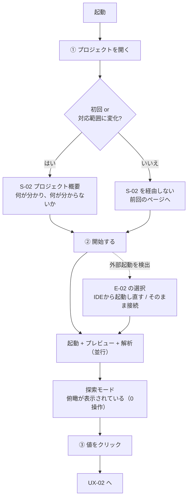
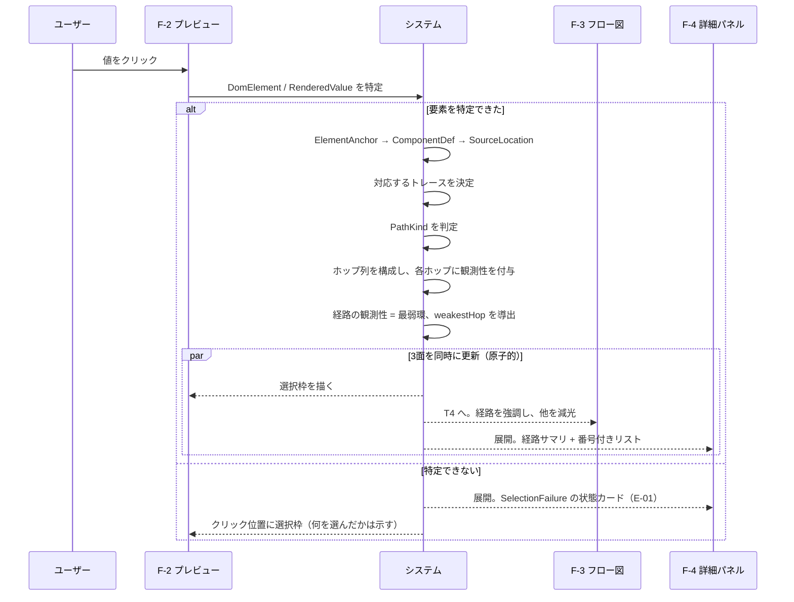
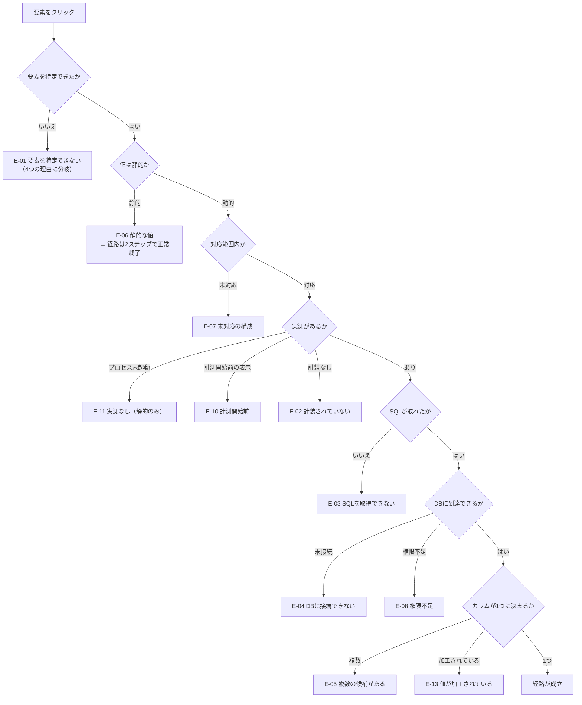
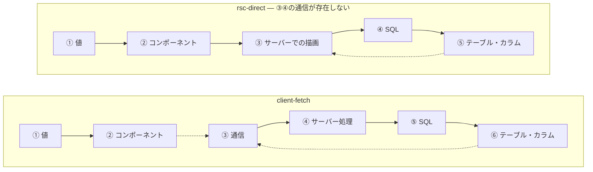
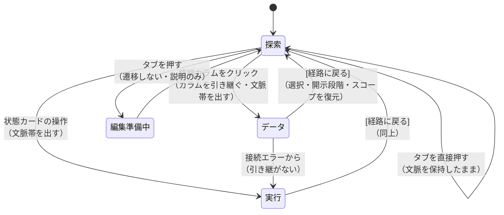

# ユーザーフロー（UX-01 〜 UX-07）

| 項目 | 内容 |
| --- | --- |
| フェーズ | Phase 3: UX設計 |
| 文書バージョン | 0.1 |
| 作成日 | 2026-10-31 |
| 位置づけ | `docs/03-ux-design.md` の付属文書（操作フローの詳細） |
| スコープ | 操作の順序・システムの反応・選択状態の変化・代替フロー。UIの実装と視覚デザインは含まない |

### 関連文書

| 文書 | 関係 |
| --- | --- |
| `docs/03-ux-design.md` | 親。UX原則の規則化 (UXR)、表示語彙、UC-01 の設計方針 |
| `docs/03b-interaction-model.md` | 本書の各操作が従う選択・同期・開示の規約 |
| `docs/03c-state-transitions.md` | 本書の「選択状態の変化」の形式的な定義 |
| `docs/03d-error-and-empty-states.md` | 本書の代替フローが参照する状態カード E-01〜E-14 |
| `docs/02b-navigation-structure.md` | N0〜N5 の階層、モード間の引き継ぎ規則 |
| `docs/02c-screen-inventory.md` | S-01〜S-13、F-1〜F-5 |

### 本書の記述形式

全フローを次の11項目で記述する（指示された共通項目）。

| # | 項目 | 意味 |
| --- | --- | --- |
| 1 | ユーザーの目的 | そのフローで達成したいこと |
| 2 | 開始条件 | そのフローに入れる前提 |
| 3 | 主要操作 | ユーザーが行う操作 |
| 4 | システムの反応 | 操作に対する応答と所要時間 |
| 5 | 表示内容 | 各面に何が出るか |
| 6 | 選択状態の変化 | `SelectionTarget` / `ScopeContext` / `DisclosureState` の遷移 |
| 7 | 成功・失敗条件 | そのフローが成立したと言える条件 |
| 8 | 代替フロー | 分岐と、対応する状態カード |
| 9 | 戻る・キャンセル・再試行 | 取り消しの手段 |
| 10 | 次の操作への導線 | 自然な次の行動 |
| 11 | 対応するIAオブジェクト・画面・要件ID | トレーサビリティ |

### フロー一覧

| ID | 名称 | 対応UC | 区分 |
| --- | --- | --- | --- |
| **UX-01** | 初回起動から最初のデータフロー表示 | UC-01 の前段, UC-04 | **A** |
| **UX-02** | **画面要素からDBカラムへの追跡（中核）** | **UC-01** | **A** |
| **UX-03** | 実測・推論の理解 | UC-01 ステップ6 | **A** |
| **UX-04** | 追跡不能な場合 | UC-01 代替A1〜A4 | **A** |
| **UX-05** | RSC・API・Server Action の違い | UC-01 / UC-06 | **A** |
| **UX-06** | 大量の情報を扱う場合 | UC-07 | **A** |
| **UX-07** | モード間の移動 | 全UC横断 | **A**（編集はB） |

---

## UX-01. 初回起動から最初のデータフロー表示

### 1. ユーザーの目的

自分のプロジェクトで、このIDEが**何を見せてくれるのか**を最短で確かめる。

> **この時点でのユーザーは、まだ UC-01 を目的にしていない。** 「使えるものかどうか」を判定しようとしている。したがって、このフローの成功条件は「経路が1本見えること」ではなく、**「このプロジェクトで何が分かり、何が分からないかが分かること」**である。

### 2. 開始条件

| # | 条件 |
| --- | --- |
| 1 | IDE が起動している |
| 2 | 対象プロジェクトがローカルに存在する |
| 3 | （不要）開発サーバーが起動していること — フロー内で起動する |
| 4 | （不要）DB に接続されていること — 未接続でもフローは完走する (NFR-12) |

### 3. 主要操作



| # | 操作 | 必須か |
| --- | --- | --- |
| ① | プロジェクトを開く（フォルダ選択 / 最近開いた一覧から1クリック） | 必須 |
| ② | 「開始する」 | 必須 |
| ③ | プレビュー上の値をクリック | UX-02 の開始操作 |

> **操作は3つ。** `02b` 6章の4操作から、スクリプト選択・ページ選択・プレビュー表示を②に統合して1操作削減した（UXR-03）。

### 4. システムの反応

| 操作 | 反応 | 所要時間の目標 | 進行中の表示 |
| --- | --- | --- | --- |
| ① プロジェクトを開く | 構成検出（フレームワーク・パッケージマネージャ・スクリプト・DB接続設定の有無・対応範囲） | **2秒以内** | 「構成を調べています」+ 検出済みの項目を**順次追加表示**（スピナーのみにしない） |
| ① の完了後（背景） | 静的解析を開始（FR-02）。**操作をブロックしない** (NFR-04) | 中規模で30秒以内 | N0 に「構造を解析中（N / M ファイル）」。**完了しなくても②に進める** |
| ② 開始する | スクリプト起動 → ポート待ち受けを検出 → プレビューを既定ページで読み込み → 計装状態を確定 | **起動は環境依存。プレビュー表示まで10秒以内を目標** | 段階を1行で更新：「起動しています」→「ポート 3000 を待っています」→「ページを読み込んでいます」。**どの段階で止まったか分かること** |
| ② の完了 | 探索モードに入り、**俯瞰が表示済み**の状態になる | B-03（1.5秒以内・暫定） | — |
| ③ 値をクリック | UX-02 へ | B-01（500ms以内） | — |

> **進行表示の規約**: 段階名を出す。「読み込み中…」の一語で10秒待たせない。止まった場合、どの段階で止まったかが次の行動を決める（ポート待ちで止まる＝スクリプトの問題、ページ読み込みで止まる＝アプリの問題）。

### 5. 表示内容

#### ① の後（S-02 プロジェクト概要 / 初回のみ）

| 領域 | 内容 |
| --- | --- |
| 見出し | 「このプロジェクトで分かること」 |
| **対応状況** | フレームワーク / ORM / スタイル / DB の4行。各行が **対応 / 一部対応 / 未対応** と、**未対応の場合に制限される機能**を1文で示す (FR-07) |
| **分からないこと** | 「DB接続の設定が見つかりませんでした。テーブルとカラムは表示できません」のように、**欠落を先に宣言する**（UXR-05） |
| 次の操作 | **[開始する]** の単一ボタン + 直下に `npm run dev`（変更可能） |
| 補助導線 | 「対応範囲の詳細」(S-08) |

> **この画面の役割は、期待値を正しく設定することである。** 「何でも見える」と思わせないことが、後の信頼を決める。

#### ② の後（探索モード・未選択）

| 面 | 表示内容 |
| --- | --- |
| **N0 グローバルバー** | プロジェクト名 / 環境 `Local` / 実行中（PID・ポート） / **計装の状態** / 対応範囲インジケータ |
| **F-1 ページナビ（N2）** | ページ一覧とルートパス。現在のページが選択状態 |
| **F-2 プレビュー（N3左）** | 実際のアプリの描画。**IDE の記号を重ねない**（選択枠のみ） |
| **F-3 フロー図（N3右）** | **俯瞰（T2）**：このページの読み込みで実際に起きたことを、境界グループ（ブラウザ / サーバー / DB / 外部）に畳んで表示 |
| **俯瞰サマリ（F-3 上部1行）** | 「このページの読み込み：通信 4 件 ／ SQL 7 件 ／ 総 312ms ／ **推定を含みます**」。複数トレースがある場合は「ほかに 3 件の通信があります」を畳んだ帯で表示（T1） |
| **F-4 詳細パネル（N4）** | **格納されている**（選択が無いため。UI-13）。※「空のパネルを出す」のではない — `03-ux-design.md` 7.3節 |
| **F-5 ドロワー（N5）** | 折りたたみ。ネットワーク（A群）／ タイムライン（準備中・B群） |

> **俯瞰サマリの「推定を含みます」が、段階0における OBS-02 の実体である。** 値も確度ラベルも出さず、この1行だけで「完全に実測された図ではない」と伝える。

### 6. 選択状態の変化

| 時点 | `SelectionTarget` | `ScopeContext` | `DisclosureState` |
| --- | --- | --- | --- |
| ① の前 | なし | なし | 0 |
| ① の後 | なし | `project` | 0 |
| ② の後 | **なし**（意図的に何も選択しない） | **`page`** | 0 |
| ③ の後 | `RenderedValue` | **`path`** | 2 |

> **② の後に何も選択しない理由**: 自動で何かを選ぶと、ユーザーは「自分が選んだもの」と「システムが選んだもの」を区別できなくなる（原則3）。俯瞰は選択ではない。

### 7. 成功・失敗条件

| 判定 | 条件 |
| --- | --- |
| **成功** | ①このプロジェクトで何が分かり何が分からないかが提示された ②プレビューにアプリが表示された ③俯瞰に、このページの読み込みで起きたことが表示された ④ここまで3操作・5分以内 (NFR-36) |
| **部分成功** | プレビューは表示されたが計装が適用されていない（外部起動） → **失敗ではない**。E-02 として「何が制限されるか」を提示し、フローは完走する (NFR-12) |
| **部分成功** | DB に接続できない → E-04。経路の終端が取れないが、SQL までは辿れる |
| **失敗** | ①プロジェクトを開いても構成を検出できない（E-07） ②起動したがポートを検出できない ③プレビューが読み込めない — **いずれも「失敗の理由と次の操作」を提示して終える。無言で止まらない** |

### 8. 代替フロー

| # | 事象 | 扱い | 状態カード |
| --- | --- | --- | --- |
| A1 | **外部で既にサーバーが起動している** | 自動接続せず、**[IDEから起動し直す（推奨）] / [そのまま接続する]** の2択を1画面で提示。推奨の理由を1行：「IDEから起動すると、サーバー内部の処理とSQLまで追跡できます」 | **E-02** |
| A2 | 未対応のフレームワーク / ORM を検出 | S-02 で**先に**提示。開始は可能だが、制限される機能を明示する | **E-07** |
| A3 | ポートが既に使用されている | 「ポート 3000 は使用中です」+ 占有プロセス名（取得できた場合のみ）。占有プロセスの特定は B群 (FR-37) のため、A群では**「占有しているプロセスは特定できません」と正直に表示する** | E-09 系 |
| A4 | スクリプトが異常終了した | 終了コードと最後の出力5行を表示。[もう一度試す] | E-09 |
| A5 | 静的解析が未完了のまま要素をクリックされた | 「構造を解析中（残り N 件）」を詳細パネルに表示し、**完了後に自動で経路を補完する**（UXR-29 前段） | — |
| A6 | DB の接続設定が見つからない | S-02 で宣言。探索は可能で、経路は SQL まで到達し、そこから先が切断マーカーになる | **E-04** |
| A7 | 2回目以降の起動 | S-02 を経由せず、前回のページで探索モードに入る。**対応範囲に変化があった場合のみ** S-02 を表示する | — |

### 9. 戻る・キャンセル・再試行

| 操作 | 手段 | 結果 |
| --- | --- | --- |
| 構成検出をやめる | [キャンセル] | S-01 に戻る。副作用なし |
| 起動をやめる | [停止] | プロセスを停止。プレビューは「停止中」表示。**解析結果は保持する** |
| 別のスクリプトで起動し直す | スクリプト選択 → [開始する] | 現在のプロセスを停止してから起動。確認ダイアログなし（UXR-23） |
| プロジェクトを変える | N0 のプロジェクトセレクタ | 現在の選択・開示をすべて破棄（SG-05 により実データ開示も閉じる） |
| 再試行 | 各状態カードの [もう一度試す] | 同じ操作を再実行。**前回の失敗理由を画面に残したまま**再試行する（成功したら消す） |

### 10. 次の操作への導線

| 状況 | 提示する次の操作 |
| --- | --- |
| 正常に俯瞰が出た | **何も提示しない。** プレビューをクリックできることは、ホバー時の輪郭で伝わる（`03b` 2.2節）。ここで「要素をクリックしてみましょう」という指示を出さない — 原則1（考えずに操作できる）は、説明文を足すことではなく、操作が自明であることで達成する |
| 初回のみ | プレビュー上に**1回だけ**、消えるヒント：「画面の文字をクリックすると、その値の出所をたどれます」。2回目以降は出さない |
| 計装が無い | E-02 のカードに [IDEから起動し直す] |
| DB 未接続 | E-04 のカードに [接続を設定する]（S-03） |

### 11. 対応するIAオブジェクト・画面・要件ID

| 項目 | 内容 |
| --- | --- |
| IAオブジェクト | `Project`, `SupportMatrix`, `ScriptDef`, `ProcessInstance`, `InstrumentationState`, `PreviewSession`, `Route`, `Trace`, `Span`, `DbConnection` |
| 画面 | **S-01**（開く）→ **S-02**（概要・条件付き）→ **S-04**（探索）。補助: S-08（対応範囲）, S-09（プロセスと計装）, S-03（設定） |
| 面 | N0, F-1, F-2, F-3, F-5 |
| 要件ID（A） | FR-01, FR-02, FR-03, **FR-07**, FR-10, FR-18, FR-30, FR-31, FR-40, FR-41, FR-50, INS-02, INS-03, **INS-08**, OBS-05, OBS-06, NFR-04, NFR-11, NFR-12, **NFR-36** |
| 要件ID（B・本フローでは席のみ） | FR-06（キャッシュ）, FR-32（ログ）, FR-37（ポート占有） |

---

## UX-02. 画面要素からDBカラムへの追跡（中核）

> **本プロダクトの存在理由。** UC-01 そのものであり、`01c` M2 の達成条件が集中する。

### 1. ユーザーの目的

画面に出ているこの値が、**どの処理を通って、どのテーブルのどのカラムから来たのか**を理解する。そして、**その理解がどこまで確かなのか**を知る。

### 2. 開始条件

| # | 条件 | 満たされない場合 |
| --- | --- | --- |
| 1 | 探索モードで、プレビューにページが表示されている | UX-01 へ |
| 2 | （望ましい）IDE から起動され、計装が有効である | E-02。経路は成立するが、サーバー以降が切断される |
| 3 | （望ましい）DB に接続されている | E-04。経路は SQL まで到達する |
| 4 | （不要）静的解析が完了していること | 未完了なら「解析中」を表示し、完了後に自動補完 |
| 5 | （不要）トレースを選択していること | **要素のクリックがトレースを決める** |

### 3. 主要操作

| # | 操作 | 操作数の累計 |
| --- | --- | --- |
| ① | **プレビュー上の値をクリックする** | **1** |
| （②） | 経路サマリの ★ [ここを見る]（最弱環へ移動） | 2 |
| （③） | 番号付きリストの行をクリック（ステップの概要） | 2 |
| （④） | 詳細パネルのタブを切り替え（ヘッダ / パラメータ / 根拠 / 生データ） | 3 |
| （⑤） | 終端カラムをクリック → [実際の値を表示する] | 3 |

> **必須の操作は① の1つだけである。** ②〜⑤ は深掘りであり、UC-01 の問いへの答えは① の直後に出揃っている。

### 4. システムの反応



| 反応 | 目標時間 | 超過時の表示 |
| --- | --- | --- |
| 選択枠の描画 | **即時（50ms以内）** | — |
| 経路の構成と3面の更新 | **500ms 以内**（NFR-06） | 超える場合、詳細パネルに**経路の骨格（ステップ数と種別）を先に出し**、各ステップの中身を順に埋める。空白のスピナーにしない |
| 実値の取得（DB照会） | 1秒以内 | 「取得しています」。**取得前に空欄を出さない**（UXR-30） |

> **3面の更新は原子的に行う** (`03b` 2.4節)。プレビューだけ先に更新してフロー図が前の選択のまま、という中間状態を作らない。

### 5. 表示内容 — 各ステップでユーザーが何を理解するか

> 指示「各ステップでユーザーが何を理解するか定義してください」への回答。`client-fetch` 経路を例にする。

| # | ステップ | 画面上の表現 | **ユーザーがここで理解すること** | 観測性 | 線 |
| --- | --- | --- | --- | --- | --- |
| **①** | 選んだ表示値 | `「千葉県」`（PropertyCard 内） | 「自分が選んだのはこれだ。この文字列を追いかける」 | 実測 | — |
| **①→②** | 描いたコンポーネント | 「この要素を描いたコンポーネント」 | 「この文字を画面に出したのは `PropertyCard` だ」 | **実測**（ビルド時の印） | 実線 |
| **②** | コンポーネント | `PropertyCard` / `src/components/PropertyCard.tsx:42` | 「コードのどこにいるかが分かった」 | 実測 | — |
| **②→③** | コード上の束縛 + 応答との対応 | 「コード上で、この位置に入る値」→「応答のどの項目が、この値になったか」 | **「ここは観測していない。コードの形からの推測だ」** | **推定** | 破線 |
| **③** | 通信 | `GET /api/properties — 200 — 124ms` | 「この通信でデータが運ばれてきた」 | 実測（ブラウザ計測） | — |
| **③→④** | 通信とサーバー処理の対応 | 「その通信を受けたサーバーの処理」 | 「ブラウザが送ったものと、サーバーが受けたものが同じだと確認できている」 | 実測 | 実線 |
| **④** | サーバー処理 | `GET /api/properties ハンドラ — 98ms` | 「サーバーのどの処理が動いたか」 | 実測（計装） | — |
| **④→⑤** | 処理とSQLの対応 | 「その処理が実行したSQL」 | 「この処理がDBを見に行った」 | 実測 | 実線 |
| **⑤** | SQL | `SELECT ... FROM properties WHERE ... — 42ms — 12行` | **「実際に発行された文はこれだ」**（コードに書かれた文ではない） | 実測 | — |
| **⑤→⑥** | SQLが読んだテーブル | 「そのSQLが読んだテーブル」 | 「このSQLは `properties` を読んだ」 | 実測（実行されたSQLの解析） | 実線 |
| **⑥** | テーブル | `public.properties` | 「スキーマ上の定義はこうだ」 | 実測（DB照会） | — |
| **⑤→⑦** | SQLが取り出した列 | 「そのSQLが取り出した列」 | 「このSQLは `area` 列を取り出した」 | 実測（実行されたSQLの解析）。**`SELECT *` なら推定** | 実線 |
| **⑦** | カラム | `area (text)` | 「この列の定義はこうだ」 | 実測 | — |
| **⑦→③** | カラムと応答項目の対応 | 「カラムと応答項目の対応づけ」 | **★「ここがいちばん弱い。ORMの内部は見えていない」** | **推定** | 破線 |
| **（終端）** | 実際の値 | 既定は非表示。[実際の値を表示する] | 「実際の値はこれだ」（明示操作・SG-01〜06） | 実測 | — |

> **ステップ番号は表示順（上流→下流）で振る。** `⑦→③` のように番号が逆行するホップ（カラムから応答項目への対応づけ）が存在するが、これは**経路が一直線ではない**ことの正直な表現である。番号を振り直して見かけ上一直線にしてはならない。

> **⑥テーブルと⑦カラムは別のノードであり、⑤SQL から分岐する。** `reads` は `SqlStatement → DbTable`、`projects` は `SqlStatement → DbColumn` である (`02a` 3.5節)。**⑥→⑦（テーブルからカラム）の線はモデルに存在しないため、描いてはならない** (OBS-05)。経路は ⑤ で2本に分かれ、⑦ から ③ へ戻る。

#### 各面の表示内容

| 面 | 選択後の表示 | 持たないもの |
| --- | --- | --- |
| **F-2 プレビュー** | 選択要素の枠のみ。**値・バッジ・吹き出しを重ねない**（`02` 5.1節） | IDE の記号すべて |
| **F-3 フロー図** | T4（単一経路）。ノードは種別アイコン + 短いラベル + ステップバッジ。ホップごとに独立した線分（実線 / 破線）。**経路外は減光して残す**（削除しない。UI-33） | 属性値、SQL文、JSON |
| **F-4 詳細パネル** | 最上段に**経路サマリ**（`03` 3.5節）、その下に番号付き縦リスト。選択ステップの概要 | 全体の形（フロー図の担当） |
| **F-5 ドロワー** | 折りたたまれたまま。該当する HTTP 交換があればネットワーク一覧で強調される | — |

#### 吹き出し（段階2の付随表示）

`02` 6.4節の条件付き採用を、操作として具体化する。

| 条件 | 設計 |
| --- | --- |
| いつ出るか | **選択中の経路のノードのみ**。未選択時には出ない |
| 何を出すか | **1ノードにつき最大1つの抜粋**（SQL の先頭1行 / 応答の該当キー1つ / カラム定義1行） |
| 出さないもの | 秘密情報、実データ値（SG-01 により明示操作が必要で、吹き出しは明示操作を持てない） |
| 推定由来の場合 | 抜粋に「推定」を添える |
| 上限 | 1経路あたり **5ノードまで**（暫定・UR-07 の検証対象）。超える場合は最弱環と終端を優先する |

### 6. 選択状態の変化

| 操作 | `SelectionTarget` | `ScopeContext` | `DisclosureState` | バッジ |
| --- | --- | --- | --- | --- |
| 選択前 | なし | `page` | 0 | 俯瞰のバッジ |
| ① 値をクリック | `RenderedValue(dom:…)` | **`path`（T4）** | **2** | **振り直し** → 「番号を振り直しました」を1行通知（`02` 5.3節） |
| ② ★ [ここを見る] | `LineageHop(hop:…:7)`（`maps` ホップ） | `path`（変わらない） | 2 | 変わらない |
| ③ リスト行をクリック | 該当ノード / ホップ | `path` | 2 | 変わらない |
| ④ タブ切替 | 変わらない | 変わらない | **3** | 変わらない |
| ⑤ [実際の値を表示する] | 変わらない | 変わらない | **3 + 開示** | 変わらない |
| フロー図の空白をクリック | **なし** | `page` に戻る | 0 | 振り直し + 通知 |

> **スコープが `path` に変わるとバッジが振り直される。** これは `02` 5.3節の規則通りだが、**UX としては必ず通知する**。無言の番号変更は同期の仕掛けそのものへの信頼を損なう（`02` 12.5節の申し送り4）。

### 7. 成功・失敗条件

| 判定 | 条件 | 対応する M2 達成条件 (`01c` 1.3) |
| --- | --- | --- |
| **成功** | ①1操作で経路が表示された | 1 |
| | ②要素 → コンポーネント → (API/RSC) → サーバー → SQL → テーブル → カラム が提示された | 2 |
| | ③**各ホップが実測か推定かを個別に区別して表示している** | 3 |
| | ④**最も確度が低い箇所が名指しされ、理由が読める** | 4 |
| | ⑤秘密情報がマスクされている | 7 |
| **部分成功** | 経路が途中で切断されたが、**切断点と理由が提示されている** | 5, 8 |
| **部分成功** | 候補が複数あり、**1つに断定せず候補を提示している** | — |
| **失敗** | ①無反応 ②切断を描かずに線を消した ③推定を実測として表示した ④「完全に特定しました」等の断定を表示した | 原則6 / OBS-05 違反 |

> **「経路が最後まで繋がること」は成功条件ではない。** 繋がらないことを正しく示せていれば成功である。これが本プロダクトの判定基準である。

### 8. 代替フロー

| # | 事象 | 扱い | 状態カード |
| --- | --- | --- | --- |
| A1 | 値が静的なリテラル | 経路は2ステップで終端。「コードに直接書かれています」+ ファイル名:行。★ブロックを出さない | **E-06** |
| A2 | 複数の候補がある | **断定しない。** 候補を証拠の種別・件数つきで列挙。実トレースで通った候補があれば強調 | **E-05** |
| A3 | 開発サーバーが起動していない | 静的推定の経路（`not-traced`）。全ホップ推定。**実際の値を表示しない** | **E-11** |
| A4 | 要素を特定できない | 理由を4種に分けて提示。無反応にしない | **E-01** |
| A5 | 計装が無い | 要素・コンポーネント・ブラウザ通信までは実測。サーバー以降を切断マーカー | **E-02** |
| A6 | SQL が取れない | 処理までは辿れる。SQL ノードを切断 | **E-03** |
| A7 | DB に接続できない | SQL までは実測。テーブル・カラムが取れない | **E-04** |
| A8 | 権限不足でスキーマが読めない | 「権限により取得できません」。**「未接続」と区別する** | **E-08** |
| A9 | 未対応の ORM | 切断 + 対応範囲へ | **E-07** |
| A10 | 値が加工されている（連結・計算・整形） | 「この値は加工されています。元のカラムを特定できません」 | **E-13** |
| A11 | 外部サービス由来 | 外部境界で打ち切り。**値を出さない**（L3） | **E-12** |
| A12 | 計測開始前に読み込まれた画面 | 「この表示は計測を始める前のものです」+ [再読み込みして計測する] | **E-10** |
| A13 | 読んでいる最中に新しい実測が到着 | **黙って更新しない。**「新しい実行結果があります [切り替える]」 | **E-14** |

### 9. 戻る・キャンセル・再試行

| 操作 | 手段 | 結果 |
| --- | --- | --- |
| 1段階戻る | **Esc** | 開示段階を1つ下げる。段階2 で Esc → 選択解除（`03b` 4.3節の Esc 階段） |
| 選択を解除する | フロー図の空白をクリック / Esc（段階2 から） | スコープが `page` に戻り、俯瞰に戻る |
| **プレビューの背景クリック** | **選択を解除しない** | 誤クリックで経路が消えることを防ぐ。プレビューはアプリの操作領域でもあるため |
| 別の値を選び直す | 別の要素をクリック | 前の経路は破棄。**開示していた実データは閉じる**（SG-05） |
| 経路の取得を中止 | [中止]（500ms を超えて進行中の場合のみ出る） | 選択は維持し、経路のみ破棄 |
| 再試行 | 状態カードの [もう一度試す] | 同じ要素で経路を再構成 |
| 直前の選択に戻る | 戻る操作（履歴） | 選択・スコープ・開示段階を復元。復元できない項目があれば明示（UXR-10） |

### 10. 次の操作への導線

| 状況 | 次の導線（最大2つ） |
| --- | --- |
| 経路が表示された | ① ★ [ここを見る]（最弱環へ） ② 終端カラム名（データモードへ） |
| 最弱環を見た | ① [根拠を見る]（段階3） ② [経路に戻る] |
| 終端カラムを見た | ① [実際の値を表示する]（SG-04 の一文つき） ② [このテーブルに発行されたSQLを見る]（S-06・A群） |
| 切断された | 切断の種別ごとに1〜2個（`03d`） |

### 11. 対応するIAオブジェクト・画面・要件ID

| 項目 | 内容 |
| --- | --- |
| IAオブジェクト | `DomElement`, `RenderedValue`, `ElementAnchor`, `SelectionFailure`, `ComponentDef`, `PropBindingSite`, `SourceLocation`, `HttpExchange`, `Span`, `SqlStatement`, `DbTable`, `DbColumn`, `RowSample`, **`LineagePath`**, **`LineageHop`**, `Observability`, `Evidence`, `CandidateSet` |
| 画面 | **S-04**（探索）。遷移先: S-06（テーブル詳細）, S-08（対応範囲）, S-09（プロセスと計装） |
| 面 | F-2（現物）, F-3（空間）, F-4（内容） — **A段階の3面同期**（IA変更案 #2） |
| 要件ID（A） | **FR-22**（中核）, FR-10, FR-11, **FR-11b**, FR-12, FR-20, **FR-20b**, FR-21, FR-23, FR-40, FR-41, FR-42, FR-50, FR-51, FR-52, OBS-01, OBS-02, OBS-05, OBS-06, **OBS-09**, **OBS-10**, **OBS-11**, NFR-06, NFR-12, NFR-17, NFR-20, NFR-28 |
| 要件ID（B・本フローでは使わない） | FR-24（コードジャンプ）, FR-25（スコープ切替）, FR-43（タイムライン）, OBS-03（確度ラベル）, OBS-12（連続線） |

---

## UX-03. 実測・推論の理解

### 1. ユーザーの目的

表示された経路の **どこまでを信じてよいか** を判断する。具体的には「この結論に基づいてコードを直してよいか」を決める。

### 2. 開始条件

| # | 条件 |
| --- | --- |
| 1 | UX-02 により経路が表示されている |
| 2 | （不要）観測性レベル L0〜L3 の知識 — **本フローの設計目標は、これを不要にすることである** |

### 3. 主要操作

| 段階 | 操作 | 得られる理解 |
| --- | --- | --- |
| **0** | **何もしない** | 線を見るだけで「実線＝実測 / 破線＝推定」が分かる。俯瞰サマリに「推定を含みます」 |
| **1** | ホップにホバー | 1行要約：「推定 — カラムと応答項目の対応づけ」。最弱環には ★ |
| **2** | 経路サマリを読む（選択と同時に表示済み） | 「14 か所のうち 2 か所が推定」「経路全体は推定」「いちばん弱いのは ⑦→③ で、理由はこれ」 |
| **2'** | **★ [ここを見る]** | 最弱環のホップが選択され、リストがその行までスクロール。**なぜ推論なのかの定型文が表示される** |
| **3** | [根拠を見る]（根拠タブ） | 証拠の全件（種別・何が一致したか）、取得手段、降格の有無と理由 |

### 4. システムの反応

| 操作 | 反応 |
| --- | --- |
| ホバー | 100ms の遅延後に1行要約。**詳細パネルは書き換えない**（UXR-08） |
| ★ [ここを見る] | フロー図で該当線分を選択状態にし、リストを該当行へスクロール。**新しい情報は出さない**（移動のみ。UXR-28） |
| 根拠タブ | 証拠の一覧を表示。**`L2` などの記号はここで初めて併記される**（UXR-21） |

### 5. 表示内容

#### 段階0 — 常時表示されるもの（これだけで二値の区別がつく）

| 要素 | 表現 |
| --- | --- |
| 実測のホップ | **実線** |
| 推定のホップ | **破線** |
| 説明用の図（L3） | **低彩度の破線** + 値を出さない |
| 切断 | **切断マーカー**（線を消さない） |
| 俯瞰・経路の要約 | 「この経路は**推定を含みます**」の1行 |
| 出さないもの | L0/L1/L2/L3 のバッジ、確度ラベル、パーセント |

#### 段階2 — 最弱環を選択したときの表示（本フローの中核）

```
┌────────────────────────────────────────────────┐
│ ★ ⑦→③  カラムと応答項目の対応づけ              │
│         推定                                    │
│                                                │
│ 何を推定しているか                              │
│   カラム area と、応答の項目 area が            │
│   対応すると推定しています。                     │
│                                                │
│ なぜ観測できないか                              │
│   ORMの内部変換は外から観測できません。          │
│                                                │
│ どういうとき成立しないか                         │
│   別名（@map）・計算列・結合があると             │
│   成立しません。                                │
│                                                │
│ 根拠 2 件                                       │
│   ・実行されたSQLの解析                         │
│   ・値の一致                                    │
│     （値の一致だけでは1つに絞れません）          │
│                                                │
│ [ 根拠を見る ]        [ 経路に戻る ]            │
└────────────────────────────────────────────────┘
```

| 設計判断 | 根拠 |
| --- | --- |
| **4つの問いに答える形式に固定する**（何を / なぜ / いつ崩れる / 根拠） | 毎回同じ構造にすることで、2回目以降は読む箇所を絞れる |
| 定型文を関係種別ごとに固定する | `03` 4.4節。文面が毎回変わると、同じ説明を読み直すことになる |
| 「値の一致」には必ず但し書きを添える | `02d` 1.3節の禁止事項。値の一致は必要条件であって十分条件ではない |
| 確度ラベルを出さない | IA変更案 #3 / NFR-17 |

#### 降格（本来は実測できたはずの箇所）の表示

| 通常の推定 | 降格した推定 |
| --- | --- |
| 「ORMの内部変換は外から観測できません」 | 「**本来は同じIDで確認できますが、IDを引き継げませんでした。**時刻の近さで結び付けています」 |
| 次の操作：なし（構造的な限界） | 次の操作：**[計装の状態を見る]** / **[再読み込みして計測する]** |

> **この区別が UX 上きわめて重要である。** 構造的な限界には打つ手がなく、降格には打つ手がある。同じ「推定」として並べると、ユーザーは改善できる箇所を見逃す (UXR-22)。

### 6. 選択状態の変化

| 操作 | `SelectionTarget` | `DisclosureState` |
| --- | --- | --- |
| ホバー | **変わらない**（ホバーは選択ではない） | 変わらない |
| ★ [ここを見る] | `LineagePath` → `LineageHop` | 2 のまま |
| [根拠を見る] | 変わらない | **3** |
| [経路に戻る] | `LineageHop` → `LineagePath` | 2 |

### 7. 成功・失敗条件

| 判定 | 条件 |
| --- | --- |
| **成功** | ①L0〜L3 という語を一度も見ずに、実測と推定を区別できた ②最弱環が1操作以内で分かった ③なぜ推論なのかを読んで理解できた ④「修正の判断に使ってよいか」をユーザー自身が決められた |
| **失敗** | ①画面のどこかに「確度: 高」が出た ②経路全体に ✓ や「完了」が付いた ③推定の理由が「おそらく〜」のような推測文だった ④降格と構造的限界が同じ見た目だった |

### 8. 代替フロー

| # | 事象 | 扱い |
| --- | --- | --- |
| A1 | **最弱環が複数ある（同率）** | `02d` 2.2節の優先順位で1つに決める（①未解決 ②下流）。決まらない場合は **2つまで ★ を付け、「同じくらい弱い箇所が2つあります」と明示する**。3つ以上なら「経路全体が推定です」に切り替える |
| A2 | **経路全体が推定**（`not-traced`） | ★ を使わない。「この経路は全体が推定です。実行していないため、コードから推定しました」+ [起動して実測する] |
| A3 | **推定が1つも無い** | 理論上は `static-literal` のみ。★ブロックを出さず、「この値はコードに直接書かれています」で終える |
| A4 | 集約ノードの中に推定が含まれる | 集約ノードを破線で描き、「内部に推定 1 件を含みます」+ 展開操作 (`02d` 2.4) |
| A5 | 同じ経路を2回目に見る | **説明文を省略しない。** 定型文は毎回同じ場所に出す。「前に読んだから」を理由に情報を隠すと、別の経路と取り違える |

### 9. 戻る・キャンセル・再試行

| 操作 | 手段 |
| --- | --- |
| 根拠タブから概要へ | タブ切替 / Esc |
| ホップ選択から経路へ | [経路に戻る] / Esc |
| 降格を解消して再測定 | [再読み込みして計測する]（UX-02 A12 と同じ操作） |

### 10. 次の操作への導線

| 状況 | 次の導線 |
| --- | --- |
| 最弱環を理解した | ① [根拠を見る] ② [経路に戻る] |
| 降格だった | ① [計装の状態を見る]（S-09） ② [再読み込みして計測する] |
| 構造的限界だった | **次の操作を提示しない。** 打つ手が無いことが答えである。偽の選択肢を置かない |

### 11. 対応するIAオブジェクト・画面・要件ID

| 項目 | 内容 |
| --- | --- |
| IAオブジェクト | `Observability`（level / status / source / evidence[] / degradedFrom / degradeReason）, `Evidence`, `LineageHop`, `LineagePath.weakestHop` |
| 画面 | S-04 / F-4（経路サマリと根拠タブ） |
| 要件ID（A） | **OBS-01, OBS-02, OBS-05, OBS-09, OBS-10, OBS-11**, FR-23, NFR-17, NFR-30 |
| 要件ID（B・本フローでは使わない） | OBS-03（確度ラベル）, OBS-08（情報源の開示の充実）, OBS-13（算出根拠） |

---

## UX-04. 追跡不能な場合

> 指示された7状態を中心に、**各状態で何を表示し、次に何ができるか**を設計する。状態カードの全文は `03d-error-and-empty-states.md` にある。本節は**操作フローとしての扱い**を定める。

### 1. ユーザーの目的

**追跡できなかったという事実を、正しく受け取る。** そのうえで、①自分の操作で解消できるのか ②待てば解消するのか ③構造的に無理なのか を判定する。

> **このフローの成功は「解消すること」ではない。** 解消できない場合に、そうと分かって次に進めることが成功である。

### 2. 開始条件

要素を選択した結果、経路の構成のいずれかの段階で情報が得られなかった。

### 3. 主要操作

| # | 操作 |
| --- | --- |
| ① | 要素をクリックする（UX-02 と同じ） |
| ② | 提示された次の操作を実行する（0〜2個） |
| ③ | または、別の要素を選び直す |

> **追跡不能専用の操作を増やさない。** ユーザーは「追跡不能モード」に入るのではなく、通常の操作の結果としてこの状態を受け取る。

### 4. システムの反応 — 7状態の分類と判定順序



> **判定の順序が体験を決める。** 「DBに接続できない」を先に出すと、実は未対応ORMだった場合にユーザーは接続設定を疑って時間を失う。**上流の原因から順に判定し、最初に見つかった原因を提示する** — 複数の原因を同時に並べない（UXR-17）。

### 5. 表示内容 — 7状態の要約

> 全文・文言は `03d` 第2章。ここでは「何を表示し、次に何ができるか」を一覧する。

| ID | 状態 | 何を表示するか | **次にできること** | 解消可能性 |
| --- | --- | --- | --- | --- |
| **E-01** | **要素を特定できない** | 4つの理由のどれかを名指しする：①UIライブラリ由来 ②開発ビルドでない ③要素に印が無い ④特定できない | ①ライブラリ由来 → **[親の要素を選ぶ]**（1操作で上位へ）<br>②③ → [起動の仕方を見る]<br>④ → **提示しない** | ①△ ②○ ③○ ④× |
| **E-02** | **計装されていない** | 「このサーバーはIDEの外で起動されています。サーバー内部の処理とSQLは観測できません」 | **[IDEから起動し直す]**（1操作） | **○** |
| **E-03** | **SQLを取得できない** | 「サーバーの処理までは追跡できましたが、SQLは観測できませんでした」+ 理由（未対応ORM / 計装の部分失敗 / DBを使っていない可能性） | [対応範囲を見る] / [計装の状態を見る] | △ |
| **E-04** | **DBに接続できない** | 「データベースに接続していないため、テーブルとカラムを確認できません」。**SQL文からテーブル名は読める**ので、そこまでは表示する | **[接続を設定する]** | **○** |
| **E-05** | **複数の候補がある** | 「候補が 2 件あります」+ 各候補の根拠の種別と件数。**1つに断定しない。** 実トレースで通った候補があれば強調 | [候補を比べる]（並べて表示） | 判断はユーザー |
| **E-06** | **静的な値である** | 「この文字はコードに直接書かれています」+ ファイル名:行番号。**これは失敗ではない** | **提示しない**（答えが出ている） | — |
| **E-07** | **未対応の構成** | 「この構成（ORM: XXX）は対応していません。この先は追跡できません」 | **[対応範囲を見る]**（S-08） | ×（対応待ち） |

#### 追加の7状態（本書で発見・追加したもの）

| ID | 状態 | 何を表示するか | 次にできること |
| --- | --- | --- | --- |
| **E-08** | 権限不足 | 「権限により取得できません」。**「未接続」「停止中」と区別する** | [必要な権限を見る] |
| **E-09** | プロセスが停止している | 「開発サーバーが停止しています」+ 終了コード | **[起動する]** |
| **E-10** | 計測開始前の読み込み | 「この表示は計測を始める前のものです」 | **[再読み込みして計測する]** |
| **E-11** | 実測なし（静的のみ） | 「実行していないため、コードから推定した経路です。実際の値は表示できません」。**経路は表示する**（全ホップ推定） | **[開始する]** |
| **E-12** | 外部境界で打ち切り | 「外部サービスから来ています。この先は観測できません」。**値を出さない** | 提示しない |
| **E-13** | 値が加工されている | 「この値は加工されています（計算 / 連結 / 整形）。元のカラムを特定できません」+ 加工が行われた箇所のコード位置（取得できた場合） | 提示しない |
| **E-14** | 新しい実測の到着 | 「新しい実行結果があります」 | **[切り替える]**（黙って更新しない） |

### 6. 選択状態の変化

| 事象 | 選択はどうなるか |
| --- | --- |
| E-01（要素を特定できない） | **選択は成立する。** クリックした位置に枠を描き、`SelectionFailure` を詳細パネルに出す。**「選択できなかった」のではなく「選択はできたが追跡できなかった」** |
| E-02〜E-04, E-07〜E-09 | 選択は成立し、経路は**途中まで**構成される。切断点より上流のステップは選択・展開できる |
| E-05（複数候補） | 選択は成立。`LinkStatus = multiple-candidates`。**候補の1つを自動選択しない** |
| E-06（静的値） | 選択は成立し、経路は `complete`（2ステップ）。失敗扱いにしない |
| E-11（静的のみ） | 選択は成立。`PathKind = not-traced`。全ホップが推定 |
| E-14（新しい実測） | **選択を変えない。** ユーザーが [切り替える] を押すまで、現在の経路を保持する |

### 7. 成功・失敗条件

| 判定 | 条件 |
| --- | --- |
| **成功** | ①無反応が無い ②理由が名指しされている ③影響（この結果わからないこと）が書かれている ④次の操作が 0〜2個で、押せば実際に進む ⑤解消できない場合に偽の選択肢を置いていない |
| **失敗** | ①クリックしても何も起きない ②「エラーが発生しました」だけ ③切断を線の不在で表した ④原因を複数並べて切り分けをユーザーに丸投げした ⑤押しても何も起きないボタンを置いた |

### 8. 代替フロー

| # | 事象 | 扱い |
| --- | --- | --- |
| A1 | **複数の原因が同時に成立する**（例：計装も無く、DBにも繋がっていない） | **上流の原因だけを出す**（計装）。解消後に次の原因（DB）を出す。同時に並べない（UXR-17） |
| A2 | 理由そのものが特定できない | 「追跡できませんでした。理由を特定できません」+ **[この状況を記録する]**（診断情報の保存）。**推測の理由を書かない**（UXR-18） |
| A3 | 次の操作を実行したが解消しなかった | 前回の試行を画面に残したまま、新しい結果を追加する。「IDEから起動し直しましたが、計装が適用されませんでした」+ 次の候補 |
| A4 | 状態カードが連続して出る（別の要素でも同じ原因） | **2回目以降はカードを縮める。** 「同じ理由です（計装されていません）」+ 既に提示済みの操作へのリンク。同じ長文を繰り返さない |

### 9. 戻る・キャンセル・再試行

| 操作 | 手段 | 備考 |
| --- | --- | --- |
| 別の要素を試す | クリックするだけ | 状態カードを閉じる操作を要求しない |
| 親の要素を選ぶ（E-01①） | [親の要素を選ぶ] | ライブラリ由来の要素の場合、親に自作コンポーネントがあることが多い。**1操作で上位へ上がれる**ことが、この状態の実質的な回復手段である |
| 再試行 | [もう一度試す] | 失敗理由を残したまま再試行 |
| 解消操作を取り消す | 再起動の取り消しは無い（再起動は副作用が小さい） | — |

### 10. 次の操作への導線

| 解消可能性 | 導線の設計 |
| --- | --- |
| **解消できる**（E-02, E-04, E-09, E-10, E-11） | **解消操作を1つだけ、主たる操作として置く**。迷わせない |
| **部分的に解消できる**（E-01①, E-03, E-07） | 情報を得る導線（対応範囲・計装状態）を置く。解消を約束しない |
| **解消できない**（E-01④, E-12, E-13） | **次の操作を置かない。** 「打つ手がない」ことが正しい答えであり、偽の選択肢は時間を奪う |

### 11. 対応するIAオブジェクト・画面・要件ID

| 項目 | 内容 |
| --- | --- |
| IAオブジェクト | **`SelectionFailure`**（4値 + 提案する5値目 `measurement-not-started`）, `NodeStatus`（8値）, `LinkStatus`（6値）, `SupportMatrix`, `InstrumentationState`, `DbConnection`, `CandidateSet` |
| 画面 | S-04（表示）→ S-08（対応範囲）, S-09（プロセスと計装）, S-03（接続設定） |
| 要件ID（A） | **FR-11b**, **FR-07**, **OBS-05**, **OBS-06**, FR-12, FR-22（代替A1〜A4）, INS-03, **INS-08**, NFR-12, NFR-13 |

---

## UX-05. RSC・API・Server Action の違い

### 1. ユーザーの目的

**自分のページがどの構成で動いているかを意識せずに、同じ操作で出所を知る。** そのうえで、構成の違いが結果にどう効いているかを理解できる。

### 2. 開始条件

要素を選択し、経路が構成された。`PathKind` が判定されている。

### 3. 主要操作

**UX-02 と完全に同一である。** 構成によって操作を変えない。

| # | 操作 |
| --- | --- |
| ① | 値をクリックする |

> **ユーザーに「このページは RSC ですか？」と尋ねない。** 構成の判定はシステムが行う。構成の違いは、**結果の形**にのみ現れる。

### 4. システムの反応 — 共通の操作体験と、結果の差分



| 項目 | `client-fetch` | `rsc-direct` | `server-action` |
| --- | --- | --- | --- |
| ホップ構成 | `renders → binds → derives → requests → handles → invokes → executes → reads/projects → maps` | 同左から **`derives` / `requests` / `handles` を除いたもの** | `client-fetch` と同じ（`requests` が POST） |
| 「通信」ステップ | **ある** | **無い（作らない）** | ある（POST） |
| ステップの説明文 | 「ブラウザが送った通信」 | — | 「フォーム送信（Server Action）」 |
| 構成の説明（1行） | 出さない（既定の構成のため） | **「このページはサーバーが直接データを取得しています（API通信はありません）」** | **「この通信はフォーム送信です。URLは処理の名前を表しません」** |
| 最弱環 | `maps` | `maps` | `maps` + ラベルの曖昧さ |
| **経路全体の確からしさ** | **推定** | **推定** | **推定** |

### 5. 表示内容 — 禁止事項と採用事項

> **上表に「ステップ数」の行を置いていないことは意図的である。** 経路種別ごとのステップ数を並べると、その差が意味を持つように読める。確からしさは最弱環だけが決める（UXR-13）。

| 禁止 | 採用 | 根拠 |
| --- | --- | --- |
| **架空のAPIノードを置く** | ノードを作らない | OBS-05、指示 |
| 「APIリクエスト: なし」という**空のステップ行** | ステップそのものを作らない | 空行は「取得失敗」と読まれる |
| 「API情報を取得できませんでした」 | 「サーバーが直接データを取得しています」— **構成の説明であって失敗ではない** | UXR-14 の逆適用：切断でないものを切断として描かない |
| ステップ番号の欠番（③を飛ばす） | 存在するステップだけで連番 | `02` 5.3節 |
| **短い経路に肯定的な記号（✓・緑・「直接」の強調）** | 経路種別によって肯定・否定の表現を変えない | **UXR-13 / `03` 4.6節** |
| `rsc-direct` を「情報が少ない」と表示 | 表示しない | `02` 10.4節 |

> **この2つの禁止は方向が逆だが、同じ原則から出ている。** `rsc-direct` を「情報不足」と描くのも、「より確か」と描くのも、**経路の形から確からしさを推測している**点で同じ誤りである。確からしさは最弱環だけが決める (OBS-10)。

### 6. 選択状態の変化

| 項目 | 内容 |
| --- | --- |
| 選択の対象 | 経路種別によらず `RenderedValue` で同一 |
| スコープ | `path`（T4）で同一 |
| バッジ | 存在するステップにのみ振る。経路種別で振り方を変えない |
| 面の表現可否 | `rsc-direct` では `HttpExchange` が存在しないため、ドロワーのネットワーク一覧に該当が無い。**空にせず**「この経路にはブラウザからの通信がありません」と表示する（UXR-07） |

### 7. 成功・失敗条件

| 判定 | 条件 |
| --- | --- |
| **成功** | ①3つの構成すべてで、操作が1クリックで同一 ②APIノードが無い経路で、架空のノードが追加されていない ③APIが無いことが「構成の説明」として提示され「失敗」として提示されていない ④経路種別によって確からしさの表現が変わっていない |
| **失敗** | ①`rsc-direct` でステップが欠番になった ②「API: なし」の空行が出た ③短い経路に ✓ や肯定色が付いた ④ユーザーが構成を自分で指定する必要があった |

### 8. 代替フロー

| # | 事象 | 扱い |
| --- | --- | --- |
| A1 | **経路種別を判定できない**（`unknown`） | 「このページの構成を判定できませんでした」+ 取得できた範囲の経路を提示。**どれかの種別に丸めない** |
| A2 | 1ページに複数の種別が混在する（RSCで初期描画 + クライアントで追加取得） | **選択した値ごとに種別が決まる。** ページに単一の種別を与えない。俯瞰（T2）では両方の経路が併存して見える |
| A3 | Server Action の URL が処理名を表さない | ラベルに生の URL を出さず、**「フォーム送信（Server Action）」+ 判明している場合のみ処理名**。URL は段階3（生データ）で確認できる |
| A4 | RSC の計装が部分的に失敗した | 「サーバー内部処理」1つの集約ノードとして表示し、**内訳が推定であることを明示**（`01b` Q-02.5 代替1、`02d` 2.4）。**このとき `rsc-direct` の確度は下がる** — `03` 4.6節 #2 の実例 |
| A5 | ストリーミングSSR で処理が時間的に重なる | A段階では時間の面を持たない。所要時間の合計に**必須の注記**：「各処理の所要時間の合計は、並行実行のため全体時間と一致しない場合があります」（IA変更案 #7） |

### 9. 戻る・キャンセル・再試行

UX-02 と同一。経路種別によって戻り方を変えない。

### 10. 次の操作への導線

| 経路種別 | 次の導線 |
| --- | --- |
| 共通 | ① ★ [ここを見る] ② 終端カラム |
| `server-action` のみ | 追加で「この送信の内容を見る」（ドロワーのネットワーク一覧へ） |
| `rsc-direct` のみ | **追加しない。** 「通信が無いこと」への補足導線を置くと、欠落の印象を与える |

### 11. 対応するIAオブジェクト・画面・要件ID

| 項目 | 内容 |
| --- | --- |
| IAオブジェクト | `LineagePath.経路種別`（7値）, `Span.種別`（`document` / `rsc-render` / `server-handler` / `client-fetch` / `db` / `external` / `internal`）, `Span.境界`, `HttpExchange`, `Trace.起点種別` |
| 画面 | S-04 / F-3, F-4, F-5（ネットワーク） |
| 要件ID（A） | **FR-20b**（スパンの木構造）, FR-22, FR-20, FR-40, FR-42, OBS-05, OBS-10 |
| 要件ID（B） | FR-20c（Client/Server 境界の可視化）, FR-43b（並行・入れ子） |

---

## UX-06. 大量の情報を扱う場合

### 1. ユーザーの目的

実プロジェクトの、**数十の通信と数百の処理がある**ページでも、①全体の形をつかみ ②関心のある1本に降り ③降りた後も全体の中での位置を見失わない。

### 2. 開始条件

ページを選択し、俯瞰（T2）が構成された。可読性予算（`03` 5.2節 B-01〜B-05）のいずれかが超過している。

> **閾値（500 / 5000ノード）を無条件に採用しない。** 一次基準は予算であり、閾値はその目安である（`03` 5.1節）。

### 3. 主要操作

| # | 操作 | 効果 |
| --- | --- | --- |
| ① | **何もしない** | 予算を超過していれば、**既に集約された状態**で表示されている。集約は自動、展開は明示操作 |
| ② | 集約ノードをクリック | 選択される（展開ではない）。詳細パネルに内訳の件数と最弱レベル |
| ③ | 集約ノードを展開 | 枝番（`3-1`, `3-2`）で採番。**全体の再採番は行わない** |
| ④ | 要素をクリック（UX-02） | **T4 に直行。** 経路以外は減光（削除しない） |
| ⑤ | ズーム / パン | 3段階で情報量が変わる |
| ⑥ | フォーカス（選択経路に集中） | 選択時に自動で入る。解除は選択解除 |

### 4. システムの反応

#### 集約の段（`03` 5.3節）

| 段 | 発動条件 | 表示 | 必ず伴う表示 |
| --- | --- | --- | --- |
| 段0 | 予算内 | そのまま | — |
| 段1 | B-04（画面内150ノード）/ B-05（経路20ステップ）超過 | 同種連続を畳む | 「12 件を畳んでいます」+ 内包の最弱レベル |
| 段2 | 段1でも超過 | 境界グループ単位 | 各グループの件数と最弱レベル |
| 段3 | 段2でも超過 | グループを1ノードに | **「N 件を1つにまとめて表示しています」** |

> **どの段でも削除しない。** 畳む＝存在が見える。描かない＝存在が消える。後者は禁止する（UXR-15）。

#### ズームの3段階（UI-32）

| 段階 | 表示 | **縮退しても残すもの** |
| --- | --- | --- |
| 俯瞰 | アイコンのみ | **切断マーカー / 最弱環の ★ / 集約の件数 / 選択中の経路** |
| 標準（既定） | アイコン + 短いラベル + ステップバッジ | 同上 |
| 詳細 | + 状態・線種の区別が明瞭 | 同上 |

> **縮退しても誠実さの記号は最後まで残す**（`03` 5.4節）。ズームアウトで切断マーカーが消えると、「繋がっている図」に見える。これは本プロダクトが最も避けるべき失敗である。

### 5. 表示内容

#### 俯瞰（T2）に必ず含める情報

| 項目 | 例 |
| --- | --- |
| このページの読み込みで起きたこと | 「通信 4 件 ／ SQL 7 件 ／ 総 312ms」 |
| **推定が含まれるか** | 「**推定を含みます**」 |
| 畳んでいる件数 | 「12 件を畳んでいます」 |
| ほかのトレース（T1・複数ある場合のみ） | 「ほかに 3 件の通信があります」（畳んだ帯） |
| 取得できていない領域 | 「サーバー内部は観測できていません」（E-02 がある場合） |

#### フォーカス（選択時）

| 対象 | 表示 |
| --- | --- |
| 選択した経路 | 通常の強度 |
| それ以外 | **減光する。削除しない**（UI-33） |
| 減光の意味 | 「ほかにもあるが、いま関心の対象ではない」。削除は「ほかに無い」と読まれる |

### 6. 選択状態の変化 — 情報量の操作をまたいだ選択の維持

> **指示された「選択状態の維持」への回答。** 下表のすべての事象で、選択は可能な限り維持される。

| 事象 | 選択はどうなるか | 通知 |
| --- | --- | --- |
| 自動集約の段が上がる | **維持する。** 選択中のノードが集約対象になった場合、**選択中の経路は集約から除外する**（`03` 5.4節） | なし |
| 集約ノードを展開 | 維持。展開されたノードに枝番を振る。**全体の再採番は行わない** | なし（番号が動かないため） |
| 集約ノードを畳む（選択対象が内部にある） | **集約ノードへ降格**し、「選択中の対象はこの中に含まれます」を表示 | パネル内の1行 |
| ズーム / パン | 維持。画面外に出た場合、**選択インジケータを画面端に表示**して方向を示す | なし |
| スコープ変更（`page` ↔ `path`） | 維持を試みる。含まれない場合は最近傍の祖先へ降格。祖先も無ければ解除して理由を表示 | **「番号を振り直しました」**（バッジの再採番時） |
| 新しい実測が到着 | **維持する。経路を黙って更新しない**（E-14） | 「新しい実行結果があります [切り替える]」 |
| ページ切替 | **解除する**（別のページの要素を選択状態にできないため）。理由を表示しない（自明なため） | なし |
| モード切替 | `02b` 5.1節の引き継ぎ規則に従う（UX-07） | 文脈帯 |

### 7. 成功・失敗条件

| 判定 | 条件 |
| --- | --- |
| **成功** | ①予算（B-01〜B-05）を満たしている ②畳んだ件数が常に見える ③選択が操作をまたいで維持される ④UC-01（要素クリック→T4直行）が情報量に影響されない ⑤縮退しても切断マーカーと ★ が残る |
| **失敗** | ①黙って描画を省略した ②集約によって最弱環が隠れた ③集約ノードに内包より高い確からしさが付いた ④選択が無言で消えた ⑤情報量が多いページで UC-01 の操作数が増えた |

### 8. 代替フロー

| # | 事象 | 扱い |
| --- | --- | --- |
| A1 | 段3 でも予算を満たせない | 「この規模は現在のバージョンでは十分に表示できません」+ **[この経路だけを表示する]**（T4 固定モード）。**UC-01 は守る** |
| A2 | 1本の経路が20ステップを超える | 同種連続を経路内でも畳む。**最弱環と終端は畳まない** |
| A3 | 集約ノードの中に切断がある | 集約ノード自体に切断マーカーを付け、「内部に追跡できない箇所が 1 件あります」 |
| A4 | 複数トレースがあり、どれが主か決まらない | **主を決めない。** T1 の帯に並べ、「どの通信か選んでください」。推測で1つを主役にしない |
| A5 | 俯瞰の描画が B-03 を超える | 骨格（境界グループ）を先に描き、中身を順に埋める。**空白のスピナーにしない** |

### 9. 戻る・キャンセル・再試行

| 操作 | 手段 |
| --- | --- |
| 集約を展開 → 戻す | 同じノードを再度操作。**番号は動かない** |
| フォーカスを解除 | 選択を解除（フロー図の空白 / Esc） |
| ズームを戻す | [全体を表示]（1操作で初期ズームへ） |
| 描画をやり直す | [再描画]（レイアウトの自動算出をやり直す。UI-31） |

### 10. 次の操作への導線

| 状況 | 導線 |
| --- | --- |
| 俯瞰が出ている | **提示しない**（プレビューのクリックが自明な次の操作） |
| 集約ノードを選択した | [展開する]（件数つき） |
| 段3 まで落ちた | [この経路だけを表示する] |

### 11. 対応するIAオブジェクト・画面・要件ID

| 項目 | 内容 |
| --- | --- |
| IAオブジェクト | `Span`（木構造）, `Trace`, `ScopeContext`, `ViewProjection`, `LineagePath.branches[]`, 集約ノード（`02d` 2.4） |
| 画面 | S-04 / F-3（フロー図）, F-1（ページナビ） |
| 要件ID（A） | FR-20, FR-20b, FR-21, FR-18, OBS-07（原則としての件数表示）, OBS-10, **UI-32, UI-33**, NFR-01, **NFR-02, NFR-03**（**検証対象として扱う**） |
| 要件ID（B） | FR-25（スコープ切替）, UI-34, FR-43（タイムライン） |
| 未検証 | **UR-07**（実プロジェクト規模での可読性）。`03` 5.5節に検証計画 |

---

## UX-07. モード間の移動

### 1. ユーザーの目的

探索・データ・実行のあいだを移動しても、**いま何を追っているかを見失わない**。移動した先で得た情報を、元の文脈に持ち帰る。

### 2. 開始条件

いずれかのモードで作業しており、別のモードの情報が必要になった。

### 3. 主要操作

| # | 操作 | 典型的な動機 |
| --- | --- | --- |
| ① | 経路の終端カラムをクリック → **データモードへ** | 「このカラムの定義と実値を見たい」 |
| ② | 状態カードの [計装の状態を見る] → **実行モードへ** | 「なぜ観測できないのか」 |
| ③ | 状態カードの [対応範囲を見る] → **実行モードへ** | 「何が対応していないのか」 |
| ④ | モードタブを直接押す | 「全体の状態を見たい」 |
| ⑤ | **[経路に戻る]** | 元の文脈へ |

### 4. システムの反応 — 引き継ぎの規則

> `02b` 5.1節の規則を、操作体験として具体化する。



| 遷移 | 引き継ぐもの | 引き継がないもの | 文脈帯 |
| --- | --- | --- | --- |
| 探索 → データ（終端カラムから） | `DbColumn`。**選択カラムが強調された状態**で開く | プレビューの選択、経路の表示 | **出す**：「追跡中: 千葉県（PropertyCard）— 経路の終端 properties.area から来ました [経路に戻る]」 |
| 探索 → 実行（状態カードから） | 原因となった状態（計装 / 対応範囲） | 選択 | **出す**：「探索から来ました [経路に戻る]」 |
| データ → 探索（[経路に戻る]） | **元の選択・スコープ・開示段階を復元** | データモードで開いた実データ（SG-05 により閉じる） | 消す |
| 任意 → 実行（タブを直接） | なし（プロジェクト全体を見るため） | — | 出さない |
| 実行 → 任意（タブを直接） | なし | — | 出さない |
| 探索 → 編集（B群） | **A群では遷移しない**（第6節） | — | — |

### 5. 表示内容

#### 文脈帯（`03` 6.2節）

| 項目 | 内容 |
| --- | --- |
| 位置 | モードタブの直下。**1行** |
| 構成 | 追跡対象 ／ どこから来たか ／ [戻る] |
| **出す条件** | ①別モードから遷移して来た ②現在のモードが選択対象を表現できない |
| **出さない条件** | **探索モードで詳細パネルが開いているとき**（同じことを言うため。UXR-27 / 原則10） |
| 消え方 | 文脈を捨てる操作（別の対象を選ぶ / プロジェクト切替）。**時間では消えない** |

#### 遷移先で保持するもの

| 遷移先 | 保持する表示 |
| --- | --- |
| データモード（S-06 テーブル詳細） | 選択カラムが強調されている。「この経路の終端です」の1行。**実データは既定で非表示**（SG-01） |
| 実行モード（S-09） | 問題となっている項目（計装状態）が最上段に来ている。**一覧の中から探させない** |
| 実行モード（S-08 対応範囲） | 該当する領域（ORM 等）が展開されている |

### 6. 選択状態の変化

| 事象 | `SelectionTarget` | 復元可否 |
| --- | --- | --- |
| 探索 → データ | `RenderedValue` → `DbColumn` | 戻るときに復元する |
| データ → 探索（戻る） | `DbColumn` → `RenderedValue`（復元） | **可** |
| 探索 → 実行 | **選択を解除せず保持する**（実行モードは選択を表現しないため、`ViewProjection = no`） | **可** |
| 実行 → 探索（戻る） | 保持していた選択を復元 | **可** |
| モードをまたいで対象が消えた（プロセス停止で経路が失効） | 復元を試み、できない場合は**「元の経路は現在のデータでは再現できません」**+ 理由 | 不可（理由を表示） |

### 7. 成功・失敗条件

| 判定 | 条件 |
| --- | --- |
| **成功** | ①どのモードでも「いま何を追っているか」が分かる ②1操作で元に戻れる ③戻ったとき選択・開示段階・スコープが復元される ④復元できない場合に理由が示される ⑤文脈帯が重複表示になっていない |
| **失敗** | ①モードを変えたら選択が無言で消えた ②戻ったら最初の状態だった ③文脈帯と詳細パネルが同じことを言っている ④編集モードが実装済みに見えた |

### 8. 代替フロー

| # | 事象 | 扱い |
| --- | --- | --- |
| A1 | 経路の終端が無い（`static-literal` / `untraceable`） | **データモードへの導線を出さない。** 押せないボタンを置かない (`02b` 5.2節) |
| A2 | 戻り先の経路が失効している（プロセスが停止した等） | 「元の経路は現在のデータでは再現できません」+ 理由 + [同じ要素をもう一度選ぶ] |
| A3 | 実行モードで問題を解消した（再起動した） | **自動で探索モードへ戻さない。** 「計装が有効になりました [探索に戻る]」を提示する。自動遷移は、ユーザーが実行モードで続けたい場合に邪魔になる |
| A4 | 編集モード（準備中）を押した | **モード遷移しない。** その場に3行の説明（`03` 6.3節）。タブは押下可能だが状態は変わらない |
| A5 | データモードから別のカラムを選んだ後に戻る | 文脈帯の対象は**最初に遷移したときの対象のまま**。データモード内での選択移動は文脈を書き換えない |

### 9. 戻る・キャンセル・再試行

| 操作 | 手段 | 挙動 |
| --- | --- | --- |
| 1つ前へ | [経路に戻る] / 戻る操作 | 選択・スコープ・開示段階を復元 |
| 履歴 | モード遷移・ジャンプ・スコープ変更が履歴に積まれる (`02b` 6章) | 連続して戻れる |
| 文脈を捨てる | 別の対象を選択 | 文脈帯が消える |
| 復元の失敗 | 理由を表示 + 代替操作 | UXR-10 |

### 10. 次の操作への導線

| 遷移先 | 導線 |
| --- | --- |
| データモード | ① [実際の値を表示する]（SG-04） ② [このテーブルに発行されたSQLを見る] ③ [経路に戻る] |
| 実行モード（計装） | ① [IDEから起動し直す] ② [経路に戻る] |
| 実行モード（対応範囲） | ① 該当箇所のファイル一覧 ② [経路に戻る] |

### 11. 対応するIAオブジェクト・画面・要件ID

| 項目 | 内容 |
| --- | --- |
| IAオブジェクト | `SelectionTarget`, `ScopeContext`, `DisclosureState`, `ViewProjection`, `DbColumn`, `InstrumentationState`, `SupportMatrix` |
| 画面 | S-04 ↔ S-06 ↔ S-09 / S-08。将来: S-11（編集・B群） |
| 要件ID（A） | FR-21, FR-50, FR-52, **INS-08**, **FR-07**, OBS-06, UI-11, NFR-32 |
| 要件ID（B） | FR-24（コードピーク）, FR-26/27（逆方向トレース）, FR-13〜16（編集） |
| IA変更案 | **P3-04**（N1 に文脈帯を付随させる） |

---

## 付録. 編集モードの将来の操作フロー（B群）

> 指示「編集モードはB群として将来の操作フローを設計しますが、A群の操作体験とは明確に区別してください」への回答。
> **本付録は将来の設計であり、A群の実装対象ではない。** A群のフロー（UX-01〜07）とは別の節に置き、混在させない。

### B-UX-01. 静的テキストの編集（将来）

| 項目 | 内容 |
| --- | --- |
| **目的** | 画面上で文言を変え、コードへ反映する |
| **開始条件** | 編集モードが有効（B群）。要素が特定できている。**値が静的である**（FR-12） |
| **主要操作** | ①編集モードに切り替える ②要素を選ぶ ③テキストを書き換える ④差分を確認する |
| **システムの反応** | プレビューに楽観的更新 → ソースを書き換え → 変更ファイルと差分を表示 → HMR で一致 |
| **選択状態** | 探索モードから `DomElement` と `ComponentDef` を引き継ぐ (`02b` 5.1節) |
| **成功条件** | 整形・コメント・データ接続が壊れていない (NFR-15) |
| **代替フロー** | **動的な値を選んだ場合 → 編集させず、探索モードでのトレースを提案する**（UC-03 代替A1 / FR-12）。これが2つのモードを繋ぐ最も重要な導線である (`02b` 5.2節) |
| **A群との区別** | ①編集モードは A群では存在しない（「準備中」） ②A群のプレビューは**読むためのもの**であり、クリックは選択であって編集ではない ③A群では `SourceLocation` を**表示するが遷移しない**（`03` 7.5節） |
| **要件ID** | FR-13, FR-15, FR-16, FR-12, NFR-14, NFR-15, NFR-16（**FR-13〜16 は分割不可** — `01c` 2.1節） |

### B-UX-02. 編集と可視化の連続（将来）

| 項目 | 内容 |
| --- | --- |
| **目的** | 「この文言を変えたら、どこに影響するか」を知ってから変える |
| **フロー** | 要素を選ぶ → **影響範囲を先に提示**（「このコンポーネントは 12 箇所で描画されています」）→ 編集 → 差分 |
| **A群との関係** | 影響範囲の提示は、A群の `ComponentDef` の情報で成立する。**ただし A群では編集できないため、提示する場面が無い** |
| **要件ID** | FR-14, FR-16, FR-17, R-04, C-6（`01b` Q-03.2） |

---

*本文書は Phase 3（UX設計）の成果物である。UIの実装、視覚デザインの確定、技術選定は行っていない。*
