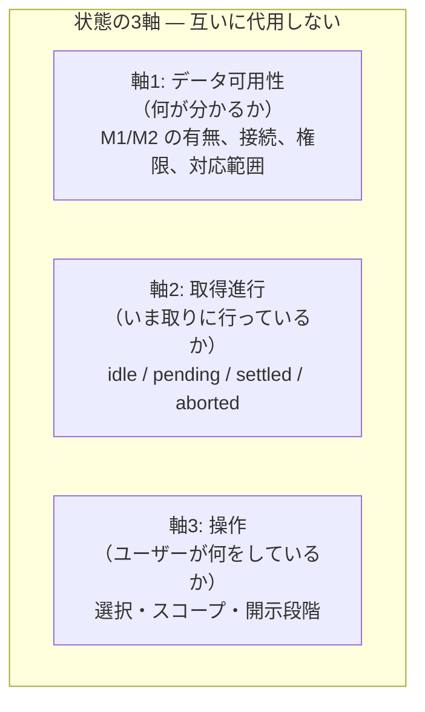
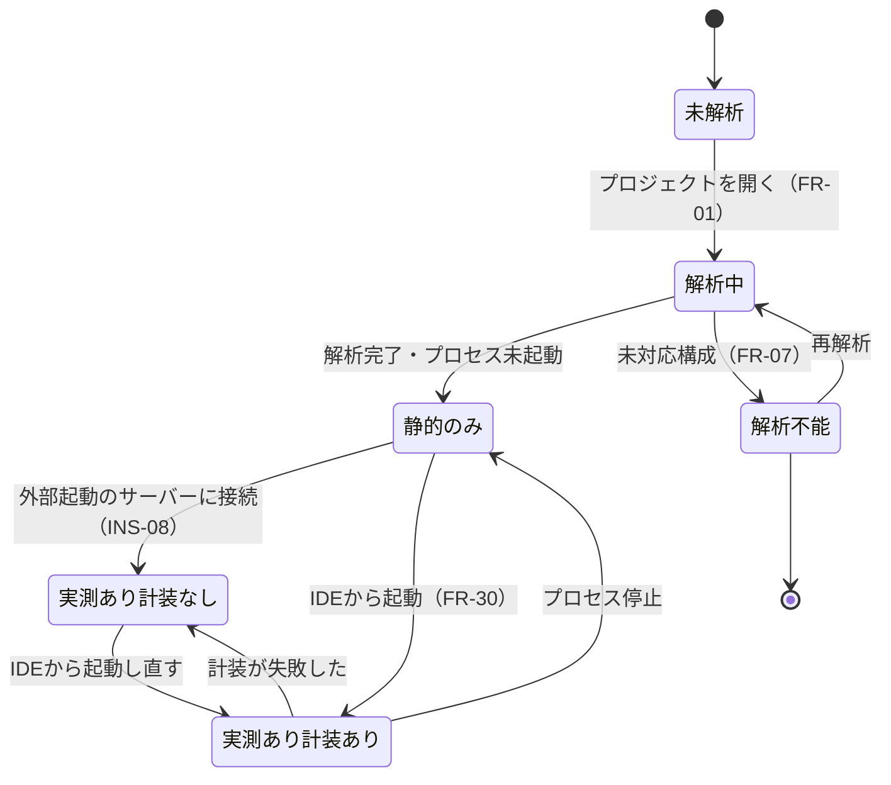
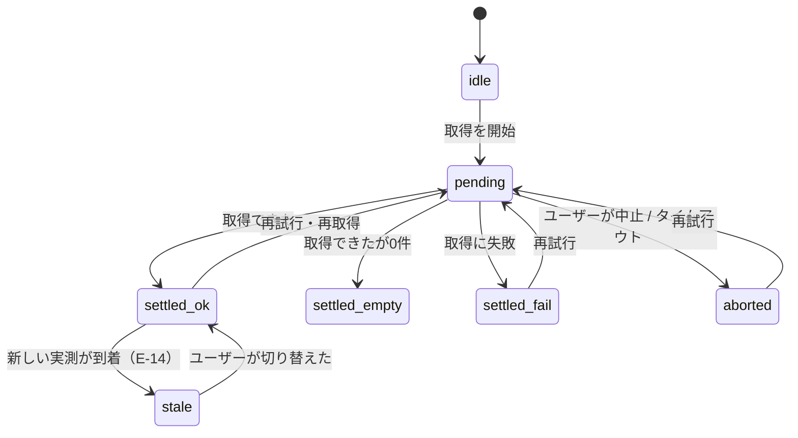
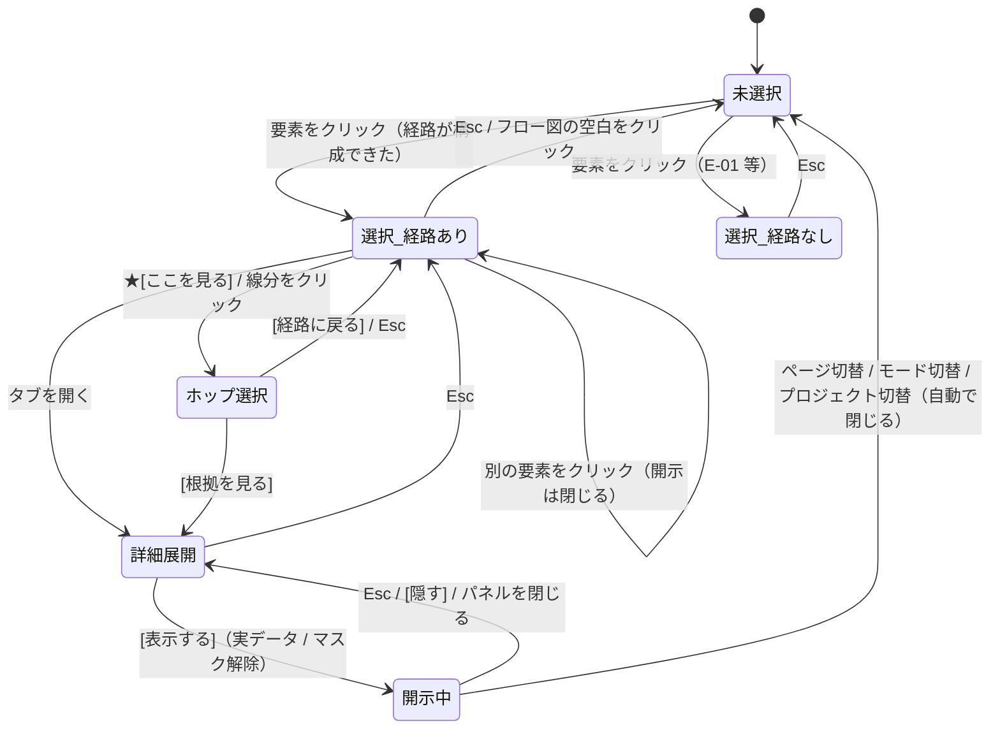
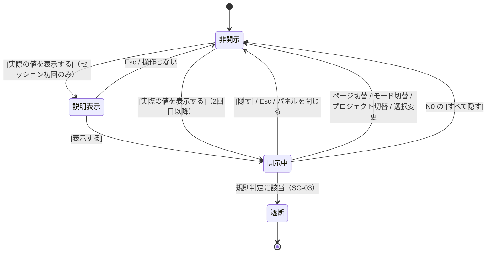
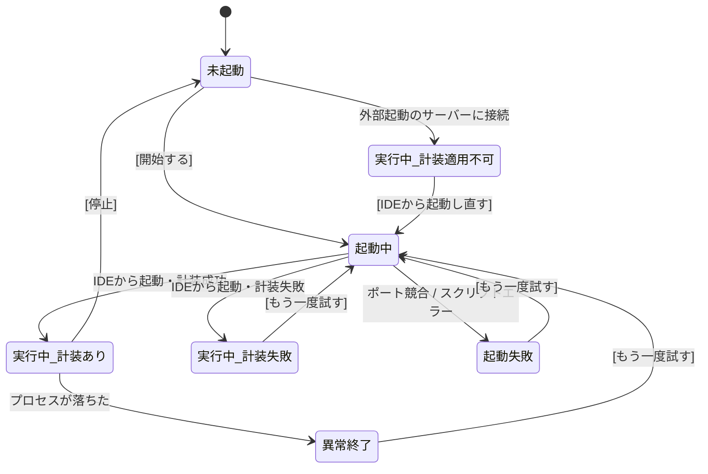

# 状態遷移

| 項目 | 内容 |
| --- | --- |
| フェーズ | Phase 3: UX設計 |
| 文書バージョン | 0.1 |
| 作成日 | 2026-10-31 |
| 位置づけ | `docs/03-ux-design.md` の付属文書（状態の定義と遷移） |
| スコープ | 状態の分離・遷移・復元の規約。状態の視覚表現は Phase 4 |

### 関連文書

| 文書 | 関係 |
| --- | --- |
| `docs/03-ux-design.md` | 親。7.3節「操作状態とデータ状態の分離」の検査結果 |
| `docs/03a-user-flows.md` | 各フローにおける「選択状態の変化」の出典 |
| `docs/03b-interaction-model.md` | 遷移を引き起こす操作の規約 |
| `docs/03d-error-and-empty-states.md` | 各状態で表示する内容 |
| `docs/02a-object-model.md` | 4.1 `NodeStatus` / 4.2 `LinkStatus` / 4.3 可用性と縮退 / 5章 ビューの状態 |

---

## 1. 本書が解く問題

状態の設計で最も頻出する失敗は、**性質の違う状態を1つの軸に押し込むこと**である。

| 押し込みの例 | 起きること |
| --- | --- |
| 「読み込み中」と「データなし」を同じ空表示にする | ユーザーは待てばよいのか、諦めるべきか判断できない |
| 「未選択」と「選択はあるが表現できない」を同じ空パネルにする | 「クリックが効いていない」と誤解する |
| 「計装が無い」と「SQLが0件」を同じ表示にする | **「このページはDBを使っていない」と誤った結論に至る** — 本プロダクトが最も避けるべき失敗 |
| 「値を開示していない」と「値が無い」を同じ空欄にする | 開示操作の存在に気づかない |

本書は状態を **3つの直交する軸** に分離し、どの軸の値も他の軸で代用しないことを規約とする。

---

## 2. 状態の3軸

| 軸 | 何を表すか | 値の出典 | 誤用の典型 |
| --- | --- | --- | --- |
| **軸1 データ可用性** | 「このプロジェクト／このノードについて、何が分かるか」 | `02a` 4.1（`NodeStatus` 8値）、4.2（`LinkStatus` 6値）、4.3（4つの可用性状態） | 進行中を `no-data` と表示する |
| **軸2 取得進行** | 「いま取りに行っているか」 | 本書 4章 | `pending` を `error` と表示する |
| **軸3 操作** | 「ユーザーが何を選び、どこまで開いているか」 | `02a` 5章（`SelectionTarget` / `ScopeContext` / `DisclosureState`） | 未選択を「データなし」と表示する |

| ID | 規約 |
| --- | --- |
| **ST-01** | **3軸の値を相互に代用しない。** 空白・灰色・スピナーを3軸で共有しない |
| **ST-02** | **軸1 の値は、ユーザーの操作では変わらない。** 選択を変えても「DBに接続できない」は変わらない |
| **ST-03** | **軸3 の値は、軸1 の変化で勝手に変わらない。** 新しい実測が到着しても、選択は保持される（E-14） |
| **ST-04** | **軸2 は常に収束する。** `pending` のまま放置しない。タイムアウトまたは失敗で `settled` へ移す |

---

## 3. 軸1 — データ可用性

### 3.1 プロジェクト全体の可用性（`02a` 4.3 の再掲と、操作の追加）

| 状態 | リネージの到達点 | 経路の観測性 | **ユーザーに見えるもの** | 主たる次の操作 |
| --- | --- | --- | --- | --- |
| **未解析** | なし | — | S-01 | プロジェクトを開く |
| **解析中** | なし（部分的に可） | — | 「構造を解析中（N / M）」。**操作をブロックしない** | 待つ（並行して起動できる） |
| **静的のみ** | 静的推定の経路（`not-traced`） | **全ホップ推定** | 経路は出る。**実際の値は出ない** | **[開始する]** |
| **実測あり・計装なし** | ブラウザの通信まで | 混在。サーバー以降は `not-instrumented` | 通信までは実測。その先は切断マーカー | **[IDEから起動し直す]** |
| **実測あり・計装あり** | カラムまで | 混在。最弱環は `derives` / `maps` | 完全な経路 + 最弱環の名指し | — |
| **解析不能** | なし | — | 対応範囲（S-08） | 対応範囲を見る |

> **この表が NFR-12（グレースフルデグレード）の体験上の定義である。** どの状態でも「何も表示されない」は存在せず、「何がどこまで分かるか」が変わる。

### 3.2 ノード単位の可用性（`NodeStatus` 8値）

| 値 | 値を出してよいか | 表示 | **次の操作** | 混同してはならない相手 |
| --- | --- | --- | --- | --- |
| `ok` | はい | 通常 | — | — |
| `no-data` | はい（0件として） | 「0 件」 | — | **`not-instrumented`** |
| `not-connected` | いいえ | 「接続していません」 | [接続を設定する] | `stopped`, `no-data` |
| `permission-denied` | いいえ | 「権限により取得できません」 | [必要な権限を見る] | `not-connected` |
| `stopped` | いいえ | 「停止しています」（**停止を確認できた場合のみ**） | [起動する] | `not-connected` |
| `not-instrumented` | いいえ | 「計装が適用されていないため観測できません」 | **[IDEから起動し直す]** | **`no-data`** |
| `unsupported` | いいえ | 「この構成は対応していません」 | [対応範囲を見る] | `error` |
| `error` | いいえ（内容は表示） | エラーの内容 | [もう一度試す] | `unsupported` |

| ID | 規約 |
| --- | --- |
| **ST-05** | **`no-data` と `not-instrumented` を同じ見た目にしない。** 「SQLが0件実行された」と「SQLを観測できなかった」は別である。これを混同すると「このページはDBを使っていない」という誤った結論に至る（`02d` 第6章） |
| **ST-06** | **`not-connected` / `stopped` / `no-data` を同じ灰色の空ノードで表さない。** 3者はユーザーが取る行動が異なる。形またはラベルで区別する (NFR-30) |
| **ST-07** | **`stopped` は、停止を確認できた場合にのみ使う。** 確認できない場合は `not-connected`（「不明」側に倒す） |

### 3.3 ホップ単位の可用性（`LinkStatus` 6値）

| 値 | 線 | 必須の付随情報 | **次の操作** | 解消可能性 |
| --- | --- | --- | --- | --- |
| `resolved` | レベルに応じた線種 | — | — | — |
| `multiple-candidates` | 破線の分岐 | **候補件数**。実トレースで通った候補を強調 | [候補を比べる] | 判断はユーザー |
| `static-literal` | **終端マーカー** | ソース位置 | — | — |
| `untraceable` | **切断マーカー** | **理由** | 理由による | 多くは不可 |
| `unsupported` | 切断マーカー | 対応範囲へのリンク | [対応範囲を見る] | 対応待ち |
| `blocked-by-node` | 切断マーカー | **上流の `NodeStatus` と、その解消操作** | 上流の解消操作 | **可**（上流を直せば解決） |

| ID | 規約 |
| --- | --- |
| **ST-08** | **`blocked-by-node` では、ホップ自身ではなく上流ノードの解消操作を出す。** 「DBに接続できない」のはカラムノードの問題であり、SQLとカラムを結ぶホップの問題ではない。原因の所在を誤らせない (`02` 4.4節) |
| **ST-09** | **`untraceable` / `unsupported` / `blocked-by-node` を同じ切断として扱わない。** 取るべき行動が違う（諦める / 対応待ち / 直せば解決） |

### 3.4 経路の状態（`LineagePath.状態`）

| 値 | 意味 | 経路サマリの構成 |
| --- | --- | --- |
| `complete` | 打ち切られていない | 主張 + 最弱環（★ブロックあり） |
| `truncated` | 途中で打ち切った（情報量の上限など） | 主張 + **打ち切り理由** + ★ブロック |
| `blocked` | 上流が取得不能で先へ進めない | **主張を出さない。** 「ここまでしか追跡できませんでした」+ 原因 + 解消操作 |
| `ambiguous` | 主経路を1つに決められない | **主張を出さない。** 候補を列挙（E-05） |

| ID | 規約 |
| --- | --- |
| **ST-10** | **`blocked` / `ambiguous` では「出所はこれです」という主張を出さない。** 断定できないときに断定しない (OBS-05) |
| **ST-11** | **`complete` でも「完了」「成功」と書かない。** 終端が構造的に L2 であるため（UXR-12） |

---

## 4. 軸2 — 取得進行

### 4.1 進行の状態

| 状態 | 表示 | 禁止 |
| --- | --- | --- |
| `idle` | 何も出さない | — |
| `pending` | 50ms未満：何も出さない／500ms未満：何も出さない／500ms〜：骨格 or 進行表示／2秒〜：段階名 + [中止] | **空状態として描かない**（ST-12） |
| `settled_ok` | 結果 | — |
| `settled_empty` | **「0 件」**（軸1 の `no-data`） | 空白にしない |
| `settled_fail` | 状態カード（`03d`） | 「エラーが発生しました」だけにしない |
| `aborted` | 「中止しました」+ [もう一度試す] | 失敗と同じ表示にしない |
| `stale` | **現在の内容を保持したまま**、バナー「新しい実行結果があります [切り替える]」 | **黙って更新しない** |

| ID | 規約 |
| --- | --- |
| **ST-12** | **`pending` を `settled_empty` / `settled_fail` として描かない**（UXR-30） |
| **ST-13** | **`aborted` と `settled_fail` を区別する。** 中止はユーザーの意思であり、失敗ではない |
| **ST-14** | **`stale` は自動で `settled_ok` に遷移しない。** ユーザーの操作でのみ切り替わる（UXR-29 後段） |
| **ST-15** | **ただし「ユーザーが要求した結果の到着」は自動反映する。** 例：解析中に要素をクリックし、解析完了で経路が補完される場合（UXR-29 前段） |

### 4.2 UXR-29 の2つの更新の区別

| 種類 | 例 | 挙動 | 理由 |
| --- | --- | --- | --- |
| **要求した結果の到着** | 解析中にクリック → 解析完了で経路が補完される／実値を要求 → 取得完了 | **自動で反映する** | ユーザーは待っている。通知を挟むと余計な操作になる |
| **背景で変わった事実** | ページが再読み込みされた／新しいリクエストが発生した／ファイルが変更された | **通知して、操作で切り替える** | 読んでいる最中に内容が入れ替わると、読んでいた内容と結論が食い違う (`02` 5.5節) |

---

## 5. 軸3 — 操作の状態

### 5.1 選択と開示の状態機械

| 状態 | `SelectionTarget` | `DisclosureState` | 詳細パネル |
| --- | --- | --- | --- |
| 未選択 | なし | 0 | **格納**（パネル自体が無い） |
| 選択_経路あり | `RenderedValue` | 2 | 経路サマリ + 番号付きリスト |
| **選択_経路なし** | `RenderedValue`（選択は成立） | 2 | **状態カード**（`03d`）。**空白ではない** |
| ホップ選択 | `LineageHop` | 2 | 推定の説明（4つの問い） |
| 詳細展開 | 変わらない | 3 | タブの中身 |
| 開示中 | 変わらない | 3 + 開示 | 値が見えている + N0 にバナー |

| ID | 規約 |
| --- | --- |
| **ST-16** | **「未選択（格納）」と「選択はあるが経路が無い（状態カード）」を同じ空パネルにしない**（`03` 7.3節で発見・修正した問題） |
| **ST-17** | **開示は選択に従属する。** 選択が変われば開示は閉じる（SG-05） |
| **ST-18** | **E-01（要素を特定できない）でも選択は成立する。** 「選択できなかった」のではなく「選択はできたが追跡できなかった」 |

### 5.2 スコープの状態

| スコープ | いつ | バッジの採番 | 区分 |
| --- | --- | --- | --- |
| `project` | プロジェクトを開いた直後 | なし | A |
| **`page`** | **ページを選択した後（俯瞰 T2）** | トレースのスパン開始時刻順 | A |
| **`path`** | **要素を選択した後（T4）** | 経路の論理順（上流→下流） | A |
| `trace` | T1 から特定のトレースを選んだ | スパン開始時刻順 | A |
| `component` | スコープ切替（FR-25） | 部分木の順 | **B** |

| 遷移 | 選択の扱い | バッジ | 通知 |
| --- | --- | --- | --- |
| `page` → `path` | 維持（要素を選択したため） | **振り直す** | **「番号を振り直しました」** |
| `path` → `page` | 解除 | 振り直す | 同上 |
| `page` → `trace` | 維持を試みる | 振り直す | 同上 |
| ページ切替 | **解除**（別ページの要素を保持できない） | 振り直す | なし（自明） |

---

## 6. 文脈の引き継ぎと復元

### 6.1 モード遷移での引き継ぎ（`02b` 5.1節の操作への翻訳）

| 遷移 | 引き継ぐ | 復元できるか | 復元できない場合 |
| --- | --- | --- | --- |
| 探索 → データ（終端カラム） | `DbColumn` + 戻り先の完全な状態（選択・スコープ・開示段階） | **可** | — |
| データ → 探索（[経路に戻る]） | 保存した状態を復元 | **可**（経路が失効していなければ） | 「元の経路は現在のデータでは再現できません」+ 理由 + [同じ要素をもう一度選ぶ] |
| 探索 → 実行（状態カードから） | 原因となった状態 + 戻り先の状態 | **可** | — |
| 任意 → 実行（タブ直接） | なし | — | — |
| 探索 → 編集（B群） | `DomElement` + `ComponentDef` | B群で定義 | 「この要素は編集モードで特定できません」 |

### 6.2 経路が失効する条件

| 事象 | 経路は失効するか | 選択はどうなるか |
| --- | --- | --- |
| プロセスが停止した | **失効する**（M2 が失われる） | 選択は保持。経路は `not-traced`（全ホップ推定）へ**降格し、降格したことを明示**（`degradedFrom`） |
| 計装が無効になった | 失効する（サーバー以降） | 同上 |
| ページが再読み込みされた | **失効しない。** 現在の経路を保持し、`stale` として通知（E-14） | 保持 |
| 別のページへ移動した | 失効する | 解除 |
| ファイルが変更された（B群 FR-04） | M1 が変わる。A群では手動再解析まで変わらない | 保持 |
| プロジェクトを切り替えた | 失効する | 解除。**開示も閉じる**（SG-05） |

| ID | 規約 |
| --- | --- |
| **ST-19** | **失効を無言で行わない。** 経路が降格した場合、「サーバーを停止したため、この経路は推定に変わりました」を明示する |
| **ST-20** | **降格と「もともと推定」を区別する**（`degradedFrom`。UXR-22） |

### 6.3 復元の範囲

| 復元する | 復元しない |
| --- | --- |
| `SelectionTarget` | **開示状態**（SG-05 により必ず閉じる） |
| `ScopeContext` | 進行中の取得（`pending` は復元せず再実行） |
| `DisclosureState`（段階0〜3） | スクロール位置の厳密な一致（近傍で可） |
| 開いていたタブ | 一時的な通知 |
| ズーム・パンの位置 | — |

---

## 7. 実データ開示の状態（SG-01〜06 の状態機械）

| 状態 | 表示 | 記録 |
| --- | --- | --- |
| 非開示 | 「値は表示していません [実際の値を表示する]」。**空欄にしない** | — |
| 説明表示 | SG-04 の一文 + [表示する] | — |
| 開示中 | 値 + N0 に「実データ表示中 N 件 ／ [すべて隠す]」 | **監査に対象と時刻を記録。値は記録しない** |
| 遮断 | 「この値は規則により表示できません（秘密情報の可能性）」 | 記録 |

| ID | 規約 |
| --- | --- |
| **ST-21** | **開示状態はセッションをまたいで保持しない** (`02` 7.4節) |
| **ST-22** | **開示の単位は1セル。** 行・列・「すべて」を提供しない（SG-01） |
| **ST-23** | **経路に紐づく行が特定できない場合、無関係な行サンプルで代用しない**（SG-02） |
| **ST-24** | **遮断されたことを「値が無い」と表示しない。** 「規則により表示できない」と明示する |

---

## 8. 計装とプロセスの状態（N0 インジケータ）

| 状態 | N0 の表示 | L1 情報 | 次の操作 |
| --- | --- | --- | --- |
| 未起動 | 「停止中」 | 取得できない | [開始する] |
| 起動中 | 段階名（「ポート 3000 を待っています」） | — | [中止] |
| **実行中・計装あり** | 「実行中（PID / :3000） ／ 計装: 有効」 | 取得できる | — |
| **実行中・計装適用不可** | 「実行中（外部起動） ／ **計装: 適用不可**」 | **取得できない** | **[IDEから起動し直す]** |
| 実行中・計装失敗 | 「実行中 ／ **計装: 失敗**」+ 理由 | 取得できない | [もう一度試す] / [計装の状態を見る] |
| 起動失敗 / 異常終了 | 「異常終了（終了コード N）」 | 取得できない | [もう一度試す] |

| ID | 規約 |
| --- | --- |
| **ST-25** | **「適用不可（外部起動）」と「失敗」を区別する。** 前者は起動の仕方の問題（解消手段が明確）、後者は設定や環境の問題。これを混同すると、ユーザーは設定を疑って時間を失う (`02c` S-09) |
| **ST-26** | **計装の状態は常時 N0 に表示する。** 全ての L1 情報の前提条件であるため (`02d` 第6章) |

---

## 9. 本書が満たす要件の確認

| 要件 / 原則 | 担保 | 章 |
| --- | --- | --- |
| OBS-05（推測で補完しない） | `blocked` / `ambiguous` で主張を出さない（ST-10） | 3.4 |
| **OBS-06**（状態の区別） | `NodeStatus` 8値それぞれに表示・次の操作・混同禁止の相手を定義 | 3.2 |
| **INS-08**（計装の適用条件） | 「適用不可」を独立状態とし、N0 に常時表示 | 8 |
| INS-03 / NFR-12（縮退） | 軸1 の4つの可用性状態と、各々の到達点 | 3.1 |
| NFR-14（明示操作なしに変更しない） | 実データ開示の状態機械。自動開示が存在しない | 7 |
| **NFR-20**（秘密情報のマスク） | ST-21〜24 | 7 |
| **NFR-28**（監査） | 開示の記録（値は記録しない） | 7 |
| 原則3（選択した対象が常に分かる） | ST-16〜18。選択の成立と経路の成否を分離 | 5.1 |
| 原則4（文脈を失わない） | 引き継ぎと復元の範囲 | 6 |
| 原則6（成功したように見せない） | ST-10, ST-11, ST-19 | 3.4, 6.2 |
| **本書固有** | 3軸の分離（ST-01〜04）。`03` 7.3節のレビュー項目への回答 | 2 |

---

*本文書は Phase 3（UX設計）の成果物である。状態の視覚表現（色・形・アイコン）は Phase 4 の対象であり、本書では決定していない。*
